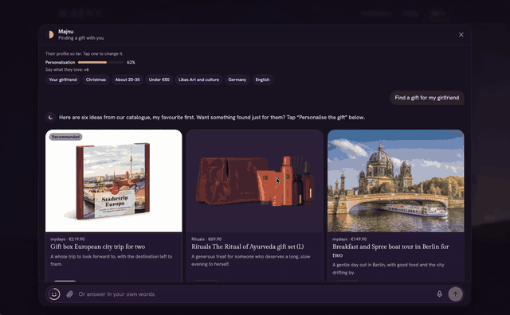
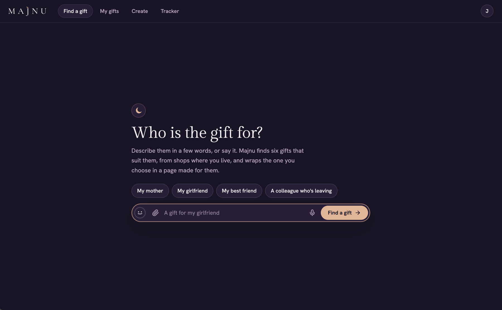
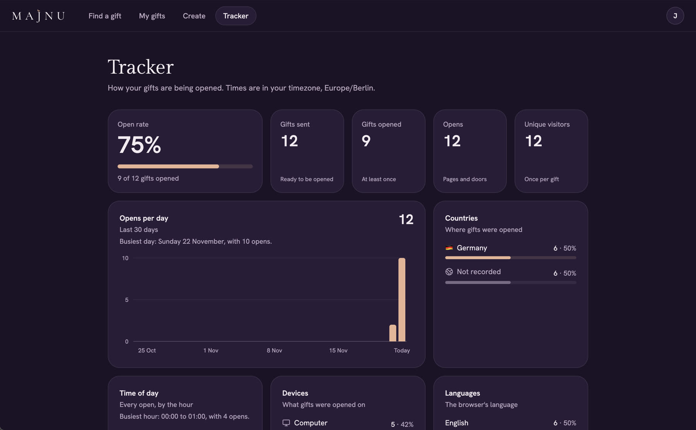
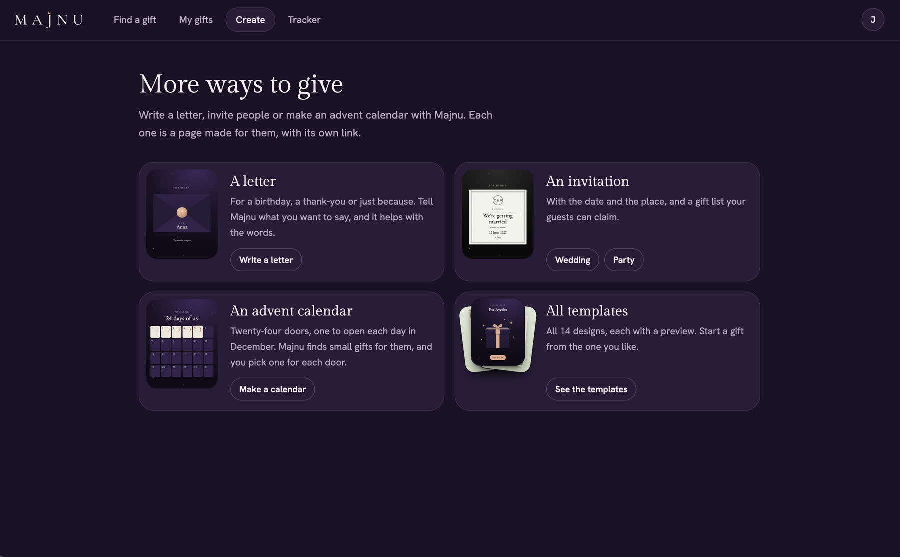
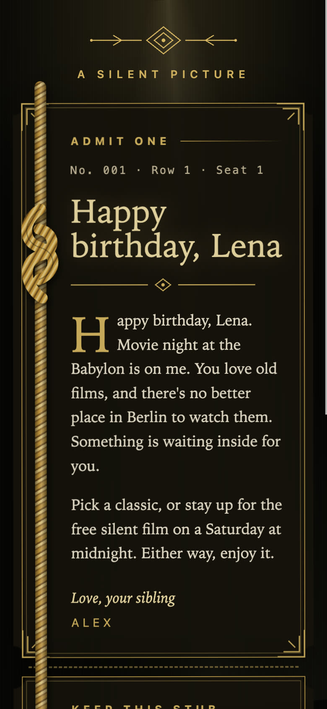
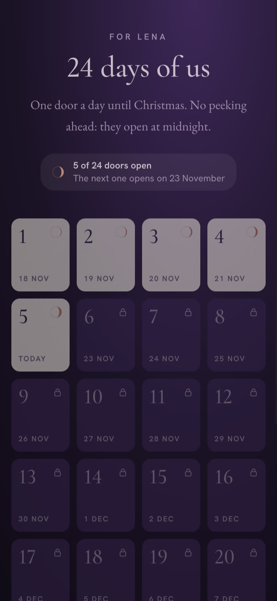
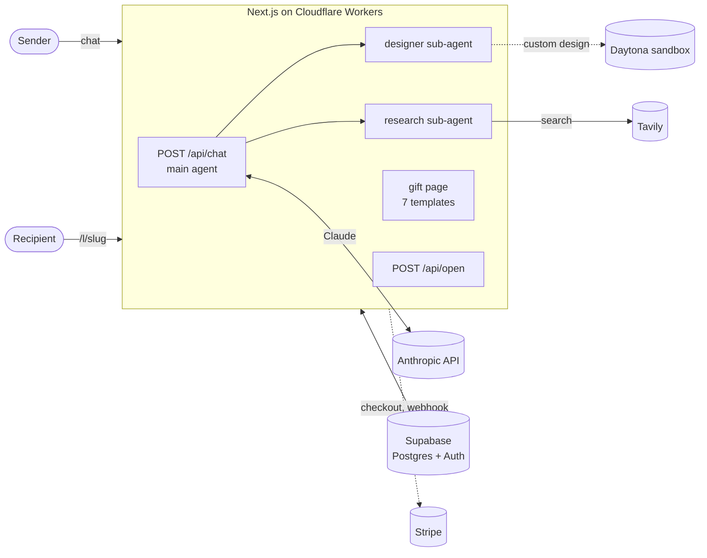

<p align="center">
  <picture>
    <source media="(prefers-color-scheme: dark)" srcset="public/brand/majnu-wordmark-on-dark.svg">
    
  </picture>
</p>

<p align="center"><strong>Personalized digital gifting.</strong> Chat with Majnu about the person you love, and it makes them a letter, a gift, an invitation or an advent calendar: one web page, made for one person, sent as a link.</p>

<p align="center">
  <a href="https://majnu.app"></a>
  <a href="https://github.com/peresramirez/majnu/actions/workflows/ci.yml"></a>
  <a href="LICENSE"></a>
</p>

<p align="center">
  
  
  
  
  
  
  
  
  
</p>

---

## See it work

<p align="center">
  
</p>

Most gift ideas are generic. Majnu starts from the person: you describe them in a sentence, and it finds gifts that fit, from real shops, with a short reason for each. Then you can wrap the gift in a page made for them and send it as a link.

| 1. Find the right gift | 2. Keep track | 3. Wrap it |
|---|---|---|
|  |  |  |
| Tell Majnu who it is for. Six ideas in seconds, no account needed. | Your gifts in one place, with a note when each one is opened. | Pick a design, add a message or a voice note, and share the link. |

| What they open | One door a day |
|---|---|
|  |  |
| A page made for one person, opened from a link. They need no account. | Advent calendars and countdowns: locked doors stay secret until their day. |

## How it works

1. **Tell Majnu who it is for.** Sign in and chat: who the gift is for, the occasion, a memory or two. Majnu suggests a template, or you pick one with the **Template** button.
2. **Make it yours.** Majnu writes the page from what you said and shows it next to the chat. Ask for changes until it feels like you. It can also search the web for gift ideas.
3. **Send the link.** Copy it, send it on WhatsApp or print the QR code. The person you send it to needs no account, and you see when they open it.

| You can send | Templates | Price |
|---|---|---|
| A letter | Classic envelope, Postcard | Free |
| A gift code or voucher | Gift reveal | Free |
| An invitation with date, place and map link | Wedding, Party | Free |
| An advent calendar or countdown, one door a day | Advent calendar, Countdown | Free, with an account |
| A personalised wrapper: a design made for one gift | Made by Majnu's designer | €2.99 once |

## Status

Built during a hackathon and live at **[majnu.app](https://majnu.app)**.

| Part | State |
|---|---|
| Sign-in (Google and email), legal pages, brand | Live |
| Chat with the main agent, the designer and the research sub-agent | Live |
| Seven templates, gift pages at `/l/<slug>`, share panel with QR code | Live |
| Open tracking (no cookies, nothing stored on the recipient's device) | Live |
| Spending limits per user | Live |
| Personalised wrapper: €2.99 once in Stripe Checkout, designed in a Daytona sandbox | Being built ([#39](https://github.com/peresramirez/majnu/issues/39)) |

Open work is tracked in the [GitHub issues](https://github.com/peresramirez/majnu/issues).

## Architecture



- **Letters are data, not generated code.** Templates are React components in this app. The designer sub-agent fills a JSON object that matches a schema (`lib/letters/schema.ts`), so a new gift is live in seconds and its link never breaks.
- **The main agent keeps the conversation.** It calls the designer to build or change a page and the research agent to find gift ideas, and streams its reply to the chat as newline-delimited JSON events (`lib/agents/events.ts`).
- **Private by default.** Gift pages are readable only by exact link, through server code: the database has no anonymous read access. Calendar doors that have not opened yet are removed on the server, so their text never reaches the browser early.

## Project layout

| Path | What lives there |
|---|---|
| `app/(marketing)/` | Landing page and legal pages |
| `app/(auth)/` | Sign-in and sign-up |
| `app/(app)/` | The signed-in app: Create, My gifts and Plan tabs |
| `app/(public)/l/[slug]/` | The gift page a recipient opens |
| `app/api/` | Chat, open tracking and billing routes |
| `lib/agents/` | Main agent, designer, research and the Anthropic client |
| `lib/letters/` | The letter contract: schema, templates, fixtures, store |
| `components/letters/`, `components/calendars/` | The templates |
| `supabase/migrations/` | Database schema and row-level security |
| `docs/` | Plan, setup and brand guidelines |

## Getting started

You need Node 22 and the keys listed in [docs/setup.md](docs/setup.md).

```bash
npm install
cp .env.sample .env.local   # then fill in the keys
npm run test:smoke          # checks that every key reaches its service
npm run dev                 # http://localhost:3000
```

## Commands

| Command | What it does |
|---|---|
| `npm run dev` | Local server on http://localhost:3000 |
| `npm run typecheck` | TypeScript check. Run it before every push: the build does not fail on type errors |
| `npm test` | Unit tests in `tests/unit/` (no network) |
| `npm run test:smoke` | Read-only checks that each key in `.env.local` works |
| `npm run build` | Production build |
| `npm run preview` | The production build in the local Workers runtime |
| `npm run deploy` | Deploys the last commit to Cloudflare from a clean copy, so no local secrets are uploaded |
| `npm run cf:secrets` | Copies the secret keys from `.env.local` to the Worker |

## Documentation

- [docs/plan.md](docs/plan.md): what we are building, the architecture, decisions and who builds what
- [docs/setup.md](docs/setup.md): keys, services, tests and coding-agent tooling
- [docs/brand.md](docs/brand.md): the Night Post brand: logo, colours, type, motion and voice

## Links

| | |
|---|---|
| Website | [majnu.app](https://majnu.app) |
| Pitch, 3 slides | [majnu.app/short-pitch](https://majnu.app/short-pitch) |
| Full pitch | [majnu.app/pitch](https://majnu.app/pitch) |
| The TikTok ad we spent €10 on | [vt.tiktok.com/ZSsdbb1NA](https://vt.tiktok.com/ZSsdbb1NA/) |
| App demo video (38 s) | [public/pitch/majnu-app-demo.mp4](public/pitch/majnu-app-demo.mp4) |
| Street flyers video (7 s) | [public/pitch/street-flyers.mp4](public/pitch/street-flyers.mp4) |
| Instagram | [@majnu.app](https://www.instagram.com/majnu.app) |
| TikTok | [@majnu.app](https://www.tiktok.com/@majnu.app) |
| X | [@Majnuapp](https://x.com/Majnuapp) |

## Credits

Majnu started from [ysskrishna/nextjs-supabase-starter](https://github.com/ysskrishna/nextjs-supabase-starter) by Y. Siva Sai Krishna, released under the MIT License. It gave us working authentication, route protection and the UI component set on day one, which let us spend the hackathon on the product itself. Thank you. The original license notice is kept in [LICENSE](LICENSE).

---

Built for the Layla hackathon 2026.
