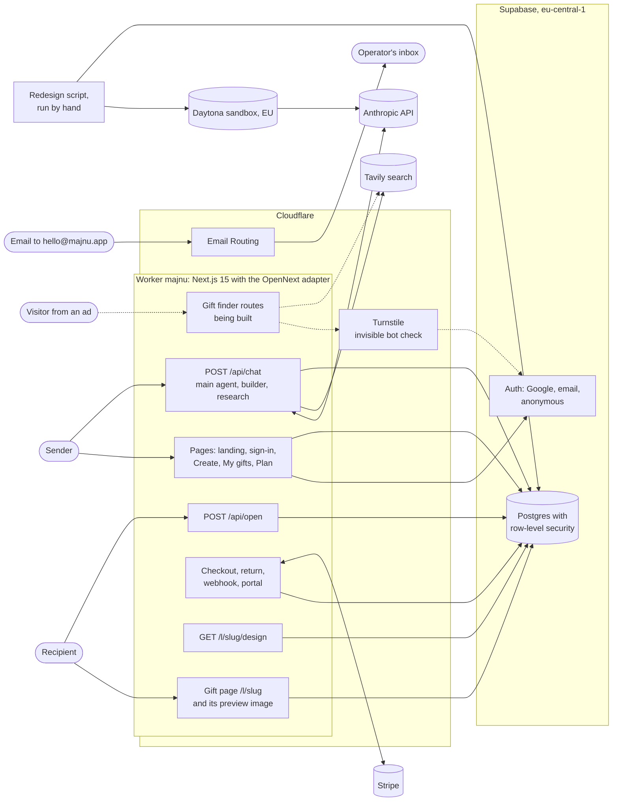
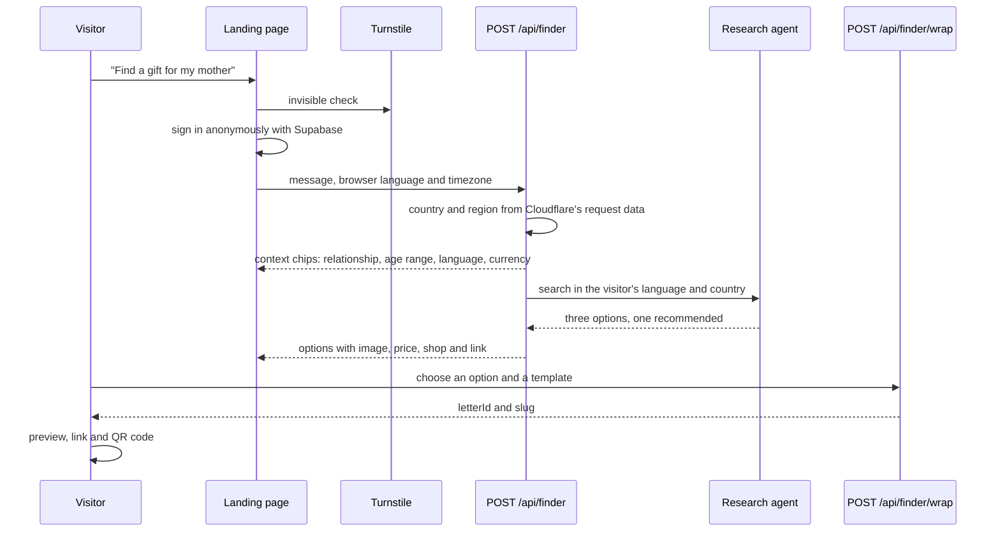
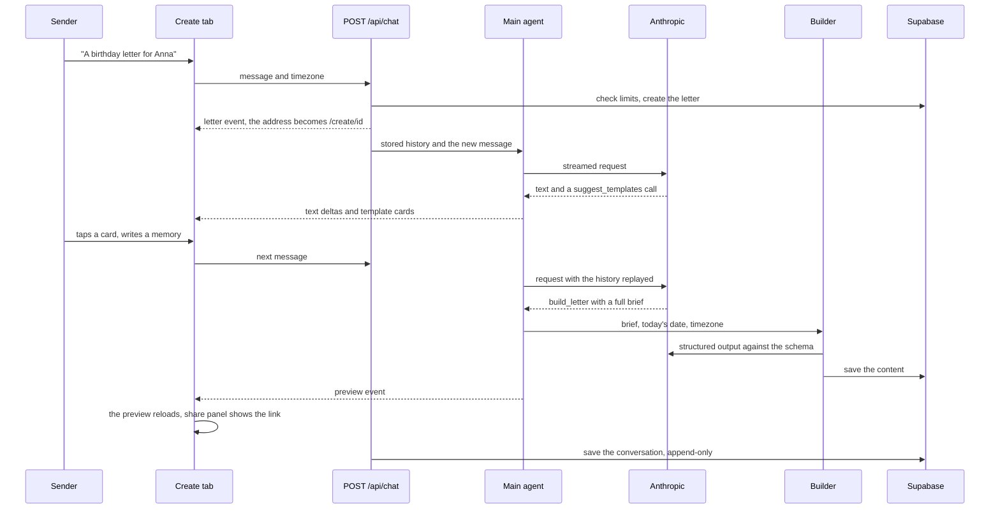
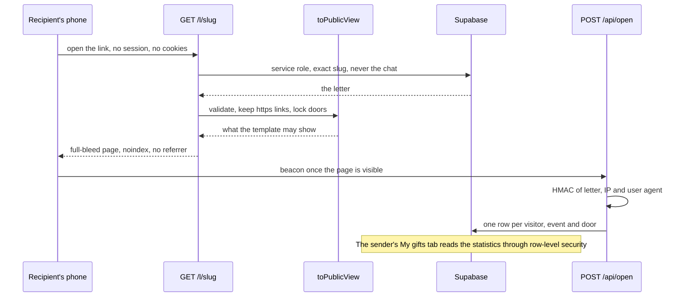
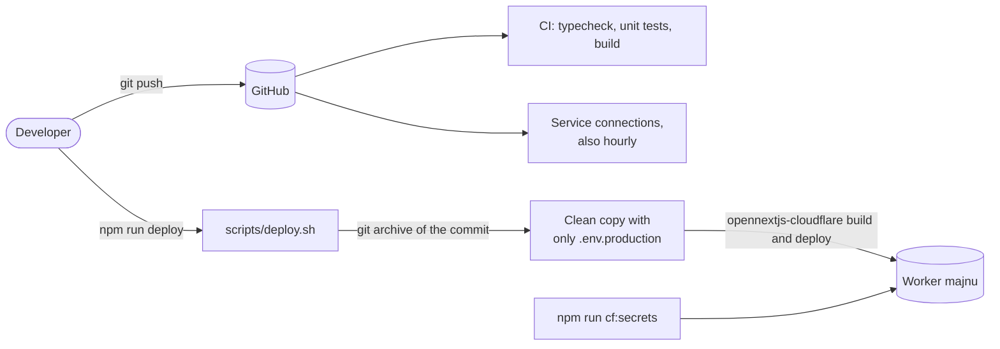

# Majnu architecture

Majnu is a personalized digital gifting platform. Someone tells Majnu who a gift is for, and Majnu wraps a gift, a letter, an invitation or an advent calendar in one web page made for that person, shared as a link and a QR code. The sender sees when it is opened. It runs at [majnu.app](https://majnu.app) and was built in a few hours by two developers working with Claude Code: a lead session that splits the work, and parallel task sessions that build it.

This page is the overview, for presenting how Majnu works. Each part has its own page with the details, listed at the end. Decisions and the schedule are in [plan.md](plan.md), keys and services in [setup.md](setup.md), and the brand in [brand.md](brand.md).

## Three ideas behind the design

1. **Letters are data, not generated code.** The templates are React components in our app. An agent fills a JSON object that matches a schema ([`lib/letters/schema.ts`](../lib/letters/schema.ts)), and the object is stored in Postgres. A new gift is therefore live in seconds, every page is checked against the same contract, and its link never breaks.
2. **One agent leads the conversation.** The sender talks only to the main agent. It calls a builder to write or change the page and a research agent to find gift ideas, and streams its reply as newline-delimited JSON events.
3. **Private by default.** The database has no anonymous read access at all. Gift pages are read by exact link, on the server. Calendar doors that have not opened are removed before the page is rendered, and the recipient's device stores nothing.

## The system

Dotted lines are being built (the gift finder) or run outside the app (the Daytona redesign).

| Part | What it does | Where |
|---|---|---|
| **Next.js app on Cloudflare Workers** | Every page and route. Next.js 15.5 with React 19 and Tailwind 3, built with `@opennextjs/cloudflare` into the Worker `majnu` at `majnu.app` and `www.majnu.app`. Prerendered pages are served from static assets | [`wrangler.jsonc`](../wrangler.jsonc), [`open-next.config.ts`](../open-next.config.ts), [`app/`](../app/) |
| **Supabase Auth** | Sign-in with Google or email and password; anonymous accounts for the gift finder are planned. Sessions live in a cookie refreshed by the middleware | [`lib/supabase/`](../lib/supabase/), [`middleware.ts`](../middleware.ts) |
| **Supabase Postgres** | Letters, profiles, open events and Daytona designs, all behind row-level security, in eu-central-1 (Frankfurt) | [`supabase/migrations/`](../supabase/migrations/) |
| **Anthropic** | The model behind every agent (`MAJNU_MODEL`, default `claude-opus-5-5`), through the official TypeScript SDK and our own key | [`lib/agents/`](../lib/agents/) |
| **Tavily** | Web search for gift ideas, used by the research agent when `TAVILY_API_KEY` is set; otherwise Anthropic's own web search | [`lib/agents/tavily.ts`](../lib/agents/tavily.ts) |
| **Stripe** | The personalised wrapper, €2.99 once: hosted Checkout in payment mode, a signed webhook, automatic refunds when a design fails | [`lib/billing/`](../lib/billing/) |
| **Daytona** | A sandbox where Claude Code writes the personalised wrapper's one-off HTML design, reached with `fetch` from a Cloudflare Queue consumer in the same Worker | [`lib/daytona/`](../lib/daytona/), [`daytona/sandbox/`](../daytona/sandbox/), [`worker.ts`](../worker.ts) |
| **Cloudflare Turnstile** | The invisible bot check in front of anonymous sign-in for the gift finder. The site key is in `.env.production` and the secret in Supabase; no code uses it yet | [`.env.production`](../.env.production) |
| **Cloudflare Email Routing** | Forwards `hello@majnu.app` to the operator's inbox. The app sends no email | [setup.md](setup.md#services) |
| **GitHub Actions** | Type check, tests and build on every push; live connection checks every hour | [`.github/workflows/ci.yml`](../.github/workflows/ci.yml) |

## The main journeys

### Finding a gift (being built now)

The product now leads with one job: **help someone find the right gift for a person they love**, without signing in. The flow is decided and its contract is frozen in [`lib/finder/events.ts`](../lib/finder/events.ts); the code is being built in issues [#31](https://github.com/peresramirez/majnu/issues/31) (agent and API), [#32](https://github.com/peresramirez/majnu/issues/32) (landing page chat), [#33](https://github.com/peresramirez/majnu/issues/33) (anonymous visitors, app tabs and privacy) and [#34](https://github.com/peresramirez/majnu/issues/34) (reading a public social profile). The sessions building it write its own feature pages, which will be listed in [features/README.md](features/README.md).

1. The landing page's hero becomes a chat box. Sending opens the finder as a modal, a full-height sheet on phones.
2. The first message signs the visitor in **anonymously** with Supabase, behind an invisible Turnstile check that Supabase verifies. Everything that works for signed-in users (ownership, row-level security, limits, My gifts) works for them, and signing up later keeps it all.
3. The server reads the visitor's country and region from the network; the browser sends its language and timezone. Majnu infers the relationship and an age range from what was typed and shows them as chips the visitor can correct.
4. The research agent searches with Tavily and returns **three options** with one recommended. If none fits, Majnu asks a few questions and searches again.
5. Choosing an option wraps it in a gift reveal, classic envelope or postcard, with the link and QR code.
6. Limits: 3 searches per visitor per day, 2 of them personalised, plus a site-wide daily cap.

### Making a letter in chat

The sender writes on the **Create** tab. The first message creates the letter, and the address moves to `/create/<id>` without interrupting the reply. The main agent leads in steps (who it is for, the template, the words and details, build, share, offer a calendar) and calls four tools: `suggest_templates`, `research_gifts`, `build_letter` and `edit_letter`. The builder makes one structured-output call validated against the contract and retried once; the research agent searches the web at most four times. The conversation is stored exactly as the API returned it and replayed append-only. Every route that calls the model is behind the spending guard: 5 new gifts per user per day, 40 messages per gift, 4,000 characters per message, 6 model requests per message. Details: [features/letters-chat.md](features/letters-chat.md).

### A recipient opening a gift

The recipient needs no account. The page renders on the server on every request, so doors unlock on the right day, and loads no third-party scripts. A link pasted into a chat app previews as an envelope addressed to the recipient's first name and nothing else. Details: [features/templates-and-gift-pages.md](features/templates-and-gift-pages.md) and [features/sharing-and-tracking.md](features/sharing-and-tracking.md).

## The security model

| Rule | How it is enforced |
|---|---|
| **Row-level security everywhere** | On for all four tables. The `anon` role has no grants and no policies. Signed-in users read their own rows and can change only the content columns of their own letters (`kind`, `template_id`, `title`, `content`) |
| **Service-role reads by exact slug** | The gift page, its preview image, open tracking and the design route read with a server-only service-role client ([`lib/supabase/admin.ts`](../lib/supabase/admin.ts)), one letter at a time, by exact slug. Slugs are 10 characters from a 49-character alphabet, about 56 bits, so they cannot be guessed |
| **Server-only columns** | `slug`, `owner_id`, `chat` and everything in `profiles` are written only by server code. `chat` is protected because the turn limit counts it |
| **Locked doors stripped on the server** | `toPublicView()` keeps only `day`, `locked` and `opensOn` for a door that has not opened in the calendar's own timezone, so its text is in no HTML and no response. The owner's preview opens every door and is never tracked |
| **No cookies on gift pages** | The middleware does not run for `/l/` or `/api/open`. The beacon stores nothing on the device; the visitor id is an HMAC of the letter, IP address and user agent under a server secret, and the IP is never saved. This is why there is no cookie banner (§ 25 TDDDG) |
| **Generic previews** | Titles and preview images name the kind of gift and the first name ("A letter for Anna"), never the message or a code. Gift pages are `noindex` and send no referrer |
| **Safe links** | Every link a model writes is kept only if it is `https:`, in the builder, the research agent and again in the public view |
| **Sandboxed designs** | Daytona pages are served with `Content-Security-Policy: sandbox …; default-src 'none'`, so their scripts get an opaque origin and the browser makes no request for them |
| **Secrets on the server** | Modules that touch a secret start with `import "server-only"`. Secrets are Worker secrets in production and never in a committed or deployed file |
| **Spending guard** | Per-user limits on every model route, caps per message, and a monthly spend limit in the Anthropic Console |

Details: [features/data-and-security.md](features/data-and-security.md).

## Deploying and CI

- **Deploy** only with `npm run deploy`. The Cloudflare adapter copies every `.env` file into the Worker at build time, so a build in a working directory would upload the secrets in `.env.local`. [`scripts/deploy.sh`](../scripts/deploy.sh) exports the committed code to a temporary folder, refuses to go on if the legal pages still have placeholders, and builds and deploys from there. Direct `wrangler deploy` is denied to every coding agent.
- **Configuration:** public values (site URL, Supabase URL and publishable key, Stripe publishable key, Turnstile site key, tip link) are in the committed [`.env.production`](../.env.production). Secrets are Worker secrets, copied from `.env.local` with `npm run cf:secrets`.
- **CI** ([`.github/workflows/ci.yml`](../.github/workflows/ci.yml)) runs the type check, the unit tests and a production build on every push to `main`, `dev-a`, `dev-b` and `task/**` and on pull requests. Production builds ignore type errors, so the type check is what catches them. A second job calls Supabase, Anthropic, Stripe and Daytona read-only, also every hour, so a revoked key or an exhausted quota is noticed even when nobody is pushing.
- **Workers limits:** on Workers Free a request may use 10 ms of CPU. Cached pages measured 1 to 3 ms, server-rendered pages 10 to 20 ms, and a cold request 50 ms, so dynamic pages can fail under real traffic unless the account is on Workers Paid ([setup.md](setup.md#services)). Time spent waiting on the model does not count.

## How it is built

The developer talks to one Claude Code session, the **lead**. The lead splits work into tasks that touch separate files, and `scripts/agents/session.sh` starts one **task session** per task in its own branch (`task/<name>`), git worktree and Herdr workspace, with its own dev-server port and isolated browser. Every task session plans, builds, verifies (type check, tests, build, a browser check at 375 px and 1440 px), pushes its branch and waits for green CI, then reports and stops. The lead merges one branch at a time, reruns the checks, pushes `main`, closes the finished GitHub issues with the commit and how it was checked, and deploys only when the developer asks. Every feature gets an architecture page in the same branch. Details: [features/agent-workflow.md](features/agent-workflow.md).

## Feature pages

| Page | What it covers |
|---|---|
| [Letters chat](features/letters-chat.md) | The main agent, the builder and research sub-agents, the chat route and its NDJSON events, stored history, the model settings verified live |
| [Templates and gift pages](features/templates-and-gift-pages.md) | The letter contract, the seven templates, `/l/[slug]`, door locking, the link-preview image, demo slugs, the template workbench |
| [Sharing and tracking](features/sharing-and-tracking.md) | The share panel and QR code, the open beacon, the visitor hash, the statistics and My gifts |
| [Billing](features/billing.md) | The personalised wrapper: the dialog and consent, one-time Checkout, the return page and webhook, the `purchases` table, refunds and the Purchases tab |
| [Daytona redesign](features/daytona-redesign.md) | The snapshot, the sandbox job and its REST client, the queue consumer, the page checker, storage and the design route, costs per run |
| [Data and security](features/data-and-security.md) | The schema and migrations, row-level security, server-only writes, the spending guard, secrets and deploying |
| [Landing page and brand](features/landing-and-brand.md) | The landing page and its scroll scene, the Night Post brand, the legal pages |
| [Agent workflow](features/agent-workflow.md) | How the repository is built with a lead session and parallel task sessions |

The gift finder's pages are added to [features/README.md](features/README.md) by the sessions building it.

## What is built and what is not

| Part | State in the code |
|---|---|
| Sign-in, the three app tabs, the chat with all three agents, seven templates, gift pages, the share panel, open tracking, spending limits, legal pages, brand | Built |
| Personalised wrapper (Stripe Checkout in payment mode, the queue consumer, refunds) | Built and checked in test mode up to an automatic refund; a successful paid design run waits on the Anthropic key's limit ([#39](https://github.com/peresramirez/majnu/issues/39)) |
| Gift finder, anonymous accounts, Turnstile | Contract frozen, code being built ([#31](https://github.com/peresramirez/majnu/issues/31) to [#34](https://github.com/peresramirez/majnu/issues/34)) |
| Gift list on invitations | Decided, not started ([#35](https://github.com/peresramirez/majnu/issues/35)) |

## Features added since this overview was written

- [Gift finder, landing page](features/gift-finder-ui.md)
- [Gift finder, server](features/gift-finder-api.md)
- [Guest accounts](features/guest-accounts.md)
- [Voice input](features/voice-input.md)
- [Gift list on invitations](features/gift-list.md)
- [Voice notes in gifts](features/audio-note.md)
- [Advent calendars, filled door by door](features/advent-calendar.md)

The business model (free product, a paid personalised wrapper) is in [business-plan.md](business-plan.md).
