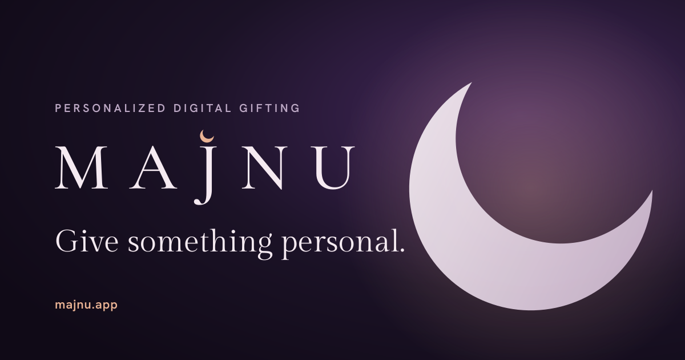

# Majnu brand guidelines

<picture>
  <source media="(prefers-color-scheme: dark)" srcset="../public/brand/majnu-wordmark-on-dark.svg">
  
</picture>

Majnu is a personalized digital gifting platform. Someone tells it who a gift is for, and it wraps a gift code, a letter, an invitation or an advent calendar in a page made for one person, shared as a link.

The brand is called **Night Post**. In Arabic, Layla means night, and in the old story Majnu writes poems for Layla. Every gift goes out like a letter under the moon. The brand should feel calm, elegant and personal: a quiet night sky, one warm light, nothing loud.

These rules cover the site, the app and anything we publish. Letter and calendar templates may use their own look (see [Templates](#templates)).

## Logo

### Wordmark

The logo is the name in wide capitals with a **rose-gold crescent above the J**. It is drawn as vector outlines from Cormorant Garamond Medium with letter spacing of 0.3 em, so it never depends on a font being installed.

| File | Use it on |
|---|---|
| [`majnu-wordmark-on-dark.svg`](../public/brand/majnu-wordmark-on-dark.svg) | Plum, velvet and other dark grounds (the default) |
| [`majnu-wordmark-on-light.svg`](../public/brand/majnu-wordmark-on-light.svg) | Petal, white and other light grounds |
| [`majnu-wordmark-mono.svg`](../public/brand/majnu-wordmark-mono.svg) | One-colour use only: stamps, embossing, single-ink print. Takes the surrounding text colour |

- **Clear space:** keep empty space around the wordmark equal to half the height of the M on every side, measured from the top of the crescent.
- **Minimum size:** 88 px wide on screens. Smaller than that, use the mark.
- In the site header it sits at about 120 to 160 px wide; in the hero it can go large.

### Mark

The crescent on its own is the mark. It is used for the favicon, the app icon, avatars and anywhere square.

| File | Use |
|---|---|
| [`majnu-mark.svg`](../public/brand/majnu-mark.svg) | The rose-gold crescent, transparent background |
| [`majnu-mark-mono.svg`](../public/brand/majnu-mark-mono.svg) | One colour, takes the surrounding text colour |
| [`majnu-app-icon.svg`](../public/brand/majnu-app-icon.svg), [`-512.png`](../public/brand/majnu-app-icon-512.png), [`-192.png`](../public/brand/majnu-app-icon-192.png) | App and PWA icon: crescent on a plum gradient, full square (platforms apply their own corner mask) |
| [`apple-touch-icon.png`](../public/brand/apple-touch-icon.png) | iOS home screen, 180 px |
| [`majnu-favicon.svg`](../public/brand/majnu-favicon.svg), [`favicon-32.png`](../public/brand/favicon-32.png), [`favicon.ico`](../public/brand/favicon.ico) | Browser tabs. The plum tile keeps the crescent visible on both light and dark tab bars |

### Don't

- Retype the wordmark in a font. Always use the SVG files.
- Change the letter spacing, stretch, rotate or outline it.
- Move the crescent off the J, or recolour it outside the palette.
- Add shadows, glows or gradients to the wordmark.
- Place it on a busy photo without a dark scrim behind it.
- Put the crescent next to a star. Crescent and star together is a religious and national symbol.

## Colour

Majnu is dark by default: the marketing site, the gift pages around templates and the share flow use **Plum night**. Forms, the dashboard and long reading may use **Petal**, the light counterpart.

### Plum night (primary)

| Name | Hex | Role | Contrast on Plum |
|---|---|---|---|
| Plum | `#1B1226` | Page ground | – |
| Velvet | `#2A1C3A` | Cards, panels, inputs | – |
| Petal white | `#F5EAF1` | Text, the wordmark | 15.4:1 |
| Lilac haze | `#BCA8C4` | Secondary text, labels | 8.2:1 |
| Rose gold | `#EAB394` | The crescent, primary buttons, focus rings | 9.8:1 |
| Orchid | `#CD8DBD` | Rare highlights: a badge, a selected day | 7.0:1 |

Primary buttons are rose gold with plum text (9.8:1). Secondary buttons are transparent with a petal outline at 24% opacity.

**Night sky** (hero and large backgrounds):

```css
background: radial-gradient(120% 100% at 72% 30%, #3E2759 0%, #1B1226 58%, #100A17 100%);
```

### Petal (light)

| Name | Hex | Role | Contrast on Petal |
|---|---|---|---|
| Petal | `#F8F1F5` | Page ground | – |
| White | `#FFFFFF` | Cards, inputs | – |
| Ink | `#1B1226` | Text, primary buttons (with Petal text) | 16.3:1 |
| Ink muted | `#6B5876` | Secondary text | 5.8:1 |
| Deep rose gold | `#B9775A` | The crescent in the light wordmark. **Not for text** | 3.2:1 |
| Deep orchid | `#8E4C80` | Links | 5.4:1 |

### Proportions

Roughly 70% plum and velvet, 20% petal text, under 10% rose gold. Rose gold means "this is the thing to do"; if everything is rose gold, nothing is. Orchid appears at most once per screen.

## Typography

| Role | Typeface | Weights | Notes |
|---|---|---|---|
| Headlines | **Gilda Display** | 400 only | Never fake bold. Sentence case. Letter spacing −0.01 em at large sizes |
| Everything people read and tap | **Hanken Grotesk** | 400, 500, 600 | Body, buttons, forms, navigation |
| Logo | Cormorant Garamond Medium | – | Only inside the wordmark files. Not used as live text |

All three are free under the SIL Open Font License. Load them with `next/font/google`.

**Scale (web):**

| Style | Face | Size / line height |
|---|---|---|
| Display | Gilda Display | `clamp(48px, 7vw, 88px)` / 1.04 |
| Heading 1 | Gilda Display | 40 px / 1.1 |
| Heading 2 | Gilda Display | 28 px / 1.15 |
| Body | Hanken Grotesk 400 | 17 px / 1.6 |
| Small | Hanken Grotesk 400 | 14 px / 1.5 |
| Button | Hanken Grotesk 600 | 15 px |
| Eyebrow | Hanken Grotesk 600, uppercase, 0.2 em spacing | 12 to 13 px |

## The moon

The moon is the brand's main image, more than any illustration.

- **Hero:** a 3D moon in the night sky. As visitors scroll through the story (who it is for, making it theirs, sending the link) it fills from a crescent towards full.
- **Phases** are the brand pattern: progress through the create flow, loading states, and the advent calendar, where each day's door is one step fuller.
- **Stars** are small, sparse and still or nearly still. No shooting stars or sparkles.

## Motion

- Slow and calm. A full moon-phase cycle takes at least 10 seconds; scene transitions 600 to 1200 ms; interface feedback 150 to 300 ms.
- Easing: `cubic-bezier(0.22, 0.61, 0.36, 1)`. No bounces or springs.
- With `prefers-reduced-motion`, show a still half moon and remove scroll-linked movement. Every screen must work without animation.

## Voice

Write to one person, the way the sender would. Short sentences, plain words, sentence case.

| Say | Not |
|---|---|
| Find a gift, Create a gift | Get started, Submit |
| Who is it for? | Enter recipient details |
| Send the link | Share now! |
| Opened 2 hours ago | Engagement: 1 view |
| Something went wrong saving the letter. Try again. | Oops! Something went wrong |

- No exclamation marks, no emoji in the interface, no "magic", "AI-powered" or "unlock". One deliberate exception: the Tracker shows a country's flag beside the city it was opened in, as data rather than decoration, hidden from screen readers.
- Name things by what people do, not how we built them: "letter", "gift", "link", not "template instance" or "slug".
- The main action is **Find a gift** wherever the gift finder is (the landing page, the Find a gift tab), and **Create a gift** for letters, invitations and calendars.

## Templates

Letter, invitation and calendar templates are the sender's gift, not our page, so they may have their own palette and type. Around them, our chrome (share panel, "made with Majnu" footer, link previews) uses this brand. The link-preview image for the site is [`majnu-og.png`](../public/brand/majnu-og.png); per-letter previews stay generic ("A gift for Anna") and never show message text or gift codes.



## Implementation

CSS custom properties for the site chrome:

```css
:root {
  --plum: #1B1226;  --velvet: #2A1C3A;  --petal-white: #F5EAF1;
  --lilac-haze: #BCA8C4;  --rose-gold: #EAB394;  --orchid: #CD8DBD;
  --petal: #F8F1F5;  --ink: #1B1226;  --ink-muted: #6B5876;
  --rose-gold-deep: #B9775A;  --orchid-deep: #8E4C80;
  --night-sky: radial-gradient(120% 100% at 72% 30%, #3E2759 0%, #1B1226 58%, #100A17 100%);
  --ease-calm: cubic-bezier(0.22, 0.61, 0.36, 1);
}
```

- Assets live in `public/brand/`. Next.js icon files (`app/icon.svg`, `app/apple-icon.png`, `app/opengraph-image.png`) should be copies of `majnu-favicon.svg`, `apple-touch-icon.png` and `majnu-og.png`.
- The assets are generated by `scripts/brand/build-brand.mjs` (instructions at the top of that file). Change colours there and regenerate, rather than editing SVGs by hand.
- The explorations that led here (three directions and the Night Post variations, chosen combination W3 · M1 · P3 · T3) are kept locally in `docs/internal/brand/` and are not committed.
