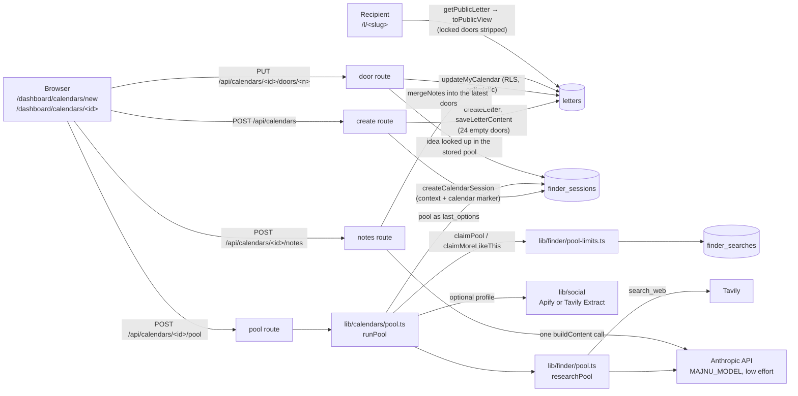

# Advent calendars, filled door by door

Issue #48. The calendar point of [../plan.md](../plan.md), "Gift finder", step 6. It builds on the gift finder's server side ([gift-finder-api.md](gift-finder-api.md)) and on the calendar templates and door locking ([templates-and-gift-pages.md](templates-and-gift-pages.md)).

## What it does

A sender with a free account says who an advent calendar is for (relationship, age, what they love, a public profile if they like), what one door may cost (with a bigger gift on the last door) and when it opens. Majnu finds a pool of 12 to 30 small gifts for that person, each with a photo, a price, the shop and a link. The sender then fills the 24 doors one by one: one of Majnu's ideas, "more like this", a gift of their own (with a link, a price or a voucher code), or a note only. Each door has a short note, written by the sender or by Majnu for every empty door at once. The editor shows "14 of 24 doors filled", the owner preview shows every door open, and the link to send it appears once every door has a gift or a note. A countdown (1 to 31 days up to a big day) works the same way.

## How it works

One calendar, in order:

1. **Start.** "Make a calendar" on the Create tab (`app/(app)/dashboard/create/page.tsx`) opens `/dashboard/calendars/new`; for a guest it is "Create an account", with `next` back to the same flow. A guest (anonymous account) sees "Create a free account for your calendar", with Sign up and Log in carrying a same-site `next` back to the same page; upgrading links the identity to the guest account, so what they made comes with them. Every calendar route answers 403 `signin_required` to guests and 401 without a session.
2. **Who and how much.** The form sends `CalendarSetupRequest` (`lib/calendars/types.ts`). `POST /api/calendars` checks the daily letter limit, then saves the letter with `kind: "calendar"`, template `advent-classic` (24 doors) or `countdown` (1 to 31), every door `{ day, title: "", message: "" }`, a default headline ("24 doors for Anna") and the night palette. It also creates the calendar's **finder session**: the finder's context (country and region from the network, language from the browser, currency, relationship, an age range given or assumed, the door budget, interests) and a server-only `calendar` marker in the same `context` column with the letter id, the name, the age the sender typed, what they said about the person, both budgets and the profile link. The editor opens with `?ideas=1`.
3. **A pool of ideas.** The editor starts the first pool by itself (once). `POST /api/calendars/<id>/pool` loads the letter through row-level security and its session, claims one plain finder search plus the pool cap (see "Limits and costs"), reads the public profile once if one was given, and runs `researchPool()` in the calendar mode: up to 6 Tavily searches in 5 model requests, in the sender's language and country, reporting `poolSize(doors)` ideas (doors + 4, 12 to 30) with a title, description, reason, price, shop and link, and the one that suits the last door. Links are checked as in the finder (a page the searches returned, or a site that came up), product photos come from the very page an idea links to, and ideas without a link or repeated are dropped. The pool is stored on the session as `last_options` (`{ options: GiftOption[], recommendedId: <idea for the last door>, why }`) and replaces any earlier pool; gifts already behind doors stay. If research fails or finds nothing with a link, the search is given back.
4. **Fill the doors.** Tapping a door opens the picker: a sheet from the bottom on phones, a dialog on larger screens. Its tabs are Majnu's ideas (each with "More like this" and a link to the shop; ideas already used say "In door 3", and the last door shows the suggested idea), Your own (title, link, price, voucher code, a line about it) and Note only, with the door's title and note below. `PUT /api/calendars/<id>/doors/<n>` sends only the idea's id: the server finds it in the stored pool and copies it onto `CalendarDoor.gift` with `giftFromOption()` (title, description, https link, price; never the product image). An own gift is checked by `ownGift()` (title required, https links only). The write goes through `updateMyCalendar()`, which applies the change to the content as stored now and saves it only if the row has not changed since it was read.
5. **More like this.** The same pool route with `{ similarTo: optionId }`: a smaller research run (3 searches in 4 requests, 6 ideas) told which idea the sender liked and which titles the pool already has. New ideas are added to the end of the pool (at most 48 in all).
6. **Notes.** `POST /api/calendars/<id>/notes` sends every door to the existing builder (`buildContent`, structured output of `CalendarContent`) in one call: each door's gift title and description (never its price, link or code), the sender's own notes to copy, the person, the language. `mergeNotes()` then fills only the doors whose note is empty, keeps the sender's notes and every gift exactly as picked (the builder cannot add or change a gift), and takes the builder's headline and intro only while they are still the defaults. It is merged into the doors as they are when the builder answers, so a door saved meanwhile is not lost.
7. **Preview and share.** "Preview every door" opens the owner preview (`/create/<id>/preview`, every door open, no tracking). The share panel appears once `shareReady()` is true: every door has a gift or a note. The recipient's page is the existing `/l/<slug>`; `toPublicView()` removes the title, note and gift of every door whose day has not come in the calendar's timezone.

A door with a gift and no note shows "A little something" as its title on the recipient's page, and no empty paragraph (`components/calendars/calendar.tsx`).

## Pieces

| Piece | Job |
|---|---|
| `app/(app)/dashboard/create/page.tsx` | The Create tab's "Make a calendar" links to the start (or, for a guest, to sign-up with `next` back to it). |
| `app/(app)/dashboard/calendars/new/page.tsx` | The start: the guest gate or the setup form. |
| `app/(app)/dashboard/calendars/[id]/page.tsx` | The editor page: loads the letter (RLS) and its session; a calendar made in the letters chat has no session and is sent back to its chat. |
| `components/calendars/setup-form.tsx` | Who it is for, the budget per door and for the last door, the kind of calendar, the start date or big day, the timezone, the sender's name. |
| `components/calendars/editor.tsx` | Progress with a moon that fills, the ideas card, the door grid (each filled door one moon step fuller, as the recipient will see it), notes, preview and the share gate. |
| `components/calendars/door-picker.tsx` | The picker for one door (Radix Dialog): ideas, own gift, note only, the note. |
| `components/calendars/guest-gate.tsx`, `api.ts` | The sign-up step for guests; the editor's calls to the routes. |
| `app/api/calendars/route.ts` | `POST`: create the calendar and its session. |
| `app/api/calendars/[id]/pool/route.ts` | `POST`: a pool, or more like one idea. |
| `app/api/calendars/[id]/doors/[day]/route.ts` | `PUT`: one door's gift and note. |
| `app/api/calendars/[id]/notes/route.ts` | `POST`: Majnu's notes for the empty doors. |
| `lib/calendars/doors.ts` | Pure rules shared by browser and server: what a filled door is, progress, the share gate, option to gift, own gifts, setting a door, merging notes, default dates and cover. |
| `lib/calendars/types.ts` | The routes' request and response types. |
| `lib/calendars/requests.ts` | zod checks for every request body. |
| `lib/calendars/sessions.ts` | The calendar's finder session: marker, pool, the notes limit. |
| `lib/calendars/pool.ts` | `runPool()`: claims, profile, research, saving the pool. |
| `lib/calendars/notes.ts` | The builder's brief for the notes and the one builder call. |
| `lib/calendars/route.ts` | The account check and JSON answers shared by the routes. |
| `lib/finder/pool.ts` | The finder's calendar mode: byte-stable prompts, the `report_ideas` tool, the research loop, links and photos, `toPoolOptions()`. |
| `lib/finder/pool-limits.ts` | `claimPool()` (a plain finder search plus at most 2 pools a day), `claimMoreLikeThis()` (a personalised search). |
| `lib/letters/store.ts` | `updateMyCalendar()`, added: change a calendar's content with an optimistic check on `updated_at`. |
| `finder_sessions`, `finder_searches` (migration `0004_finder.sql`) | Reused as they are: one session per calendar; one search row per pool or "more like this". No migration. |
| `MAJNU_MODEL`, `TAVILY_API_KEY`, `MAJNU_DAILY_SEARCH_CAP`, `APIFY_DAILY_CAP` | As for the finder. Without a Tavily key, the pool runs on Anthropic's web search (no photos). |

## Data and privacy

- **Stored.** The letter holds the calendar content as the contract defines it (`CalendarContent`, no change). The calendar's finder session holds the finder's context, the `calendar` marker (letter id, name, relationship kind, the age typed, what the sender said, the budgets, the profile link, the times Majnu wrote notes), a public profile's few interests if one was read, and the pool. Per pool or "more like this", one row in `finder_searches`. Nothing is deleted automatically; deleting the account deletes all of it (cascades).
- **Who can read it.** Row-level security limits letters and finder sessions to their owner; every write to a session uses the service role after `getUser()`, and the door route trusts only ideas from the stored pool, never one sent by the browser. Content writes go through the owner's own client, as the letters chat's do.
- **Locked doors.** Unchanged and still on the server: `toPublicView()` strips a locked door to `{ day, locked, opensOn }`, so a picked gift, its link, an own gift's voucher code and the note never reach the HTML or a response before their day. Tested with picked and own gifts in `tests/unit/lib/calendars/locked-doors.test.ts`, and checked live (below).
- **Shop photos.** Shown to the sender in the editor and picker only, with `referrerPolicy="no-referrer"`. A door's gift never carries `imageUrl`, so the recipient's page loads nothing from a shop (the same rule as wrapping a finder gift).
- **What the model sees.** The pool brief has the person, the budgets, the place and language; the notes brief has each door's gift title and description and the sender's notes, never a price, link or code. Logs carry error classes and request ids, never the brief or the queries.

## Limits and costs

- **Calendars need a real account** (`canUseFeature("calendar")`'s rule, `calendarResult()` in `lib/limits.ts`).
- **Creating** a calendar counts as one of the 5 letters a day.
- **A pool is one finder search**: it counts against the finder's 3 searches a day and the site-wide `MAJNU_DAILY_SEARCH_CAP`, and on top of that at most **2 pools a day** per user (`POOLS_PER_DAY`). **More like this** is a later search in the calendar's session, so by the finder's rule it is a personalised search (2 a day, within the 3). A search that fails or finds nothing with a link is given back. Claims are made the finder's way: insert first, count second.
- **Research caps.** A pool may run 6 Tavily searches in 5 model requests (the finder keeps 4 and 4), because one pool must cover 24 doors from different shops; more like this runs 3 searches in 4 requests. Tavily's basic search is 1 credit per search, so a pool costs at most 6 credits. Model: `MAJNU_MODEL` at low effort with the server-side fallback, `max_tokens` 16,000; a 28-idea report is about 3,000 to 4,000 output tokens. Not measured live (see below).
- **Notes**: one builder call (two if the first output does not fit), at most **4 runs a day per user** over all their calendars (`NOTES_PER_DAY`, counted from the markers). A run that fails is given back.
- **Size**: a pool never grows past 48 ideas; a note is at most 80 characters of title and 600 of text; an own gift's fields are capped too.

## How it was checked

- **Unit tests** (`npm test`):
  - `tests/unit/lib/calendars/doors.test.ts`: empty calendars, countdown length, default and countdown dates, what counts as filled, progress ("14 of 24"), the share gate, option to gift without its image, own gifts (https only, codes kept), setting a door, merging notes (sender's notes and gifts kept, defaults replaced).
  - `tests/unit/lib/calendars/locked-doors.test.ts`: a picked idea, an own gift with a voucher code and notes behind locked doors are absent from the public view on 1 December, appear on their day without the shop image, and all show in the owner preview.
  - `tests/unit/lib/finder/pool.test.ts`: pool size, the brief (person, both budgets, country, language, currency, caps, "more like this"), byte-stable prompts, link checking and photos, repeats, the Tavily loop and its search cap, Anthropic's web search without a key, refusals and a missing report.
  - `tests/unit/lib/finder/pool-limits.test.ts` (in-memory database): a pool is a plain search in a calendar session; a third pool is refused and given back; finder searches share the daily 3 but are not pools; earlier days do not count; the site cap; more like this is personalised and stops at 2.
  - `tests/unit/lib/calendars/pool.test.ts`, `notes.test.ts`: `runPool` (the brief, replacing and adding to the pool, 404 before any claim, limits as 429, every failure gives the search back, a profile read keeps the marker), the notes brief (no price, link or code) and the single builder call.
  - `tests/unit/app/api/calendars/`: all four routes, including 401, 403 for guests, 400, 404 for an idea not in the pool, 429 limits, and notes merged into the latest content.
  - `tests/unit/lib/letters/update-calendar.test.ts`: the optimistic update starts again on fresh content when the row changed, keeping both changes.
- **Live, on 22 November, on `next dev` against the real Supabase project**, with a temporary confirmed user (signed in through an admin magic link) and the isolated browser at 375 and 1440 px:
  - The setup form created a 24-door calendar starting 20 November (so doors 1 to 3 were open), and the editor started the pool once.
  - **The pool's research could not run**: the Anthropic API refused the first request with `429 enforced_spend_limit_reached` (the organisation's monthly threshold, "regain access on 2026-12-01"). The editor showed the busy message and a retry button, and the search was given back (no `finder_searches` row was left). "Write the empty notes for me" hit the same refusal, showed its error, and its run was given back too. To check the rest, a 12-idea pool was written into the calendar's session with the service role.
  - Door 2 filled with an idea by keyboard only (Tab into the list, arrow keys, Save), door 3 with an own gift and a voucher code, door 1 with a note only; doors 4 to 24 through the door route with `curl` (ideas, notes, an own gift with a code behind locked door 10, the scarf on door 24). Error cases answered 404 (door 25, an idea not in the pool) and 400 (an http link). Progress went to "24 of 24 doors filled" and the share panel appeared.
  - `curl` of `/l/<slug>` (HTTP 200): none of the locked doors' gift titles, door titles, notes, the voucher code `LOCKED-CODE-1010` or any shop link was in the HTML; doors 1 to 3 and the open door's code were. `/api/open` answers carried nothing from the doors. The owner preview had every door open, the codes, and no shop image. Opening door 3 on the recipient's page showed the gift without an empty note; door 7 (no title, no note) showed "A little something".
  - A guest (real anonymous session) saw the sign-up gate on both pages and got 403 from the routes; a second real account got 404 from every route and the not-found page on the editor URL (with HTTP 200, as `/create/<id>` has, because the dashboard's loading state streams).
  - Keyboard: focus starts on the picker's title, Escape closes it and focus returns to the door. Reduced motion: no tile, sheet or overlay animation. No console errors or warnings. No horizontal scroll at 375 px.
  - The test users, their calendar, session and open events were deleted afterwards.
- **Not checked**: a live pool and live notes (the API spend limit; re-run one pool and one notes run once the key works: create a calendar at `/dashboard/calendars/new`), a public profile read for a pool (unit-tested only), a countdown in the browser (unit-tested), and rendering the recipient's HTML in a unit test (the tests do not transform JSX, so the HTML is checked live with `curl` instead).

## Open questions

- **Links into the editor** (files of other sessions, left for the lead): the finder's wrapped-gift screen (`components/finder/wrap-view.tsx`) still sends "Make a calendar" to the letters chat with `?template=advent-classic`; it should link to `/dashboard/calendars/new`, as the Create tab now does. `activeTab()` in `components/app/tabs.ts` should count `/dashboard/calendars` as the Create tab. My gifts (`components/app/gift-card.tsx`) links every letter to `/create/<id>`, where a calendar made here opens as a chat with an empty conversation; it should link to `/dashboard/calendars/<id>` for calendars (the editor sends chat-made ones back to their chat).
- **Calendars made in the letters chat** have no session, so no pool or notes here; the editor sends them back to their chat. A setup step could create a session for them.
- **The language of the editor.** The editor is in English like the rest of the app; the pool's ideas and Majnu's notes follow the browser's language.
- **More like this** spends one of the 2 personalised searches a day, which is little when filling 24 doors. A separate small allowance (say 3 a day) could be added to `pool-limits.ts` if senders run out.
- **Images behind a door.** As for wrapped finder gifts, a door never shows the shop's photo. Storing the image on our side (see [gift-finder-api.md](gift-finder-api.md)) would let doors show it.
- Pools are kept with the calendar's session until the account is deleted; a retention period should be chosen with the finder's.
