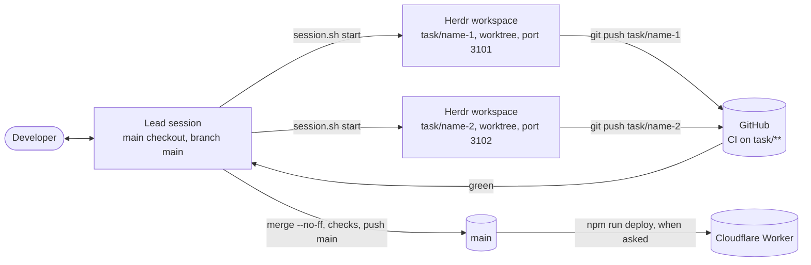
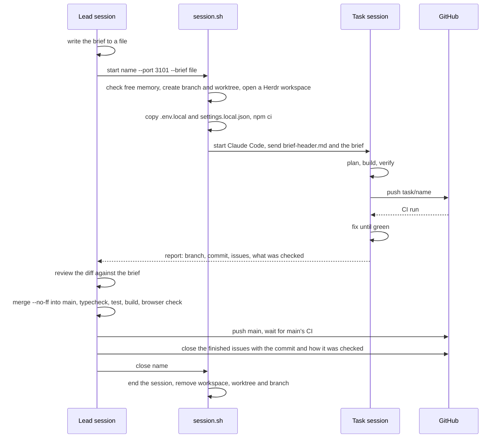

# How Majnu is built: a lead session and parallel task sessions

## What it does

Majnu was built in a few hours by two developers, each working with Claude Code. To get more done at once without the work colliding, the session the developer talks to acts as the **lead**: it splits the work into tasks that touch separate files, starts one **task session** per task in its own branch, git worktree and terminal workspace, and merges each branch once it is done and its CI is green. The developer watches every session in Herdr, a terminal workspace manager for coding agents, and can step into any of them.

The rules are in [AGENTS.md](../../AGENTS.md) ("Working in parallel") and [CLAUDE.md](../../CLAUDE.md) ("Parallel sessions with Herdr"). This page explains how they fit together.

## How it works

One task, in order:

### Starting, watching and closing a session

[`scripts/agents/session.sh`](../../scripts/agents/session.sh) runs only inside Herdr (`HERDR_ENV=1`):

- **`start <name> --port <port> --brief <file>`** checks the name (lowercase letters, digits and dashes, at most 24 characters) and the 4-digit port, and refuses to start when less than 30 % of memory is free (`MAJNU_MIN_FREE_PCT` changes the threshold). It creates the branch `task/<name>` from `main` and the worktree `.claude/worktrees/<name>`, opens it as a Herdr workspace, copies the gitignored `.env.local` and `.claude/settings.local.json` into it, and runs `npm ci`. Then it starts Claude Code with `--dangerously-skip-permissions`, `--no-chrome` and the extra MCP server `browser` ([`browser-mcp.json`](../../scripts/agents/browser-mcp.json): Chrome DevTools in an isolated, throwaway profile at 1440 × 900), retrying while the shell is still busy. It sends [`brief-header.md`](../../scripts/agents/brief-header.md), with the branch and port filled in, followed by the brief, and returns once the session is working. On this machine a start takes about five minutes, mostly `npm ci`.
- **`status <name>`** prints the session's state and its latest output. `herdr agent wait <name>` returns when it is idle, done or blocked.
- **`close <name>`** refuses a branch that is not merged into `main` unless given `--force`. It removes the Herdr workspace, the worktree and the branch, locally and on GitHub. It takes a few minutes, mostly deleting `node_modules`.

A task session starts without permission prompts, at the developer's request. Its limits are its brief (never push or merge `main`, never deploy) and the deny rules in [`.claude/settings.json`](../../.claude/settings.json).

### The five steps

Every task session follows the same five steps, from `brief-header.md`:

1. **Plan.** Read AGENTS.md, CLAUDE.md, [docs/plan.md](../plan.md) and the files the task names. Write a short plan before editing.
2. **Build.** Edit only the files the brief gives. Contract files change only if the brief says so; otherwise the change is reported. Write or update the feature's architecture page in `docs/features/` and add it to the table in [README.md](README.md).
3. **Verify** with the tools the session has: `npm run typecheck` and `npm test` every time, `npm run build` when shipping code changed, and anything visible in its own isolated browser at 375 px and 1440 px, with the console read and the keyboard tried. Say what could not be checked and why.
4. **Commit and push** the task branch only, then wait for its CI run and fix it until it is green.
5. **Report and stop:** the branch, the last commit, the GitHub issues the work finishes or partly covers, what changed, what was verified and how, what was not, and what the lead must do next (contract changes, migrations, secrets).

A brief from the lead always states the goal, the files the session owns, the files it must not touch, the contract it codes against, how to verify the work (with its own dev-server port), and that contract changes are reported, not made. The lead never gives two sessions the same files.

### CI before merge

[`.github/workflows/ci.yml`](../../.github/workflows/ci.yml) runs on every push to `main`, `dev-a`, `dev-b` and `task/**`, on pull requests, on demand and once an hour:

| Job | When | What |
|---|---|---|
| Type check, unit tests, build | Every run except the hourly one | `npm ci`, `npm run typecheck`, `npm test`, `npm run build` on Node 22, within 10 minutes |
| Service connections | Every run, including hourly | `npm run test:smoke`: read-only calls to Supabase and Anthropic (required) and Stripe and Daytona (skipped until their keys exist), within 5 minutes |

The lead merges a branch only when its report covers every item of the brief, the diff matches it, and **the CI run for the branch's last commit is green** (`gh run list --branch task/<name> --limit 1`). It then merges one branch at a time with `git merge --no-ff`, reruns the type check, tests and build on `main`, checks the result in a browser, pushes `main`, and waits for `main`'s CI before deploying. Production builds ignore type errors, so the type check is the only thing that catches them. The hourly run notices a revoked key or an exhausted quota even when nobody is pushing.

### Who owns what

The work is split between **Dev A** (agent, data, payments) and **Dev B** (templates, public pages, brand); the full table is in [docs/plan.md](../plan.md#who-builds-what). Neither edits the other's files. The seam between them is a small set of functions and components: `getPublicLetter()` and `toPublicView()` in one direction, `<LetterRenderer>`, `<SharePanel>` and `<TemplateCard>` in the other. The contract files (`lib/letters/schema.ts`, `templates.ts`, `fixtures.ts`, the signatures in `store.ts`, and the event types in `lib/agents/events.ts` and `lib/finder/events.ts`) change only by adding, and only when both agree.

### Tools every session has

- **Skills** in `.claude/skills/`, pinned by [`skills-lock.json`](../../skills-lock.json): Supabase, Stripe, Cloudflare, design (the Taste Skill and frontend design) and Black Forest Labs (FLUX images and video). CLAUDE.md lists which to load for which work.
- **MCP servers** in [`.mcp.json`](../../.mcp.json): `supabase` (migrations, SQL, logs) and `stripe`. Task sessions also get `browser`; the lead uses Claude in Chrome, which drives the developer's own Chrome with their sign-ins, so only the lead can check signed-in pages. Task sessions check signed-in screens on a temporary page with mock data and delete it before committing.
- **Permissions** in `.claude/settings.json`: routine commands are allowed without asking (checks, `git add` and `commit`, pushes to `task/*`, the local dev server, the `browser` server), direct `wrangler deploy` and `opennextjs-cloudflare deploy` are denied, and commit and pull-request attribution is off. No AI attribution goes into commits, pull requests, comments or docs.

### GitHub issues

Work is tracked in the GitHub issues on `peresramirez/majnu`, and every task names the issues it covers. An issue is finished when the work is merged into `main`, pushed and checked, not when a task branch is pushed. The lead then closes it straight away: `gh issue close <number> --comment "Done in <commit>: <what now works>. Checked: <how>."`. Work that covers only part of an issue gets a comment saying what is done and what is left.

### The documentation rule

Every feature has an architecture page in `docs/features/<feature>.md`, in the outline of [README.md](README.md), written or updated by the session that builds or changes the feature, in the same branch. [docs/architecture.md](../architecture.md) is the overview that links them. The developers present Majnu from these pages, so they must stay true to the code. When a decision in `docs/plan.md` changes, the plan is updated in the same change.

## Pieces

| Piece | Job |
|---|---|
| [`AGENTS.md`](../../AGENTS.md) | Rules for every coding agent: ownership, Git, the five steps, checking, secrets, user protections |
| [`CLAUDE.md`](../../CLAUDE.md) | Claude Code specifics: skills, MCP servers, settings, Herdr commands |
| [`scripts/agents/session.sh`](../../scripts/agents/session.sh) | Start, status and close task sessions |
| [`scripts/agents/brief-header.md`](../../scripts/agents/brief-header.md) | The five steps every brief starts with |
| [`scripts/agents/browser-mcp.json`](../../scripts/agents/browser-mcp.json) | The isolated browser for task sessions |
| [`.claude/settings.json`](../../.claude/settings.json) | Shared permissions and attribution settings |
| [`.github/workflows/ci.yml`](../../.github/workflows/ci.yml) | CI |
| `.claude/worktrees/<name>` | Each task's worktree. The main checkout's dev server ignores the folder ([`next.config.mjs`](../../next.config.mjs)), so a session's writes do not make it recompile; inside a worktree nothing extra is ignored |

## Data and privacy

- Each worktree gets a copy of `.env.local`, which is gitignored. Sessions must never print a key, paste one into a tracked file, or put one in a URL.
- `docs/internal/` and `.claude/settings.local.json` are private and ignored by git; nothing from them goes into tracked files.
- Task sessions use a throwaway browser profile with no sign-ins, so they cannot reach the developer's accounts.

## Limits and costs

- This machine has 16 GB of memory. Each session runs Claude Code, a dev server, a build and a browser, and more than two at a time pushes it into heavy swap, so at most two task sessions run at once and `start` refuses when less than 30 % of memory is free. Briefs ask sessions to keep their footprint small: the dev server only while checking, one build at the end, one browser page.
- Every session spends model tokens, and its CI runs spend GitHub Actions minutes; the hourly connection check runs regardless.

## How it was checked

- The workflow is in use: this page was written by the task session `feature-docs`, started with `session.sh`. The commit history shows it being tightened as it was used, for example "Retry starting a session's agent while its shell is still busy", "Return from session start only once the agent is working", "Keep parallel sessions within this machine's memory" and "Merge task branches only when their CI is green".
- `session.sh` has no automated tests.

## Open questions

- The workflow depends on Herdr and on one machine's memory. Without Herdr, each developer's agent works on `dev-a` or `dev-b` and merges at each checkpoint in the plan.
- Branches are merged locally by the lead rather than through pull requests, so reviews live in the lead's session, not on GitHub.
