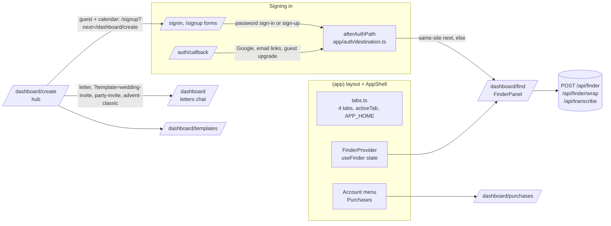

# The app shell: finding a gift first, then Create

## What it does

The signed-in app leads with finding a gift (issue #47). Signing up, signing in and turning a guest account into a real one all land on **Find a gift**, which is the gift finder itself, inline in the app: it greets with "Who is the gift for?", a row of suggestions and a message box with a microphone, and then works exactly like the finder on the landing page (three gift ideas, personalising, wrapping the chosen gift into a page, voice input). The tab bar has four tabs, **Find a gift · My gifts · Create · Tracker**: a bottom bar on phones and top tabs from `md` (768 px) up. Letters, invitations, advent calendars and the template gallery are the optional extras, one tap away under **Create**. **Purchases** (the personalised wrappers bought) is in the account menu.

## How it works

1. **After signing in.** `afterAuthPath(next)` returns a `next` that `safeNextPath()` accepts (a path on this site; never another host, a scheme or a sign-in page), otherwise `APP_HOME`, `/dashboard/find`. The auth callback uses it for Google, for Google linked to a guest and for every email link; the forms use it after a password sign-in or a sign-up without confirmation, and for a guest's "Back to Majnu" link. Details are in [guest-accounts.md](guest-accounts.md).
2. **The shell.** `app/(app)/layout.tsx` loads the user (guests included) and renders `AppShell`: the header with the wordmark (a link to Find a gift), the top tabs from `md` up, the account menu, the guest notice for guests, `<main>`, and the bottom tab bar on phones. The shell is one screen tall and `<main>` scrolls, so the finder and the letters chat pin their message box above the tab bar. While a message box marked `data-composer` has focus on a phone, the tab bar and the guest notice step aside for the keyboard.
3. **One finder for the whole app.** `FinderProvider` (in `components/finder/finder-panel.tsx`) calls `useFinder()` once, inside `<main>`, and shares it through React context. The Find a gift page renders `SharedFinderPanel`, so a conversation, its gift ideas and a gift being wrapped are still there after a visit to My gifts. Reloading the page, signing out or leaving the app forgets it, as on the landing page. Only the provider and the panel re-render while a reply streams; the pages passed through as `children` do not.
4. **The panel.** `FinderPanel` builds on the same parts as the landing page's dialog: `useFinder`, `Conversation`, `WrapView` and `WrapFooter`, the context chips and `VoiceButton`. Empty, it shows Majnu's mark, the heading "Who is the gift for?", one line on what happens, the landing page's suggestions and the message box. The examples type themselves out in the box, and a still one is shown with reduced motion. On phones these sit at the bottom by the thumb; from `md` up they are centred together, in the same reading order (heading, suggestions, message box). Sending turns it into the finder's conversation: a status line with the moon filling as Majnu works and **New search** (`useFinder().reset()`), the chips Majnu assumed, the conversation, and the message box pinned to the bottom. New gift ideas scroll to their top; coming back to the tab jumps to where the conversation left off. Choosing a gift opens the wrap step with its button bar, and Ready to send widens the column to 960 px. A keyboard or mouse user starts with focus in the empty message box; phones are left alone so the keyboard does not cover the suggestions.
5. **Create.** `/dashboard/create` lists four options, each with a still drawing of a template (`TemplateThumbnail`): a letter (the letters chat at `/dashboard`), an invitation (Wedding or Party, which open the chat with that template attached through `?template=`), an advent calendar (the chat with `advent-classic`; a guest is asked to create a free account and comes back here), and all templates (`/dashboard/templates`). Issue #48 will turn calendars into picking a gift for each door.
6. **Which tab is lit.** `activeTab(pathname)` in `components/app/tabs.ts`: `/dashboard/find` is Find a gift, `/dashboard/gifts` My gifts, `/dashboard/tracker` Tracker, and `/dashboard/create`, `/dashboard` (the letters chat), `/create/<id>`, `/dashboard/templates` and the advent calendar editor at `/dashboard/calendars` (issue #48, [advent-calendar.md](advent-calendar.md)) all belong to Create. Purchases and the old `/dashboard/plan` light no tab; the account menu marks Purchases with `aria-current` instead.

**Why `/dashboard` stays the letters chat.** Moving the chat to a new address (say `/dashboard/letters`) and redirecting `/dashboard` to the finder was the alternative. Several pages link to `/dashboard` meaning "a new letter": the template gallery's "Use this template" (`/dashboard?template=<id>`), the chat's own "New gift" button, My gifts and the error pages. Keeping the address means none of them change and none needs a redirect that carries its query along. Sign-in reaches the finder through `afterAuthPath()` instead.

## Pieces

| Piece | Job |
|---|---|
| `components/app/tabs.ts` | The four tabs, `APP_HOME` (`/dashboard/find`), `LETTERS_CHAT`, `PURCHASES`, `activeTab()` and `giftEditorPath()` (a calendar continues in its editor, anything else in the letters chat) |
| `components/app/app-shell.tsx` | Header, top tabs, bottom tab bar (as many columns as tabs), guest notice, `<main>` wrapped in `FinderProvider` |
| `components/app/account-menu.tsx` | Name and email, **Purchases** for members (Create an account and Sign in for guests), Write to us, Sign out, legal links |
| `components/finder/finder-panel.tsx` | `FinderProvider`, `SharedFinderPanel` and `FinderPanel`: the finder inline |
| `components/finder/use-finder.ts` | The finder's state; `reset()` (New search) was added for the panel, and `restart()` now uses it |
| `app/(app)/dashboard/find/page.tsx` | The Find a gift tab |
| `app/(app)/dashboard/create/page.tsx` | The Create hub; reads `isGuest` to gate calendars |
| `app/(app)/dashboard/page.tsx` | The letters chat (`CreateChat`), unchanged apart from its title |
| `app/auth/destination.ts` | `afterAuthPath(next)`: where sign-in, sign-up and upgrades land |
| `components/landing/hero-finder.tsx` | Source of the suggestions and typed examples the panel shares with the landing page |

## Data and privacy

- No new tables, routes or environment variables. The panel talks to the same routes as the landing page's finder (`POST /api/finder`, `POST /api/finder/wrap`, `POST /api/transcribe`); what they store is described in [gift-finder-api.md](gift-finder-api.md) and [voice-input.md](voice-input.md).
- The conversation is kept in memory in the app shell only, never in `localStorage`, so it is gone after a reload or sign-out.
- Every destination after sign-in is a path on this site; `next` from a URL can never send someone elsewhere.

## Limits and costs

- The inline finder has the finder's own limits (3 searches a day, 2 of them personalised for members, plus the site-wide cap) and costs the same per search. Keeping the conversation in the shell adds no requests; a reply that is still streaming when the sender switches tab simply finishes.
- At 375 px the four tabs are 94 × 64 px each.

## How it was checked

- **Unit tests:** `tests/unit/components/app/tabs.test.ts` (four tabs in order, `APP_HOME` is the first tab, Create and Tracker addresses, no Plan, Purchases, Templates or Letters tab, unique ids, and `activeTab()` for every address including look-alikes such as `/dashboard/findings` and `/dashboard/creators`); `tests/unit/app/auth/destination.test.ts` and `tests/unit/app/auth/next-redirects.test.ts` for where sign-in lands. `npm run typecheck`, `npm test` and `npm run build` pass.
- **In an isolated Chrome on `next dev`, 22 November**, signed in as a temporary confirmed user (created with the service-role key and deleted afterwards), at 375 × 812 as a touch phone and at 1440 × 900:
  - The real `/signin` form with email and password landed on `/dashboard/find`. At 375 px: four tabs with Find a gift lit, the empty state above the message box, no autofocus, and no horizontal scroll. At 1440 px: the group is centred and the message box has focus.
  - One live search ("My mother") streamed three gift ideas with shops, prices, the context chips and the recommendation, and scrolled to the ideas. After a visit to My gifts, Find a gift still showed the same conversation, scrolled to the ideas. A second live search was refused by the Anthropic API ("You have reached your specified API usage limits", until 1 December). The panel showed the finder's error notice with Try again and kept focus in the message box.
  - Choosing a gift, the wrap step with its button bar, Ready to send, Back to the gift ideas (scrolls to the ideas, focus in the message box) and New search (back to the empty state, focus in the message box) were checked on a temporary page that put the panel on `/dev/finder`'s mock transport inside the app shell. The page was deleted before committing.
  - Create at both widths: four cards with template drawings and correct links; a guest (a temporary anonymous user, also deleted) sees "Create an account" with `next=/dashboard/create` for calendars, the guest notice and the guest account menu without Purchases. A member's account menu has Purchases, which opens `/dashboard/purchases` with no tab lit.
  - Keyboard: skip link, wordmark, the four tabs, account menu, suggestions, message box, microphone, Find a gift; focus rings visible. With reduced motion the typed example stays still and the entrance does not animate. No console errors.
- **With `curl`:** the auth callback lands on `/dashboard/find` without a `next` or with an unsafe one, keeps a same-site `next`, and `/dashboard/find` and `/dashboard/create` send a signed-out visitor to `/signin`.
- **Not checked here:** Google sign-in and linking (they need a person at Google; left to the lead), a guest's email upgrade end to end (it sends a real email), and the Tracker tab's page (issue #49, built in its own branch).

## Open questions

- `WrapView`'s Ready to send tells everyone "This gift is kept in this browser. Sign up to keep your gifts", which is wrong for a member in the app. It needs to know whether the sender is a guest.
- My gifts' empty state ("Create a gift") and its "New gift" button still open the letters chat. Under the new focus they could open Find a gift.
- A guest who signs up in the middle of a search lands on an empty finder: the conversation lives in memory. It could be kept in `sessionStorage`, or restored from the finder session, which the account keeps.
- `FinderDialog` and `FinderPanel` share their parts but each has its own message box and scrolling code. The dialog could render the panel's body.
- `lib/supabase/middleware.ts` still sends a signed-in member who opens `/signin` without a `next` to `/dashboard`; `afterAuthPath()` would make it the finder.
