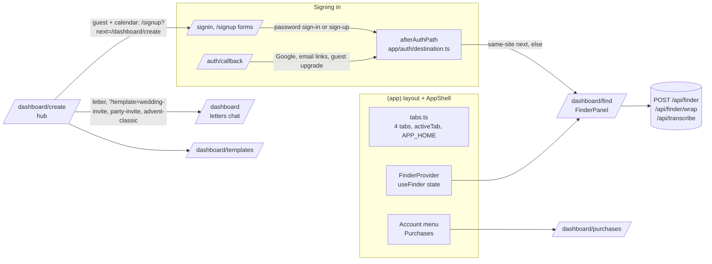
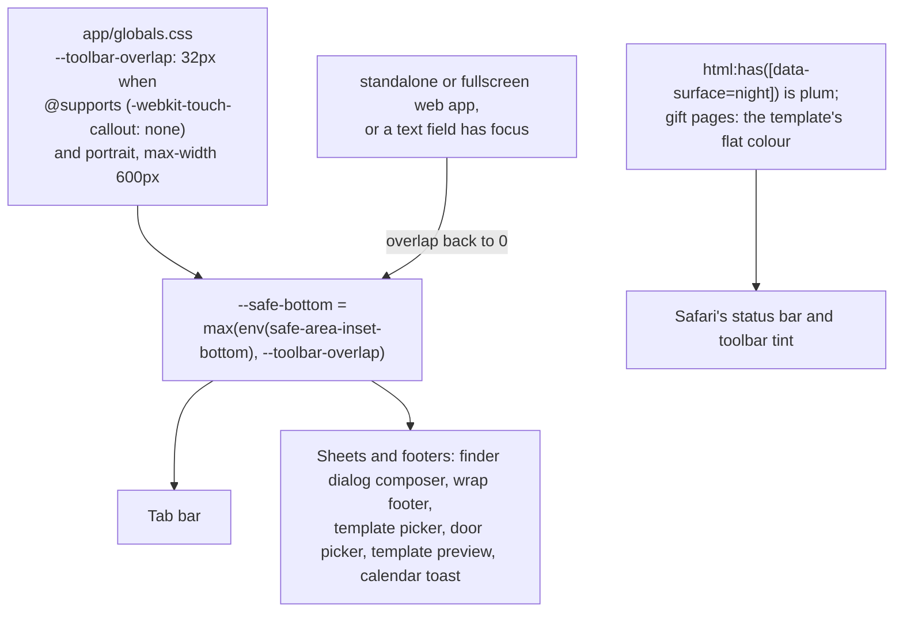
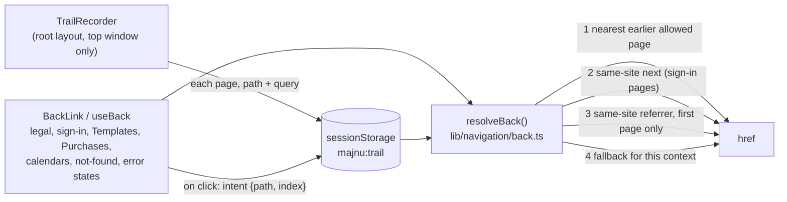

# The app shell: finding a gift first, then Create, on any phone, with Back links that go back

## What it does

The signed-in app leads with finding a gift (issue #47). Signing up, signing in and turning a guest account into a real one all land on **Find a gift**, which is the gift finder itself, inline in the app: it greets with "Who is the gift for?", a row of suggestions and a message box with a microphone, and then works exactly like the finder on the landing page (three gift ideas, personalising, wrapping the chosen gift into a page, voice input). The tab bar has four tabs, **Find a gift · My gifts · Create · Tracker**: a bottom bar on phones and top tabs from `md` (768 px) up. Letters, invitations, advent calendars and the template gallery are the optional extras, one tap away under **Create**. **Purchases** (the personalised wrappers bought) is in the account menu.

On an iPhone the tab bar and every bar or sheet pinned to the bottom of the screen stay clear of Safari's floating toolbar (issue #65), and Safari colours its status bar and toolbar to match the page. Every **Back** link (the legal pages, sign-in and sign-up, Templates, Purchases, the calendar pages, the not-found and error pages) returns to the page this tab came from on this site, or to a sensible place when there is none, never to another site, never to a sign-in page and never in a loop (issue #66).

## How it works

1. **After signing in.** `afterAuthPath(next)` returns a `next` that `safeNextPath()` accepts (a path on this site; never another host, a scheme or a sign-in page), otherwise `APP_HOME`, `/dashboard/find`. The auth callback uses it for Google, for Google linked to a guest and for every email link; the forms use it after a password sign-in or a sign-up without confirmation, and for a guest's "Back to Majnu" link. Details are in [guest-accounts.md](guest-accounts.md).
2. **The shell.** `app/(app)/layout.tsx` loads the user (guests included) and renders `AppShell`: the header with the wordmark (a link to Find a gift), the top tabs from `md` up, the account menu, the guest notice for guests, `<main>`, and the bottom tab bar on phones. The shell is one screen tall and `<main>` scrolls, so the finder and the letters chat pin their message box above the tab bar. While a message box marked `data-composer` has focus on a phone, the tab bar and the guest notice step aside for the keyboard. The tab bar also steps aside while the gift finder's wrap step is open (its form is marked `data-wrap-step`, issue #71), so the details of step 2 fit above the wrap buttons at 375 × 667 with the guest notice; it comes back on the gift ideas and on Ready to send.
3. **One finder for the whole app.** `FinderProvider` (in `components/finder/finder-panel.tsx`) calls `useFinder()` once, inside `<main>`, and shares it through React context. The Find a gift page renders `SharedFinderPanel`, so a conversation, its gift ideas and a gift being wrapped are still there after a visit to My gifts. Reloading the page, signing out or leaving the app forgets it, as on the landing page. Only the provider and the panel re-render while a reply streams; the pages passed through as `children` do not.
4. **The panel.** `FinderPanel` builds on the same parts as the landing page's dialog: `useFinder`, `Conversation`, `WrapView` and `WrapFooter`, the context chips and `VoiceButton`. Empty, it shows Majnu's mark, the heading "Who is the gift for?", one line on what happens, the landing page's suggestions and the message box. The examples type themselves out in the box, and a still one is shown with reduced motion. On phones these sit at the bottom by the thumb; from `md` up they are centred together, in the same reading order (heading, suggestions, message box). Sending turns it into the finder's conversation: a status line with the moon filling as Majnu works and **New search** (`useFinder().reset()`), the chips Majnu assumed, the conversation, and the message box pinned to the bottom. New gift ideas scroll to their top; coming back to the tab jumps to where the conversation left off. Choosing a gift opens the wrap step with its button bar, and Ready to send widens the column to 960 px. A keyboard or mouse user starts with focus in the empty message box; phones are left alone so the keyboard does not cover the suggestions.
5. **Create.** `/dashboard/create` lists four options, each with a still drawing of a template (`TemplateThumbnail`): a letter (the letters chat at `/dashboard`), an invitation (Wedding or Party, which open the chat with that template attached through `?template=`), an advent calendar (the chat with `advent-classic`; a guest is asked to create a free account and comes back here), and all templates (`/dashboard/templates`). Issue #48 will turn calendars into picking a gift for each door.
6. **Which tab is lit.** `activeTab(pathname)` in `components/app/tabs.ts`: `/dashboard/find` is Find a gift, `/dashboard/gifts` My gifts, `/dashboard/tracker` Tracker, and `/dashboard/create`, `/dashboard` (the letters chat), `/create/<id>`, `/dashboard/templates` and the advent calendar editor at `/dashboard/calendars` (issue #48, [advent-calendar.md](advent-calendar.md)) all belong to Create. Purchases and the old `/dashboard/plan` light no tab; the account menu marks Purchases with `aria-current` instead.

### The bottom of the screen on iPhones (issue #65)

Safari on iOS 26 and later (Liquid Glass) changed two things that the shell relied on:

- **The toolbar floats over the page.** In a browser tab the expanded address bar is a pill whose top sits about 24 CSS px above the bottom of `100dvh`, and `env(safe-area-inset-bottom)` stays 0 under it. The developer's screenshot (iPhone, 22 November) showed exactly that: the tab bar's labels behind the pill. Only `<main>` scrolls in the shell, so Safari never collapses its toolbar here; the expanded state is the one to design for, and the smaller collapsed pill sits lower, inside the same room. WebKit's own description: Safari treats the compact tab bar as an "obscured content inset" ([WebKit bug 301756](https://bugs.webkit.org/show_bug.cgi?id=301756)); write-ups by [Pavel Larionov](https://1ar.io/updates/safari-26-liquid-glass-web/) and others, a [Mantine issue](https://github.com/mantinedev/mantine/issues/8326) and a [Stack Overflow thread](https://stackoverflow.com/questions/79753701) report the same overlap and that the inset does not include the toolbar.
- **`theme-color` is ignored.** Safari 26 colours its status bar and toolbar from the root's background, or from a fixed element touching the edge ([Arpit Agrawal](https://arpit.blog/articles/2025/11/safari-drops-support-theme-color/), quoting WebKit). The body was Petal, so every dark screen had light bars above and below it.

What the code does:

1. `--toolbar-overlap` is 32 px (the 24 px overlap and 8 px of air) only where Safari's floating toolbar exists: WebKit on iOS (`-webkit-touch-callout` is supported nowhere else), held upright, at phone width (600 px or less, so iPads and the iPhone Duo's inner screen keep 0). A web app opened from the home screen has no Safari toolbar, and while a text field has focus the keyboard replaces the toolbar, so both drop back to 0.
2. `--safe-bottom` is the larger of the home-indicator inset and that overlap. The tab bar pads its bottom with it, and so does everything pinned to the bottom edge. Android Chrome and desktop get exactly what they had before: the inset, which is 0 or the gesture bar.
3. The shell, the landing page, sign-in, the owner's preview and the not-found page mark themselves `data-surface="night"`, and `html:has([data-surface="night"])` turns the root plum, so Safari's bars match. `LetterRenderer` writes the template's flat colour (from the fixed palette table, never from content) to the root of a gift page.
4. The message boxes in the gift finder (landing hero, Find a gift tab, finder dialog) reset iOS's own textarea styling (`appearance: none`, no border, radius or shadow) so the typed example sits centred on its 24 px line beside the 44 px buttons.

Why this rather than the alternatives: making the document scroll (so the toolbar collapses) would break the pinned message boxes and still overlap in the expanded state; measuring the toolbar from JavaScript is not possible (no API reports it, and `visualViewport` does not include it); padding by user-agent string would miss in-app browsers and break when the version string changes. The CSS feature query is decided before the first paint, needs no JavaScript and falls back to the old behaviour everywhere else.

### Back links (issue #66)

1. **The trail.** Next.js changes pages without reloading, so `document.referrer` keeps naming the page the tab first came from, and gift pages send no referrer at all. Each tab therefore keeps its own short list of the pages it visited on this site (`TrailRecorder` in the root layout writes it to `sessionStorage`, at most 30 entries, paths only). Arriving at the page just before or after the current one is read as the browser's back or forward button, so the list moves instead of growing. Frames (the gift preview on the create page) do not record, and neither do `/auth`, `/api`, `/billing` or `/dev`.
2. **Where Back goes.** `resolveBack()` takes the nearest earlier page the link may go to; then, on the sign-in pages, a same-site `next`; then a same-site referrer when the trail has nothing earlier; then the link's fallback. "May go to" means: a path on this site (`safeNextPath()`), never a sign-in or sign-up page, never `/auth`, `/api`, `/billing` or `/dev`, and no app page for a visitor who is signed out (it would only send them to sign in).
3. **No loops.** A Back link writes which trail entry it goes to (the intent) before navigating, and the trail moves to that entry when the page arrives; a fallback takes the current entry's place. The position only ever moves back, so following Back links always ends at a fallback, and fallbacks are pages without a Back link (the landing page and the app's tabs). The unit tests walk 600 random trails to check this.
4. **Fallbacks.** Legal pages and the not-found page: the app (`/dashboard/find`) for anyone signed in, `/` for everyone else. Sign-in and sign-up: `/` (the app for a guest). Templates and the new calendar page: Create. Purchases and the calendar editor: My gifts. App error states: "Go back", with Find a gift as the fallback; states that name a place ("My gifts") still link there.
5. **Guests come back.** The guest notice, the guest account menu ("Create an account", "Sign in") and the calendar templates' "Create an account" carry the current page as `next`, so signing up returns to it.
6. **What stays as it was.** The finder dialog's close button and "Back to your gift ideas", and the create page's "Back to chat", change what is shown on the same page rather than going to another page, so they need no history; focus returns to what opened them. The link to `/` on a missing gift's page is unchanged.

**Why `/dashboard` stays the letters chat.** Moving the chat to a new address (say `/dashboard/letters`) and redirecting `/dashboard` to the finder was the alternative. Several pages link to `/dashboard` meaning "a new letter": the template gallery's "Use this template" (`/dashboard?template=<id>`), the chat's own "New gift" button, My gifts and the error pages. Keeping the address means none of them change and none needs a redirect that carries its query along. Sign-in reaches the finder through `afterAuthPath()` instead.

## Pieces

| Piece | Job |
|---|---|
| `components/app/tabs.ts` | The four tabs, `APP_HOME` (`/dashboard/find`), `LETTERS_CHAT`, `PURCHASES`, `activeTab()` and `giftEditorPath()` (a calendar continues in its editor, anything else in the letters chat) |
| `components/app/app-shell.tsx` | Header, top tabs, bottom tab bar (as many columns as tabs), guest notice, `<main>` wrapped in `FinderProvider` |
| `components/app/account-menu.tsx` | Name and email, **Purchases** for members (Create an account and Sign in for guests), Write to us, Sign out, legal links |
| `components/finder/finder-panel.tsx` | `FinderProvider`, `SharedFinderPanel` and `FinderPanel`: the finder inline |
| `components/finder/use-finder.ts` | The finder's state; `reset()` (New search) was added for the panel, and `restart()` now uses it |
| `app/(app)/dashboard/find/page.tsx` | The Find a gift tab |
| `app/(app)/dashboard/create/page.tsx` | The Create hub; reads `isGuest` to gate calendars |
| `app/(app)/dashboard/page.tsx` | The letters chat (`CreateChat`), unchanged apart from its title |
| `app/auth/destination.ts` | `afterAuthPath(next)`: where sign-in, sign-up and upgrades land |
| `components/landing/hero-finder.tsx` | Source of the suggestions and typed examples the panel shares with the landing page |
| `app/globals.css` | `--toolbar-overlap` and `--safe-bottom` for the bottom of iPhone screens; the plum root for `data-surface="night"` |
| `lib/navigation/back.ts` | Pure: the trail (`recordVisit`), what Back may go to (`backDestination`), `resolveBack()` |
| `lib/navigation/use-back.tsx` | `TrailRecorder` (root layout), `useBack()` and `<BackLink>`: the trail in `sessionStorage`, the intent on click |
| `components/app/page-back-link.tsx` | The "Back" row at the top of Templates, Purchases and the calendar pages |
| `app/not-found.tsx` | The site's not-found page, with "Go back" |
| `components/app/format.ts` | `displayName()`: "patricia" shows as "Patricia" on My gifts and the Tracker; longer names stay as typed |

## Data and privacy

- No new tables, routes or environment variables. The panel talks to the same routes as the landing page's finder (`POST /api/finder`, `POST /api/finder/wrap`, `POST /api/transcribe`); what they store is described in [gift-finder-api.md](gift-finder-api.md) and [voice-input.md](voice-input.md).
- The conversation is kept in memory in the app shell only, never in `localStorage`, so it is gone from the screen after a reload or sign-out. Since issue #70 the finder session on the server is not: the next message continues today's open session, so a reload uses up none of the day's two (see [gift-finder-api.md](gift-finder-api.md)).
- Every destination after sign-in is a path on this site; `next` from a URL can never send someone elsewhere.
- The Back links' trail is the list of paths (with their query) this tab visited on this site, in `sessionStorage`: it belongs to one tab, is gone when the tab closes, is never sent to the server, and leaves out `/auth`, `/api`, `/billing` and `/dev` (sign-in tokens and Stripe session ids are never kept). A Back link only ever leads to a path on this site.
- Recipient names are unchanged in the database; only My gifts and the Tracker capitalise a single lower-case word when they show it.

## Limits and costs

- The inline finder has the finder's own limits (since 22 November: 100 finder sessions a day, counted from their first search, each with 30 searches, personalised or not and without an account, plus the site-wide cap) and costs the same per search. Keeping the conversation in the shell adds no requests; a reply that is still streaming when the sender switches tab simply finishes.
- At 375 px the four tabs are 94 × 64 px each. In an iPhone browser tab the bar is 32 px taller (the toolbar's room), so it is 96 px from the bottom edge.

## How it was checked

- **Unit tests:** `tests/unit/components/app/tabs.test.ts` (four tabs in order, `APP_HOME` is the first tab, Create and Tracker addresses, no Plan, Purchases, Templates or Letters tab, unique ids, and `activeTab()` for every address including look-alikes such as `/dashboard/findings` and `/dashboard/creators`); `tests/unit/app/auth/destination.test.ts` and `tests/unit/app/auth/next-redirects.test.ts` for where sign-in lands. `npm run typecheck`, `npm test` and `npm run build` pass.
- **In an isolated Chrome on `next dev`, 22 November**, signed in as a temporary confirmed user (created with the service-role key and deleted afterwards), at 375 × 812 as a touch phone and at 1440 × 900:
  - The real `/signin` form with email and password landed on `/dashboard/find`. At 375 px: four tabs with Find a gift lit, the empty state above the message box, no autofocus, and no horizontal scroll. At 1440 px: the group is centred and the message box has focus.
  - One live search ("My mother") streamed three gift ideas with shops, prices, the context chips and the recommendation, and scrolled to the ideas. After a visit to My gifts, Find a gift still showed the same conversation, scrolled to the ideas. A second live search was refused by the Anthropic API ("You have reached your specified API usage limits", until 1 December). The panel showed the finder's error notice with Try again and kept focus in the message box.
  - Choosing a gift, the wrap step with its button bar, Ready to send, Back to the gift ideas (scrolls to the ideas, focus in the message box) and New search (back to the empty state, focus in the message box) were checked on a temporary page that put the panel on `/dev/finder`'s mock transport inside the app shell. The page was deleted before committing.
  - Create at both widths: four cards with template drawings and correct links; a guest (a temporary anonymous user, also deleted) sees "Create an account" with `next=/dashboard/create` for calendars, the guest notice and the guest account menu without Purchases. A member's account menu has Purchases, which opens `/dashboard/purchases` with no tab lit.
  - Keyboard: skip link, wordmark, the four tabs, account menu, suggestions, message box, microphone, Find a gift; focus rings visible. With reduced motion the typed example stays still and the entrance does not animate. No console errors.
- **With `curl`:** the auth callback lands on `/dashboard/find` without a `next` or with an unsafe one, keeps a same-site `next`, and `/dashboard/find` and `/dashboard/create` send a signed-out visitor to `/signin`.
- **iPhone pass and Back links (issues #65 and #66), 22 November**, `next dev` in an isolated Chrome with iPhone emulation (375 × 667 and 393 × 852, mobile and touch, Safari 26 user agent), Android emulation (Pixel 7, 412 × 915, Chrome user agent) and 1440 × 900, signed in as a temporary confirmed user (password sign-in) and as a temporary guest, both deleted afterwards with their gifts:
  - **The toolbar, simulated.** Chrome cannot show Safari's toolbar or enter the iOS-only `@supports` branch, so a temporary overlay of the toolbar's measured size (a 45 px pill whose top is 24 px above the bottom of the viewport, from the developer's screenshot) was injected, with `--toolbar-overlap` forced to 32 px. Before the fix the tab bar's labels ended 13 px below the pill's top, as in the screenshot; after it they end 15 px (375 × 667) and 19 px (393 × 852) above it. The finder dialog's message box, the wrap step's "Wrap the gift", the template preview's "Use this template" and the door picker's buttons all end at least 8 px above it. On Android emulation the tab bar has no extra padding.
  - **Screens:** landing (hero message box: textarea and button share the same centre line), sign-in and sign-up, Find a gift, My gifts ("For Patricia"), Create, Tracker, Templates and its preview dialog, Purchases, a gift's chat with its preview and the composer focused (the tab bar steps aside and the overlap drops to 0), the new-calendar page, the calendar editor and its door picker on a 667 px screen, a gift page (the root takes the template's colour), a gift page with a voice note, a calendar, and the not-found page. No horizontal scroll and no text field under 16 px on any of them; no console errors.
  - **Back links:** signed out, Privacy from the landing page goes back to `/`; Terms, then Privacy again from the footer, still goes back to `/` (no bounce); Sign in, then Create an account, goes back to `/`, skipping the sign-in page; `/dashboard/gifts` while signed out lands on sign-in, whose Back is `/`. Signed in, Privacy from My gifts goes back to My gifts (the issue's example); with no trail it uses a same-site referrer, and with neither it goes to Find a gift. Templates, Purchases and the calendar editor go back to where they were opened from. As a guest, the notice, the account menu and the calendar templates carry `next` to the current page; sign-up's Back returns to it, and with no trail `next` is used. Keyboard: the Back link follows the header in tab order with a visible focus ring; dialogs return focus to what opened them.
  - **Screenshots** of every screen above, the simulated toolbar before and after, Android and 1440 px: [screenshots/iphone-and-back-links/](screenshots/iphone-and-back-links/).
  - **Unit tests:** `tests/unit/lib/navigation/back.test.ts` (same-site only, never sign-in pages, app pages only when signed in, the trail's back and forward, intents, fallbacks, `next`, referrers, and 600 random walks that must end without a loop) and `tests/unit/components/app/format.test.ts`.
- **Not checked here:** a real iPhone (the developer checks the tab bar above Safari's toolbar, expanded and collapsed, after the deploy), the keyboard on a real phone (iOS scrolls the page so the focused message box stays above the keyboard; Chrome cannot show that), a gift page with a personalised design (needs a paid design), and an app error state in the browser (nothing here makes a page fail on purpose). Google sign-in and linking (they need a person at Google; left to the lead), a guest's email upgrade end to end (it sends a real email), and the Tracker tab's page (issue #49, built in its own branch).

## Open questions

- The "Make it unique" sheet (`components/wrapper/make-it-unique.tsx`, not part of issue #65's files) still pads its bottom with `max(20px, env(safe-area-inset-bottom))`; in an iPhone browser tab its last line sits about 4 px under Safari's toolbar. `max(20px, var(--safe-bottom))` would match the other sheets.
- iPhones on iOS 18 or earlier, and Safari set to the "Top" tab layout, have no floating pill at the bottom; there the tab bar keeps an extra 32 px of plum below its labels. CSS cannot tell the layouts apart.
- Gift pages and their link titles show the recipient's name as the builder wrote it ("A gift for patricia"); only the sender's lists capitalise it.

- `WrapView`'s Ready to send tells everyone "This gift is kept in this browser. Sign up to keep your gifts", which is wrong for a member in the app. It needs to know whether the sender is a guest.
- My gifts' empty state ("Create a gift") and its "New gift" button still open the letters chat. Under the new focus they could open Find a gift.
- A guest who signs up in the middle of a search lands on an empty finder: the conversation lives in memory. It could be kept in `sessionStorage`, or restored from the finder session, which the account keeps.
- `FinderDialog` and `FinderPanel` share their parts but each has its own message box and scrolling code. The dialog could render the panel's body.
- `lib/supabase/middleware.ts` still sends a signed-in member who opens `/signin` without a `next` to `/dashboard`; `afterAuthPath()` would make it the finder.
