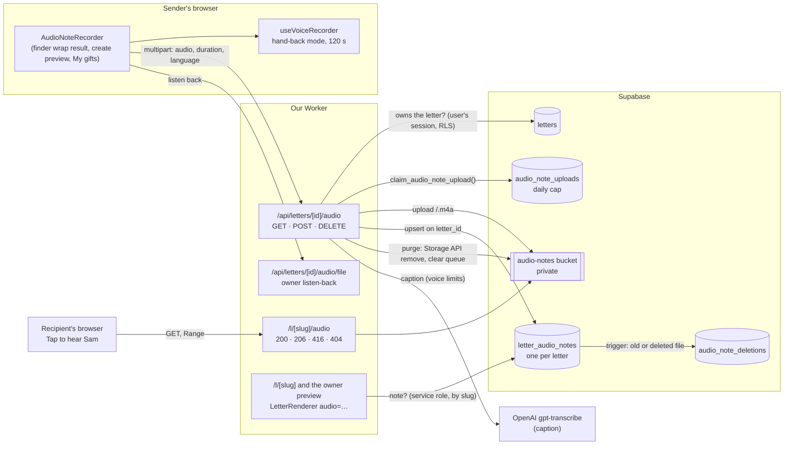
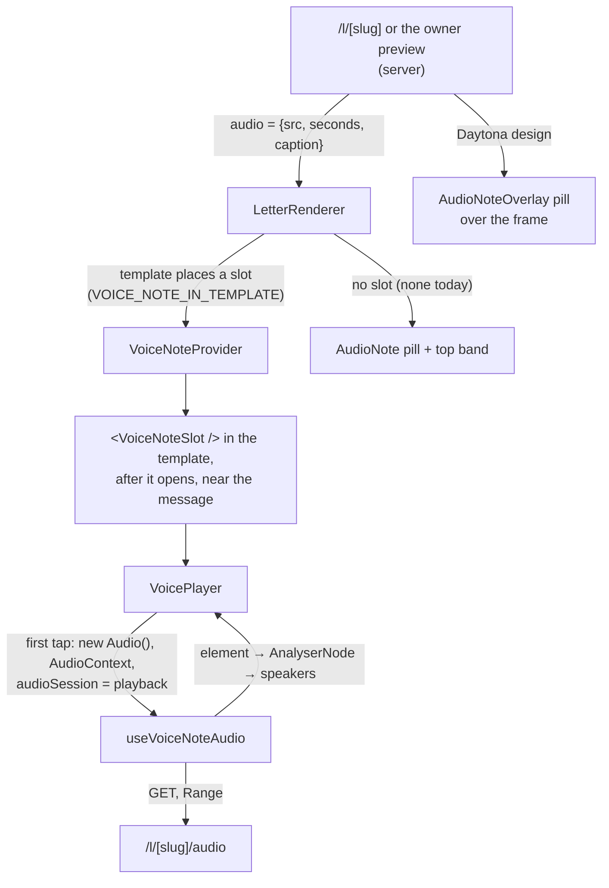

# Voice note in a gift

Issues #38 (recording, storing, serving) and #83 (the voice player inside every template). The decision is in [../plan.md](../plan.md), "Voice": the sender records up to two minutes, the note is stored in a private Supabase Storage bucket with the letter and served from our own domain at `/l/<slug>/audio`, and every template plays it when a note exists.

## What it does

After wrapping a gift in the finder, beside the create page's preview, and on every letter in My gifts, the sender can **record a voice note**: up to two minutes in their own voice. They listen back, then save it, record again or discard it; a saved note can be replaced or removed. The recipient opens the gift and, once the envelope is open or the gift unwrapped, finds **"A voice note from Sam"** beside the message: a round play button and a waveform whose bars move with Sam's voice while it plays, fill with colour as it goes and show the time left. Each template draws it in its own paper, ink and type. Over a personalised (Daytona) design, which is a sandboxed frame we don't control, the note stays a **"Tap to hear Sam"** pill at the top of the page. One tap plays it, another pauses it. Screen readers also get what was said, from a transcription. Guests (anonymous accounts) can add notes to the gifts they wrapped. Calendars have no notes.

## How it works

### The sender records and saves

1. `AudioNoteRecorder` needs only the letter's id. Given `initial` (My gifts passes it), it shows the saved note at once; otherwise it asks `GET /api/letters/<id>/audio`, and hides itself when the answer is `409 not_a_letter` (a calendar), so it can be mounted anywhere without knowing the gift's kind.
2. **Record a voice note** asks for the microphone and records with `useVoiceRecorder` in its hand-back mode (`onRecording`, `maxSeconds: 120`, `recordingTypes`): mp4/AAC first, because every browser plays it, then webm/opus and ogg/opus. Chrome records AAC; Firefox records webm. A timer shows "0:42 / 2:00", ten seconds before the end the live region warns, and at two minutes the recording stops by itself. Stop and Cancel keep focus where the hands are.
3. The recording is uploaded as soon as it stops, with no second tap (since 22 November: senders shared the link before pressing the old **Save voice note**, and the note never reached the gift). While it uploads the recorder shows "Saving it to the gift…". If the upload fails the recording stays in the browser as a draft with the reason: **Try again** uploads it, **Record again** starts over, **Discard** drops it. A saved note stays in place until a new one is saved. On the finder's "Ready to send" step the voice note sits above the link, under "Add your voice (optional)".
4. `POST /api/letters/<id>/audio` (multipart: `audio`, `duration`, up to three `language`s):
   1. refuses a cross-site post (403) and no session (401); anonymous sessions count;
   2. reads the letter with the **user's own client**, so row-level security decides, and compares the owner (404 for anyone else's or an unknown letter, 409 for a calendar);
   3. reads the body with a hard byte cap, then checks the recording: present, not empty, at most 5 MB (413), `audio/webm`, `audio/mp4`, `audio/ogg` or `audio/mpeg` only (415), at least half a second and at most two minutes plus three seconds of clock slack (400 / 413);
   4. claims today's upload with `claim_audio_note_upload()` (10 a day per user, 429 above);
   5. uploads the file with the service role under a **new random name**, `<letter id>/<uuid>.<ext>`, then **upserts the one row per letter** on `letter_id`. If the row cannot be written, the file is deleted again (or queued, if even that fails) and the day's claim is released;
   6. purges the deletion queue (below), which removes the file of the note it replaced;
   7. makes the **caption**: the voice-input transcription (`lib/voice`), claimed against the same per-user and site-wide voice limits; it is skipped for ogg (OpenAI cannot read it), without `OPENAI_API_KEY`, over the limits or when OpenAI fails, and the note is saved without one;
   8. answers `{ note: { seconds, caption, mimeType, sizeBytes, updatedAt, src } }`, where `src` is the owner's own listen-back route.
5. In the finder and on the create page the preview frame reloads after a save or a removal, so the sender sees the button appear on the page.
   The recorder names the recipient by the whole name the sender gave, with a verb that agrees: "Anna hears it with one tap on the gift.", "Our friends hear it …" (before issue #62 it took the first word, "our hears it").
6. **Remove** asks first ("Remove the voice note? The gift stays as it is."), then `DELETE /api/letters/<id>/audio` deletes the row and purges its file.

### Deleting files

Supabase deletes a file only through its Storage API; deleting its row in `storage.objects` with SQL leaves the file orphaned. So the database records every file that has to go: a trigger on `letter_audio_notes` inserts the old path into `audio_note_deletions` when a note is **deleted** (on its own, with its letter, or with its owner's account, through the cascades) or **gets a new file**. `purgeDeletedAudio()` removes up to 20 queued files through the Storage API and clears them from the queue; it runs after every upload and removal, and is safe to run again (removing a missing file succeeds). A deleted note is unreachable at once, because the audio route reads the row; its file goes on the next purge.

### The recipient hears it

1. `/l/<slug>` looks the note up on the server (`getPublicAudioNote`, service role, by exact slug, only for a letter that is a letter and has valid content) next to the design lookup, and passes `{ src: "/l/<slug>/audio?v=<file id>", seconds, caption }` to `<LetterRenderer audio>`. The owner preview (`/create/<id>/preview`, which the finder's wrap result and the create page show in a frame) passes the owner's route instead. A failed lookup shows the page without a note.
2. **Inside the template (issue #83).** Every letter template places `<VoiceNoteSlot />` in its own story; `VOICE_NOTE_IN_TEMPLATE` in `voice-player-model.ts` lists them, typed by template id so a new template has to decide. For those, the renderer hands the note to the template through `VoiceNoteProvider` (a small React context) and draws neither the pill nor the band below. Where each template puts it:
   - **Classic envelope:** on the letter, under the ornament, above the first paragraph.
   - **Gift reveal, 3D gift box, party pop box:** at the top of the note card, under the gift card, with a rule before the message.
   - **3D wedding envelope:** at the top of the hosts' note, under the maps and calendar buttons.
   - **Wedding invitation:** centred on the engraved card, under the message and above the date.
   - **Party invitation:** a paper pill with the accent button, between the message and the ticket.
   - **Treasure map:** a dashed margin note in ink on the parchment, above the letter.
   - **Postcard:** under the card, once it has been turned to the written side (at once with reduced motion, where both sides show).

   The player (`voice-player.tsx`): a 52 px round button, "A voice note from Sam" in the template's display face (first name; a group whole: "Lea and Max"), the length before playing and the time left after ("-0:31"), and 34 bars. `tone="paper"` takes the palette's paper, ink, deep button and paper accent; `tone="page"` the page's ink and accent. Templates fine-tune it with `--vp-*` CSS variables (button, played and resting bar colours, surface, font, size).

   **The waves.** At rest the bars sit in a gentle, voice-like shape seeded from the note's URL, so the server and the browser draw the same bars. On the first tap, inside the click (iPhone Safari allows audio only there), `useVoiceNoteAudio` makes the `<audio>` element and an `AudioContext`, and routes the element through an `AnalyserNode` (FFT 256) to the speakers. Once a frame while playing, each bar follows one band of the low spectrum, where voices are, mixed with the overall loudness; bars rise fast and settle slowly, and the halo behind the button grows with the voice. The played part fills with colour by a clip-path sweep read from `currentTime`. On pause the bars ease back to rest and the animation stops. The bars, sweep and halo are written straight to the DOM in `requestAnimationFrame`, without React renders.

   **iPhones and the silent switch.** Web Audio on an iPhone is muted by the silent switch; `<audio>` is not. So the hook sets `navigator.audioSession.type = "playback"` (Safari 17 and later), which plays through the switch, and on an iPhone or iPad without that API it never routes through Web Audio: the note plays from the element and the bars breathe instead of following the voice. The same fallback covers any browser where the context will not start; a context is only connected once it is running, so a suspended one can never silence the note.

3. **The pill (Daytona designs, and any template without a slot).** The renderer puts `AudioNote` first in the page (first on screen, so first for keyboards and screen readers) and reserves a band for it at the top: every template draws its page in a top-level `<main>` whose first screen is `min-h-[100svh]`; with a note, `<main>` gets the band as top padding (its own background, stars and gradient fill it, so there is no seam) and each first-screen block gets that much less height, so a template's own button at the bottom of the first screen (the 3D box's "Open your gift") stays on it. Over a Daytona design, the frame starts below the band, which takes the letter's page colour.
4. Nothing is fetched until the first tap, in the player and the pill. The pill's button plays and pauses, shows "Sam 0:12 / 0:42" and a thin progress bar; the name is the signature when it is short ("Lea and Max", "Mum"), else the first name. Browsers often report Infinity as the length of a recorded file, so the stored length stands in until they know better.
5. `GET /l/<slug>/audio` reads the file through the Storage API and answers the whole file (200) or the byte range asked for (206 with `Content-Range`), 416 past the end, with `Accept-Ranges: bytes`, `Cache-Control: private, max-age=300`, an `ETag` (the file's random name; `If-Range` is honoured), `Cross-Origin-Resource-Policy: same-origin`, `nosniff`, `noindex` and `no-referrer`. Anything else, including a letter without content, a calendar or a demo slug, is a plain `404 Not found` with `no-store`.
6. Accessibility: in the player the button's name says what a tap does ("Play the voice note from Sam", "Pause the voice note from Sam"), the caption is its description ("Sam says: …"), a live region says "Playing the voice note from Sam.", "Paused." or that it could not play, and with reduced motion the bars stay still in their resting shape while the sweep and the time still move. The renderer drops a note whose URL is not a path on our own site (`isOwnAudioSrc`). In the pill, the button's name says what it does ("Tap to hear Sam", "Pause Sam's voice note"); the caption is its description, read once, with a verb that agrees with the sender ("Sam says:", "Lea and Max say:", issue #62); a live region says "Playing…", "Paused." or that it could not play; with reduced motion the bar jumps instead of gliding and nothing spins.

Link previews and page titles are unchanged ("A letter for Anna"): the caption never reaches metadata or the preview image.

## Pieces

| Piece | Job |
|---|---|
| `supabase/migrations/0008_audio_notes.sql` | The private `audio-notes` bucket (5 MB, four formats), `letter_audio_notes` (one per letter), the `audio_note_deletions` queue and its trigger, `audio_note_uploads` and `claim_audio_note_upload()` |
| `lib/audio/rules.ts` | Shared by browser and server: limits, formats and file endings, the recording order, the Range parser, URLs and versions, error codes and messages, playback maths |
| `lib/audio/upload.ts` | Reads and checks an upload with a byte cap |
| `lib/audio/store.ts` | Ownership, the daily cap, save, caption, delete, the purge, downloads and the public lookup. Server only |
| `lib/audio/caption.ts` | The caption through `lib/voice` (claim, OpenAI, settle or release). Server only |
| `lib/audio/serve.ts` | The 200 / 206 / 416 answers and their headers |
| `app/api/letters/[id]/audio/route.ts` | `GET` (the note), `POST` (save or replace), `DELETE` (remove), owner only |
| `app/api/letters/[id]/audio/file/route.ts` | The owner's listen-back, whatever state the letter is in |
| `app/(public)/l/[slug]/audio/route.ts` | The recipient's audio, from our own domain |
| `app/(public)/l/[slug]/page.tsx`, `app/(owner)/create/[id]/preview/page.tsx` | Fill `audio` on the server; the design overlay |
| `components/letters/voice-player.tsx` | `VoicePlayer` (button, waveform, sweep, time, caption, live region), `VoiceNoteProvider` and `VoiceNoteSlot` (issue #83) |
| `components/letters/use-voice-note-audio.ts` | The `<audio>` element and, on the first tap, the AudioContext, the audio session and the AnalyserNode |
| `components/letters/voice-player-model.ts` | Pure: which templates place a slot, `isOwnAudioSrc`, the resting shape, bars from the analyser, the words and the time left |
| `components/letters/templates/*` | Each letter template places `<VoiceNoteSlot />` near its message |
| `components/letters/audio-note.tsx` | `AudioNote` ("Tap to hear"), `AudioNoteOverlay` (over a design), `AUDIO_SPACE_CSS` (the band): for designs and templates without a slot |
| `components/letters/registry.tsx` | The optional `audio` prop on `LetterRenderer`; picks the slot or the pill and wraps the template in `VoiceNoteProvider` |
| `public/dev/voice-note.m4a`, `app/dev/templates/` | The workbench's sample note (7 s of macOS `say`, AAC, 42 KB) and `?audio=1` on every template, with links under "With a voice note" |
| `components/voice/audio-note-recorder.tsx`, `audio-note-model.ts` | The recorder and its pure state machine and API calls |
| `components/voice/use-voice-recorder.ts`, `recorder-state.ts` | Gained `maxSeconds`, `recordingTypes` and the `onRecording` hand-back mode; without them the message box behaves as before |
| `components/voice/use-audio-player.ts` | Play, pause and progress for both sides |
| `components/finder/wrap-view.tsx`, `components/create/preview-pane.tsx`, `components/app/gift-card.tsx` (with `gifts-view.tsx` and `app/(app)/dashboard/gifts/page.tsx`) | Where the recorder is mounted |
| `OPENAI_API_KEY`, `MAJNU_DAILY_VOICE_CAP` | Shared with voice input: without the key there are no captions; captions count against the voice caps |

## Data and privacy

- **The file** is in the private `audio-notes` bucket. It has no policies on `storage.objects`, so neither `anon` nor `authenticated` can list, read or write it; only server code with the service-role key touches it. Recipients reach it only through `/l/<slug>/audio`, which streams it from our domain for letters that have content.
- **`letter_audio_notes`** holds one row per letter: the letter, its owner, the file's path, type, size, length, the caption and timestamps. Row-level security is on; owners can read their own rows; there are no grants for `anon` and no writes for `authenticated`. Every write is server code after an ownership check with the user's own session.
- **`audio_note_deletions`** and **`audio_note_uploads`** are server-only (the latter readable by its user). Upload rows older than seven days are deleted on the next claim.
- **Who can hear it:** anyone with the gift's link, like the gift itself. Browsers may keep it for five minutes (`private`); shared proxies and CDNs may not keep it at all. Another site cannot embed it (`Cross-Origin-Resource-Policy: same-origin`).
- **How long it is kept:** until the sender removes or replaces it, or the gift or the account is deleted. The row goes at once; the file goes on the next purge.
- **OpenAI** receives the recording once, for the caption, with the language hints and nothing else (no user id, no letter). The caption is stored with the note for screen readers. Neither the audio nor the caption is ever logged; the routes log status codes and error messages only (a test checks that the caption never reaches the logs).
- The privacy page has a paragraph, "Voice notes in gifts".

## Limits and costs

- **Per note:** two minutes (the recorder stops at the limit; the route refuses a declared length over 123 seconds) and 5 MB (the route and the bucket). Chrome's AAC came out at about 100 kbit/s in the live check (136 KB for 10.7 s; Chrome ignores the 48 kbit/s asked for), so two minutes is about 1.5 MB.
- **Per user per UTC day:** 10 uploads (`AUDIO_NOTE_LIMITS.uploadsPerDay`); replacing counts, listening and removing do not. Letters themselves are capped at 5 a day, so one account stores at most a few notes a day.
- **Captions** count against the voice-input limits (20 transcriptions or 10 minutes per user per day, `MAJNU_DAILY_VOICE_CAP` site-wide). `gpt-transcribe` is $0.0045 a minute, so a two-minute caption costs about $0.009.
- **Serving:** each request reads the whole file from Storage and answers the asked range from it; at 5 MB at most that is cheap, and Safari makes two or three requests per play.

## How it was checked

- **Unit tests** (`npm test`, 79 new in six files):
  - `tests/unit/app/api/letters/audio/route.test.ts` runs against an in-memory Supabase stand-in (`tests/unit/lib/audio/fake-supabase.ts`) that mirrors 0008's one-note-per-letter constraint and its deletion trigger. It covers: saving with the caption; the exact request OpenAI gets; replacing (one row, the old file deleted); guests; no caption when transcription fails or is off, or for ogg; the caption never logged; 401, 403, 404 for a malformed id and for someone else's letter (nothing stored, no claim); 409 for calendars; 415, 413 by file and by `Content-Length`, too long, too short, empty, missing fields; the daily cap; the claim released and nothing stored when the upload fails; the file deleted when its row fails, and queued when even that fails; GET, listen-back with Range, and DELETE.
  - `tests/unit/app/l/audio/route.test.ts`: 200, 206 (including Safari's `bytes=0-1`), 416, the headers, 404 for unknown, malformed, demo, content-less, invalid and calendar letters and for no note, **deletion with the letter** (404 at once, the file gone after the purge), 500 when Storage fails, and the purge keeping its queue when Storage refuses and working in batches.
  - `tests/unit/lib/audio/rules.test.ts` and `serve.test.ts`: formats, every Range form, If-Range, HEAD, captions, URLs, the route's answers.
  - `tests/unit/components/voice/recorder-options.test.ts` and `audio-note-model.test.ts`: the two-minute limit, the hand-back mode, the message box unchanged without options (`toStrictEqual`), the recording order, and every transition of the recorder. The existing voice-input tests pass unchanged.
- **The migration** was run in PGlite (Postgres 17) with stand-ins for Supabase's roles, `auth.users`, `auth.uid()` and `storage.buckets`: 30 checks, including one note per letter, the path, type, size and length checks, replacing and deleting (on its own, with the letter, with the account as `supabase_auth_admin`) queueing the file, and `anon` and `authenticated` refused on every write, the queue and the function. The lead applied it to production after a dry run and checked with only the anon key that the three tables and the function are refused (42501) and that listing the bucket returns nothing.
- **Live, 22 November**, against the dev server and the production database, with a temporary confirmed user and letters made with the service-role key and deleted afterwards (letters, notes, files, queue rows and users confirmed gone):
  - curl with the user's session: a webm/opus note made with macOS `say` saved with the right caption; replaced with an m4a, the bucket held only the new file and the queue was empty; refusals 401, 403, 404, 413 (130 s and 6 MB), 415 (wav).
  - curl on `/l/<slug>/audio`: 200 with the uploaded bytes, `bytes=0-1` and `bytes=30000-` 206 with exactly those bytes, past the end 416, 404 for an unknown slug, a letter without content and a demo slug; the owner's route 200 and 206 with the session, 404 without.
  - In the browser (Chrome, isolated profile), every letter template: classic envelope, gift reveal, postcard, wedding and party invitations, 3D gift box, party box and treasure map, closed and opened, at 375 × 667 and 375 × 812: nothing of the template under the button (each template's first line now starts at 96 to 181 px, below the button's 54 px), each first-screen button still on the first screen (the 3D box's at 577 to 627 of 667), no horizontal scroll. At 1440 × 900 the button sits above the centred template. Over a Daytona design (a test design with a header bar at its top edge), the design's header is fully visible below the band at 375 px.
  - Playing with a real click: the browser fetched `/l/<slug>/audio` from our domain with 206, the bar moved, the name changed to "Pause Mila's voice note"; Tab reaches the button first, with a visible focus ring, and Enter plays; reduced motion on throughout the template pass; no console errors on the gift page.
  - The sender's side with a fake microphone (the saved clip played through WebAudio into a MediaStream, started by a real click): on My gifts at 375 px, Record again → 0:10 / 2:00 → Stop → Listen back → Save; Chrome recorded mp4/AAC, the caption came back from OpenAI, focus moved to Listen and the live region said "Saved. Kai can hear it with one tap on the gift." On the create page at 1440 px, the preview showed the button and the recorder its saved note under the share panel; Remove → "Remove it" by keyboard removed the note, the preview reloaded without the button, and the row and the file were gone (the audio route then 404). The finder's wrap result was checked at 375 and 1440 px on the `/dev/finder` workbench (its letter id is a placeholder, so the recorder there shows "This gift isn't yours or no longer exists"); wrapping for real needs the model, whose key is over its limit tonight.
  - Three OpenAI transcriptions in all, a few seconds each.
- **Not checked:** real iOS Safari and Android Chrome with a real microphone (the "done when" of #38 asks for a note recorded on one phone and heard on another), Firefox, a real two-minute recording, and the routes on Cloudflare Workers (only `next dev`). Next.js's Node server drops `Content-Length` from route answers (`FORBIDDEN_HEADERS` in `next/dist/server/send-response.js`), so the 206 answers went out chunked with a correct `Content-Range`; whether Safari plays them that way, and what the Worker sends, is unverified.

### The voice player (issue #83), 22 November

- **Unit tests:** `tests/unit/components/letters/voice-player-model.test.ts` (38): every letter template places a slot; `isOwnAudioSrc` accepts our paths and refuses other origins, `//host`, `/\host`, `data:`, `blob:` and `javascript:`; the resting shape is stable per note, differs between notes, stays in range and has no jumps; the bins sit in the voice range in a scattered order; loudness; bars rise with sound, fall in silence, rise faster than they fall, breathe without an analyser and settle back to rest; the words, time left and live-region status. `fixture-letter.test.ts` checks the sample note is an MP4 in `public/dev` on our own domain.
- **In the browser** (isolated Chrome, `next dev`, the workbench's `?audio=1`): at 375 × 812, with reduced motion, all nine letter templates: before opening no pill, no band (`<main>` padding 0) and no audio request; after opening the player in its place; a tap played it (the `.m4a` fetched from our own domain), the sweep and the time moved, the bars stayed still, a second tap paused it ("Paused."), no sideways scroll. With motion on, on the classic envelope at 375 px and the gift reveal at 1440 × 900: sampled every 300 ms, the bars followed the voice (about 15 % between phrases, 50 to 80 % while speaking), the halo grew with loudness, the sweep moved smoothly and the time counted down; at the end it returned to "0:07" and the resting shape. Keyboard: Tab reaches the button with a visible ring after the gift card, Enter plays, and the name becomes "Pause the voice note from Lea and Max". No console errors or warnings.
- **Not checked:** a real iPhone (the silent switch, `audioSession`, the fallback on iOS before 17), Android Chrome, Firefox, a stored note on `/l/<slug>` (the dev data has none, so the fixture clip stood in), a Daytona design's pill (that code did not change), and the pill's fallback for a template without a slot (none exists today).

## Open questions

- **iPhone checks for the player.** The audio-session handling follows WebKit's documented behaviour but has not run on a phone. If a note is silent on an iPhone in silent mode, the quick fix is to stop routing through Web Audio there (`unrouted`), at the cost of breathing bars.
- **Seeking.** The waveform is not a slider: a recipient cannot jump to a point in the note. A scrubber needs a real `role="slider"` with keyboard steps.

- **Safari and `Content-Length`.** See above. If Safari refuses to play, the fix is on the serving side (for example answering from a Worker route outside Next's response handling), not in the browser.
- **webm notes on older iPhones.** Chrome before mp4 recording and Firefox record webm/opus, which iOS Safari before 17.4 may not play. Most senders now record AAC; a server-side transcode is not possible in a Worker.
- **A scheduled purge.** Files of deleted gifts go on the next upload or removal by anyone. If letters start being deleted in bulk (account deletion), a daily cron calling `purgeDeletedAudio()` would empty the queue promptly.
- **The renderer's band depends on a template convention** (now only for a template without a slot) (a top-level `<main>` with a `min-h-[100svh]` first screen). A new template that breaks it would sit under the button; the overlap check in this page's live notes is how to catch it.
- **Captions for people who cannot hear.** The caption reaches screen readers only; a visible "Read it" toggle on the gift page would help deaf recipients.
- **The privacy page's list of providers** does not name OpenAI yet (also noted for voice input).
- **Unfinished gifts** show the recorder on My gifts; a note there plays for the owner but only reaches recipients once the page is built.
