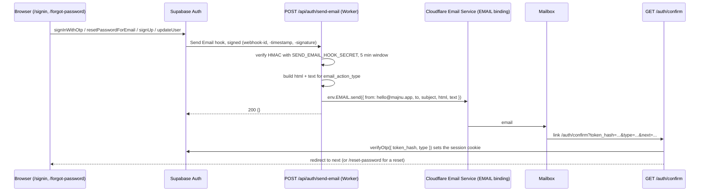

# Account emails (Cloudflare Email Service)

## What it does

Every account email Majnu sends comes from **Majnu &lt;hello@majnu.app&gt;** in the Night Post look: the sign-up confirmation, the sign-in link, the password reset, an invitation, the email-change confirmation and the reauthentication code. On the sign-in page people can now choose **Email me a sign-in link** instead of typing a password, or **Forgot your password?** to get a reset link and choose a new password (issue #84).

Supabase's built-in sender only reaches the project's own team, two emails an hour, so before this change these emails never reached real users and email confirmation had to be switched off.

## How it works

1. A form asks Supabase for an email: `signInWithOtp` (sign-in link, `shouldCreateUser: false`), `resetPasswordForEmail`, `signUp`, or `updateUser` (a guest adding an email). Each passes `/auth/callback?next=...` as its redirect, the address already on Supabase's allow list.
2. With the Send Email hook on, Supabase does not send the email itself. It POSTs the user and `email_data` to `https://majnu.app/api/auth/send-email`, signed in the Standard Webhooks format.
3. The route (`lib/email/hook.ts`) checks the signature: HMAC-SHA256 over `<webhook-id>.<webhook-timestamp>.<body>` with the base64 key from `SEND_EMAIL_HOOK_SECRET`, compared in constant time, and a timestamp within five minutes. Anything unsigned, stale, tampered or signed with another secret gets 401 and nothing is sent.
4. `lib/email/auth-emails.ts` builds the email for `email_action_type`. Every link points at **our** `/auth/confirm` with the token hash, the type and a same-site `next` taken from `redirect_to`. For an email change with "Secure email change" on, two emails go out, one to each address, with Supabase's reversed hash names mapped as its docs describe (`token_hash_new` with the current address, `token_hash` with the new one). Reauthentication gets the six-digit code and no link. Security notices (`password_changed_notification` and the like) get a short notice if they are switched on.
5. `lib/email/sender.ts` sends through the Worker's `send_email` binding `EMAIL`, from `hello@majnu.app` (the binding is restricted to that address in `wrangler.jsonc`). The route answers Supabase `200 {}`; on a send failure `503` with `retry-after`, which Supabase retries within its five-second budget; otherwise `{ "error": { "http_code", "message" } }`.
6. `/auth/confirm` calls `verifyOtp({ token_hash, type })` on the server, which sets the session cookie, then redirects: a reset to `/reset-password`, everything else to `next` or the gift finder. Errors land on `/signin?auth_error=<code>`. Unlike the PKCE code exchange in `/auth/callback`, this needs nothing stored in the browser that asked, so a link opened in a mail app or another browser works.
7. `/reset-password` shows the new-password form when the browser is signed in and calls `updateUser({ password })`, then goes to the gift finder. Signed out, it explains how to get a new link.

**Sender address.** `hello@majnu.app`, not `no-reply@`: it is the contact address already printed on the sign-in page, and Email Routing forwards it to the operator, so a reply ("this wasn't me") reaches a person.

**No code beside a link.** Supabase also sends a six-digit code with link emails. Majnu has no field to type a code into, so the code would only confuse; it is shown only in the reauthentication email, which has no link. Adding a code field later is a one-line change in `buildAuthEmails`.

## Pieces

| Piece | Job |
|---|---|
| `app/api/auth/send-email/route.ts` | The hook endpoint Supabase calls. |
| `lib/email/hook.ts` | Signature check, payload check, build, send, and the answer Supabase expects. |
| `lib/email/webhook.ts` | Standard Webhooks verification with Web Crypto (constant-time, five-minute window, several signatures during rotation). |
| `lib/email/auth-emails.ts` | Wording, links and the html and text of each email. Pure. |
| `lib/email/sender.ts` | The `EMAIL` binding through `getCloudflareContext()`; in `next dev` it logs the email instead of sending. |
| `app/auth/confirm/route.ts` | Verifies the token hash from an email link and signs the browser in. |
| `components/auth/sign-in-form.tsx` | "Email me a sign-in link" (uses only the email field) and the "Forgot your password?" link. |
| `components/auth/forgot-password-form.tsx`, `app/(auth)/forgot-password/page.tsx` | Asks for a reset link. |
| `components/auth/reset-password-form.tsx`, `app/(auth)/reset-password/page.tsx` | Sets the new password. |
| `components/auth/email-auth.ts` | `sendSignInLink` and `sendPasswordReset`, with the Turnstile token. |
| `public/brand/majnu-wordmark-on-dark.png` | The wordmark as PNG for mail apps that do not show SVG (Gmail). Rendered from the SVG. |
| `wrangler.jsonc` | `"send_email": [{ "name": "EMAIL", "allowed_sender_addresses": ["hello@majnu.app"] }]`. |
| `SEND_EMAIL_HOOK_SECRET` | The hook secret, `v1,whsec_<base64>`. Server only; uploaded with `npm run cf:secrets`. |

## Data and privacy

- The route stores nothing. The email address and the link exist only in the request, the email and Cloudflare Email Service's delivery logs. Our logs carry the email type on failure, never the address or the link.
- The hook secret never reaches the browser. Without a usable secret the route refuses every call (401) rather than sending unchecked.
- The sign-in link and reset forms answer the same whether or not an account exists ("If there's a Majnu account for ..."), so they do not reveal who has an account.
- `next` in a link is only ever a same-site path (`safeNextPath`); an outside `redirect_to` is dropped.
- The privacy page names Cloudflare Email Service as the sender of account emails.

## Limits and costs

- Supabase's own email rate limits still apply (Authentication → Rate Limits); with the hook on they count hook calls.
- Cloudflare Email Service bills per email sent on the Workers paid plan; account emails are a handful per user.
- Supabase gives the hook five seconds in total, retries included. A send is one binding call.
- Email links work once. A mail scanner that opens links before the person does (some company mail systems) can use one up; the person then asks for a new link.

## How it was checked

- **Unit tests** (`tests/unit/lib/email/`): the signature check (valid, secret with or without prefix, rotation, wrong secret, tampered body, changed timestamp, stale and future timestamps, unsigned, garbage, missing secret); every email type's subject, recipient and link in html and text, the two-email secure change, the one-email guest change, notices, escaping, no brand-banned words; the hook answering 200 with the stub sender called, 401 without sending, 400, 503 with `retry-after`, 500 without a binding. `tests/unit/components/auth/email-auth.test.ts` covers `sendSignInLink` (no account created, the same answer for an unknown address) and `sendPasswordReset`.
- **`next dev` with `curl`**: unsigned → 401; signed with a throwaway secret → `200 {}` and the email in the server log; the same signature with a changed body → 401; a timestamp ten minutes old → 401.
- **`/auth/confirm` end to end** (isolated Chrome, a temporary user created and then deleted with the service-role key): the admin `generateLink` recovery token hash opened at `/auth/confirm?token_hash=...&type=recovery` signed the browser in and went to `/reset-password`; a mismatched confirmation was refused; the new password was saved, the page went to the gift finder, and a password sign-in with the new password worked.
- **Browser**, 375 px and 1440 px: the sign-in page with both new options (an empty email shows the field error; an address without an account shows the neutral message, Supabase answered 422 `otp_disabled`), `/forgot-password`, `/reset-password` signed out and signed in. No horizontal scroll. The only console messages were Turnstile's localhost errors (600010), which were already there.
- **Emails rendered to HTML** and looked at (sign-in link at 375 px, code email at 1440 px).
- **Not checked:** a real send. The `EMAIL` binding exists only on the deployed Worker, so `next dev` cannot send; the lead checks it after deploy with the hook on (see docs/setup.md).

## Open questions

- A field for the six-digit code would make sign-in work even when a mail scanner uses the link up first.
- Switch "Confirm email" back on in Supabase once a real email has arrived.
