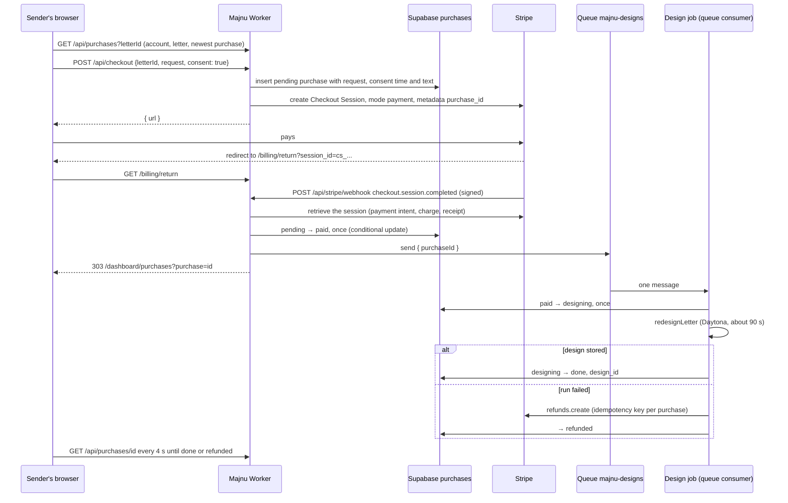

# Billing: the personalised wrapper

## What it does

Majnu is free: finding a gift, wrapping it in our designs, letters, invitations, gift lists, calendars (with a free account), sharing and open tracking cost nothing. The one thing a sender can buy is a **personalised wrapper**: a design Majnu's designer makes for one gift, **€2.99 once**, VAT included ([business-plan.md](../business-plan.md)). On a wrapped gift the sender taps "Make it unique, €2.99", describes the look they want, ticks a box agreeing that the design starts at once (which ends their right of withdrawal), and pays on a Stripe-hosted page. They come back to the Purchases tab, which shows the design being made and then links to the gift page that shows it. If the design cannot be made, the payment is refunded automatically.

There is no subscription. The Full moon subscription built earlier (issue #14) and its code are removed.

A **coupon code** makes the wrapper free: "Have a code?" in the same dialog skips Stripe, the consent box and (for guests) the account step, and a failed run gives the code its use back instead of a refund. That path is described in [coupons.md](coupons.md). Since issue #85, everyone also gets **three free designs per internet connection per day**: while some are left, the dialog offers only those, without an account step, consent or code ([free-designs.md](free-designs.md)). Everything below is the paid path, which both leave unchanged.

## How it works

### Opening Checkout

1. The "Make it unique" button ([`make-it-unique.tsx`](../../components/wrapper/make-it-unique.tsx)) sits under the share panel on the finder's wrapped gift ([`wrap-view.tsx`](../../components/finder/wrap-view.tsx)) and on the letter preview in the app ([`preview-pane.tsx`](../../components/create/preview-pane.tsx)). It first asks [`GET /api/purchases?letterId=`](../../app/api/purchases/route.ts) where the letter stands: nothing is shown for a calendar or an unbuilt letter, a design on its way or done shows its status instead, and otherwise the button opens a dialog (not a new page).
2. A **guest** (an anonymous account from the finder) is asked to create a free account first, with links to `/signup?next=/create/<letterId>` and `/signin?next=...`. Signing up upgrades the guest account in place ([guest-accounts.md](guest-accounts.md)), so the gift is already theirs, and the same button waits on the gift in the app. The `next` path is checked by [`next-path.ts`](../../lib/billing/next-path.ts) (same-site only).
3. A **member** writes a short design request (3 to 500 characters, with example chips) and ticks a required box with the sentence in `WRAPPER_CONSENT_TEXT` ([`lib/plans.ts`](../../lib/plans.ts)): "Start making my design straight away. I understand that because it is made just for me, I lose my right of withdrawal once you start." The dialog posts JSON to [`POST /api/checkout`](../../app/api/checkout/route.ts).
4. [`startWrapperCheckout()`](../../lib/billing/service.ts) refuses, before reading or writing anything, unless `consent` is exactly `true`; then refuses an empty or too-long request, a guest, a letter that is not the sender's (read through row-level security), a calendar and an unbuilt letter. If a paid design for the letter is already on its way it refuses with "in progress". Earlier unpaid Checkouts for the same letter are expired (`checkout.sessions.expire`), so one gift is not paid for twice from two tabs; one that turns out to be paid already is applied instead of selling a second wrapper.
5. It inserts a **pending** purchase with the request, `consent_at` and the server's own copy of the consent sentence (never text the browser sent), then creates a Checkout Session: `mode: "payment"`, one line item with the price in `STRIPE_PRICE_WRAPPER`, `client_reference_id` = the user id, `customer_email`, `metadata` and `payment_intent_data.metadata` = `{ purchase_id, letter_id, user_id }`, `success_url` `/billing/return?session_id={CHECKOUT_SESSION_ID}`, `cancel_url` the same-site page the dialog was opened on, `expires_at` one hour, `managed_payments: { enabled: false }` (see below), `integration_identifier`, and the idempotency key `majnu-wrapper-checkout-<purchase id>`. No payment methods are listed in code: Stripe shows those enabled in the Dashboard. If Stripe fails, the pending row is deleted and the dialog says nothing was charged.

### Payment, return and webhook

- **The webhook** ([`POST /api/stripe/webhook`](../../app/api/stripe/webhook/route.ts)) is the source of truth. It verifies `Stripe-Signature` against `STRIPE_WEBHOOK_SECRET` with `constructEventAsync` and Web Crypto (400 if invalid, 413 above 512 KB, 500 if processing fails so Stripe retries, 200 otherwise). It handles `checkout.session.completed` and `checkout.session.async_payment_succeeded` (fulfilled only when `payment_status` is not `unpaid`, so a delayed method waits for its success event), and `checkout.session.async_payment_failed` and `checkout.session.expired` (the pending row is deleted: it never became a purchase). Everything else gets 200 and is ignored.
- **The return page** ([`GET /billing/return`](../../app/billing/return/route.ts)) does the same step for the sender's own session, so the design starts at once even if the webhook is slow, then redirects to `/dashboard/purchases?purchase=<id>` (`&billing=processing` for a delayed method). Only the session id comes from the URL; the session must belong to the signed-in user and to one of their purchases.
- Both retrieve the session from Stripe with `payment_intent.latest_charge` expanded and call `applyPaidSession()`: a **conditional update** `pending → paid` that also requires the session id on file, so a session can only pay for its own purchase and a replay changes nothing. It records the payment intent, the charge's `receipt_url` and the amount Checkout charged. Whenever the purchase is (still) `paid` afterwards, it is handed to the design queue; a duplicate hand-over is harmless (below).
- **Paid twice**: the partial unique index `purchases_one_run_per_letter_idx` allows one `paid` or `designing` purchase per letter. A second payment for the same letter fails the update with 23505 and is refunded at once.

### The design job and refunds

[`enqueueDesign()`](../../lib/billing/queue.ts) sends `{ purchaseId }` to the `DESIGN_QUEUE` binding on Workers; in `next dev` it runs the job in the background of the dev server; anywhere else without a queue the purchase stays `paid` for `node scripts/daytona/run-purchase.mts <purchaseId>`. The queue consumer ([`worker.ts`](../../worker.ts), [`consumer.ts`](../../lib/billing/consumer.ts)) calls [`runPurchaseDesign()`](../../lib/billing/fulfil.ts):

1. Claim: `paid → designing`, a conditional update, so a duplicate message or a second consumer finds nothing to claim and the paid run happens once.
2. Run [`redesignLetter()`](../../lib/daytona/redesign.ts) ([daytona-redesign.md](daytona-redesign.md)), which checks and stores the page in `letter_designs`.
3. `designing → done` with `design_id`; `/l/<slug>` shows the design from then on.
4. If anything failed, [`refundPurchase()`](../../lib/billing/refunds.ts) calls `refunds.create({ payment_intent, reason: "requested_by_customer" })` with the idempotency key `majnu-wrapper-refund-<purchase id>`, so any retry gets the same refund back, and marks the purchase `refunded` with the refund id and a `failure_reason` the owner cannot read. If the refund itself fails, the purchase is marked `failed` for a refund by hand.

A message whose consumer threw or died goes (with `max_retries: 0`) to `majnu-designs-dlq`, whose consumer refunds the purchase if it is still `paid` or `designing`.

### What the sender sees

- **Status card** ([`purchase-status.tsx`](../../components/wrapper/purchase-status.tsx)): polls [`GET /api/purchases/<id>`](../../app/api/purchases/[id]/route.ts) every 4 seconds (for at most 15 minutes) and announces each change politely: "Paid, starting soon", "Being designed", "Ready" with "Open the gift page", or "Refunded".
- **Purchases tab** ([`app/(app)/dashboard/purchases/`](../../app/(app)/dashboard/purchases/page.tsx)), which replaced the Plan tab (`/dashboard/plan` redirects there): every purchase that was paid, newest first, with the gift, the request, the date, the amount, the status, a link to the gift page when done and Stripe's receipt. The purchase just paid for, and any still in progress, get the live status card; the list refreshes when one settles.

### Paid with a coupon code

Since issue #72 a purchase can also be paid with a coupon code ([coupons.md](coupons.md)): `POST /api/coupons/redeem` records it as `paid` with `amount_cents = 0` and `coupon_id`, without consent or Stripe ids, and hands it to the same queue. The design job treats it like any other purchase until a run fails: then `giveBack()` in [`refunds.ts`](../../lib/billing/refunds.ts) marks it `failed` and returns the code's use (`return_coupon_use()`), and never calls Stripe. The status card and the Purchases tab word it accordingly ("Code accepted, starting soon", "Your code works again", "Free with a code").

### Free designs

Since issue #85 a purchase can also be one of the day's three free designs ([free-designs.md](free-designs.md)): `POST /api/designs/free` records it as `paid` with `amount_cents = 0` and `free_day`, without consent, coupon or Stripe ids, and hands it to the same queue. A failed run marks it `failed` and gives the free design back (`return_free_design()`), never calling Stripe. The status card and the Purchases tab say "Free design, starting soon", "it didn't count" and "Free".

### Managed Payments

The Stripe account has **Managed Payments** (Stripe as merchant of record) switched on by default. It refuses `custom_text` and requires a product tax code, and it would make Stripe the seller, with its own fees and VAT handling. The business plan and the terms make Majnu the seller with prices including VAT, so sessions pass `managed_payments: { enabled: false }`. Whether to use Managed Payments instead (it would take over VAT outside Germany) is the developer's decision; switching needs a product tax code on the wrapper product, removing that flag, and rewording the terms.

## Pieces

| Piece | Job |
|---|---|
| [`lib/plans.ts`](../../lib/plans.ts) | The free tier and the wrapper: names, €2.99 (`priceCents: 299`, `eur`), features, the consent sentence. The landing page, Purchases tab, dialog and terms read it |
| [`lib/limits.ts`](../../lib/limits.ts) | The spending guard (100 letters a day, 200 chat turns per letter since 22 November) and "calendars need a real account". No plan gating |
| [`lib/billing/service.ts`](../../lib/billing/service.ts) | Opening Checkout, the return confirmation, the webhook events |
| [`lib/billing/purchases.ts`](../../lib/billing/purchases.ts) | Reads and conditional writes of `purchases` |
| [`lib/billing/refunds.ts`](../../lib/billing/refunds.ts) | The automatic refund |
| [`lib/billing/queue.ts`](../../lib/billing/queue.ts), [`consumer.ts`](../../lib/billing/consumer.ts), [`fulfil.ts`](../../lib/billing/fulfil.ts) | Handing a paid purchase to the job, the queue consumer, the job |
| [`lib/billing/view.ts`](../../lib/billing/view.ts) | What the browser is told about a purchase, and the status wording |
| [`lib/billing/stripe.ts`](../../lib/billing/stripe.ts) | The Stripe client (API `2026-11-18.endive`, fetch HTTP client, 2 retries), the price id, webhook verification |
| [`lib/billing/http.ts`](../../lib/billing/http.ts), [`next-path.ts`](../../lib/billing/next-path.ts) | Same-origin checks and redirects; the same-site `next` check |
| `POST /api/checkout`, `GET /billing/return`, `POST /api/stripe/webhook`, `GET /api/purchases`, `GET /api/purchases/[id]` | The routes |
| [`components/wrapper/`](../../components/wrapper/) | The button and dialog, the status card |
| `purchases` table ([`0007_purchases.sql`](../../supabase/migrations/0007_purchases.sql), `coupon_id` since [`0011_coupons.sql`](../../supabase/migrations/0011_coupons.sql)) | One row per wrapper, paid by card or with a coupon code |
| `STRIPE_SECRET_KEY`, `STRIPE_PRICE_WRAPPER`, `STRIPE_WEBHOOK_SECRET` | Server-only Worker secrets (`npm run cf:secrets`) |
| `DESIGN_QUEUE` binding, queues `majnu-designs` and `majnu-designs-dlq` | [`wrangler.jsonc`](../../wrangler.jsonc); `scripts/deploy.sh` creates the queues if missing |

The test-mode product is "Majnu personalised wrapper" (`prod_VfiOBakdbyQU8Z`) with the one-time price `price_1UeMy7Ieh8tCba0kv2rSa9af` (€2.99, `tax_behavior: inclusive`, lookup key `majnu_wrapper_eur_299`). `tests/smoke/stripe-wrapper-price.test.ts` checks that the configured price matches `lib/plans.ts`.

## Data and privacy

- **`purchases`** holds the owner, the letter (set to null if the letter is deleted, so the record of the payment stays), the request, the consent time and sentence, the amount and currency, the Stripe session, payment intent and refund ids, the receipt URL, the design, the status and its timestamps, and an internal `failure_reason`. Row-level security is on; owners read their own rows through a column grant that leaves `failure_reason` out (so `select *` fails for them); anon has nothing; only the service role writes. Rows are deleted with the user.
- **Stripe receives** the sender's email and the purchase, letter and user ids as metadata. We never see a card number. Stripe emails the receipt.
- The request and the letter go to Daytona and Anthropic to make the design ([daytona-redesign.md](daytona-redesign.md)). The privacy page names Stripe and Daytona.

## Limits and costs

- €2.99 per wrapper including VAT; Stripe's fee is about €0.29 on a standard EU card; one run costs about $0.26 in model use (capped at $3) plus sandbox time ([business-plan.md](../business-plan.md#unit-economics-estimates-to-be-replaced-by-measured-numbers)).
- One paid run per letter at a time; Checkout Sessions expire after an hour.
- The design request is at most 500 characters (the job accepts 2,000).
- **Fallback keys** (issue #67, [provider-fallbacks.md](provider-fallbacks.md)): the design job starts its sandbox with `DAYTONA_API_KEY_FALLBACK` when Daytona refuses the primary for its key, quota or billing. Claude Code gets `ANTHROPIC_API_KEY_FALLBACK` when a free token count shows the primary refused (as on 22 November, when the tier threshold stopped every run). A run on a fallback key reserves $4.50 (Anthropic) and about $0.06 (Daytona) against that key's $150 monthly cap before the sandbox starts, and settles with Claude Code's reported cost and the sandbox's running time. If no key can be used, or a cap is reached, the run fails before any sandbox starts and the purchase is refunded as for any failed run.

## How it was checked

- **Unit tests** in [`tests/unit/lib/billing/`](../../tests/unit/lib/billing/): `service.test.ts` (payment mode and the session's parameters; no Checkout without `consent === true`, and the stored consent is the server's sentence; refusals for guests, other people's letters, calendars, unbuilt letters, runs in progress; expiring an earlier open Checkout and applying an earlier paid one; webhook fulfilment from Stripe's current session; idempotent replays; delayed payment methods; a session that cannot pay for another purchase; refunding a second payment for the same letter; expired sessions; the return page), `fulfil.test.ts` (claim once, done with the design, refund on failure with the idempotency key, a failed refund marks it failed, the dead-letter path), `consumer.test.ts`, `queue.test.ts`, `stripe.test.ts`, `next-path.test.ts`; the route tests in [`tests/unit/app/`](../../tests/unit/app/); `limits.test.ts` (no plan gating left). The model and Daytona are faked in every test.
- **Live, in Stripe test mode, on a dev server (22 November):** a test user paid €2.99 with `4242 4242 4242 4242` from the dialog at 375 px. Stripe redirected to `/billing/return`, the purchase went `pending → paid → designing`, the job ran with `DAYTONA_SNAPSHOT` set to a snapshot that does not exist (so it failed before any model call; the Anthropic key is over its usage limit), and the payment was refunded automatically: in Stripe the payment intent succeeded for €2.99 with the purchase metadata and the refund `re_3UeNIhIeh8tCba0k1NMDcSLQ` succeeded for €2.99; in the database the row is `refunded` with the consent, receipt and refund id. The Purchases tab showed it as refunded with the receipt.
- **The webhook route, live:** test mode's webhook endpoint points at production, so it cannot reach a laptop. A correctly signed `checkout.session.completed` for the real session above, signed with `STRIPE_WEBHOOK_SECRET`, was posted to the dev server twice: both 200 and changed nothing (the purchase was already finished, no second refund); a tampered signature got 400.
- **Row-level security, live:** with the anon key, select and insert on `purchases` are refused (42501); the owner can read their purchases with explicit columns, but `failure_reason`, `select *`, update and insert are refused (42501); a second `paid` purchase for the same letter fails with 23505 and `done` without a design with 23514.
- **The other screens:** "Being designed" and "Ready" (with the gift page showing a stored design) were checked with a temporary row and a stand-in design, removed afterwards; the guest dialog with a mocked account state, since a guest session needs Turnstile.
- **Not verified:** a successful real design run after payment (the Anthropic key is over its usage limit until it is raised); the webhook arriving from Stripe itself at a deployed Worker with the new code; the queue consumer on Cloudflare (it runs only after a deploy); delayed payment methods; live mode.

## Open questions

- **Managed Payments** (above): keep it off, or let Stripe be the merchant of record and handle VAT.
- **The confirmation on a durable medium** that § 356 (5) BGB also asks for: the consent is stored with the purchase, but Stripe's receipt does not repeat it. Options: Checkout's post-payment invoice (`invoice_creation` with the consent in the footer, a small Stripe fee) or our own email.
- Disputes and early fraud warnings are not handled.
- Abandoned pending rows are deleted when their session expires (webhook) or when the sender opens Checkout again; with the webhook not reaching a laptop, some may remain in development.
