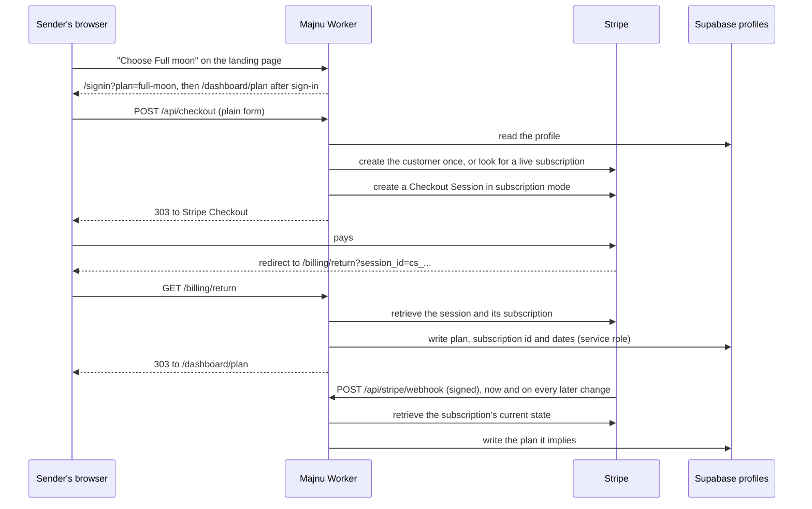

# Billing: Crescent and Full moon

## What it does

Majnu has two plans. **Crescent** is free: 3 gifts a month (letters, invitations and gift pages). **Full moon** costs €4.99 a month: unlimited gifts, advent calendars and countdowns, and gift research on the web. A sender upgrades on the Plan tab, pays on a Stripe-hosted page, comes back to Full moon at once, and can manage or cancel in Stripe's customer portal; a cancelled subscription stays on until the end of the paid period.

The whole flow is built, but **plans are not enforced yet**. Until Stripe takes live payments, `MAJNU_BILLING` stays unset: everyone gets Full moon features, the Plan tab says so, checkout sends people straight back, and only the spending guard applies.

## How it works

### Checkout

1. "Choose Full moon" on the landing page links to `/signin?plan=full-moon`. Email and Google sign-in carry that intent to `/dashboard/plan` through a `next` parameter that accepts only same-site paths ([`next-path.ts`](../../lib/billing/next-path.ts): exactly one leading `/`, never `//`, a backslash, a scheme, whitespace or control characters), so a crafted sign-in link cannot become an open redirect. The middleware applies the same check when a signed-in user lands on a sign-in page.
2. The Plan tab's button posts a plain HTML form to [`POST /api/checkout`](../../app/api/checkout/route.ts). The route refuses a post whose `Origin` names another site (403), sends a signed-out form to sign-in (or answers 401 to anything that is not a form), and while billing is off answers 303 back to the Plan tab.
3. [`startCheckout()`](../../lib/billing/service.ts) does nothing for a user already on Full moon. If the profile has a Stripe customer, it first asks Stripe for a live subscription on that customer: one the database missed (a lost webhook, a tab closed before the return page) is applied instead of charged again. Otherwise it creates the customer once, with the idempotency key `majnu-customer-<user id>` so a double click or two tabs get one customer, and stores its id only if the profile has none yet.
4. It creates a Checkout Session in `subscription` mode with the price from `STRIPE_PRICE_FULL_MOON`, `client_reference_id` set to the user id, `success_url` `/billing/return?session_id={CHECKOUT_SESSION_ID}`, `cancel_url` `/dashboard/plan`, and an `integration_identifier` that tags the flow in the Stripe Dashboard. No payment methods are listed in code: Stripe shows the ones enabled in the Dashboard. The route answers 303 to the session's URL, or to `/dashboard/plan?billing=error` if Stripe fails.

### The return page

[`GET /billing/return`](../../app/billing/return/route.ts) uses nothing from the URL but the session id, and that only as a key to look the session up. [`confirmCheckout()`](../../lib/billing/service.ts) checks that the id looks like `cs_test_…` or `cs_live_…`, retrieves the session from Stripe with its subscription, and accepts it only if it was created for this user (`client_reference_id`), in subscription mode, for this user's customer if one is on file, and is `complete`. It then writes the plan the subscription implies with the service-role client and redirects to the Plan tab, so the upgrade shows at once. A delayed payment method leaves the subscription inactive: the Plan tab then says the payment is being confirmed (`?billing=pending`) and the webhook switches Full moon on when it succeeds. A signed-out visitor goes to sign-in and comes back to the same URL.

### The webhook

[`POST /api/stripe/webhook`](../../app/api/stripe/webhook/route.ts) is the source of truth after the return page.

- It reads the raw body (at most 512 KB; 413 above that) and verifies the `Stripe-Signature` header against `STRIPE_WEBHOOK_SECRET` with `constructEventAsync` and Web Crypto, as Workers require ([`stripe.ts`](../../lib/billing/stripe.ts)). A missing or bad signature gets 400; a missing secret or a processing failure gets 500, and Stripe retries with backoff for up to three days; everything else, including events we do not act on, gets 200.
- It handles `checkout.session.completed`, `checkout.session.async_payment_succeeded`, `customer.subscription.created`, `.updated`, `.deleted`, `.paused` and `.resumed`, `invoice.paid` and `invoice.payment_failed` (`HANDLED_EVENTS` in [`service.ts`](../../lib/billing/service.ts)).
- Stripe can deliver events late, twice or out of order, so no handler trusts the snapshot in the event. [`syncSubscription()`](../../lib/billing/service.ts) retrieves the subscription and writes its **current** state: replaying any event leaves the same result, and an old event cannot undo a newer change.
- An event is matched to a user through Stripe's own objects (subscription → customer → `profiles.stripe_customer_id`), not metadata. Only for a checkout whose customer is not linked yet is the session's `client_reference_id`, which our server set, used to link it.
- A customer can end up with two subscriptions (two Checkout tabs paid at once). The one on file governs, so the end of the other never downgrades a Full moon user.

### What a subscription means

[`planStateOf()`](../../lib/billing/subscription.ts) is pure:

- `active` or `trialing` means Full moon; every other status (`incomplete`, `past_due`, `unpaid`, `paused`, `canceled`, `incomplete_expired`) means free.
- The end of the paid period is read from the subscription items (`items.data[].current_period_end`), where it has lived since API version 2025-03-31, and stored in `plan_renews_at`.
- A cancellation scheduled in the portal shows up as `cancel_at_period_end` or as a `cancel_at` date. Either way Full moon stays on until then, `plan_cancel_at` records the date, and the Plan tab says "It ends on … and won't renew." At that moment `customer.subscription.deleted` sets the plan back to free.

### The customer portal

The Plan tab's "Manage or cancel" button posts to [`POST /api/billing/portal`](../../app/api/billing/portal/route.ts), which answers 303 to a Stripe customer portal session for a Full moon user with a customer on file, returning to `/dashboard/plan`. It is **not gated on `MAJNU_BILLING`**, so whoever pays can always cancel, even if billing is switched off later.

### The gates

| Where | Check | Effect with `MAJNU_BILLING=on` |
|---|---|---|
| `build_letter`, `edit_letter` on a calendar | `canUseFeature("calendar")` | Calendars need Full moon |
| `build_letter` on an empty letter | `canUseFeature("new_gift")` | The free plan's 4th gift in a calendar month (UTC) is refused; rebuilding or editing does not count |
| `research_gifts` | `canUseFeature("research")` | Gift research needs Full moon |
| Create page share panel | `fullMoonLocked()` in [`session.ts`](../../components/app/session.ts) | A Full moon template shows the upgrade state instead of the link |

All of these live in [`lib/limits.ts`](../../lib/limits.ts) and the chat tools ([letters-chat.md](letters-chat.md#tools)). A sender who hits one sees what Full moon unlocks and a button to choose it, not an error. With `MAJNU_BILLING` unset, `canUseFeature()` returns "allowed" without a database call.

## Pieces

| Piece | Job |
|---|---|
| [`lib/plans.ts`](../../lib/plans.ts) | The two plans: names, prices, limits and the features listed on the landing page |
| [`lib/limits.ts`](../../lib/limits.ts) | `billingEnabled()`, `canUseFeature()` and the messages a sender sees |
| [`lib/billing/stripe.ts`](../../lib/billing/stripe.ts) | The Stripe client (API version `2026-11-18.endive`, the `fetch` HTTP client, 2 network retries) and webhook verification |
| [`lib/billing/service.ts`](../../lib/billing/service.ts) | Checkout, the return confirmation, the portal and the webhook sync |
| [`lib/billing/subscription.ts`](../../lib/billing/subscription.ts) | What a subscription means for the plan |
| [`lib/billing/profiles.ts`](../../lib/billing/profiles.ts) | Reads and service-role writes of the billing columns |
| [`lib/billing/http.ts`](../../lib/billing/http.ts) | Same-origin checks, 303 helpers, the site origin for Stripe URLs |
| [`lib/billing/next-path.ts`](../../lib/billing/next-path.ts) | The same-site `next` check for sign-in |
| [`app/(app)/dashboard/plan/page.tsx`](../../app/(app)/dashboard/plan/page.tsx), [`plan-view.tsx`](../../app/(app)/dashboard/plan/plan-view.tsx) | The Plan tab: current plan, "renews on" or "ends on", the buttons, and notices after Checkout |
| `POST /api/checkout`, `GET /billing/return`, `POST /api/stripe/webhook`, `POST /api/billing/portal` | The four routes |
| `profiles`: `plan`, `stripe_customer_id`, `stripe_subscription_id`, `plan_renews_at`, `plan_cancel_at` | Billing state, one row per user, created by a trigger at sign-up; `plan_cancel_at` comes from [`0002_billing.sql`](../../supabase/migrations/0002_billing.sql) |
| `STRIPE_SECRET_KEY`, `STRIPE_PRICE_FULL_MOON`, `STRIPE_WEBHOOK_SECRET` | Server-only Worker secrets |
| `NEXT_PUBLIC_STRIPE_PUBLISHABLE_KEY`, `NEXT_PUBLIC_TIP_URL` | Public values; the tip link is shown if Stripe is not live |
| `MAJNU_BILLING` | Unset: plans are not enforced. `on`: they are |

The Stripe SDK is `stripe` 23.2 (the range in `package.json` is `^23.2.0`). The integration was built from the Stripe skills in `.claude/skills/`, not from memory.

## Data and privacy

- **We store** the plan, the Stripe customer and subscription ids, and the renewal and cancellation dates. Users can read their own profile through row-level security and **cannot write any of it**: every column in `profiles` is written by server code with the service-role key, never from a value the browser sent.
- **Stripe receives** the user's email and their user id (as customer and subscription metadata) and handles the payment. We never see a card number.
- Stripe is named on the privacy page.

## Limits and costs

- Full moon is €4.99 a month (`priceCents: 499`, currency `eur`). Stripe's own fees are not recorded in the repository.
- One subscription per user: checkout refuses when the profile already has Full moon and repairs a subscription the database missed instead of selling a second one.

## What is left before `MAJNU_BILLING=on`

From the go-live list in [docs/plan.md](../plan.md#billing-stripe), tracked in [#14](https://github.com/peresramirez/majnu/issues/14):

1. Activate the Stripe account for live payments.
2. Create the Full moon product and its €4.99 monthly price in live mode, and put the price id in `STRIPE_PRICE_FULL_MOON`.
3. Add the webhook endpoint `https://majnu.app/api/stripe/webhook` with the nine events above, and put its signing secret in `STRIPE_WEBHOOK_SECRET` as a Worker secret (`npm run cf:secrets`).
4. Set the customer portal's default configuration to cancel **at the end of the billing period**.
5. Give the restricted key write access to Customers, Checkout Sessions and Customer portal, and read access to Subscriptions.
6. Run the plan's check: a free user's 4th gift in a month, any advent calendar and any gift research show the upgrade prompt; subscribe with a test card, return, and they unlock; cancel in the portal and the plan stays until the period ends. Then once more with a real card.

Not handled yet: disputes, refunds and early fraud warnings (Stripe's Billing settings can cancel a subscription automatically after a dispute), and VAT (Stripe Tax is off).

## How it was checked

- **Unit tests** in [`tests/unit/lib/billing/`](../../tests/unit/lib/billing/): `service.test.ts` (one customer, no double sale, repairing a missed subscription, refusing someone else's or another customer's session, unpaid and delayed sessions, the webhook handlers), `stripe.test.ts` (valid, tampered, wrong-secret and replayed signatures), `subscription.test.ts` (active, trialing, both cancellation modes), `profiles.test.ts` and `next-path.test.ts`. The four routes have their own tests in [`tests/unit/app/`](../../tests/unit/app/), and [`next-redirects.test.ts`](../../tests/unit/app/auth/next-redirects.test.ts) covers the `next` parameter through Google sign-in, the OAuth callback and the middleware.
- **Not verified:** an end-to-end subscription with a Stripe test card is not recorded in the repository, and nothing has run against live mode.

## Open questions

- Disputes, refunds, fraud warnings and VAT, as above.
- The free plan's monthly count is the letters **created** this UTC month that already have content. Rebuilding or editing never costs a second gift, as intended, but a letter started on the last day of a month and first built the next day counts in neither month. Small, but worth knowing before plans are enforced.
