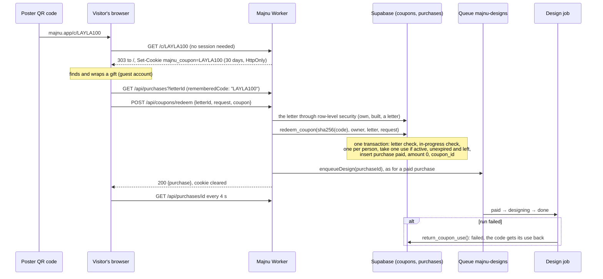

# Coupon codes for the personalised wrapper

## What it does

A coupon code makes the €2.99 personalised wrapper free ([billing.md](billing.md)). In the "Make it unique" dialog a quiet **Have a code?** link reveals a code field. With a valid code nothing is paid: there is no Stripe Checkout, no card, no consent box, and guests (anonymous accounts from the gift finder) are not sent to create an account. The design starts straight away, and the dialog closes on the same status card a paid purchase shows after Checkout. The Purchases tab lists the wrapper as **Free with a code**.

The developer uses codes to test the whole flow without paying (issue #72), and to hand out on a printed poster: a QR code opens `majnu.app/c/LAYLA100`, which remembers the code, so the dialog opens with it already filled in. Each code has a number of uses, may expire, can be switched off, and **each person can use a code once**. Codes are made, listed and switched off with `npm run coupon`.

## How it works



### Redeeming

1. The dialog ([`make-it-unique.tsx`](../../components/wrapper/make-it-unique.tsx)) shows "Have a code?" under the paid form, and under the guest's "Create a free account" step. In code mode it asks for the design request and the code, hides the consent box, and its button says "Make my design". "Pay instead" (members) or "I don't have a code" (guests) goes back. If the browser brought a code from a short link, `GET /api/purchases` returns it as `rememberedCode` and the dialog opens in code mode with it filled in, focus on the request.
2. It posts JSON to [`POST /api/coupons/redeem`](../../app/api/coupons/redeem/route.ts). We chose a separate route over an optional field on `POST /api/checkout`, so the paid path is not touched at all. The route refuses cross-site posts (403) and anything but JSON (415), and needs a session: a member or a guest (401 without one).
3. [`redeemWrapperCoupon()`](../../lib/billing/coupons.ts) cleans the request as Checkout does (3 to 500 characters), normalises the code (below; something that cannot be a code is refused without asking the database), and reads the letter through row-level security: it must be the sender's own built letter, not a calendar. Then it calls `redeem_coupon()` with the code's SHA-256.
4. **`redeem_coupon()`** ([`0011_coupons.sql`](../../supabase/migrations/0011_coupons.sql)) is one transaction, executable only by the service role:
   - it checks the letter again (owner, kind, built), as a backstop;
   - it refuses with `in_progress` when a design for the letter is already paid or designing, as Checkout does;
   - it refuses with `already_redeemed` when this user has a live (not failed) purchase with this code;
   - it takes one use with a single conditional update (`active`, not expired, `uses < max_uses`); if nothing matched it tells `invalid` (unknown or disabled: the same answer), `expired` or `used_up` apart;
   - it inserts the purchase as `paid` with `paid_at`, `amount_cents = 0`, `coupon_id` and no consent or Stripe ids.
   A unique violation from a concurrent redeem (another design for the same letter, or the same person on another letter) rolls back the use the transaction took and answers `in_progress` or `already_redeemed`, from the name of the index that refused.
5. The purchase goes to the design queue with [`enqueueDesign()`](../../lib/billing/queue.ts), exactly like a purchase Stripe confirmed. If it cannot be handed over, the code gets its use back and the route answers 502.
6. The route answers `200 { purchase }` (a `PurchaseView`), and the dialog closes onto the status card with focus on it.

| Answer | Status | Message |
|---|---|---|
| Redeemed | 200 | (the status card: "Code accepted, starting soon") |
| `code_invalid` (unknown, disabled, or not a code) | 400 | That code doesn't work. Check it and try again. |
| `code_already_used` | 409 | You have already used this code. Each person can use it once. |
| `in_progress` | 409 | A design for this gift is already being made. … |
| `code_used_up` | 410 | That code has been used as many times as it can be. |
| `code_expired` | 410 | That code has expired. |
| `invalid_request` | 400 | Describe the look you want in a few words (at most 500 characters). |
| `letter_not_found`, `not_a_letter`, `not_built` | 404, 422, 422 | As for Checkout |
| The design could not be started | 502 | We couldn't start your design just now. Your code still works. … |

### Why two people can never take the last use

The use is taken by one statement, `update coupons set uses = uses + 1 where code_hash = $1 and active and (expires_at is null or expires_at > now()) and uses < max_uses`. Two transactions redeeming the same code reach the same row; the second waits for the first's row lock, then Postgres re-checks the `where` against the row the first left (read committed), finds no use left and updates nothing. The purchase is inserted in the same transaction, so a use is never taken without a purchase, or a purchase made without a use.

### One use per person

`purchases_one_redemption_per_user_idx` is a partial unique index on `purchases (coupon_id, owner_id) where coupon_id is not null and status <> 'failed'`. "Person" means account: a guest who later signs up keeps the same user id, so the redemption stays theirs. A failed run leaves the index (its status becomes `failed`), so the same person can try again with the same code, as the dialog promises. Someone can still make a new guest account in another browser; Turnstile on anonymous sign-in and the code's own number of uses bound that.

### When a design fails

The design job ([`fulfil.ts`](../../lib/billing/fulfil.ts)) gives back what a purchase cost with `giveBack()` ([`refunds.ts`](../../lib/billing/refunds.ts)). For a coupon purchase it calls `return_coupon_use()`, never Stripe: in one transaction it marks the purchase `failed` with the reason (only from `paid` or `designing`) and gives the coupon one use back. A second call (the dead-letter queue after the job) finds it failed and changes nothing, so a use is returned once. The job's outcome is `code_returned`. The table also forbids Stripe ids and a receipt on a coupon purchase, so a coupon purchase could not reach Stripe even through a bug.

The sender sees "Something went wrong. The design could not be made. Your code works again, so you can try once more." instead of the refund wording ([`view.ts`](../../lib/billing/view.ts), `statusWords`).

### Codes

[`coupon-code.ts`](../../lib/billing/coupon-code.ts) is shared by the server and the command line, so both normalise and hash a code the same way:

- **Random codes** (the default): 16 characters from a 23-character alphabet without look-alikes (`34679ACDEFGHJKMNPQRTWXY`: no 0/O, 1/I/L, 2/Z, 5/S, 8/B or U/V), shown as `K7QM-3XRA-PD9C-WHTE`. That is about 72 bits, drawn from `crypto.getRandomValues` with rejection sampling.
- **Chosen codes** (`--code LAYLA100`): 6 to 24 letters and digits, for printing. A chosen code is meant to be public; its number of uses and one use per person limit it, not secrecy.
- **Normalising**: NFKC (full-width characters from a phone keyboard become plain ones), upper case, and spaces, dashes and underscores removed. "layla 100", "Layla-100" and "LAYLA100" are the same code. The result must be 6 to 24 characters of `0-9A-Z`.
- **Stored**: only the SHA-256 (lower-case hex) of the normalised code, in `coupons.code_hash`.

### The short link for posters

[`GET /c/<code>`](../../app/c/[code]/route.ts) answers `303` to `/` and sets `majnu_coupon=<normalised code>` with `Max-Age` 30 days, `Path=/; HttpOnly; Secure; SameSite=Lax` ([`coupon-cookie.ts`](../../lib/billing/coupon-cookie.ts)). It needs no session and asks the database nothing, so the link cannot be used to test codes, and the response has no body: the code is never shown. Something that cannot be a code clears any remembered one and lands on `/` all the same. The response is `no-store`, `noindex` and `no-referrer`.

The cookie is HttpOnly: only the server reads it. `GET /api/purchases` hands it to the dialog of the same browser as `rememberedCode`. `POST /api/coupons/redeem` clears it after a successful redemption, and also when that same code is refused for good (invalid, used up, expired, already used by this person).

### The command line

`npm run coupon` ([`scripts/coupon.ts`](../../scripts/coupon.ts)) runs with Node's built-in TypeScript support and the service-role key in `.env.local`, which points at the production project:

```bash
npm run coupon -- create                                   # one use, never expires, a random code
npm run coupon -- create --uses 5 --days 14 --label "Launch test"
npm run coupon -- create --code LAYLA100 --uses 100 --label poster
npm run coupon -- list                                     # label, uses, expiry, state; never a code
npm run coupon -- disable layla100                         # answers as invalid from then on
```

`create` prints the code once ("copy it now"): only its hash is stored. A chosen code that exists already is refused. Note the `--`: npm keeps options it does not know for itself. `npm run coupon create --code=LAYLA100 --uses=100` also works (npm passes the values on as `npm_config_*`), but `npm run coupon create --code LAYLA100` does not, and the script says so and creates nothing.

## Pieces

| Piece | Job |
|---|---|
| [`supabase/migrations/0011_coupons.sql`](../../supabase/migrations/0011_coupons.sql) | `coupons`; `purchases.coupon_id`; the relaxed purchases constraints; `purchases_one_redemption_per_user_idx`; `redeem_coupon()` and `return_coupon_use()` |
| [`lib/billing/coupon-code.ts`](../../lib/billing/coupon-code.ts) | The alphabet, random and chosen codes, normalising, SHA-256. Pure, shared with the command line |
| [`lib/billing/coupons.ts`](../../lib/billing/coupons.ts) | `redeemWrapperCoupon()`: checks, the database call, the hand-over to the queue |
| [`lib/billing/coupon-cookie.ts`](../../lib/billing/coupon-cookie.ts) | The `majnu_coupon` cookie: set, clear, read |
| [`lib/billing/purchases.ts`](../../lib/billing/purchases.ts) | `couponId` on a purchase; `returnCouponUse()` |
| [`lib/billing/refunds.ts`](../../lib/billing/refunds.ts), [`fulfil.ts`](../../lib/billing/fulfil.ts) | `giveBack()`: the code's use for a coupon purchase, a Stripe refund otherwise |
| [`lib/billing/view.ts`](../../lib/billing/view.ts) | `freeWithCode`, "Free with a code", the coupon status wording, `rememberedCode` |
| `POST /api/coupons/redeem`, `GET /c/[code]`, `GET /api/purchases` | The routes |
| [`components/wrapper/make-it-unique.tsx`](../../components/wrapper/make-it-unique.tsx) | "Have a code?", the code field, the remembered code |
| [`app/(app)/dashboard/purchases/purchases-view.tsx`](../../app/(app)/dashboard/purchases/purchases-view.tsx) | "Free with a code" in the list |
| [`scripts/coupon.ts`](../../scripts/coupon.ts), `npm run coupon` | Create, list and disable codes |

## Data and privacy

- **`coupons`**: the hash, a label for us, the maximum and the uses taken, the expiry, whether it is active, when it was made. Row-level security is on with no policies, and `anon` and `authenticated` have no privileges: no browser can list codes, read their hashes or change their uses. The codes themselves are stored nowhere.
- **`purchases`** gains `coupon_id`. Owners may read it on their own rows; it is an id, never a code. A coupon purchase has `amount_cents = 0`, no consent (nothing is paid, so the withdrawal consent of § 356 (5) BGB does not apply) and no Stripe ids or receipt; card purchases keep all of their constraints.
- **The `majnu_coupon` cookie** holds only the code from the link, for 30 days or until it is redeemed. It is set when a visitor opens a short link, is functional (it carries what they asked for), and is read only by our server.
- Nothing about a coupon reaches Stripe.

## Limits and costs

- A redeemed code costs what a paid design costs us (about $0.26 of model use, capped at $3, plus sandbox time, [daytona-redesign.md](daytona-redesign.md)) with no €2.99 to pay for it. A code's `max_uses` is the budget: 100 uses of `LAYLA100` is at most about $26 typical, $300 worst case.
- One use per person per code; one design per letter at a time; the request is at most 500 characters.
- `npm run coupon`: at most 100,000 uses and 3,650 days per code; labels up to 200 characters.

## How it was checked

- **Unit tests:** [`coupon-code.test.ts`](../../tests/unit/lib/billing/coupon-code.test.ts) (alphabet, random codes, normalising, chosen codes, the hash), [`coupons.test.ts`](../../tests/unit/lib/billing/coupons.test.ts) (the hash sent, every outcome, refusals before the database, no Stripe client is ever made, the use given back when the queue fails), [`coupon-cookie.test.ts`](../../tests/unit/lib/billing/coupon-cookie.test.ts), [`fulfil.test.ts`](../../tests/unit/lib/billing/fulfil.test.ts) (a failed coupon run gives the use back once, from the job and from the dead-letter queue, without Stripe), [`view.test.ts`](../../tests/unit/lib/billing/view.test.ts), and the routes: [`coupons/redeem`](../../tests/unit/app/api/coupons/redeem/route.test.ts) (guests and members, statuses, no Checkout, the cookie cleared), [`c/route.test.ts`](../../tests/unit/app/c/route.test.ts) (the cookie's attributes, normalising, invalid codes, no session or database), [`purchases/route.test.ts`](../../tests/unit/app/api/purchases/route.test.ts). [`scripts/coupon.test.ts`](../../tests/unit/scripts/coupon.test.ts) runs the real command line against a local stand-in for Supabase's REST API: random and chosen codes, only the hash sent, the npm forms, list and disable.
- **The migration, before it was applied** (scripts kept outside the repository): on PGlite, 0001 to 0011 (without 0008, which needs Supabase Storage) with an existing card purchase, 66 checks: `anon` and `authenticated` cannot read or change `coupons` or run either function, owners read `coupon_id` but not `failure_reason`; redeeming, `in_progress` (paid and designing), `already_redeemed`, `used_up`, `expired`, disabled and unknown codes as `invalid`, other people's letters, calendars and unbuilt letters, none taking a use; returning a use once, a done purchase keeping its use, the same person redeeming again after a failure; every new constraint; the functions are `security invoker` with an empty `search_path`. On a real Postgres 18 (embedded-postgres) with separate connections: two transactions on the last use (the second waits and gets `used_up`), two codes for one letter at once (`in_progress`, the second code keeps its use), 25 connections on a 5-use code (exactly 5 redeem), one person on two letters with a 100-use code at once (`already_redeemed`, one use taken), and a double return at once (one use back).
- **Live on a dev server:** `GET /c/LAYLA100`, `/c/layla-100` and `/c/layla%20100` with curl and no session: 303 to `/`, the cookie as above, an empty body; `/c/abc` clears it. In the isolated browser, a fresh context with no session followed the link and sent `majnu_coupon=LAYLA100` with the request for `/`. `POST /api/coupons/redeem` without a session (401), cross-site (403) and as a form (415).
- **In the browser, at 375 px (emulated) and 1440 px,** with the API answers stubbed on a temporary page (removed before committing, because 0011 is not applied to the database yet): the guest step with "Have a code?", the guest's code form (no account step, no consent), the member's paid form unchanged, switching to the code and back with focus following, an empty code, a refused code (message, field marked invalid and focused), a redeemed code closing onto the status card with focus on it, the coupon failure wording, the remembered code filled in for a guest, reduced motion, and the Purchases list with "Free with a code" rows next to a card purchase. Console clean.
- **Not checked:** the real flow against Supabase (redeeming, the status card polling a real purchase, the Purchases tab) until 0011 is applied; the queue consumer on Cloudflare running a coupon purchase; the poster link on the deployed Worker.

## Open questions

- Redeem attempts are not rate limited. Random codes cannot be guessed, but chosen codes are short; a per-user cap on failed attempts would slow guessing of chosen codes.
- An open Stripe Checkout for the same letter is not expired when a code is redeemed (that would call Stripe). If the sender then pays it while the code's design is being made, the existing rule refunds the payment at once; if the code's design is already done, they get a second, paid design.
- The landing page does not yet say that a code was remembered from a poster; the dialog is the first place it appears.
- **The privacy page** (`app/(marketing)/privacy/`, Dev B) lists the cookies the site sets: the sign-in cookie and the theme. It should name `majnu_coupon` too: set only when someone opens a code link, holding just that code, for at most 30 days, read only by our server. Like the others it is strictly necessary for what the visitor asked for (§ 25 (2) TDDDG), so no banner is needed.
