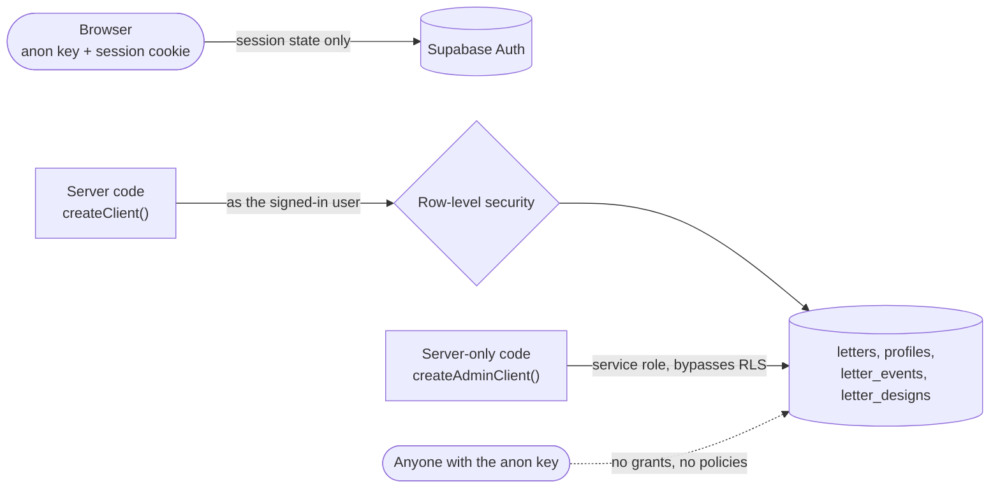

# Data and security

## What it does

Letters hold private messages and gift codes, and strangers arriving from ads spend our API budget. This page covers the data layer that protects both: the database schema with row-level security, the rule that sensitive columns are written only by server code, the spending guard on every route that calls a model, how secrets are kept, and how the app is deployed without leaking them.

## How it works

Majnu talks to Supabase through three kinds of client. Which one a piece of code uses decides what the database lets it do.

| Client | Made in | Used for |
|---|---|---|
| Browser client, anon key | [`lib/supabase/client.ts`](../../lib/supabase/client.ts) | Following the session in the browser ([`auth-provider.tsx`](../../components/auth/auth-provider.tsx)). Sign-in itself runs in server actions ([`app/auth/actions.ts`](../../app/auth/actions.ts)). The anon role has **no** grants and no policies on any table |
| Server client, the user's session | [`lib/supabase/server.ts`](../../lib/supabase/server.ts) | Everything an owner reads or changes: their letters, events, designs and profile, counting their limits, saving built content. Row-level security enforces ownership |
| Admin client, service role | [`lib/supabase/admin.ts`](../../lib/supabase/admin.ts), `import "server-only"`, a fresh client per call | Only the jobs the security rules give to server code: public letters by exact slug, open tracking, inserting new letters, saving the chat, plan changes, storing designs |

A typical owner write, saving a built letter: `saveLetterContent()` validates the content against the schema for its kind, then updates through the **user's** client, so a letter that belongs to someone else matches no row. A typical server-only write, saving the conversation: `saveChat()` first reads the letter through the user's client (proving ownership through row-level security), then writes `chat` with the **admin** client, matching both the id and the owner.

## The schema

Three migrations in [`supabase/migrations/`](../../supabase/migrations/):

| Migration | Adds |
|---|---|
| [`0001_init.sql`](../../supabase/migrations/0001_init.sql) | `letters`, `profiles`, `letter_events`, the `letter_summaries` view, the `updated_at` triggers, and a trigger that gives every new user a free profile (with a backfill for existing users) |
| [`0002_billing.sql`](../../supabase/migrations/0002_billing.sql) | `profiles.plan_cancel_at`, a nullable column without a default, so adding it is catalogue-only with no table rewrite |
| [`0003_letter_designs.sql`](../../supabase/migrations/0003_letter_designs.sql) | `letter_designs` for Daytona pages |
| [`0011_coupons.sql`](../../supabase/migrations/0011_coupons.sql) | `coupons` (hashed codes for the personalised wrapper), `purchases.coupon_id` with the constraints a free purchase needs, one redemption per user, and the service-role functions `redeem_coupon()` and `return_coupon_use()` ([coupons.md](coupons.md)) |
| [`0012_free_designs.sql`](../../supabase/migrations/0012_free_designs.sql) | `free_design_days` (the day's free designs per keyed, daily hash of an IP address), `purchases.free_day` and `free_ip_hash` with the constraints a free purchase needs, and the service-role functions `claim_free_design()`, `free_designs_left()`, `return_free_design()` and `sweep_free_design_days()` ([free-designs.md](free-designs.md)) |

| Table | Columns | Notes |
|---|---|---|
| `letters` | `id`, `owner_id` → `auth.users`, `slug` unique, `kind` (`letter` or `calendar`), `template_id`, `title`, `content` jsonb, `chat` jsonb, timestamps | `slug` must match `^[A-Za-z0-9_-]{6,64}$`; `title` at most 200 characters; `content` an object of at most 200,000 bytes (it is fed back to the model on edits); `chat` an array. Index on `(owner_id, created_at desc)` for the dashboard and the limits |
| `profiles` | `user_id` → `auth.users`, `plan` (`free` or `full-moon`), `stripe_customer_id` unique, `stripe_subscription_id`, `plan_renews_at`, `plan_cancel_at`, timestamps | One row per user, created by `handle_new_user()`, a `security definer` trigger function with an empty `search_path` whose execute right is revoked from the API roles. The billing columns are left from the retired subscription; no code reads or writes them |
| `purchases` | `owner_id`, `letter_id` (null if the letter is deleted), `status` (`pending`, `paid`, `designing`, `done`, `failed`, `refunded`), the request, `consent_at` and `consent_text`, amount, the Stripe session, payment intent and refund ids, `receipt_url`, `design_id`, `failure_reason`, timestamps ([`0007_purchases.sql`](../../supabase/migrations/0007_purchases.sql)) | One row per personalised wrapper ([billing.md](billing.md)). Owners read their own rows except `failure_reason`; only the service role writes. A partial unique index allows one `paid` or `designing` purchase per letter. Since `0011`, `coupon_id` marks a wrapper paid with a coupon code: such a row has amount 0, no consent and no Stripe ids, and another partial unique index allows one live redemption of a code per user. Since `0012`, `free_day` marks one of the day's free designs (amount 0, no consent, no coupon, no Stripe ids), and `free_ip_hash`, which owners cannot read, links it to its counter only while the design is on its way |
| `coupons` | `code_hash` (SHA-256 hex of the normalised code, unique), `label`, `max_uses`, `uses`, `expires_at`, `active`, `created_at` ([`0011_coupons.sql`](../../supabase/migrations/0011_coupons.sql)) | The codes themselves are never stored. Uses are taken and given back only by `redeem_coupon()` and `return_coupon_use()`, one transaction each ([coupons.md](coupons.md)) |
| `free_design_days` | `day` (UTC), `ip_hash` (HMAC-SHA-256 under `OPEN_HASH_SECRET` of the day and the address, IPv6 by its /64), `used`; primary key `(day, ip_hash)` ([`0012_free_designs.sql`](../../supabase/migrations/0012_free_designs.sql)) | Never an IP address. Rows older than yesterday are deleted, and the hash cleared from purchases of those days, whenever the dialog asks how many are left or a free design is claimed ([free-designs.md](free-designs.md)) |
| `letter_events` | `letter_id`, `type` (`open`, `door_open`, `gift_click`), `day` 0 to 366, `visitor_id`, `user_agent`, `country`, `city`, `language`, `device` (added in `0009_open_details.sql` for the Tracker, nullable), `created_at` | Unique on `(letter_id, type, day, visitor_id)`, so repeat visits add nothing; that index also serves lookups by letter |
| `letter_designs` | `letter_id`, `html` (1 to 512,000 bytes), `request` (1 to 2,000 characters), `created_at` | Index on `(letter_id, created_at desc)` for the newest design |
| `letter_summaries` (view) | Each letter with `recipient_name`, `has_content` and its open statistics | `security_invoker`, so it runs under the caller's row-level security |

Everything cascades from `auth.users` and `letters`: deleting a user deletes their letters, and deleting a letter deletes its events and designs.

Migrations are written as files and applied by the lead session, with a dry run first: `supabase db push --remote=<project-ref> --dry-run`, then without `--dry-run`. After applying, the security rules are checked with the anon key alone ([docs/setup.md](../setup.md#services)).

## Row-level security and grants

Row-level security is turned on explicitly for every table (tables created by SQL have it off by default). Grants are set explicitly too, so they hold whether or not the project exposes new tables to the Data API automatically.

| Table | `anon` | `authenticated` | `service_role` |
|---|---|---|---|
| `letters` | nothing | `select` own rows; `update` own rows, **only** `kind`, `template_id`, `title`, `content`, `updated_at` | everything |
| `profiles` | nothing | `select` own row | everything |
| `letter_events` | nothing | `select` events of own letters, every column except `visitor_id` and `user_agent` (a column grant since `0009`; the visitor count comes from `private.letter_unique_visitors()`) | everything |
| `letter_designs` | nothing | `select` designs of own letters | everything |
| `letter_summaries` | nothing | `select`, filtered by the policies above | `select` |
| `purchases` | nothing | `select` own rows, every column except `failure_reason` and `free_ip_hash` (`coupon_id` added in `0011`, `free_day` in `0012`) | everything |
| `coupons` | nothing | nothing | everything; `redeem_coupon()` and `return_coupon_use()` are executable by the service role only |
| `free_design_days` | nothing | nothing | everything; `claim_free_design()`, `free_designs_left()`, `return_free_design()` and `sweep_free_design_days()` are executable by the service role only |

There is no insert or delete policy for users anywhere. Policies use `(select auth.uid())`, so the function is evaluated once per query rather than once per row.

## Server-only writes

These values are never taken from the browser:

| Value | Written by | Why |
|---|---|---|
| `letters.slug`, `letters.owner_id` | `createLetter()` after checking the session, with the admin client | A link and its owner always come from the server |
| `letters.chat` | `saveChat()` after an ownership check through RLS | The turn limit counts it; a browser that could rewrite it could reset the count or replay a huge forged history at our cost |
| Every column of `purchases` | Checkout, the return page, the Stripe webhook and the design job ([billing.md](billing.md)), each status change a conditional update; a coupon purchase only through `redeem_coupon()` ([coupons.md](coupons.md)), a free one only through `claim_free_design()` ([free-designs.md](free-designs.md)) | A user must not be able to mark a design paid or done, or read why a run failed |
| Every column of `coupons` | `npm run coupon` and the two coupon functions, with the service-role key | A browser must not be able to list codes or change their uses |
| Every column of `free_design_days` | The free-design functions, with the hash computed on the server ([free-designs.md](free-designs.md)) | A browser must not be able to reset its count, read the hashes, or have a free design counted against someone else's address |
| `letter_events` | `POST /api/open` ([sharing-and-tracking.md](sharing-and-tracking.md)) | Statistics come only from the beacon route's rules |
| `letter_designs` | The Daytona job ([daytona-redesign.md](daytona-redesign.md)) | The HTML is served from our domain |
| `finder_sessions.context`, with the notes and file counts of shared files | The finder route through `writeContext()` ([finder-files.md](finder-files.md)), which writes only if the context's revision has not moved since it was read | The counts are what the file limits read; a stale save must not wipe them. The files themselves are never stored |

Slugs are 10 characters from a 49-character alphabet without look-alikes (no `0/O/o`, `1/l/I`, `2/Z`, `5/S/s` or `u/v`), drawn from `crypto.getRandomValues` with rejection sampling so every character is equally likely: about 56 bits, so links cannot be guessed, and they still work when read aloud or typed from a QR code. An insert that hits a taken slug retries with a new one, up to 5 times.

Because owners can write their own content columns directly, everything that reaches a recipient is **validated again on the way out**: `toPublicView()` re-checks the content against the schema, drops gift links and images that are not `https:`, and removes locked calendar doors ([templates-and-gift-pages.md](templates-and-gift-pages.md#door-locking)).

## The spending guard

Every route that calls a model checks limits first, counted through the signed-in user's client so row-level security restricts the counts to that user's own letters ([`lib/limits.ts`](../../lib/limits.ts)):

| Guard | Value |
|---|---|
| New gifts per user per UTC day | 5, checked in the chat route and again in `createLetter()` as a backstop |
| Sender messages per gift | 40 |
| Characters per message | 4,000 |
| Model requests per sender message | 6 |
| Research per run | 4 searches, 4 model requests |
| Builder per build or edit | 2 calls |
| Daytona per run | $3, 360 s, a 20-minute sandbox |
| Monthly spend | A limit set in the Anthropic Console |
| Calendars | Need a real account (guests are asked to sign up); nothing is gated on a payment |
| Photos and documents in the finder | 3 per message (20 MB together; 5 MB a photo, 10 MB and 20 pages a PDF, 100 KB text), 6 per finder session, 12 per visitor per UTC day, `MAJNU_DAILY_FILE_CAP` (150) reader calls a day for the site, each claimed before the reader runs and given back if it fails; the real type from the file's first bytes ([finder-files.md](finder-files.md)) |

The details of each are in [letters-chat.md](letters-chat.md#limits-and-costs).

## Other protections

- **Sessions.** [`lib/supabase/middleware.ts`](../../lib/supabase/middleware.ts) follows the official `@supabase/ssr` pattern: it writes refreshed cookies to both the request and the response, and nothing runs between creating the client and `getUser()`. A version that dropped refreshed sessions would sign senders out mid-chat. It sends signed-out visitors of `/dashboard` and `/create` to sign-in, and signed-in visitors of the sign-in pages on to a safe `next` path.
- **Gift pages read no session.** The middleware matcher skips `/l/`, `/api/open`, `/auth`, `/dev/`, build output and static files ([`middleware.ts`](../../middleware.ts)), so gift pages and the beacon set no cookies.
- **No open redirects.** The `next` parameter after sign-in accepts only same-site paths ([`lib/billing/next-path.ts`](../../lib/billing/next-path.ts)).
- **Cross-site posts.** Session cookies are `SameSite=Lax`, and the billing routes also refuse a `POST` whose `Origin` names another site.
- **Links.** Every link a model writes is kept only if it is `https:`, at three points: the builder, the research agent and the public view.
- **Privacy on public pages.** `noindex`, `no-referrer`, generic titles and previews, no third-party scripts, a strict sandbox for Daytona designs.

## Secrets

| Where | What | How it gets there |
|---|---|---|
| `.env.local` | Every key, for local development | By hand, from a teammate over a private channel; gitignored |
| `.env.production` (committed) | Public values only: site URL, Supabase URL and publishable key, tip link, Stripe publishable key, Turnstile site key | They ship in the browser bundle anyway |
| Cloudflare Worker secrets | `ANTHROPIC_API_KEY`, `SUPABASE_SERVICE_ROLE_KEY`, `STRIPE_SECRET_KEY`, `STRIPE_PRICE_WRAPPER`, `STRIPE_WEBHOOK_SECRET`, `DAYTONA_API_KEY`, `DAYTONA_ANTHROPIC_API_KEY`, `OPEN_HASH_SECRET`, `TAVILY_API_KEY`, `OPENAI_API_KEY`, `APIFY_API_TOKEN`, `BRIGHTDATA_API_KEY` | `npm run cf:secrets` copies the filled-in ones from `.env.local` with `wrangler secret bulk` |
| GitHub Actions secrets | `SUPABASE_SERVICE_ROLE_KEY`, `ANTHROPIC_API_KEY`, `STRIPE_SECRET_KEY`, `NEXT_PUBLIC_STRIPE_PUBLISHABLE_KEY`, `DAYTONA_API_KEY` | `npm run ci:secrets`, only the keys the checks use |

- `SUPABASE_SERVICE_ROLE_KEY`, `ANTHROPIC_API_KEY`, `STRIPE_SECRET_KEY` and `DAYTONA_API_KEY` are server only. Every module that touches one starts with `import "server-only"`, so importing it into client code fails the build. Only `NEXT_PUBLIC_` variables reach the browser.
- Keys never go into a log: agent errors log the error class, status and request id only ([`lib/agents/errors.ts`](../../lib/agents/errors.ts)), and the Daytona job redacts every key from its output.
- The Turnstile secret lives only in Supabase.

## Deploying

The app runs as the Cloudflare Worker `majnu` at `majnu.app` and `www.majnu.app`, built with the OpenNext adapter ([`wrangler.jsonc`](../../wrangler.jsonc), [`open-next.config.ts`](../../open-next.config.ts)). Prerendered pages are served from the build's static assets instead of being rendered again.

Deploy only with `npm run deploy` ([`scripts/deploy.sh`](../../scripts/deploy.sh)). The adapter copies every `.env` file into the Worker at build time, so building in a working directory would upload the secrets in `.env.local` and bake `http://localhost:3000` into the pages. The script instead:

1. Exports the committed tree of the chosen ref (`HEAD` by default) with `git archive` into a temporary folder, which therefore holds only `.env.production`. It warns that uncommitted changes will not be deployed.
2. Refuses to deploy if [`lib/legal.ts`](../../lib/legal.ts) still has a bracketed placeholder, so the Impressum and privacy policy never go live with them.
3. Runs `npm ci`, `opennextjs-cloudflare build` and `opennextjs-cloudflare deploy` there, and deletes the folder.

`.claude/settings.json` denies direct `wrangler deploy` and `opennextjs-cloudflare deploy` commands for every coding agent.

## Pieces

| Piece | Job |
|---|---|
| [`supabase/migrations/`](../../supabase/migrations/) | Schema, grants and row-level security |
| [`lib/supabase/`](../../lib/supabase/) | The browser, server and admin clients, and the session middleware |
| [`middleware.ts`](../../middleware.ts) | Which paths run the session middleware |
| [`lib/letters/store.ts`](../../lib/letters/store.ts) | Every letter read and write, with the client each one needs |
| [`lib/limits.ts`](../../lib/limits.ts), [`lib/plans.ts`](../../lib/plans.ts) | The spending guard and plan gates |
| [`scripts/deploy.sh`](../../scripts/deploy.sh) | The clean-copy deploy |
| [`.env.sample`](../../.env.sample) | The names of every key |

## Data and privacy

- **Stored:** accounts (Supabase Auth: email, and a password hash for email sign-ups), letters with their content and conversation, open events with hashed visitor ids, plans, and Daytona designs. Supabase runs in eu-central-1 (Frankfurt).
- **Retention:** letters, their events and designs stay until the letter or the account is deleted. There is no way for a user to delete a gift in the app yet; the privacy page offers deletion on request.
- **Never stored:** a recipient's IP address, any visitor's IP address (free designs are counted by a keyed hash of the address and the day, deleted after two days), card numbers, or anything on a recipient's device.

## Limits and costs

- The database work per request is small: one or two queries for most pages, an upsert per open event.
- On Workers Free a request may use 10 ms of CPU, which dynamic pages can exceed under real traffic ([docs/setup.md](../setup.md#services), [#12](https://github.com/peresramirez/majnu/issues/12)).

## How it was checked

- **Unit tests:** [`store.test.ts`](../../tests/unit/lib/letters/store.test.ts) (exact-slug reads that never select the chat, inserting with the session, refusing at the daily limit or without a session, validating before writing), [`limits.test.ts`](../../tests/unit/lib/limits.test.ts), [`public-view.test.ts`](../../tests/unit/lib/letters/public-view.test.ts), [`profiles.test.ts`](../../tests/unit/lib/billing/profiles.test.ts), and [`next-redirects.test.ts`](../../tests/unit/app/auth/next-redirects.test.ts) for the middleware's redirects.
- **CI** runs `npm run test:smoke` hourly, so a revoked key or an exhausted quota is noticed even when nobody is pushing ([agent-workflow.md](agent-workflow.md#ci-before-merge)).
- **Manual:** the anon-key checks (a `select` on `letters` returns no rows; a signed-in user cannot change `profiles.plan` or `letters.chat` from the browser console) are described in [docs/setup.md](../setup.md#services). Their results are not recorded in the repository, and this page did not re-run them.

## Open questions

- A way for senders to delete a gift, and their account, in the app.
- The gift finder brings anonymous accounts ([#33](https://github.com/peresramirez/majnu/issues/33)), protected by Turnstile. Per-user limits are then easy to multiply, so the planned site-wide daily caps matter.
- There is no per-IP rate limit on any route; Cloudflare's own rules could add one. The one per-address count is the three free designs a day ([free-designs.md](free-designs.md)), which is a quota, not a rate limit.
