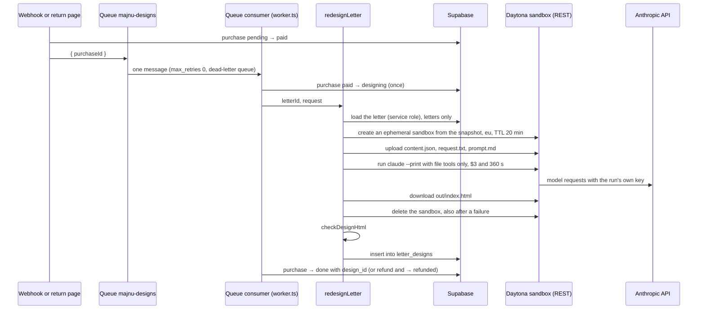
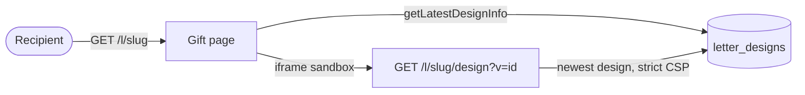

# Daytona redesign: the personalised wrapper's designer

## What it does

This is the one paid thing in Majnu: the **personalised wrapper**, €2.99 once ([billing.md](billing.md)). A sender asks for a one-off look for a gift ("a 1950s cinema ticket by the sea") instead of one of our designs, pays, and Claude Code, running in a Daytona sandbox, writes one self-contained HTML page from the letter's content. We check the page, store it with the letter and delete the sandbox, and from then on `/l/<slug>` shows the design. The result never depends on the sandbox still existing. Letters only: a calendar baked into one static page would carry its locked doors.

A paid purchase starts the job from a Cloudflare Queue consumer in the same Worker as the app; a failed run is refunded automatically. A developer can also run it by hand.

## How it works





### The snapshot

Every sandbox starts from the snapshot `majnu-letters-v1`, built in the `eu` region by [`scripts/daytona/build-snapshot.mts`](../../scripts/daytona/build-snapshot.mts) (`--print` shows the Dockerfile and builds nothing):

- `node:22-bookworm-slim`, with Claude Code pinned to **2.1.323**, the version npm tagged `stable` when the snapshot was defined, so a CLI release cannot change flags under us. Auto-update, telemetry, error reporting and non-essential traffic are switched off.
- The project Claude Code works in, [`daytona/sandbox/`](../../daytona/sandbox/), copied to `/home/daytona/letter`: the [`majnu-letter` skill](../../daytona/sandbox/.claude/skills/majnu-letter/SKILL.md) with the page rules, a [`CLAUDE.md`](../../daytona/sandbox/CLAUDE.md), [permissions](../../daytona/sandbox/.claude/settings.json) that allow only the file tools, and one rendered example per template in `daytona/sandbox/reference/rendered/` (made by [`export-references.mts`](../../scripts/daytona/export-references.mts) from the workbench).
- The template sources, the schema and the fixtures as read-only reference.
- No keys. The Anthropic key is passed to each run's command only.

Snapshots are immutable by name. After changing the templates, the skill or the CLI version, refresh the rendered examples, build `majnu-letters-v2`, and set `DAYTONA_SNAPSHOT`. Sandboxes already running keep the old one, and a bad build never replaces a working one. The alternative, a plain sandbox with the templates pushed in at every start, would start slower and not pin the CLI, for the same upkeep.

### The job

The job reaches Daytona with `fetch` ([`lib/daytona/rest.ts`](../../lib/daytona/rest.ts)), not `@daytona/sdk`: it runs in the Worker's queue consumer, and the SDK does not bundle for Workers (it pulls in `@aws-sdk/client-s3`, OpenTelemetry's Node SDK, `tar`, `ws` and `socket.io-client`, and uses axios's Node HTTP adapter). The six calls it needs were recorded from a traced SDK 0.233 run and are written out with the same paths and bodies: `POST /sandbox` (snapshot, labels, `target`, `autoDeleteInterval: 0` for ephemeral, `ttlMinutes`, `domainAllowList`), `GET /sandbox/{id}` while it starts, `GET /sandbox?labels=` and `DELETE /sandbox/{id}` on the API, and `files/bulk-upload`, `process/execute`, `files/info` and `files/download` on the toolbox proxy the create response names. Daytona's own error message is kept in the error, so the tier fallback below still recognises it. The SDK stays for building snapshots on a laptop.

[`redesignLetter(letterId, request)`](../../lib/daytona/redesign.ts):

1. Checks the letter id is a UUID and cleans the request (line ends normalised, control characters removed, at most 2,000 characters).
2. Loads the letter with the service-role client. A calendar, or a letter without valid content, is refused.
3. Starts an **ephemeral** sandbox labelled with a job id, with `ttlMinutes: 20`: it destroys itself 20 minutes after it was created, whatever happens to the job. The network allow list is `api.anthropic.com`. Daytona enforces a per-sandbox list only on Tier 3 and 4; our current tier refuses it, so the job retries without it and the tier's own policy applies (Daytona's essential services: package registries, git hosts and model providers). If the start fails late, sandboxes carrying the job's label are deleted.
4. Uploads `input/content.json`, `input/request.txt` and `input/prompt.md` as **files**, so no user text is ever part of a shell command.
5. Runs Claude Code headless ([`buildClaudeCommand()`](../../lib/daytona/redesign.ts)) with `ANTHROPIC_API_KEY` and `MAJNU_MODEL` in that one command's environment only. The key is never written to a file, a label, the sandbox's own environment or a log.
6. Downloads `out/index.html` (refusing anything over 500 KB before downloading), then **deletes the sandbox**, also when anything before failed. A failed delete is tried once more; after that the TTL removes it.
7. Checks the page ([`checkDesignHtml()`](../../lib/daytona/validate.ts)) and, only if it passes, inserts it into `letter_designs`.

Every log line and error goes through `redact()`, which removes the Anthropic, Daytona, Supabase service-role and Stripe keys and anything shaped like `sk-ant-…`.

The command, as fixed text:

| Flag | Why |
|---|---|
| `timeout --kill-after=15 360` | A 6-minute limit inside the sandbox; the SDK call that waits for it has its own, 60 seconds longer |
| `claude --print "$(cat input/prompt.md)"` | The prompt comes from a file we wrote |
| `--model "$MAJNU_MODEL"`, `--effort medium` | The app's model, at more effort than the chat agents: a design benefits from thought and nobody is waiting on each reply |
| `--max-budget-usd 3` | This CLI version has no turn limit, so the run is bounded by spend and time |
| `--restricted`, `--tools "Read,Write,Edit,Glob,Grep"`, `--disallowedTools "Bash,WebFetch,WebSearch"` | Only file tools exist in the session, confined to the project folder: no shell and no web |
| `--settings .claude/settings.json`, `--permission-mode acceptEdits` | Our permissions, passed explicitly because `--restricted` skips project settings files |
| `--no-session-persistence`, `--output-format json` | Nothing about the run is kept on disk; the last line reports turns, cost and duration |

A run that stopped at its budget after writing the page is still checked; a run that timed out (exit 124) or failed otherwise is not.

### The page checker

[`checkDesignHtml()`](../../lib/daytona/validate.ts) enforces mechanically the page rules in the skill. It is defence in depth, not the boundary: it works on raw text with regular expressions and errs on the side of rejecting. It refuses a page that:

- is over 500 KB, under 200 bytes, or does not start with `<!doctype html>`;
- contains one of our keys, or anything shaped like an Anthropic key;
- has a `<form>`, `<iframe>`, `<object>`, `<embed>`, `<base>`, `<link>`, `<meta http-equiv>` or a `<script src>`;
- uses `fetch`, `XMLHttpRequest`, `WebSocket`, `EventSource`, `sendBeacon`, cookies, any storage API, workers, `window.open`, a location change, `import`, `eval`, `new Function`, CSS `@import` or `image-set()`;
- loads anything with `src`, `poster`, `background` or CSS `url()` that is not a `data:` URI or a `#fragment`, or has attributes such as `srcset`, `ping`, `action` or `formaction`;
- links anywhere but the letter's own `https` gift links, or names another URL inside a script;
- shows a gift code in the markup. Codes may live only inside the script, inserted when the recipient taps a "Reveal your code" button.

### Storage and serving

`letter_designs` ([`0003_letter_designs.sql`](../../supabase/migrations/0003_letter_designs.sql)) holds `letter_id`, the `html` (1 to 512,000 bytes), the `request` (1 to 2,000 characters, kept so a design can be traced back to it) and `created_at`. Row-level security is on; owners can read the designs of their own letters; only the service role writes, because a browser must never be able to put HTML on our domain. Designs are deleted with their letter.

[`GET /l/[slug]/design`](../../app/(public)/l/[slug]/design/route.ts) looks the letter up by exact slug and returns its newest design with these headers ([`designs.ts`](../../lib/daytona/designs.ts)), which are the **security boundary**:

```text
Content-Security-Policy: sandbox allow-scripts allow-popups allow-popups-to-escape-sandbox; default-src 'none'; style-src 'unsafe-inline'; script-src 'unsafe-inline'; img-src data:; font-src data:; base-uri 'none'; form-action 'none'
X-Content-Type-Options: nosniff
Referrer-Policy: no-referrer
X-Robots-Tag: noindex, nofollow
Cache-Control: private, no-store
```

The `sandbox` directive gives the document an opaque origin: its scripts run but cannot read our cookies or storage or script the page around it, and `default-src 'none'` means the browser makes no request for it, whatever the HTML tries. `allow-popups` exists only so a gift link (`target="_blank"`) opens the shop in a normal tab. Errors are plain text and say nothing about the letter.

`/l/<slug>` checks `getLatestDesignInfo(slug)` for letters and, when a design exists, renders a full-screen `<iframe>` of `/l/<slug>/design?v=<design id>` with the same sandbox attributes and the open beacon outside it. `?v=` makes a new design load fresh. If the lookup fails, the page falls back to its template.

## Pieces

| Piece | Job |
|---|---|
| [`lib/daytona/config.ts`](../../lib/daytona/config.ts) | Names and limits shared by the job, the snapshot script and the checker. No imports, no secrets |
| [`lib/daytona/redesign.ts`](../../lib/daytona/redesign.ts) | The job |
| [`lib/daytona/rest.ts`](../../lib/daytona/rest.ts) | Daytona's REST API with `fetch`, behind the job's `Sandboxes` interface |
| [`worker.ts`](../../worker.ts), [`lib/billing/consumer.ts`](../../lib/billing/consumer.ts), [`lib/billing/fulfil.ts`](../../lib/billing/fulfil.ts) | The Worker entry that adds the queue consumer to the OpenNext app, the consumer, and the job for one paid purchase (claim, run, done or refund) |
| [`scripts/daytona/run-purchase.mts`](../../scripts/daytona/run-purchase.mts) | Runs the job for one paid purchase by hand, as the consumer would |
| [`lib/daytona/validate.ts`](../../lib/daytona/validate.ts) | The page checker |
| [`lib/daytona/designs.ts`](../../lib/daytona/designs.ts) | Reading stored designs and the headers they are served with; never imports the Daytona SDK |
| [`app/(public)/l/[slug]/design/route.ts`](../../app/(public)/l/[slug]/design/route.ts) | Serves the newest design |
| [`scripts/daytona/redesign.mts`](../../scripts/daytona/redesign.mts) | Runs one redesign by hand, loading the job through Vite's module runner so the app's imports resolve |
| [`scripts/daytona/build-snapshot.mts`](../../scripts/daytona/build-snapshot.mts), [`scripts/daytona/export-references.mts`](../../scripts/daytona/export-references.mts) | Build the snapshot and refresh its rendered examples |
| [`daytona/sandbox/`](../../daytona/sandbox/) | The project Claude Code works in |
| `letter_designs` table | Stored pages |
| `DAYTONA_API_KEY` | Daytona access. A Worker secret, used by the queue consumer |
| `DAYTONA_ANTHROPIC_API_KEY` | Optional key of its own for the sandbox, with a low spend limit; otherwise `ANTHROPIC_API_KEY` is used |
| `DAYTONA_API_KEY_FALLBACK`, `ANTHROPIC_API_KEY_FALLBACK` | Optional fallbacks: the sandbox starts with the Daytona fallback when Daytona refuses the primary for its key, quota or billing, and Claude Code gets the Anthropic fallback when a free token count shows its primary refused. Both are counted against `FALLBACK_CAP_USD` a month ([provider-fallbacks.md](provider-fallbacks.md)) |
| `DAYTONA_SNAPSHOT`, `DAYTONA_TARGET`, `DAYTONA_API_URL` | Defaults `majnu-letters-v1`, `eu`, `https://app.daytona.io/api` |

The SDK is `@daytona/sdk` 0.233 (`^0.233.0` in `package.json`), used only by the snapshot script. Queues `majnu-designs` and `majnu-designs-dlq` are bound in [`wrangler.jsonc`](../../wrangler.jsonc) and created by `scripts/deploy.sh` if missing.

## Data and privacy

- **What leaves our systems:** the letter's content and the sender's request go into a Daytona sandbox in the EU, and from there to Anthropic. The sandbox is deleted as soon as the page is downloaded, and in any case within 20 minutes.
- **What we keep:** the page and the request, in `letter_designs`, for as long as the letter exists. Only the owner can read them through the API; the public route serves only the HTML, by exact slug.
- **The request is untrusted.** A stranger wrote it and a model reads it, so it is a file the prompt calls a description of a look, never an instruction. Claude Code has no shell or web tools, the sandbox's network is limited, the key is cheap to lose when `DAYTONA_ANTHROPIC_API_KEY` is used, the checker rejects pages that leak keys, and the browser enforces the CSP whatever the page says.
- The privacy page names Daytona, the sandbox in the EU, and that it is deleted within 20 minutes.

## Limits and costs

| Limit | Value |
|---|---|
| Spend per run | $3 (`--max-budget-usd`) |
| Time per run | 360 s inside the sandbox, plus 15 s before a kill |
| Sandbox lifetime | 20 minutes from creation, whatever happens |
| Page size | 500 KB (512,000 bytes), in the job, the checker and the database |
| Request length | 2,000 characters |

**The first end-to-end run** (21 November, a birthday letter, "a 1950s cinema ticket by the sea", recorded in [docs/plan.md](../plan.md#daytona-redesign-only-if-everything-else-is-done)) took 81 s in all: under 2 s to start the sandbox, 9 Claude Code turns costing $0.26, and a 15 KB page. Daytona's own charge for the sandbox time is not recorded.

## Running it in production

A run takes about 90 seconds, too long for a request, so a paid purchase runs it in a **Cloudflare Queue consumer** that lives in the same Worker as the app ([`worker.ts`](../../worker.ts) wraps OpenNext's fetch handler and adds `queue`), so `npm run deploy` still deploys one Worker. Why a queue and not a Workflow: a consumer has 15 minutes of wall time per message, which holds one run with room to spare; waiting on Daytona and Anthropic is I/O, not CPU time; and the job has no steps worth retrying separately, since a retry is another paid run. A Workflow would add a class export, a second binding and per-step state for no gain here.

- **The consumer's environment.** On Workers `process.env` starts empty. OpenNext fills it for web requests only, so `worker.ts` fills it before each batch ([`lib/billing/queue-env.ts`](../../lib/billing/queue-env.ts)): the Worker's variables and secrets first, then the public values from `.env.production` that the build writes to `.open-next/cloudflare/next-env.mjs`. Without it every message failed with "NEXT_PUBLIC_SUPABASE_URL and SUPABASE_SERVICE_ROLE_KEY must be set" (found live on 22 November with the first coupon redemption; no paid customer was affected).
- **No compiled zod parsers in the Worker.** zod v4 decides when a schema is built whether it may compile a parser with `new Function`. The queue bundle builds its schemas while the Worker starts, when code generation is still allowed, and the first parse in the job then fails with "Code generation from strings disallowed for this context". `worker.ts` imports [`lib/zod-jitless.ts`](../../lib/zod-jitless.ts) first, which sets zod's `jitless` option before any schema exists.
- **`majnu-designs`**: `max_batch_size: 1`, `max_retries: 0`, `max_concurrency: 3`, dead-letter queue `majnu-designs-dlq`. The webhook and the return page send `{ purchaseId }` after moving the purchase to `paid`. The consumer claims it (`paid → designing`, once), runs the job, and marks it `done` or refunds it ([billing.md](billing.md#the-design-job-and-refunds)); it acknowledges every message it could handle.
- **`majnu-designs-dlq`**: a message lands here only if the consumer threw (it could not reach the database or Stripe) or died. Its consumer refunds the purchase if it is still `paid` or `designing`.
- **Where there is no queue:** `next dev` runs the job in the background of the dev server; anywhere else the purchase stays `paid` and `node scripts/daytona/run-purchase.mts <purchaseId>` runs it by hand.
- **Bundling:** wrangler bundles `worker.ts` with the job's modules. `server-only` is aliased to an empty module in `wrangler.jsonc`, because it throws outside a React Server Components build; `process.env` holds the Worker's secrets (`nodejs_compat` with a 2026 compatibility date).
- **CPU:** the consumer's own work is small (a few database writes and the page checker on at most 500 KB). On Workers Paid the default 30 s of CPU per invocation is plenty; on Workers Free the 10 ms limit could be too tight for the checker on a large page.

## How it was checked

- **Unit tests** in [`tests/unit/lib/daytona/`](../../tests/unit/lib/daytona/): `redesign.test.ts` runs the job against a fake sandbox (the happy path; never logging a key; deleting the sandbox after every kind of failure; the time limit; a page written before the budget ran out; oversized, rule-breaking, code-showing and key-leaking pages thrown away; the tier fallback; clean-up by label; bad input), `rest.test.ts` (the REST client's paths, bodies and headers against a fake `fetch`, waiting for a start, Daytona's error text, deleting by label), `validate.test.ts`, `designs.test.ts` and `design-route.test.ts`. The purchase side is in [`tests/unit/lib/billing/`](../../tests/unit/lib/billing/) (`fulfil.test.ts`, `consumer.test.ts`, `queue.test.ts`).
- **Live, the REST client (22 November):** a sandbox from `majnu-letters-v1` in `eu` started in 0.8 s; upload, a command with an environment variable, file info, download and delete all worked, with no model call.
- **Live, a paid purchase that failed (22 November):** paid with a Stripe test card on a dev server, with `DAYTONA_SNAPSHOT` pointing at a snapshot that does not exist. The job tried the allow list, recognised the tier's refusal in the REST error, retried without it, got "Snapshot not found", and the payment was refunded automatically ([billing.md](billing.md#how-it-was-checked)).
- **Live, earlier:** the first end-to-end design run, by hand with the SDK, on 21 November.
- **Not verified:** a successful design run through the REST client and the queue (the Anthropic key is over its usage limit until it is raised, so every model call is refused); the queue consumer on Cloudflare, and wrangler bundling `worker.ts` (both happen only at deploy; the build here is `next build`); the network allow list, which our Daytona tier refuses.

## Open questions

- Run one real design through the queue after deploying, once the Anthropic key's limit is raised, and record its time and cost here.
- Decide whether `DAYTONA_ANTHROPIC_API_KEY` becomes required in production: the sandbox runs the model on text a stranger wrote and paid for.
- A design that is made but looks wrong is refunded by hand on request (the terms promise it); there is no "make it again" yet.
- Issue [#39](https://github.com/peresramirez/majnu/issues/39) covers the production path.
