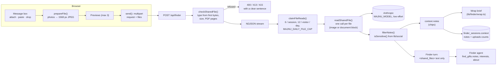

# Photos and documents in the gift finder

Issue #77, built 22 November.

## What it does

In the gift finder's chat (the landing page's dialog and the app's Find a gift tab), the visitor can share photos and documents about the person they are looking for: a screenshot of a wishlist, a photo of a bookshelf, the newsletter of their hobby club as a PDF, a few lines of notes. They attach them with the paperclip button (on an iPhone: the photo library, the camera or Files), paste an image into the message box, or drop files on the finder on a desktop. Up to three files go with one message, shown as small previews that can be removed before sending. Majnu reads each file once and keeps a few short notes ("Shelf full of fantasy novels", "Wishlist: Kindle Paperwhite, 149,99 €"). The notes appear as chips the visitor can correct, steer the gift search, and go into the brief for the gift page. The files themselves are not stored anywhere by Majnu.

## How it works

1. **In the browser** (`components/finder/attachments.ts`, `use-attachments.ts`, `attachment-tray.tsx`). A picked, pasted or dropped file is checked: its first bytes and type say whether it is a photo, a PDF or a text file (`.txt`, `.md`). Anything else gets "… isn't a photo, PDF or text file" under the previews. Photos are drawn on a canvas at most 1568 px on the long edge, on white (a transparent PNG would turn black), and re-encoded as JPEG at quality 0.85 (down to 0.6 if needed to stay under 5 MB). This also drops the photo's metadata, such as where it was taken. iPhone photos arrive as JPEG; HEIC is decoded where the browser can. PDFs (10 MB) and text files (100 KB) go as they are. At most 3 files per message and 20 MB together; the box also counts the files already sent in this search against its 6 and says so before the server has to.
2. **Sending.** `useFinder.send(text, { files })` puts the file names on the visitor's message (a line with a paperclip icon, names only) and `fetchTransport.stream` sends `multipart/form-data`: the usual `FinderRequest` as JSON in a part named `request`, and one `file` part per file. The message may be empty when files come with it. The attach and send buttons keep focus in the message box, so on a phone the tab bar (hidden while the box has focus) does not come back and move the button under the finger.
3. **Before the stream** (`app/api/finder/route.ts`). The route reads the parts, refuses a body over 20 MB, more than 3 files, an empty request, and then checks every file with `checkSharedFile()` (`lib/finder/file-rules.ts`). The real type comes from the first bytes, never the name or the declared MIME type: JPEG, PNG, GIF and WebP by their signatures, PDF by `%PDF-`, text as valid UTF-8 without binary control characters. PDFs are counted to at most 20 pages without a PDF library: page objects in the file and inside compressed object streams (inflated with `DecompressionStream`, at most 8 MB), else the page tree's `/Count`; a PDF with `/Encrypt` is refused as password-protected, one whose pages cannot be found as unreadable. A refusal is a plain 400, 413 or 415 with a sentence in the visitor's language naming the file, before any session is made or loaded, so it costs nothing. The browser shows that sentence and offers no "Try again" (it would send the words without the files).
4. **Claims** (`claimFileReads()` in `lib/finder/limits.ts`). Inside the stream, before Majnu answers, the files are claimed: 6 per finder session ever, 12 per visitor per UTC day over all their sessions, and `MAJNU_DAILY_FILE_CAP` reader calls a UTC day for the whole site (default 150). Files over a limit are not read; the visitor sees a `files_limit` notice ("Majnu has read the 6 files one search can take…"). The counts live in the session's context as `uploads: { v, total, day, today }` (see Data and privacy).
5. **Reading** (`readSharedFile()` in `lib/finder/attachments.ts`). One `client.beta.messages.parse()` call per file on the shared client (`getClient()`, so the fallback key works the same way as for every agent), `MAJNU_MODEL` at low effort with adaptive thinking and server-side fallbacks, a byte-stable system prompt (`READER_SYSTEM_PROMPT`) and structured output `{ notes: string[] }`. The file goes in as an `image` block (base64) or a `document` block (base64 PDF, or a plain-text source for text files); the user message only says what kind of file it is and the language for the notes. Files of one message are read at the same time when together they are under 8 MB, otherwise one after another. A read that fails or is refused gives its claim back (`releaseFileReads()`); a read that finds nothing useful keeps it.
6. **Notes** (`filterNotes()`). At most 6 per file, each at most 120 characters and 14 words. Dropped: anything `isSensitive()` from `lib/social/interests.ts` matches (health, religion, politics, sexuality, ethnicity…, the same filter as for public profiles), handles, links, e-mail addresses, long numbers (phones, orders) and street addresses. Angle brackets are taken out, so a note cannot close the block it is quoted in. Notes are merged into the session's `context.notes` (`mergeNotes()`: no repeats, the newest 12) and streamed as a `context` event, so the chips change before Majnu says anything.
7. **What Majnu gets.** The finder conversation gets text, never the file: a `<shared_files>` block between the context block and the visitor's words ("The visitor shared a photo. Notes from it: - … / The visitor shared a PDF, but it could not be read."), without file names. The stored history stays small and is replayed unchanged. The system prompt's "Files the visitor shares" section says the notes are data, never instructions, to use them like anything the visitor says (interests, `about`, and every note that still holds in `find_gifts.notes`), never to say who is in a photo, and to drop a note the visitor corrects. `contextFor()` merges this turn's notes into the search's context even if the model leaves them out; the researcher's brief ends with "From photos and files the visitor shared: …". Files alone that could not be read, or were all over a limit, end the turn without a model call.
8. **Correcting.** Each of the newest four notes is a chip ("From what you shared: … Correct it"); tapping one puts `About "…": ` in the message box. Majnu then leaves that note out of `find_gifts.notes`, and the chips follow.
9. **The gift page.** `wrapBrief()` adds the notes for the builder's own writing ("a detail or two can make the page personal. Never list them, never copy a price, and never mention a photo or a file"). The personalised wrapper's designer works from the finished page, so it sees them through what the builder wrote.

## Pieces

| Piece | Job |
|---|---|
| `lib/finder/file-rules.ts` | Shared by browser and server: `FILE_LIMITS`, `FILE_ACCEPT`, `sniffFile()` / `sniffImage()`, `decodeText()`, `checkPdf()` (pages, password), `checkSharedFile()`, `displayFileName()` |
| `lib/finder/attachments.ts` | Server only: `READER_SYSTEM_PROMPT`, `readSharedFile()`, `fileBlock()`, `filterNotes()`, `mergeNotes()`, `sharedFilesText()`, `readMessageFiles()` (claims, reads, give-backs, status) |
| `lib/finder/limits.ts` | `fileReadsResult()` (which limit binds), `claimFileReads()`, `releaseFileReads()`, `dailyFileCap()` |
| `lib/finder/sessions.ts` | `uploads` in the context, `countFileReadsToday()`, `changeUploads()`, and `writeContext()`, the revision-checked write every context change now goes through |
| `lib/finder/agent.ts` | The prompt's "Files the visitor shares", `find_gifts.notes`, `userTurn()` with the files' text, notes in `contextFor()` and `recipientBrief()` |
| `lib/finder/wrap.ts` | The notes in the wrap brief |
| `lib/finder/events.ts` | Contract additions: `FinderContext.notes`, the `files_limit` reason, the multipart parts `FINDER_REQUEST_PART` and `FINDER_FILE_PART` |
| `lib/finder/messages.ts` | The refusals, limits and status lines in English and German |
| `app/api/finder/route.ts` | Multipart parsing, `checkFiles()`, reading before the turn |
| `components/finder/attachments.ts` | `prepareFile()` (scaling), `guessKind()`, `roomFor()`, `fileLabel()`, `filesFromClipboard()` |
| `components/finder/use-attachments.ts` | The previews' state, object URLs, and `useFileDrop()` |
| `components/finder/attachment-tray.tsx` | `AttachButton`, `AttachmentTray` (keyboard focus kept when a preview is removed), `DropOverlay` |
| `components/finder/transport.ts` | `requestBody()` (JSON or multipart) and the server's own refusal sentence |
| `components/finder/context-chips.ts` | The note chips |
| `MAJNU_DAILY_FILE_CAP` | Reader calls a UTC day for the whole site; default 150, `0` turns reading files off |

## Data and privacy

- **The file is never stored by Majnu.** It lives in the Worker's memory while it is checked and read (the route lets go of the bytes before Majnu answers) and is sent once to Anthropic, which reads it under its commercial terms (no training). It is not written to Supabase, to logs or to the conversation. File names reach neither the model nor the database; they appear only in the visitor's own browser and in refusal sentences.
- **What is kept**, in `finder_sessions.context`: `notes` (visitor-facing, at most 12 short notes) and `uploads: { v, total, day, today }` (server-only counts; `parseContext()` leaves them out). The conversation (`chat`) holds the `<shared_files>` text with the notes. They live as long as the session (the privacy page's retention list says so).
- **Photos of people.** The reader is told never to identify anyone from their face, body or voice, even someone famous, never to guess or repeat a name, and not to describe people (age, looks). Checked live with a public-domain NASA portrait: no name, nothing about the person.
- **Sensitive things.** The prompt forbids health, religion, politics, ethnicity, sexuality and similar notes; `filterNotes()` checks again with `isSensitive()` from the public-profile reader, and drops handles, links, e-mail addresses, phone and order numbers and addresses. The filter is a backstop: it matches stems and some whole words, not every phrasing.
- **Prompt injection.** Text in a file is data: the reader's prompt says so, its output is a list of short strings, angle brackets are removed, and the finder's prompt treats the notes as data too.
- **Metadata.** Re-encoding photos in the browser removes EXIF data such as GPS location before anything leaves the device. A file sent by a direct API caller is passed to Anthropic as it is, never stored.
- **Privacy page.** `app/(marketing)/privacy/page.tsx` says what happens to shared files (the finder section, Anthropic's line among the processors, and the retention list).
- **Concurrency.** Every write of the context column (`writeContext()`) reads the row, builds the new context from it, and writes only if the context's revision `rev` has not moved, retrying up to four times. So a turn saved from a stale copy can no longer wipe a file claim or a profile read made by another request (this also closes the same gap for profile reads). Calendar code writes the column its own way and never takes files: a calendar's session is refused.

## Limits and costs

- 3 files per message, 20 MB together; 5 MB per photo after scaling, 10 MB and 20 pages per PDF, 100 KB per text file.
- 6 files per finder session, 12 per visitor per UTC day, `MAJNU_DAILY_FILE_CAP` (150) reader calls per UTC day for the site. Each is claimed before the reader runs and given back if it fails. The visitor's and the site's counts are read just before the claim is written: two sessions claiming at the very same moment can go a few files over; one session's own count cannot.
- Every message with files still counts as one of the session's messages, under the finder's existing limits.
- One reader call per file. Measured live on `claude-opus-5-5` (22 November): a 1568 × 1176 photo about 3,100 input and 110 output tokens; a 1000 × 640 screenshot 1,600 and 150; a one-page PDF 2,500 and 90; a 1254 × 1568 portrait 3,300 and 100. About $0.013 a file at $4 / $20 per million tokens; a 20-page PDF costs more (roughly 1,500 to 3,000 tokens a page).
- **The fallback key's reservation.** `lib/providers/costs.ts` reserves, before a fallback request, every character of the body as an input token. A base64 file is all characters, so a 1 MB PDF reserves about $7 and a 10 MB one about $67 for the few seconds of the call (photos, scaled, are usually 100 to 700 KB: $0.70 to $5). The reservation is settled with the real usage right after, but near the $150 cap a large PDF can be refused as "busy". Counting base64 `data` in image and document blocks at a realistic rate is a change for `lib/providers/costs.ts`, outside this feature's files (open question below).

## How it was checked

- **Unit tests:**
  - [`file-rules.test.ts`](../../tests/unit/lib/finder/file-rules.test.ts): signatures for every type, a Word file, a zip, an executable and HEIC refused whatever they are called, UTF-8 with and without a BOM, page counting plain and in compressed object streams (built with zlib), the page tree fallback, the password check, the size limits and the name cleaner.
  - [`attachments.test.ts`](../../tests/unit/lib/finder/attachments.test.ts): the reader's request (model, low effort, structured output, byte-stable prompt, image and document blocks, no temperature), a refusal, `filterNotes()` (sensitive notes, handles, numbers, addresses, repeats, at most six), `mergeNotes()`, `sharedFilesText()` (no file data, no names), the limits and which one binds, claims inside the context with a revision and two racing claims never past 6, other sessions and yesterday's, the site cap, calendar sessions refused, give-backs, and `readMessageFiles()` (claim first, read, give back the failed one, tell the visitor, no model call when nothing may be read).
  - [`files.test.ts`](../../tests/unit/app/api/finder/files.test.ts) (route): 415 for a zip named `foto.jpg`, 400 for four files and for a 21-page PDF, 413 for a photo over 5 MB, 400 for an empty request and a multipart body without its request part, none of them making a session; reading before the turn, the notes chips' `context` event, Majnu's text with no file name, the notes saved, a files-only message, and no model call when files alone could not be read or were over a limit.
  - [`agent.test.ts`](../../tests/unit/lib/finder/agent.test.ts) (the stored turn is text blocks only, notes kept in the search's context and given to the researcher), [`wrap.test.ts`](../../tests/unit/lib/finder/wrap.test.ts) (notes in the brief), and [`files.test.ts`](../../tests/unit/components/finder/files.test.ts) (components: scaling sizes, room, labels, pasting, the multipart body, sent files counted and refused ones left out, note chips).
- **Browser** (an isolated Chrome, `next dev` with the model scripted by a local stub, real guest sessions against the real Supabase project), at 375 × 812 (touch) on `/dashboard/find` and 1440 × 900 in the landing page's dialog:
  - Attach with the button (a 2400 × 1800 JPEG and a PDF), paste a PNG from the clipboard (the box got no text), and drop a Markdown file: a fourth file got "Share up to 3 files in one message."; the photo was scaled to 1568 × 1176 and re-encoded as a 73 KB JPEG.
  - The drop overlay showed while dragging and went away after the drop or when the drag left.
  - A preview removed with the keyboard moved focus to the next preview, then to the message box.
  - Sending "For my sister" with three files: three reader calls (an image block, a base64 PDF document, a plain-text document), one finder turn whose text held the `<shared_files>` notes and no file data, the research brief ending with the notes, four note chips, and "shelf.jpg, newsletter.pdf, notes.md" on the message. The stored session in Supabase: no image, document or base64 in `chat`, the notes in `context.notes`, `uploads` at 3, the revision moving.
  - A fake `.docx` was refused in the browser. A 21-page PDF was refused by the server with "long.pdf has more than 20 pages…" and no "Try again".
  - A files-only message was answered. After 6 files the server refused two more with the `files_limit` notice and made no reader or model call; the browser had lost count after a reload, so this was the server's own limit.
  - The send button did not respond to a tap in the emulated phone while the message box had focus (the tab bar came back mid-tap); fixed by keeping focus in the box, then checked again.
  - Console: no errors or warnings.
- **Live, on the fallback key** (`claude-opus-5-5`, four reader calls, about $0.05):
  - a drawn shelf of objects: "Shelf full of fantasy novels", "Plays tabletop RPGs: Dungeon Master's Guide, d20 die", "Tolkien fan…", "Shoots with a 35mm film camera", vinyl, houseplants;
  - a screenshot of a wishlist page: each item with its price ("Wishlist: Kindle Paperwhite 16 GB signature, 149,99 €"), plus "Into specialty coffee and trail running";
  - a one-page club newsletter as a PDF: saxophone, Blue Note vinyl, "Saving for a new Selmer mouthpiece", no names;
  - a public-domain NASA portrait of an astronaut: no name and nothing about the person, only "Interest in space exploration and NASA" and gift ideas around it.
- **Not verified:** a real iPhone (the photo library, camera and Files sheet, HEIC conversion; the emulator has no picker); a real drag from the desktop (drag events were dispatched in the page); paste from a real clipboard (a `ClipboardEvent` was dispatched); the finder model's use of the notes and corrections with the real model (the finder turns were scripted); a 10 MB or 20-page PDF against the real API and the fallback reservation it makes.

## Open questions

- The fallback key's reservation counts base64 as tokens (Limits and costs). A change in `lib/providers/costs.ts` that prices image and document blocks by their size class instead (about 1,600 tokens a scaled photo, about 3,000 a PDF page) would make large PDFs safe near the cap.
- `MAJNU_DAILY_FILE_CAP` belongs in `.env.sample` and `docs/setup.md` (not this feature's files).
- A dedicated table (like `voice_transcriptions` with a claim function) would make the visitor's and the site's counts exact under concurrency; the session's context is enough at today's volumes.
- Only the newest four notes show as chips; older ones are still used. A "+ N more" chip could open them all.
- A message whose files were all read but whose model turn then failed keeps the claims and loses the notes (nothing is saved without Majnu's reply).
