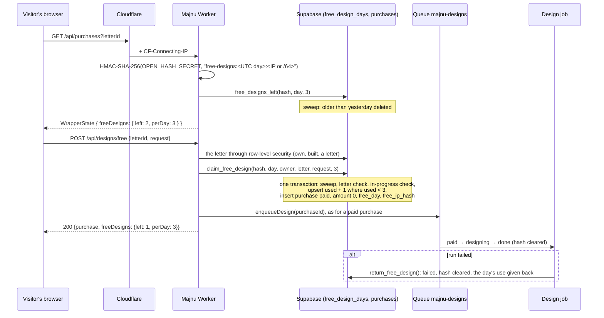

# Free designs: three personalised wrappers a day

## What it does

While Google's branding verification is pending, everyone can try the €2.99 personalised wrapper ([billing.md](billing.md)) for free: **three designs per internet connection per UTC day**, for guests and members alike (issue #85). While a connection has free designs left, the button on a wrapped gift reads **Make it unique, free today**, and the dialog leads with them: the design request, a quiet line **Free today: 2 of 3 left** and the button **Make my design, free**. There is no account step, no consent box and no code field, because nothing is paid. The design starts straight away and the dialog closes on the usual status card. Once the day's three are used, the dialog is exactly as before: coupon codes ([coupons.md](coupons.md)) and Stripe Checkout. The Purchases tab lists a free design as **Free**.

A connection is counted by a keyed hash of its IP address and the day, never the address itself, and nothing about it is kept beyond two days.

## How it works

### Counting a connection without keeping its address

[`lib/billing/free-designs.ts`](../../lib/billing/free-designs.ts):

1. **The address.** Cloudflare's `CF-Connecting-IP`, which every request to the Worker carries and a visitor cannot set. `X-Forwarded-For` is read only under `next dev`, which has no Cloudflare in front; anywhere else it is whatever the visitor sent, so it is ignored, and without an address free designs are simply not offered.
2. **One connection, written one way.** An IPv4 address as is (leading zeros dropped), an IPv4 address mapped into IPv6 (`::ffff:203.0.113.47`) as the IPv4 address, and any other IPv6 address as its **/64 network**. Phones and home routers get a whole /64 and change the last 64 bits whenever they like, so counting full IPv6 addresses would give one connection unlimited free designs.
3. **The hash.** HMAC-SHA-256, keyed with `OPEN_HASH_SECRET` (the server secret open tracking and gift claims use, [sharing-and-tracking.md](sharing-and-tracking.md)), of `free-designs:<UTC day>:<address>`. The prefix keeps these hashes apart from every other use of the secret. Without the secret the hash cannot be turned back into an address by trying them all, and because the day is inside it, the same address gives an unrelated hash every day, so nothing links one day to the next. Only the hash and the day are sent to the database; the address is never stored and never logged (the unit tests check the database calls, the stored rows and every console call for it).

### Claiming

1. `GET /api/purchases?letterId=` now also returns `freeDesigns: { left, perDay }` from `free_designs_left()`, or `null` when free designs are not offered (switched off, no secret, no address) or the count could not be read; the dialog then offers what it offered before.
2. The dialog ([`make-it-unique.tsx`](../../components/wrapper/make-it-unique.tsx)) posts JSON to [`POST /api/designs/free`](../../app/api/designs/free/route.ts). A route of its own, like the coupon route, so the paid path is untouched. It refuses cross-site posts (403) and anything but JSON (415), and needs a session: a member or a guest (401 without one).
3. [`claimFreeDesign()`](../../lib/billing/free-designs.ts) cleans the request as Checkout does (3 to 500 characters), reads the letter through row-level security (the sender's own built letter, not a calendar), hashes the address and calls `claim_free_design()`.
4. **`claim_free_design()`** ([`0012_free_designs.sql`](../../supabase/migrations/0012_free_designs.sql)) is one transaction, executable only by the service role:
   - it sweeps (below);
   - it checks the letter again (owner, kind, built), as a backstop;
   - it refuses with `in_progress` when a design for the letter is already paid or designing, as Checkout and coupons do;
   - it takes one use with a single conditional upsert, `insert into free_design_days (day, ip_hash, used) values ($day, $hash, 1) on conflict (day, ip_hash) do update set used = used + 1 where used < $limit`; when nothing comes back, the answer is `used_up`;
   - it inserts the purchase as `paid` with `paid_at`, `amount_cents = 0`, `free_day` and `free_ip_hash`, and no consent, coupon or Stripe ids.
   A unique violation from a concurrent purchase of the same letter rolls back the use the transaction took and answers `in_progress`. The day is checked to be today in UTC (give or take one, for clocks either side of midnight), because it is inside the hash.
5. The purchase goes to the design queue with [`enqueueDesign()`](../../lib/billing/queue.ts), exactly like one Stripe confirmed. If it cannot be handed over, the free design is given back and the route answers 502.
6. The route answers `200 { purchase, freeDesigns }`; the dialog closes onto the status card ("Free design, starting soon") with focus on it.

| Answer | Status | Message |
|---|---|---|
| Claimed | 200 | (the status card: "Free design, starting soon") |
| `free_used_up` | 429 | Today's free designs are used up. You can still make it unique with a code, or for €2.99. |
| `free_unavailable` (switched off, no secret, no address) | 503 | Free designs aren't available just now. |
| `in_progress` | 409 | A design for this gift is already being made. … |
| `invalid_request` | 400 | Describe the look you want in a few words (at most 500 characters). |
| `letter_not_found`, `not_a_letter`, `not_built` | 404, 422, 422 | As for Checkout |
| The design could not be started | 502 | We couldn't start your design just now. It didn't use one of your free designs. … |

On `free_used_up` or `free_unavailable` (another tab, or someone else on the same connection, used the last one) the dialog does not show an error on a form it can no longer submit: it falls back to today's dialog, a member keeps the request they typed, and the reason is shown above it (focused when the free form's controls are gone).

### Why the fourth claim always fails

The first claim of the day inserts the counter row; every later claim for the same day and hash conflicts on the primary key and takes the row lock. Concurrent claims queue on that lock, and Postgres re-evaluates `used < limit` against the row the one before left (read committed), so the fourth finds none left and updates nothing. The purchase is inserted in the same transaction, so a use is never taken without a purchase. Checked on Postgres 18 with separate connections (below): 4 claims at once give exactly 3 purchases, and 25 at once give exactly 3.

### The sweep: nothing kept beyond two days

`sweep_free_design_days()` runs at the start of `claim_free_design()` and `free_designs_left()`, that is whenever anyone opens the dialog or claims a free design. It clears `free_ip_hash` on purchases whose `free_day` is older than yesterday (UTC) and then deletes those days' counters. Both are index scans (the counters' primary key starts with `day`; a tiny partial index covers purchases that still carry a hash), and usually find nothing.

A purchase carries the hash only while its design is on its way, so a failed run can give the use back to the right counter: `markDone()` and `markFailed()` clear it, `return_free_design()` clears it, and the sweep clears whatever is left after a day. `free_day` (a date, nothing personal) stays, so the Purchases tab can say "Free".

### When a design fails

The design job ([`fulfil.ts`](../../lib/billing/fulfil.ts)) gives back what a purchase cost with `giveBack()` ([`refunds.ts`](../../lib/billing/refunds.ts)). For a free purchase it calls `return_free_design()`, never Stripe: it locks the purchase, marks it `failed` with the reason (only from `paid` or `designing`), clears the hash and gives the day's counter one use back. A second call (the dead-letter queue after the job) finds it failed and changes nothing; two calls at once queue on the purchase's lock, so the use is returned once. A purchase from a day older than yesterday is marked failed without touching a counter (that counter has been swept). The job's outcome is `free_returned`. The table forbids Stripe ids and a receipt on a free purchase, so it could not reach Stripe even through a bug.

The sender sees "Something went wrong. The design could not be made, so it didn't count as one of your free designs. You can try again." ([`view.ts`](../../lib/billing/view.ts), `statusWords`), and above the button: "Your last design could not be made, so it didn't count. You can try again."

**Lock order.** Every function locks purchase rows before counter rows, and a give-back never touches a counter older than yesterday (the one a sweep deletes), so a sweep and a give-back cannot deadlock. Both orders were run on Postgres with separate connections.

## Pieces

| Piece | Job |
|---|---|
| [`supabase/migrations/0012_free_designs.sql`](../../supabase/migrations/0012_free_designs.sql) | `free_design_days`; `purchases.free_day` and `free_ip_hash`; the relaxed constraints; `sweep_free_design_days()`, `claim_free_design()`, `free_designs_left()`, `return_free_design()` |
| [`lib/billing/free-designs.ts`](../../lib/billing/free-designs.ts) | The address (`CF-Connecting-IP`, /64 for IPv6), the keyed daily hash, `freeDesignsLeft()`, `claimFreeDesign()`, `FREE_DESIGNS_PER_DAY` |
| [`lib/billing/purchases.ts`](../../lib/billing/purchases.ts) | `freeDay` on a purchase; `returnFreeDesign()`; `markDone()` and `markFailed()` clear the hash |
| [`lib/billing/refunds.ts`](../../lib/billing/refunds.ts), [`fulfil.ts`](../../lib/billing/fulfil.ts) | `giveBack()`: the free design for a free purchase, the code's use for a coupon one, a Stripe refund otherwise |
| [`lib/billing/view.ts`](../../lib/billing/view.ts) | `FreeDesigns`, `WrapperState.freeDesigns`, `PurchaseView.freeDesign`, "Free", the status wording |
| `POST /api/designs/free`, `GET /api/purchases` | The routes |
| [`components/wrapper/make-it-unique.tsx`](../../components/wrapper/make-it-unique.tsx) | "Make it unique, free today", the free form, the fall-back when they run out |
| [`app/(app)/dashboard/purchases/purchases-view.tsx`](../../app/(app)/dashboard/purchases/purchases-view.tsx) | Shows the view's amount: "Free" |
| [`app/(marketing)/privacy/page.tsx`](../../app/(marketing)/privacy/page.tsx) | "Free designs": the keyed daily code, kept for two days |
| `OPEN_HASH_SECRET` | The key of the hash (already a Worker secret). Without it free designs are off |
| `MAJNU_FREE_DESIGNS_PER_DAY` | Optional. The number a day (default 3, at most 100); `0` switches free designs off and the dialog is as before issue #85 |

## Data and privacy

- **`free_design_days`**: the UTC day, the keyed hash and the number used. Row-level security on, no policies, no privileges for `anon` or `authenticated`; only the service role reads or writes it, through the functions. Rows older than yesterday are deleted as described above.
- **`purchases`** gains `free_day` (owners may read it on their own rows) and `free_ip_hash` (not granted to owners; set only while the design is on its way, cleared when it settles and after a day at the latest). A free purchase has `amount_cents = 0`, no consent (nothing is paid, so the withdrawal consent of § 356 (5) BGB does not apply), no coupon, and no Stripe ids or receipt; card and coupon purchases keep all of their constraints.
- **The IP address** is read from the request, normalised and hashed in memory, and never stored, sent to the database or logged. The hash cannot be reversed without the secret and changes every day.
- **The privacy page** says so in a short paragraph under "Free designs" (legal basis: legitimate interest in keeping a free offer fair, Art. 6 (1) (f) GDPR). Nothing about a free design reaches Stripe.

## Limits and costs

- A free design costs what a paid one costs us (about $0.26 of model use, capped at $3 per run, plus sandbox time, [daytona-redesign.md](daytona-redesign.md)), with no €2.99 to pay for it. Three per connection per day.
- One design per letter at a time; the request is at most 500 characters.
- There is **no site-wide daily cap** on free designs: someone with many addresses gets three per address. What bounds the total today is the model spend: the Anthropic monthly limit, and while the primary key is over its limit, `FALLBACK_CAP_USD` on the fallback key ([provider-fallbacks.md](provider-fallbacks.md)); a run that cannot get a key fails before its sandbox starts, and the free design is given back.

## How it was checked

- **Unit tests:** [`free-designs.test.ts`](../../tests/unit/lib/billing/free-designs.test.ts) (IPv4, IPv6 /64, mapped and invalid addresses; `CF-Connecting-IP` first, `X-Forwarded-For` only in development; the HMAC and that it changes daily and needs the secret; the number and the switch; the database calls with the hash and never the address, nor in a stored row or a log line; the fourth claim refused and another address allowed; a new UTC day; in progress; refusals before the database; unavailable; the use given back when the queue fails; no Stripe client), [`designs/free/route.test.ts`](../../tests/unit/app/api/designs/free/route.test.ts) (the real service and the real design job over the fakes: guests and members, no Stripe, the 4th refused with 429, an IPv6 /64 counted once, a failed run giving the free design back so it can be used again, the IP never stored, sent or logged, `X-Forwarded-For` ignored outside development, 503 when switched off, 409, 400, 404, 422, 401, 403, 415 and 502), [`fulfil.test.ts`](../../tests/unit/lib/billing/fulfil.test.ts) (a free run done keeps its use and clears the hash; a failed one gives it back once, from the job and from the dead-letter queue, without Stripe), [`view.test.ts`](../../tests/unit/lib/billing/view.test.ts) ("Free", no receipt, the wording), [`purchases/route.test.ts`](../../tests/unit/app/api/purchases/route.test.ts) (`freeDesigns`, and `null` when it cannot be counted).
- **The migration, before it was applied** (scripts kept outside the repository): on PGlite, 0001 to 0012 (without 0008, which needs Supabase Storage) with an existing card and coupon purchase, 85 checks: `anon` and `authenticated` cannot read or change `free_design_days` or run any of the four functions; RLS on with no policies; all four `security invoker` with an empty `search_path`; three claims then `used_up`, another address unaffected, a limit passed in; `in_progress` (paid and designing) and `letter_not_found` (unbuilt, calendar, someone else's, missing) taking nothing; the give-back once, marking failed and clearing the hash, then the letter claimable again; card and coupon purchases refused by `return_free_design()` and a free one by `return_coupon_use()`; `markDone`'s update clearing the hash; yesterday's purchase giving back to yesterday's counter; the sweep deleting counters from two and thirty days ago, keeping yesterday's and today's, and clearing old hashes on purchases while keeping `free_day`; the day, hash, limit and null-argument checks; every new constraint; owners reading `free_day` but not `free_ip_hash` or `select *`, and nothing of other users'. On a real Postgres 18.7 (embedded-postgres) with separate connections: 4 claims at once from one address (exactly 3 claimed, 1 `used_up`, 3 purchases); the same with the first claim's transaction held open (the other three wait on its lock, then exactly 3); 25 at once (exactly 3); two addresses on one letter at once (`claimed` and `in_progress`, the second address's use rolled back); two give-backs at once (one use back); a give-back and a sweeping claim in both orders (no deadlock, the old counter gone).
- **Live on a dev server:** `POST /api/designs/free` with curl and no session (401), cross-site (403), as a form (415) and with GET (405).
- **In the browser, at 375 px (emulated) and 1440 px,** with the API answers stubbed on a temporary page (removed before committing, because 0012 is not applied to the database yet): a guest with 2 of 3 left (the button "Make it unique, free today"; the dialog without account step, consent or code field; "Free today: 2 of 3 left"; an empty request refused with focus on the field; the keyboard order Close, request, ideas, "Make my design, free", Terms; a claim closing onto "Free design, starting soon" with focus on the card), a guest and a member with none left (today's dialog unchanged), the last one taken by another tab for a guest (back to the account step, the reason shown and focused) and for a member (the paid form, the request kept), the line after a failed free design, the Purchases list with "Free", "Free with a code" and a card purchase, reduced motion (no entrance animation, no breathing moon while busy), no horizontal scroll. Console clean.
- **Not checked:** the real flow against Supabase (claiming, the status card polling a real purchase, the Purchases tab) until 0012 is applied; `CF-Connecting-IP` on the deployed Worker; the queue consumer on Cloudflare running a free purchase.

## Open questions

- **No site-wide cap.** A daily cap on free designs across all addresses (say 100) would bound the cost of someone with many addresses. The per-address count is in place; a global row in `free_design_days` or a check in `claim_free_design()` would add it.
- **The sweep needs traffic.** It runs whenever anyone opens the dialog or claims a free design. On a day with neither, rows older than yesterday wait for the next visitor. A `pg_cron` job (`select public.sweep_free_design_days()` every hour) would make the two days exact without traffic; it needs the extension switched on in Supabase.
- **Shared connections.** Everyone behind one address (an office, a university, a mobile carrier's NAT) shares three a day. Fine for a trial; worth knowing if many people report "used up" on their first try.
- **The end of the offer.** When Google's verification is done, `MAJNU_FREE_DESIGNS_PER_DAY=0` switches free designs off without a code change; the counters then empty themselves within two days of traffic.
