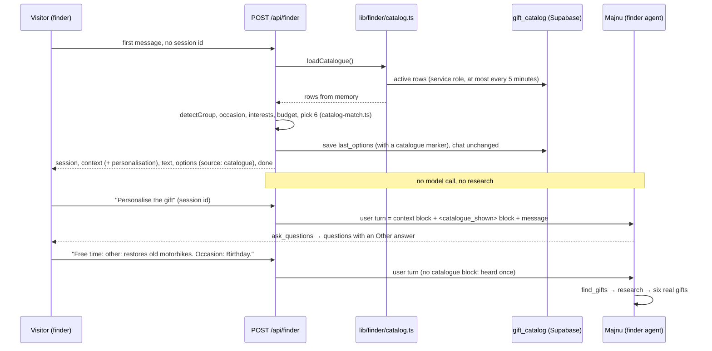

# Gift catalogue and the finder's instant first answer

Issue #97. Owner: Dev A.

## What it does

The finder's first answer comes at once, from Majnu's own catalogue of real gifts, instead of after a round of questions. A visitor writes "Ein Geschenk für meine Mama" and sees, within about a second, a short line from Majnu ("Hier sind sechs Ideen für den Anfang. Mein Favorit steht vorne."), six gift cards for a mother (the recommended one first, with why), and under them "Want ideas made just for them?" with a "Personalise the gift" button. Tapping it shows Majnu's questions, each with its tappable answers and an "Other" answer that opens a small field for the visitor's own words. Only after the answers does the live research run, as before. Every catalogue gift can be chosen and wrapped exactly like a researched one.

Next to "Their profile so far" the finder shows a small "Personalisation" meter, 0 to 100 %, and one hint for the addition that would raise it most ("Add their Instagram, TikTok or LinkedIn: +20").

## How it works

1. **Who it is for.** `detectGroup()` in `lib/finder/catalog-match.ts` matches the message, lower-cased and without accents (ß as ss), against keyword lists in English, German and Spanish for nine groups: mother, father, partner, best_friend, sibling, grandparent, colleague, child_teen, and `general` when nothing matches. A word right after "for my / für meine / para mi" wins over one named earlier ("my sister and I want a gift for our mum" is for a mother), then the earliest, then the longest ("beste Freundin" is a best friend, "Freundin" alone a partner). The word as the visitor wrote it becomes the relationship chip ("Mama").
2. **What else the message says.** `detectOccasion()` (birthday, christmas, anniversary, valentines, mothers_day, fathers_day, wedding, thank_you, graduation, retirement, housewarming, new_baby, get_well, farewell, the same names as the catalogue's tags), `detectBudget()` ("under 50 €", "unter 30 Euro", "menos de 40", "€25") and `interestWords()` plus `interestTags()`, which map words in the three languages to the catalogue's English interest tags ("Kochen" → cooking, "leer" → reading, "Wellness" → wellness).
3. **Picking six.** `pickCatalogueGifts()` scores every row: 10 for the group, 5 for a general gift, 0 otherwise; +3 for the occasion; +2 per interest match (at most two); +1 within a stated budget, −4 over it. Rows without an https link are skipped and no title repeats. Ties are broken by a hash of the session id, so the order is stable within a session and varies between sessions. The best is recommended and comes first. If the group has fewer than six, general gifts and then any others fill up.
4. **The instant answer.** The route (`app/api/finder/route.ts`) takes this path for the first message of a conversation as the visitor sees it (no session id, or a session that has shown nothing), when it has no files and no wrap choice, and the catalogue has rows. It saves the six as the session's `last_options` (so Choose and the wrap step find them) with a marker `{ message, group, startedOver? }`, leaves the stored conversation untouched, and streams `context`, `text`, `options` with `source: "catalogue"`, and `done`. The language of the line comes from the message's little words ("für", "para", "for"), else the browser.
5. **The next model turn.** When the visitor's next message reaches Majnu, the route turns the marker into a `<catalogue_shown>` block (the first message and the ideas shown, angle brackets removed so nothing can close the block) that goes into that user turn after the context block, and saves the options without the marker, so it is heard once. The system prompt tells Majnu that "Personalise the gift" after the catalogue means: ask one round with `ask_questions`, or search at once if the first message already said what the person loves and more.
6. **Fallback.** Without catalogue rows (not imported yet, or the table cannot be read and nothing is cached), a first message goes to Majnu, who asks first, as before issue #97. A first message with files also goes to Majnu, because the files need reading.

**Rich first messages.** A first message always gets the catalogue's answer, even one with interests and a budget. It is instant and free (strangers from ads spend nothing on the model), its details already steer the picking, and they reach Majnu with the personalise tap, where Majnu may search at once instead of asking.

### The "Other" answer

`components/finder/conversation.tsx` adds an "Other" chip after each question's answers; picking it opens a 200-character field. `composeAnswers()` in `finder-state.ts` sends it like a picked answer, as "Free time: other: restores old motorbikes.", and only once something is typed. The system prompt tells Majnu that an "other:" answer is in the visitor's own words.

### The personalisation score

`personalisationScore()` in `lib/finder/personalisation.ts` (pure, used by the route) weighs what Majnu knows, out of 100:

| What | Points |
|---|---|
| Who it is for | 10 |
| Age | 8 |
| Occasion | 10 |
| Budget | 8 |
| Interests | 6 each, up to 3 (18) |
| Name | 6 |
| A public profile or page read | 20 |
| Notes from shared files | 5 each, up to 2 (10) |
| Answers in their own words ("Other") | 5 each, up to 2 (10) |

`next` is the missing item with the biggest gain (ties in the order profile, interests, relationship, occasion, notes, own words, age, budget, name). The route adds `personalisation` to every `context` event, counting profile reads with status "read" and the "other:" answers in the visitor's own messages of this conversation. `components/finder/personalisation-meter.tsx` shows a `role="meter"` bar with the percentage and the hint; the bar's width transition runs only without reduced motion.

## Pieces

| File | Role |
|---|---|
| `supabase/migrations/0014_gift_catalog.sql` | The table: id, groups[], occasions[], interests[], title, description, why, shop, price, price_eur, url, image_url, checked_at, active, created_at, updated_at; https checks; GIN indexes on groups and occasions for active rows; RLS on, no policies, no grants to anon or authenticated |
| `scripts/catalog-import.mjs` | `npm run catalog:import -- <file> [--dry-run]`: checks each row, lists the skipped ones, counts by group, upserts by id in batches of 100 with the service-role key from `.env.local` |
| `lib/finder/catalog.ts` | Server only: reads the active rows (at most 1,000) with the admin client, keeps them in memory per Worker for 5 minutes, never throws |
| `lib/finder/catalog-match.ts` | Pure: group, occasion, budget and interest detection, picking, options, the line, the marker and the `<catalogue_shown>` text |
| `lib/finder/personalisation.ts` | Pure: the score and the next hint, and counting "other:" answers |
| `lib/finder/events.ts` | Additive: `options.source?: "catalogue"`, `context.personalisation?` |
| `lib/finder/sessions.ts` | Additive: `StoredOptions.catalogue?`, parsed and kept |
| `lib/finder/agent.ts` | The system prompt's "Ask first, then search" section, the tool descriptions, `catalogueShown` in the user turn |
| `components/finder/*` | The offer under catalogue options, the Other chip and field, the meter, the client parser keeping the new fields |

## Data and privacy

- The catalogue holds no personal data. It is read only by server code with the service role; visitors receive only the six picked, as options.
- The visitor's first message is kept in the session's `last_options` marker until the next model turn has heard it, in the visitor's own session row, which only they and the server can read. It is dropped from the row when that turn is saved.
- The link and image of each gift come from the shop, checked by whoever collected it. Later the links may carry referral codes; the import replaces them by id.

## Limits and costs

- The instant answer makes no model call and no research call. It reads the database at most once every 5 minutes per Worker and writes the session row once.
- It still goes through the session limits: a new session needs `canStartSession`, and today's open session is reused after a reload.
- The personalise tap is one ordinary finder turn (as before, the first message's turn), and the search after the answers is one research run.

## How it was checked

- **Unit tests** (`npm test`): `tests/unit/lib/finder/catalog-match.test.ts` (group detection in English, German and Spanish, occasions, budgets, interests, picking, fill-up, seeds, options, the line and the block, and 27 real rows from the first catalogue as fixtures), `tests/unit/app/api/finder/catalogue.test.ts` (the first message streams options with no model call, saves them with the marker, the started-over marker, the fallback without rows, files go to Majnu, a failed save, the next turn's block, askFirst off, the marker dropped, the score counting profiles and own answers), `tests/unit/lib/finder/personalisation.test.ts`, and additions to the agent, sessions, answers and ndjson tests.
- **Import script**: a dry run against the collected file (87 gifts, 0 skipped; mother 20, father 17, partner 24, best_friend 27, sibling 24, grandparent 24, colleague 21, child_teen 17, general 20).
- **Migration** on PGlite: applied after a stand-in `set_updated_at()`; service_role inserts, upserts and reads by group, the updated_at trigger fires, http links and empty groups are refused, anon and authenticated get "permission denied" for select and insert, RLS is on, and all 87 real rows insert.
- **Browser** (isolated Chrome, 375 and 1440 px, a real guest session, the catalogue read from the collected file through a temporary local change that was not committed, the model replaced by a local stub that answers `ask_questions`): a German first message showed six gifts for a mother with a wellness gift recommended, the German line, the chips and the meter; "Personalise the gift" made exactly one model request, which carried the `<catalogue_shown>` block; the questions showed an Other chip whose field took focus; Send answers sent "Free time: other: restores old motorbikes. Occasion: Birthday." with no catalogue block; Choose opened the wrap step for a catalogue gift; a Spanish message showed six partner gifts with the Spanish line. No console errors. The session row held the `cat-` option ids.

## Open questions

- Wrapping a catalogue gift all the way to a page was not run in the browser (the wrap route calls the model); the route finds the option the same way as a researched one.
- The meter's rise animation was not watched with reduced motion on; the transition is `motion-safe:` only.
- The catalogue has few reading gifts for partners, so "le encanta leer" picked none: more rows per interest would help.
- Keyword detection misses unusual phrasings; the model could refine the group in the same turn later, if it stays fast.
