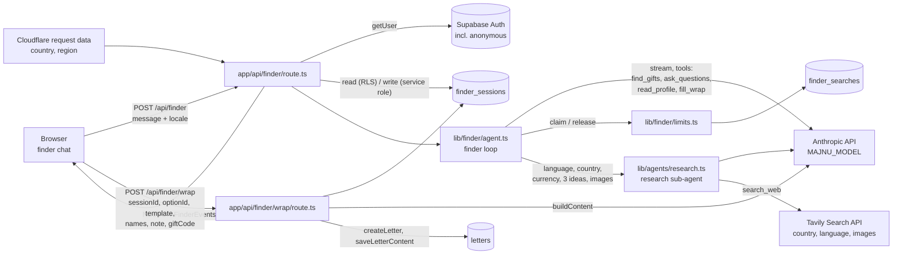
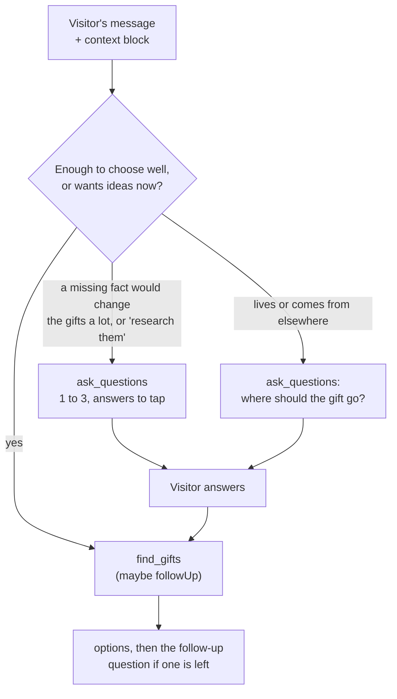
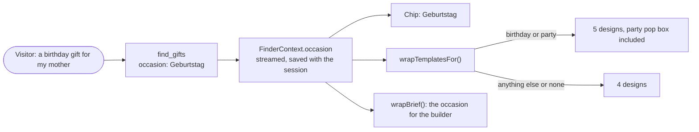
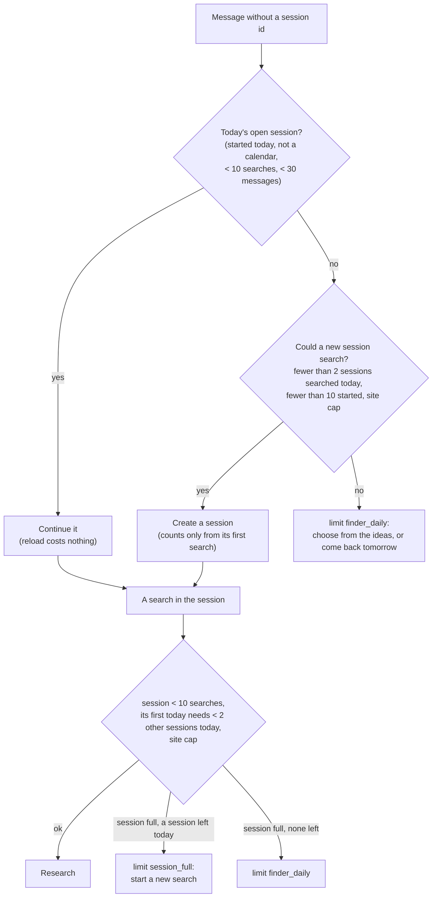

# Gift finder: agent and API

Issue #31. The server side of the main flow in [../plan.md](../plan.md), "Gift finder". The chat on the landing page that uses it is [gift-finder-ui.md](gift-finder-ui.md) (issue #32); anonymous accounts are #33. Asking before searching, the wrap step's conversation, the gift code and the limits of 22 November are issues #70 and #71.

## What it does

A visitor types who they are looking for a gift for ("Finde ein Geschenk für meine Mutter"). When that is enough, Majnu assumes the rest, shows those assumptions as chips (mother, about 45 to 70, Berlin, euros), searches the web in the visitor's language and country, and shows three gifts with a photo, a local price, the shop and a link, one of them recommended with a reason, sometimes with one follow-up question under them. When what is missing would change the gifts a lot, or the visitor asks Majnu to research the person first, it asks one to three questions with answers to tap before searching. Asked to personalise, it asks again and searches again. Choosing a gift opens the wrap step: a message typed there reaches Majnu with the chosen gift and design, and Majnu can fill in the names, the note and the gift code for the visitor to check. Wrapping puts it in a gift reveal, 3D gift box, party pop box, classic envelope or postcard page, saved as the visitor's letter at `/l/<slug>`, with the gift code hidden inside until it is opened.

## How it works



One search, in order:

1. The browser posts `{ message, locale }` to `POST /api/finder` (the contract is `lib/finder/events.ts`). The route checks the Supabase session with `getUser()`; anonymous users count. Without one it answers 401 `{ "error": "session_required" }`.
2. The route reads the country and the first-level region from Cloudflare's request data (`getCloudflareContext().cf`), or only the country from the `cf-ipcountry` header. The language and timezone come from the body; the currency follows from the country (`lib/finder/context.ts`).
3. A message without `sessionId` continues today's open session if there is one (`findOpenSession()`: the newest finder session started today, not a calendar's, with searches and messages left), so a reload or the finder opened again uses up nothing; otherwise the route checks that a new session could search today, creates a `finder_sessions` row. Either way it streams `session` first. Later messages send `sessionId`; the route loads the session through row-level security and refuses after 30 messages (`session_full`).
4. The finder agent sends one streamed request with a byte-stable system prompt and four tools. The visitor's message is preceded by a `<context>` block: today's date, the browser language, where the connection comes from, and the local currency; on the wrap step also the chosen gift and design, and for a continued session a line saying the visitor sees nothing from before. The model's text streams as `text` events.
5. The model decides whether to search now or ask first (below). To search, it calls `find_gifts` with its assumptions: the relationship in the visitor's words, the kind of relationship, the name, age, budget, interests and occasion when the visitor gave them (each is a required field that is null when unknown), the country the gift goes to when it is not the visitor's own, a sentence for the researcher, a status line in the visitor's language, and an optional follow-up question. The server fills in a default age range for the kind of relationship (partner 20 to 35, parent 45 to 70, grandparent 65 to 90, friend or sibling within five years of the sender when their age is known).
6. The server claims the search in `finder_searches` (see "Limits and costs"). If a limit is reached, it streams `limit` and the turn ends.
7. It streams `context` and `status`, then runs the research sub-agent: up to 4 Tavily searches and 4 model requests, in the visitor's language and country, reporting three ideas with a description, reason, price, shop and link, one recommendation and why. Each idea gets the product photo Tavily returned for the very page it links to; a link to a site no search returned is dropped.
8. Ideas without a link are left out. The rest become `GiftOption`s with ids that are stable within the session, streamed as `options` with `recommendedId` and `why`. If none is left, or research failed, the search is given back and an `error` event says so.
9. If the model gave a follow-up question and another search would still be allowed in the session, it streams as one `question` event under the options. The turn ends there, without a closing model request: the visitor's next move is to look at the options. The route appends the turn to the stored conversation, saves the context and the options, and streams `done`.

### Searching now or asking first (issue #70)

Until 22 November the prompt said "Don't ask questions first", so Majnu searched on every message, even "my friend is from Venezuela, 30, likes video games", where it assumed the connection's city. The prompt (still byte-stable for prompt caching) now lets the model decide each turn:



- "Find a gift for my mother" is named in the prompt as enough: the one-tap path from ads still shows gifts in one turn.
- After the visitor has answered, Majnu searches; it does not ask twice before showing options.
- A question may invite the visitor to say more in their own words, and once per conversation it may ask for a public Instagram, TikTok or LinkedIn profile or any public page about the person, with "No public profile" to tap ([social-profiles.md](social-profiles.md)). Majnu never looks anyone up by name or email address: a pasted email address gets one sentence saying so and a request for a profile link or what the visitor knows.
- `find_gifts.country` (an ISO code, null for the visitor's own) moves the search: `contextFor()` sets that country and its currency and drops the visitor's region, so the researcher no longer hears "Berlin" for a gift to Venezuela. The "Berlin" examples are gone from the prompt and the tools.
- `find_gifts.followUp` is one question that would most improve the next search. It costs no extra request: it comes with the search call, and the server streams it after the options only when `canSearch()` says another search is allowed in the session.
- `ask_questions` still checks `canSearch()` first, so it never asks questions whose answers could not be searched.

### On the wrap step (issues #70 and #71)

```mermaid
sequenceDiagram
  participant V as Visitor (wrap step)
  participant F as POST /api/finder
  participant S as finder_sessions
  participant M as Finder model
  V->>F: message + wrap { optionId, templateId }
  F->>S: load session (RLS), find optionId in lastOptions
  alt not among the last options
    F-->>V: 404 optionNotFound (no model call)
  end
  F->>M: context block + "The visitor chose "Photo book A4" and the 3D gift box design and is filling in the page."
  M-->>F: one sentence + fill_wrap { recipientName, senderName, note, giftCode }
  F-->>V: text, fill { fields }, done
  Note over V: the form shows the fields for the visitor to check; Wrap stays theirs
```

- While the wrap step is open, the finder sends `wrap: { optionId, templateId }` with each message (`FinderRequest.wrap`, additive). The route accepts it only with a session id and a template from `WRAP_TEMPLATE_IDS`, and looks the option up in the session's own last options, never trusting the browser's copy; anything else is refused before any model call. The agent hears the choice in the context block (`wrapFrameLine()`: the title without angle brackets, so a shop's title cannot close the block, and the design's name from `lib/letters/templates.ts`).
- The prompt tells Majnu to answer in that frame and not to search again unless the visitor asks for other gifts. If it does search, the new options replace the session's last options, and the finder closes the wrap step so the visitor sees them.
- `fill_wrap` takes the recipient's name, the sender's name, a note and a gift code, each null when not said. `parseFillWrap()` trims them, cuts them to the form's limits (60, 60, 600 and 200 characters) and leaves out empty ones; the server streams them as one `fill` event and ends the turn. Outside the wrap step, or with nothing to fill, the call gets an error result and Majnu answers in words. Nothing is wrapped by the model: the visitor checks the form and presses Wrap.

The context the server streams and saves is what the chips show: the place, language and currency from the request, and from `find_gifts` the relationship, the age range, the budget, the interests and, since issue #59, the occasion as the visitor said it (`FinderContext.occasion`, an additive optional field). The occasion is kept because the wrap step needs it; the chip lets the visitor see and correct it.

Public profiles: when the visitor pastes a public Instagram or TikTok profile, or another public page about the person, the model calls a third tool, `read_profile`, before `find_gifts`. Its 3 to 6 interests are merged into the next search's context. That is its own page, [social-profiles.md](social-profiles.md) (issue #34).

Personalising: when the visitor asks for it (the finder's button sends "Personalise the gift") or says none fit, the model calls `ask_questions`. The server first checks that another search would still be allowed in the session, then streams up to three `question` events with up to four `suggestions` each, and the turn ends. The visitor's answers are the next message. Every search after the first in a session is still recorded as personalised in `finder_searches`, but since 22 November that no longer changes any limit, and no account is needed.

Wrapping: `POST /api/finder/wrap` with `{ sessionId, optionId, templateId }` (and optionally the names, a note and `giftCode`, at most 200 characters after trimming) loads the session through RLS, finds the option among the last ones shown, checks the daily letter limit (the new-gift gate it also asks is open to everyone), then has the builder sub-agent write the page in the visitor's language. The finder's form always sends their name (it is required there, issue #71); the brief then says "Use exactly this as recipientName", and the names the sender typed replace the builder's after the build. Only an API caller that sends no name still gets the relationship fallback ("Mama" for a mother). `templateId` is one of `WRAP_TEMPLATE_IDS` in [`lib/finder/wrap.ts`](../../lib/finder/wrap.ts): `gift-reveal`, `gift-box-3d`, `party-box`, `classic-envelope` or `postcard` (the two boxes since issue #50); anything else is a 400.

Which of them the finder offers depends on the occasion (issue #59). [`lib/finder/wrap-templates.ts`](../../lib/finder/wrap-templates.ts) has `isPartyOccasion()`, which looks for the words for a birthday or a party in the occasion, in the languages visitors write in most (English, German, French, Spanish, Italian, Portuguese, Dutch, Polish, Turkish, the Scandinavian languages, Russian and Arabic), ignoring case and accents. Compounds count ("Kindergeburtstag", "Überraschungsparty"); words that contain a party word but mean a holiday, a memorial or a parent's day are taken out first ("Feiertag", "Trauerfeier", "fête des mères", "festa della mamma"), and short or ambiguous words count only on their own ("fiesta" but not "felices fiestas", "feest" but not "kerstfeest"). `wrapTemplatesFor(context)` then offers the party pop box only for a birthday or a party; the 3D gift box and the other three are offered for every gift. The route still accepts all five ids, so a page opened before the change keeps working.



- The builder is called with `giftRequired: true`, so a page without the gift goes back to the model once, even on a party pop box, where a gift is otherwise optional. The brief says the page is a gift and not an invitation. It passes on the occasion the finder heard ("Occasion, as the sender told the gift finder: Geburtstag"), unless the sender's note names another; without one it asks for a celebrating occasion ("Celebration") on a party pop box and a gentle one ("Just because") otherwise.
- The gift on the page is copied from the stored option after the builder has run, so the model cannot change its link or price. Any `event` the builder wrote is dropped at the same time: the finder never learns a date or a place, so an event could only be made up, and the party pop box would show it as the party.
- The gift code (issue #71) is put in `gifts[0].code` at the same moment, never through the model: the brief only says that a code is waiting inside, so the builder neither writes one nor invents one. Every wrap template shows a code only once the gift is opened (the gift reveal and both boxes after the unwrap, the envelope and postcard behind "Show the code"). The page title and the link preview name only the template and the recipient (`titleFor()`, `components/letters/page-meta.ts`), so the code never appears there. Like every letter's content, the code is in the page's data for the recipient's browser, which is who it is for.
- Building comes before `createLetter()`, so a failed build leaves no empty letter. The title comes from `titleFor()`: "A gift for …" for the gift reveal and both boxes. The answer is `{ letterId, slug }`.

## Pieces

| Piece | Job |
|---|---|
| `lib/finder/events.ts` | The contract with the finder chat: request, streamed events, wrap call. Frozen; additive changes only. |
| `app/api/finder/route.ts` | Session check, location and locale, continuing today's open session or creating one, the wrap choice checked against the session, the per-session message cap, the stream, saving the turn append-only. |
| `app/api/finder/wrap/route.ts` | Wrapping a chosen option: session, option and letter limits, the gift code, then `wrapOption()`. |
| `lib/finder/agent.ts` | The finder loop: system prompt, `find_gifts` (with `country` and `followUp`), `ask_questions`, `read_profile` ([social-profiles.md](social-profiles.md)) and `fill_wrap`, the context block with the wrap step's line, default age ranges, the context with the occasion and name it heard, turning research into options. |
| `lib/finder/wrap-templates.ts` | Which designs the wrap step offers: `isPartyOccasion()` and `wrapTemplatesFor()`, the party pop box only for a birthday or a party (issue #59). Client-safe, used by the wrap view. |
| `lib/finder/context.ts` | Country and region from the request, language, timezone, currency, place names, age-range defaults. |
| `lib/finder/limits.ts` | 2 finder sessions a day counted from their first search, 10 searches and 30 messages per session, sessions started per day, the site-wide cap; finding today's open session; claiming and releasing searches. |
| `lib/finder/pool-limits.ts` | The calendar mode's limits, counted the same way ([advent-calendar.md](advent-calendar.md)). |
| `lib/finder/sessions.ts` | Reading sessions through RLS (one by id, or today's for continuing one) and writing them with the service role. |
| `lib/finder/wrap.ts` | The builder's brief, and the chosen gift copied into `gifts[]` without its image (and without any event), with the sender's gift code and typed names. `WRAP_TEMPLATE_IDS` lives in `wrap-templates.ts` and is re-exported here; the finder offers the same five, in its own order, as `WRAP_TEMPLATES` in `components/finder/finder-state.ts`. |
| `lib/finder/messages.ts` | The sentences the server writes itself (limits, errors, the fallback status), in English and German. |
| `lib/finder/stream.ts` | The NDJSON stream, built on `lib/agents/ndjson.ts`. |
| `lib/agents/research.ts` | The research sub-agent, shared with the main agent's `research_gifts`. `researchGiftReport()` is the finder's richer report; `researchGifts()` keeps the main agent's shape. |
| `lib/agents/tavily.ts` | One Tavily search, with the visitor's country (Tavily's own country names), language and product images. |
| `finder_sessions` (migration `0004_finder.sql`) | One row per finder conversation: owner, context, timezone, the conversation as the API returned it, the last options. |
| `finder_searches` (same migration) | One row per search: owner, session, whether it was personalised, when. Counted for the limits. |
| `MAJNU_DAILY_SEARCH_CAP` | Searches the whole site may run per UTC day. Default 300; 0 switches new searches off. |
| `TAVILY_API_KEY` | Tavily search. Without it, research falls back to Anthropic's web search (no product photos). |
| `MAJNU_MODEL` | The model for the finder, research and the builder (default `claude-opus-5-5`, low effort). |

## Data and privacy

- Stored per session: the context Majnu assumed (country, region, language, currency, relationship, the person's name when given, age range, budget, interests, occasion), the browser timezone, the conversation exactly as the Anthropic API returned it (including what the visitor typed on the wrap step, so a gift code told to Majnu is in it), and the last options. Per search: owner, session, personalised, time. Nothing is deleted automatically yet.
- The gift code typed into the wrap form goes only into the letter's content (`gifts[0].code`), never into the brief, the title, the link preview or the logs.
- Location: only the ISO country code and the first-level region (a state such as "Berlin") are read. Cloudflare's request data also carries the city, postal code and coordinates, and the request has an IP address; the finder reads none of them, stores none of them and logs none of them.
- Who can read it: row-level security is on for both tables. Signed-in users, anonymous ones included, can read only their own rows; there is nothing for `anon`. Every write goes through server code with the service-role key after `getUser()` has identified the user, because the conversation is replayed to the model and the search rows are what the limits count. The wrap route trusts only the options stored in the session, never an option sent by the browser.
- Product images are shown in the finder only. The wrapped gift page never gets `imageUrl`, because gift pages load nothing from other sites: a shop's image URL would tell the shop who opened the gift and when.
- Logs carry error classes, HTTP statuses and request ids, never the visitor's message, search queries or options.
- The browser's language tag is canonicalised before it goes into the model's context block, so no other text from the request can reach the prompt that way.

## Limits and costs

The developer's decision of 22 November (issue #70) replaced "3 searches a day, 2 of them personalised" with limits counted by session:



- **Finding and personalising are open to guests.** An invisible guest account (a Supabase anonymous user) has exactly the same limits as a signed-up one, and nothing in the routes or the agent asks for an account. The only payment anywhere is the €2.99 personalised wrapper; the `signin_required` reason stays in the contract for calendars.
- **2 finder sessions per user and UTC day.** A session is one conversation ("New search" in the finder starts another). It counts on a day from its first search that day, so a session that never searched costs nothing (counted from `finder_searches`, which records each search's session; no migration). Calendar sessions are not among the two.
- **10 searches per session**, plain or personalised alike (`FINDER_LIMITS.searchesPerSession`). The eleventh is refused with `session_full` ("start a new search") while one of the day's sessions is left, and with `finder_daily` ("come back tomorrow") when not. Either way the visitor can still choose and wrap the ideas shown: the wrap route checks only the letter limit.
- **Continuing an open session.** A message without a session id continues the newest finder session started today that still has searches and messages left, and Majnu hears that the visitor sees nothing from before. So a reload, the landing page's finder opened again, or "New search" while the session still has room never uses up a session.
- **30 messages per session** (`session_full`) and **10 sessions started a day** (`finder_daily`), because every message is a model request even without a search. A visitor using the finder as meant never reaches either.
- Site-wide: `MAJNU_DAILY_SEARCH_CAP` searches a day (`site_busy`), checked after the visitor's own limits. Refusals are kind sentences in the visitor's language (English or German), sent as a `limit` event. `personalise_daily` stays in the contract for older pages but is no longer sent.
- A search is claimed by inserting its row first and counting second, so two requests at the same moment can both be refused but never both get past a limit (also two sessions starting at once). A search that fails, or finds nothing with a link, is given back.
- Messages over 2,000 characters are refused. One message makes at most 3 finder requests plus one research run (at most 4 requests and 4 searches); a follow-up question and `fill_wrap` add no request. Wrapping is one builder call (two if the first output does not fit), under the existing limit of 5 letters per user per day.
- A visitor's most in a day is now 20 searches instead of 3; the site cap (default 300) and the fallback key's `FALLBACK_CAP_USD` bound the total.
- Measured on 21 November with `claude-opus-5-5` at low effort: a first search took 23 s with 2 Tavily searches, a personalised search on Anthropic's web search took 28 s, the personalising questions 3.6 s and wrapping 3.5 s. Token usage per search was not measured. Tavily's basic search costs 1 credit per search, so a search costs 1 to 4 credits.

## How it was checked

- Unit tests, with the model, Tavily and Supabase mocked:
  - `tests/unit/lib/finder/`: context and currency, age-range defaults, the limits (including the site cap and two claims at once) against an in-memory stand-in for the database, the event sequence for a first search and for personalising, failures, and wrapping.
  - `tests/unit/app/api/finder/`: both routes.
  - `tests/unit/lib/agents/research.test.ts` and `tavily.test.ts`: language, country, currency, images and links.
- Migration: `0001` + `0002` + `0004` applied in PGlite with stand-ins for Supabase's `auth` schema and roles. Owners read only their own rows, the API roles cannot write either table, and `anon` cannot read them. The lead applied it to the project and checked that the anon key is refused on both tables.
- Live, with the limits and the letter store mocked so nothing was written to the database:
  - One full flow from a German browser in Berlin, "Finde ein Geschenk für meine Mutter": three German options in euros, two with a photo, one recommended. Then three personalising questions with answers to tap, and a personalised search. Wrapping the recommended gift gave a German gift reveal with the gift copied exactly and no image.
  - Then two checks of the fixes that run showed were needed. One direct Tavily search checked the product-image choice: three of five shop pages got a product photo, the other two a sale card and a site graphic. Finder requests with research mocked checked that the age, budget and interests the visitor gave reach the chips: before the fix the model put them only in `about`; after it, "sie wird 62 … Budget etwa 50 Euro" gave age 62, the budget and two interests, in a single call.
- Live as a guest, on 21 November, through the landing page on `next dev` against the real Supabase project (anonymous sign-ins switched on; Turnstile's site key left empty because Cloudflare refuses a browser driven by DevTools): the visitor was signed in anonymously, "Find a gift for my mother" gave three English options in euros with one recommended (20 s), "Personalise the gift" gave three questions with answers to tap (2 s, no sign-in asked), and a typed answer ("she loves gardening, she is about 60, and it is for Christmas") gave a personalised search with three new gardening gifts and the chips "About 58–62" and "Likes gardening" (17 s). Two searches in total; nothing was wrapped.
- With `curl` against `next dev`: both routes answer 401 `{ "error": "session_required" }` without a session, also with a forged cookie, and GET answers 405.
- Against the finder chat's transport (`components/finder/transport.ts`, merged from #32): errors before a stream are mapped by status, so a message that is too long answers 413; limits and errors during a reply are events; wrap errors carry `error` and, for finder limits, `reason`.
- Issue #50 (the 3D gift box and party pop box as wrappers), 22 November:
  - Unit tests: [`wrap.test.ts`](../../tests/unit/lib/finder/wrap.test.ts) (both boxes build with `giftRequired`, get the chosen gift card, the title "A gift for …" and no event even when the builder wrote one; the party box's occasion; `WRAP_TEMPLATE_IDS` equal to what the finder offers), [`route.test.ts`](../../tests/unit/app/api/finder/wrap/route.test.ts) (the five ids accepted, `wedding-envelope-3d`, `treasure-map` and the others refused), [`finder-state.test.ts`](../../tests/unit/components/finder/finder-state.test.ts) (the order of the choices, choosing either box, guest or member), and [`builder.test.ts`](../../tests/unit/lib/agents/builder.test.ts) (the rules and titles).
  - Live against `next dev` and the real database, as a temporary member (made with the admin API, deleted afterwards with every row it owned): `POST /api/finder/wrap` with the member's cookie answered 400 for `treasure-map` and `wedding-envelope-3d`, and for `gift-box-3d` got past validation, the stored session and option and the limits to the builder. A `gift-box-3d` letter carrying a stored option exactly as `giftFromOption()` copies it rendered at `/l/<slug>` at 375 and 1440 px: the box opened to the gift card with the title, description, price and shop link, then the note; console clean.
  - On `/dev/finder` (mock transport) at 375 and 1440 px: the five choices, the arrow keys moving between them, and Ready to send with the guest text (no session) and the member text (the member's session cookie).
  - Not checked: a real search and a real wrap, because the Anthropic key was over its monthly spend limit (429 `enforced_spend_limit_reached`, until 1 December). The builder writing either box from a finder brief is unverified live.
- Issue #59 (the party pop box only for parties), 22 November:
  - Unit tests: [`wrap-templates.test.ts`](../../tests/unit/lib/finder/wrap-templates.test.ts) (30 birthday and party phrasings in twelve languages heard as parties; holidays, memorials, parents' days, "anniversary", "felices fiestas" and "kerstfeest" not; four designs without an occasion, five with one, the gift reveal first), [`agent.test.ts`](../../tests/unit/lib/finder/agent.test.ts) (the occasion from `find_gifts` streamed and kept in the context), [`sessions.test.ts`](../../tests/unit/lib/finder/sessions.test.ts) (read back from a stored session), [`wrap.test.ts`](../../tests/unit/lib/finder/wrap.test.ts) (passed to the builder in the brief) and [`context-chips.test.ts`](../../tests/unit/components/finder/context-chips.test.ts) (its chip).
  - On `/dev/finder` (mock transport, its new "Birthday" scenario) at 375 and 1440 px: the "Birthday" chip, five designs with the party pop box after the 3D gift box; "First search" (no occasion) gives four, two by two from md up; the arrow keys move between them; the console shows only the mock's deliberately broken shop image.
  - Not checked live: the model filling `occasion` for a real visitor (the Anthropic key is over its monthly spend limit until 1 December), and a wrap with the occasion in the brief.
- Issues #70 and #71 (asking first, the wrap step's conversation, the gift code, the limits of 22 November), 22 November:
  - Unit tests: [`agent.test.ts`](../../tests/unit/lib/finder/agent.test.ts) (the prompt's rules for searching or asking, no "Berlin", the email-address rule; questions before a first search checked against the session; `country` moving the search and its currency; the name in the context; the follow-up question only while a search is left; the wrap line and the started-over line in the context block; `fill_wrap` streaming `fill` and ending the turn, refused outside the wrap step; `parseFillWrap()`), [`route.test.ts`](../../tests/unit/app/api/finder/route.test.ts) (the chosen option taken from the session, an unknown option or a design the finder does not offer refused before any model call; a message without an id continuing the open session with `startedOver`, a new session only when none is open), [`limits.test.ts`](../../tests/unit/lib/finder/limits.test.ts) (10 searches per session, a third session refused, an empty session not counted, yesterday's, other visitors' and calendar sessions not counted, two sessions starting at once, the open session found or skipped for the reload case), [`pool-limits.test.ts`](../../tests/unit/lib/finder/pool-limits.test.ts) (calendars apart from the finder's two, 10 searches per calendar session), [`wrap.test.ts`](../../tests/unit/lib/finder/wrap.test.ts) and the wrap [`route.test.ts`](../../tests/unit/app/api/finder/wrap/route.test.ts) (the code in `gifts[0].code`, trimmed and at most 200 characters, never in the brief, the title or the link preview; the typed names used as given).
  - Routes with `curl` against `next dev`, with the model scripted by a local stub (`ANTHROPIC_BASE_URL`; Tavily off, so research ran in its Anthropic mode) and a real guest session against the real Supabase project: a first message streamed `session`, `context` (with the name), `status`, `options` and the follow-up `question`; the same message without an id continued the same session, and the stub saw the started-over line; a wrap-step message with a real option id streamed the stub's sentence and `fill` with the three fields, and the stub saw "The visitor chose "Herb garden kit" and the 3D gift box design and is filling in the page."; an option id not in the session answered 404 and `wedding-invite` 400; `POST /api/finder/wrap` with a padded code answered 200 and 201 characters 400; the built page's title and Open Graph tags were "A gift for Ana" with no code.
  - Model decisions not verified live: whether the real model searches at once for "Find a gift for my mother", asks first for "research him first", and calls `fill_wrap` for "it's for my sister Ana, from Javi". A three-request check ran twice on the fallback key (six paid requests), but this repository's vitest hides `console.log` of passing tests, so their answers were not seen.
- Not checked: a request from a signed-up (not guest) account against the real database (no test user was created in the live project), a live wrap, the Cloudflare `cf` data on a deployed Worker (in `next dev` there is none), and the research prompt's informal-address rule in German on a fresh live search.

## Open questions

- The product photo is the image most likely to be the product among those Tavily returned for that page. On listing pages it is sometimes a sale banner or a site graphic; a few options have none.
- Prices come from the search results; when a page shows none, the researcher gives a typical price marked as approximate.
- The image in a wrapped gift: to show it later without loading anything from the shop, the wrap route could fetch the image once on the server (https only, with a size and type check), store it in Supabase Storage or R2 under the letter, and put our own URL (`/l/<slug>/image/<n>`) in `gifts[].imageUrl`, served with `no-store` and no referrer.
- A reload continues the session on the server, but the conversation is not restored on screen: the finder starts empty and Majnu is told the visitor sees nothing from before. Showing the earlier ideas again would need a read of the stored session for display.
- A continued session keeps its one public-profile read, even when the visitor started over for another person.
- `listTodaysFinderSessions()` looks at the three newest sessions started today; an older open one is not found, and a new session is started (which still counts only from its first search).
- Reading a public social profile is built (issue #34); see [social-profiles.md](social-profiles.md).
- The main agent's `research_gifts` (in `lib/agents/tools.ts`) does not pass a language to research, so its ideas follow the language of the brief the main agent writes. Passing the sender's language there would fix the same bug in the letters chat.
- **The party words are a list, not a classifier.** An occasion in a language the list does not cover, or a party named in an unusual way, gets the four designs without the party pop box. If that shows up in practice, `find_gifts` could return a fixed kind of occasion next to the visitor's words instead.
- **A visitor who mentions the birthday only in the wrap step's note** still sees four designs: the list is made from what Majnu heard in the search, so it does not change while they type.
- Finder sessions and searches are kept indefinitely; a retention period should be chosen before the privacy page names them (#33).
