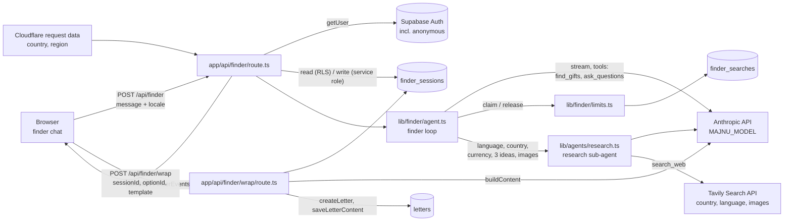

# Gift finder: agent and API

Issue #31. The server side of the main flow in [../plan.md](../plan.md), "Gift finder". The chat on the landing page that uses it is [gift-finder-ui.md](gift-finder-ui.md) (issue #32); anonymous accounts are #33.

## What it does

A visitor types who they are looking for a gift for ("Finde ein Geschenk für meine Mutter"). Majnu assumes the rest, shows those assumptions as chips (mother, about 45 to 70, Berlin, euros), searches the web in the visitor's language and country, and shows three gifts with a photo, a local price, the shop and a link, one of them recommended with a reason. Asked to personalise, it asks up to three questions with answers to tap and searches again. Choosing a gift wraps it in a gift reveal, 3D gift box, party pop box, classic envelope or postcard page, saved as the visitor's letter at `/l/<slug>`.

## How it works

One search, in order:

1. The browser posts `{ message, locale }` to `POST /api/finder` (the contract is `lib/finder/events.ts`). The route checks the Supabase session with `getUser()`; anonymous users count. Without one it answers 401 `{ "error": "session_required" }`.
2. The route reads the country and the first-level region from Cloudflare's request data (`getCloudflareContext().cf`), or only the country from the `cf-ipcountry` header. The language and timezone come from the body; the currency follows from the country (`lib/finder/context.ts`).
3. On the first message, the route checks that the visitor can still start a session and search today, creates a `finder_sessions` row and streams `session` first. Later messages send `sessionId`; the route loads the session through row-level security and refuses after 20 messages.
4. The finder agent sends one streamed request with a byte-stable system prompt and two tools. The visitor's message is preceded by a `<context>` block: today's date, the browser language, where the connection comes from, and the local currency. The model's text streams as `text` events.
5. The model calls `find_gifts` with its assumptions: the relationship in the visitor's words, the kind of relationship, the age, budget, interests and occasion when the visitor gave them (each is a required field that is null when unknown), a sentence for the researcher and a status line in the visitor's language. The server fills in a default age range for the kind of relationship (partner 20 to 35, parent 45 to 70, grandparent 65 to 90, friend or sibling within five years of the sender when their age is known).
6. The server claims the search in `finder_searches` (see "Limits and costs"). If a limit is reached, it streams `limit` and the turn ends.
7. It streams `context` and `status`, then runs the research sub-agent: up to 4 Tavily searches and 4 model requests, in the visitor's language and country, reporting three ideas with a description, reason, price, shop and link, one recommendation and why. Each idea gets the product photo Tavily returned for the very page it links to; a link to a site no search returned is dropped.
8. Ideas without a link are left out. The rest become `GiftOption`s with ids that are stable within the session, streamed as `options` with `recommendedId` and `why`. If none is left, or research failed, the search is given back and an `error` event says so.
9. The turn ends there, without a closing model request: the visitor's next move is to look at the options. The route appends the turn to the stored conversation, saves the context and the options, and streams `done`.

Public profiles: when the visitor pastes a public Instagram or TikTok profile, or another public page about the person, the model calls a third tool, `read_profile`, before `find_gifts`. Its 3 to 6 interests are merged into the next search's context. That is its own page, [social-profiles.md](social-profiles.md) (issue #34).

Personalising: when the visitor asks for it (the finder's button sends "Personalise the gift") or says none fit, the model calls `ask_questions`. The server first checks that a personalised search would still be allowed, then streams up to three `question` events with up to four `suggestions` each, and the turn ends. The visitor's answers are the next message, and the next `find_gifts` call counts as a personalised search: every search after the first in a session does.

Wrapping: `POST /api/finder/wrap` with `{ sessionId, optionId, templateId }` (and optionally the names and a note) loads the session through RLS, finds the option among the last ones shown, checks the daily letter limit (the new-gift gate it also asks is open to everyone), then has the builder sub-agent write the page in the visitor's language. `templateId` is one of `WRAP_TEMPLATE_IDS` in [`lib/finder/wrap.ts`](../../lib/finder/wrap.ts): `gift-reveal`, `gift-box-3d`, `party-box`, `classic-envelope` or `postcard` (the two boxes since issue #50); anything else is a 400.

- The builder is called with `giftRequired: true`, so a page without the gift goes back to the model once, even on a party pop box, where a gift is otherwise optional. The brief says the page is a gift and not an invitation, and for a party pop box it asks for a celebrating occasion ("Celebration") when the visitor named none, instead of "Just because".
- The gift on the page is copied from the stored option after the builder has run, so the model cannot change its link or price. Any `event` the builder wrote is dropped at the same time: the finder never learns a date or a place, so an event could only be made up, and the party pop box would show it as the party.
- Building comes before `createLetter()`, so a failed build leaves no empty letter. The title comes from `titleFor()`: "A gift for …" for the gift reveal and both boxes. The answer is `{ letterId, slug }`.

## Pieces

| Piece | Job |
|---|---|
| `lib/finder/events.ts` | The contract with the finder chat: request, streamed events, wrap call. Frozen; additive changes only. |
| `app/api/finder/route.ts` | Session check, location and locale, session creation, the per-session message cap, the stream, saving the turn append-only. |
| `app/api/finder/wrap/route.ts` | Wrapping a chosen option: session, option and letter limits, then `wrapOption()`. |
| `lib/finder/agent.ts` | The finder loop: system prompt, `find_gifts`, `ask_questions` and `read_profile` ([social-profiles.md](social-profiles.md)), default age ranges, turning research into options. |
| `lib/finder/context.ts` | Country and region from the request, language, timezone, currency, place names, age-range defaults. |
| `lib/finder/limits.ts` | Daily search limits, the site-wide cap, sessions per day, messages per session; claiming and releasing searches. |
| `lib/finder/sessions.ts` | Reading sessions through RLS and writing them with the service role. |
| `lib/finder/wrap.ts` | The templates a gift can be wrapped in (`WRAP_TEMPLATE_IDS`), the builder's brief, and the chosen gift copied into `gifts[]` without its image (and without any event). The finder offers the same five, in its own order, as `WRAP_TEMPLATES` in `components/finder/finder-state.ts`. |
| `lib/finder/messages.ts` | The sentences the server writes itself (limits, errors, the fallback status), in English and German. |
| `lib/finder/stream.ts` | The NDJSON stream, built on `lib/agents/ndjson.ts`. |
| `lib/agents/research.ts` | The research sub-agent, shared with the main agent's `research_gifts`. `researchGiftReport()` is the finder's richer report; `researchGifts()` keeps the main agent's shape. |
| `lib/agents/tavily.ts` | One Tavily search, with the visitor's country (Tavily's own country names), language and product images. |
| `finder_sessions` (migration `0004_finder.sql`) | One row per finder conversation: owner, context, timezone, the conversation as the API returned it, the last options. |
| `finder_searches` (same migration) | One row per search: owner, session, whether it was personalised, when. Counted for the limits. |
| `MAJNU_DAILY_SEARCH_CAP` | Searches the whole site may run per UTC day. Default 300; 0 switches new searches off. |
| `TAVILY_API_KEY` | Tavily search. Without it, research falls back to Anthropic's web search (no product photos). |
| `MAJNU_MODEL` | The model for the finder, research and the builder (default `claude-opus-5-5`, low effort). |

## Data and privacy

- Stored per session: the context Majnu assumed (country, region, language, currency, relationship, age range, budget, interests), the browser timezone, the conversation exactly as the Anthropic API returned it, and the last options. Per search: owner, session, personalised, time. Nothing is deleted automatically yet.
- Location: only the ISO country code and the first-level region (a state such as "Berlin") are read. Cloudflare's request data also carries the city, postal code and coordinates, and the request has an IP address; the finder reads none of them, stores none of them and logs none of them.
- Who can read it: row-level security is on for both tables. Signed-in users, anonymous ones included, can read only their own rows; there is nothing for `anon`. Every write goes through server code with the service-role key after `getUser()` has identified the user, because the conversation is replayed to the model and the search rows are what the limits count. The wrap route trusts only the options stored in the session, never an option sent by the browser.
- Product images are shown in the finder only. The wrapped gift page never gets `imageUrl`, because gift pages load nothing from other sites: a shop's image URL would tell the shop who opened the gift and when.
- Logs carry error classes, HTTP statuses and request ids, never the visitor's message, search queries or options.
- The browser's language tag is canonicalised before it goes into the model's context block, so no other text from the request can reach the prompt that way.

## Limits and costs

- **Finding and personalising are open to guests.** An invisible guest account (a Supabase anonymous user) has exactly the same limits as a signed-up one, and nothing in the routes or the agent asks for an account. The developer decided this on 21 November, replacing a short-lived plan to ask guests to sign up before personalising; the `signin_required` reason stays in the contract for calendars.
- Per user and UTC day: 3 searches in total, at most 2 of them personalised. The 4th search of the day is refused (`finder_daily`), and a 3rd personalised one is refused even when the total allows it (`personalise_daily`). Site-wide: `MAJNU_DAILY_SEARCH_CAP` searches a day (`site_busy`). The visitor's own limits are checked first, then the site cap. Refusals are kind sentences in the visitor's language (English or German), sent as a `limit` event.
- A search is claimed by inserting its row first and counting second, so two requests at the same moment can both be refused but never both get past a limit. A search that fails, or finds nothing with a link, is given back.
- Also per user: 10 finder sessions a day and 20 messages per session, because every message is a model request even without a search. Both are reported as `finder_daily`, the closest reason the contract has.
- Messages over 2,000 characters are refused. One message makes at most 3 finder requests plus one research run (at most 4 requests and 4 searches). Wrapping is one builder call (two if the first output does not fit), under the existing limit of 5 letters per user per day.
- Measured on 21 November with `claude-opus-5-5` at low effort: a first search took 23 s with 2 Tavily searches, a personalised search on Anthropic's web search took 28 s, the personalising questions 3.6 s and wrapping 3.5 s. Token usage per search was not measured. Tavily's basic search costs 1 credit per search, so a search costs 1 to 4 credits.

## How it was checked

- Unit tests, with the model, Tavily and Supabase mocked:
  - `tests/unit/lib/finder/`: context and currency, age-range defaults, the limits (including the site cap and two claims at once) against an in-memory stand-in for the database, the event sequence for a first search and for personalising, failures, and wrapping.
  - `tests/unit/app/api/finder/`: both routes.
  - `tests/unit/lib/agents/research.test.ts` and `tavily.test.ts`: language, country, currency, images and links.
- Migration: `0001` + `0002` + `0004` applied in PGlite with stand-ins for Supabase's `auth` schema and roles. Owners read only their own rows, the API roles cannot write either table, and `anon` cannot read them. The lead applied it to the project and checked that the anon key is refused on both tables.
- Live, with the limits and the letter store mocked so nothing was written to the database:
  - One full flow from a German browser in Berlin, "Finde ein Geschenk für meine Mutter": three German options in euros, two with a photo, one recommended. Then three personalising questions with answers to tap, and a personalised search. Wrapping the recommended gift gave a German gift reveal with the gift copied exactly and no image.
  - Then two checks of the fixes that run showed were needed. One direct Tavily search checked the product-image choice: three of five shop pages got a product photo, the other two a sale card and a site graphic. Finder requests with research mocked checked that the age, budget and interests the visitor gave reach the chips: before the fix the model put them only in `about`; after it, "sie wird 62 … Budget etwa 50 Euro" gave age 62, the budget and two interests, in a single call.
- Live as a guest, on 21 November, through the landing page on `next dev` against the real Supabase project (anonymous sign-ins switched on; Turnstile's site key left empty because Cloudflare refuses a browser driven by DevTools): the visitor was signed in anonymously, "Find a gift for my mother" gave three English options in euros with one recommended (20 s), "Personalise the gift" gave three questions with answers to tap (2 s, no sign-in asked), and a typed answer ("she loves gardening, she is about 60, and it is for Christmas") gave a personalised search with three new gardening gifts and the chips "About 58–62" and "Likes gardening" (17 s). Two searches in total; nothing was wrapped.
- With `curl` against `next dev`: both routes answer 401 `{ "error": "session_required" }` without a session, also with a forged cookie, and GET answers 405.
- Against the finder chat's transport (`components/finder/transport.ts`, merged from #32): errors before a stream are mapped by status, so a message that is too long answers 413; limits and errors during a reply are events; wrap errors carry `error` and, for finder limits, `reason`.
- Issue #50 (the 3D gift box and party pop box as wrappers), 22 November:
  - Unit tests: [`wrap.test.ts`](../../tests/unit/lib/finder/wrap.test.ts) (both boxes build with `giftRequired`, get the chosen gift card, the title "A gift for …" and no event even when the builder wrote one; the party box's occasion; `WRAP_TEMPLATE_IDS` equal to what the finder offers), [`route.test.ts`](../../tests/unit/app/api/finder/wrap/route.test.ts) (the five ids accepted, `wedding-envelope-3d`, `treasure-map` and the others refused), [`finder-state.test.ts`](../../tests/unit/components/finder/finder-state.test.ts) (the order of the choices, choosing either box, guest or member), and [`builder.test.ts`](../../tests/unit/lib/agents/builder.test.ts) (the rules and titles).
  - Live against `next dev` and the real database, as a temporary member (made with the admin API, deleted afterwards with every row it owned): `POST /api/finder/wrap` with the member's cookie answered 400 for `treasure-map` and `wedding-envelope-3d`, and for `gift-box-3d` got past validation, the stored session and option and the limits to the builder. A `gift-box-3d` letter carrying a stored option exactly as `giftFromOption()` copies it rendered at `/l/<slug>` at 375 and 1440 px: the box opened to the gift card with the title, description, price and shop link, then the note; console clean.
  - On `/dev/finder` (mock transport) at 375 and 1440 px: the five choices, the arrow keys moving between them, and Ready to send with the guest text (no session) and the member text (the member's session cookie).
  - Not checked: a real search and a real wrap, because the Anthropic key was over its monthly spend limit (429 `enforced_spend_limit_reached`, until 1 December). The builder writing either box from a finder brief is unverified live.
- Not checked: a request from a signed-up (not guest) account against the real database (no test user was created in the live project), a live wrap, the Cloudflare `cf` data on a deployed Worker (in `next dev` there is none), and the research prompt's informal-address rule in German on a fresh live search.

## Open questions

- The product photo is the image most likely to be the product among those Tavily returned for that page. On listing pages it is sometimes a sale banner or a site graphic; a few options have none.
- Prices come from the search results; when a page shows none, the researcher gives a typical price marked as approximate.
- The image in a wrapped gift: to show it later without loading anything from the shop, the wrap route could fetch the image once on the server (https only, with a size and type check), store it in Supabase Storage or R2 under the letter, and put our own URL (`/l/<slug>/image/<n>`) in `gifts[].imageUrl`, served with `no-store` and no referrer.
- The contract has no limit reason for "too many sessions" or "too many messages in this session"; both use `finder_daily`. A `finder_turns` reason could be added to `lib/finder/events.ts` if the chat should say something different.
- Reading a public social profile while personalising is built (issue #34); see [social-profiles.md](social-profiles.md).
- The main agent's `research_gifts` (in `lib/agents/tools.ts`) does not pass a language to research, so its ideas follow the language of the brief the main agent writes. Passing the sender's language there would fix the same bug in the letters chat.
- **The party pop box is offered for every gift, not only for birthdays.** The finder agent hears the occasion (`find_gifts` has an `occasion` field) but does not keep it in `FinderContext`, so the wrap step cannot tell a birthday. Adding `occasion?: string` to `FinderContext` (additive) and saving it in `lib/finder/agent.ts` would let the finder put the party box first, or offer it only then.
- **"Redeem your gift" on a shop product.** The gift card's button says "Redeem your gift" for every gift with a link. For a product from the finder, which has no code, "See it in the shop" or "Your gift" would read better; that wording lives in `components/letters/gift-card.tsx`.
- Finder sessions and searches are kept indefinitely; a retention period should be chosen before the privacy page names them (#33).
