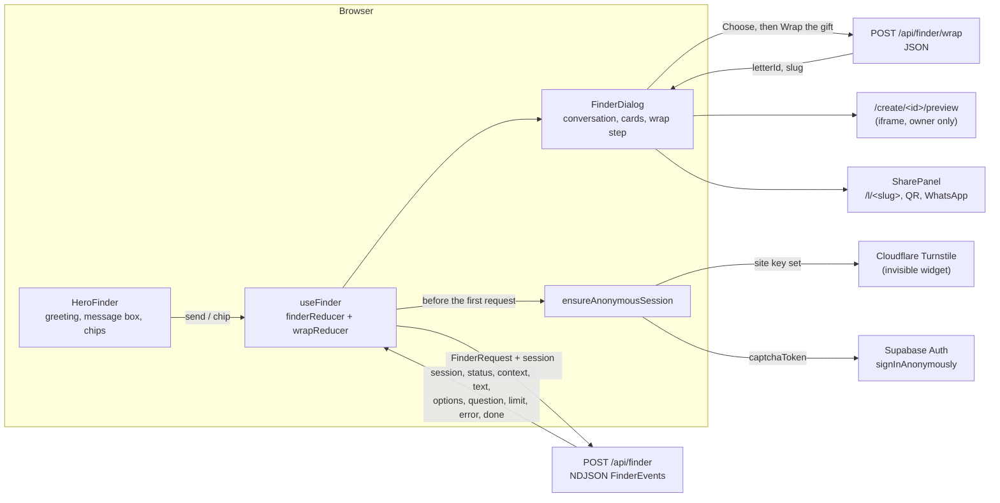

# Gift finder: landing page and finder UI

Issue #32. The server side (the finder agent, `POST /api/finder` and `POST /api/finder/wrap`) is issue #31 and has its own page; this page covers what runs in the browser.

## What it does

A visitor from an ad lands on Majnu's greeting, "Who is the gift for?", and types who they are shopping for, or taps a suggestion. A finder opens over the page (a full-height sheet on phones): Majnu says what it assumed (country, language, relationship, age), streams its reply and shows three gifts from real shops, one of them recommended. The visitor can personalise the search by answering a few questions, choose a gift, pick a design for the page it arrives in, and leave with a link and a QR code, all without signing up.

## How it works

One search, in order:

1. The visitor sends a message from the hero (Enter, the Find a gift button, or a suggestion chip). `useFinder.restart` clears any earlier conversation, opens the dialog and shows the message with the status "Reading your message…".
2. `ensureAnonymousSession` asks the Supabase browser client for a session. If there is one (anonymous or signed up), nothing else happens. Otherwise, when `NEXT_PUBLIC_TURNSTILE_SITE_KEY` is set, it loads the Turnstile script, renders an invisible widget inside the dialog (it only becomes visible if Cloudflare ever asks for an interaction) and waits for a token, then calls `signInAnonymously({ options: { captchaToken } })`. Without a site key (local development) it signs in without a token. Concurrent calls share one attempt, so a visitor gets one account.
3. The browser posts `{ sessionId?, message, locale: { language, languages, timezone } }` to `/api/finder`. Country and region are never sent; the server reads them from the network.
4. `readFinderEvents` reads the NDJSON stream line by line, skipping any line that is not a valid `FinderEvent`, and `finderReducer` turns each event into what the dialog shows. `session` keeps the finder session id for the next message; `status` updates the status line and fills the moon in the header by one step; `context` replaces the assumption chips; `text` streams into Majnu's paragraph; `options` adds the three cards and scrolls the conversation to their top; `question` adds tappable answers; `limit` and `error` add a notice; `done` ends the reply. A stream that ends without `done` adds "The reply stopped before it finished" with Try again.
5. Tapping a context chip puts a correction in the message box ("They're ", "It's for my "); "Personalise the gift" sends that exact text as a message, and the agent answers with questions.

Wrapping a chosen gift:

1. Choose replaces the conversation with the wrap step: the three gift templates (`gift-reveal`, `classic-envelope`, `postcard`) as `TemplateCard` radio buttons, and optional fields for their name, your name and a note. The chosen gift and the Wrap the gift button sit in a bar fixed to the bottom of the finder, so the action is always in view.
2. Wrap the gift posts `{ sessionId, optionId, templateId, recipientName?, senderName?, note? }` to `/api/finder/wrap`. An error, including a limit, comes back into the bar without moving focus.
3. On `{ letterId, slug }`, the finder shows the owner preview (`/create/<letterId>/preview` in an iframe; the anonymous visitor owns the letter) beside `SharePanel` with `https://<site>/l/<slug>`. On phones the share panel comes first. A quiet line offers "Sign up to keep your gifts" and says advent calendars need an account.

## Pieces

| Piece | Job |
|---|---|
| `app/(marketing)/page.tsx` | The landing page: hero finder, How it works (the moon scene), examples, pricing, questions |
| `components/landing/hero-finder.tsx` | Greeting bubble, message box with the typed placeholder, Find a gift, suggestion chips; owns the dialog's open state |
| `components/landing/gift-scene.tsx` | The Majnu and Layla painting with the travelling moon; now starts at its final crop so it causes no layout shift |
| `components/finder/finder-dialog.tsx` | The Radix dialog: header with the status moon, chips, conversation or wrap step, message box; returns focus to whatever opened it |
| `components/finder/conversation.tsx` | Messages, product cards, Personalise the gift, questions, notices |
| `components/finder/gift-option-card.tsx` | One product card and the lazy product image with its placeholder |
| `components/finder/wrap-view.tsx` | Template choice, names and note, the fixed action bar, the preview frame and share panel |
| `components/finder/use-finder.ts` | Sends messages, reads the stream, wraps; the only place that calls the transport |
| `components/finder/transport.ts` | The real `fetch` calls, preview and share URLs, and the browser locale; `/dev/finder` swaps in a mock |
| `components/finder/anonymous-session.ts` | Turnstile token and `signInAnonymously`, with friendly errors |
| `components/finder/ndjson.ts`, `finder-state.ts`, `typewriter.ts`, `context-chips.ts`, `urls.ts` | Pure logic: stream reader, reducers, placeholder cycle, chip labels, safe links and images |
| `app/dev/finder/` | `/dev/finder` (noindex): the hero and finder on a scripted stream, one chip per state |
| `lib/finder/events.ts` | The contract with the server (not changed here) |
| `NEXT_PUBLIC_TURNSTILE_SITE_KEY` | Public site key of the invisible Turnstile widget. Empty means no check (local development) |
| `NEXT_PUBLIC_SUPABASE_URL`, `NEXT_PUBLIC_SUPABASE_ANON_KEY` | The browser Supabase client used for the anonymous session |

No tables are read or written from the browser; everything goes through the two finder routes and Supabase Auth.

## Data and privacy

- The browser sends the visitor's message, `navigator.language`, `navigator.languages` and the timezone. It never asks for location; country and region come from the network on the server.
- The anonymous account is a normal Supabase session in cookies, so ownership and row-level security apply as for any user. Signing up later links an identity to the same account (issue #33).
- The browser keeps the conversation only in memory: closing the tab loses it, and a new search from the hero starts a new finder session. Nothing goes into `localStorage`.
- Product images load straight from the shops with `referrerPolicy="no-referrer"`, so shops do not learn the page they were shown on. Shop links open in a new tab with `noopener noreferrer nofollow`. Only https links and https (or same-site) images are used.
- Turnstile is a third-party script, loaded only when a visitor without a session sends their first message. The privacy page must name it, and anonymous accounts, before ads run (issue #33).
- Majnu's text is rendered as plain text with paragraphs and bold only; nothing from the server is parsed as HTML.

## Limits and costs

- The browser sends at most 1,000 characters per message, and nothing while a reply is still streaming. The real limits (3 searches a day per visitor, 2 of them personalised, and the site-wide cap) are enforced by the server and arrive as `limit` events, which the finder shows with the server's message.
- The browser itself costs nothing per use. Each search is one `/api/finder` request; each wrap is one `/api/finder/wrap` request; costs are on the server's page.
- The Turnstile check adds about a second before the very first request; later requests reuse the session.

## How it was checked

- **Unit tests** (`tests/unit/components/finder/`, 50 tests): every event type and malformed lines in the stream reader, chunk boundaries and multi-byte characters, cancelling the download; every reducer transition (limits, errors, a cut-off stream, retry, sign-in, reset, unique ids, wrap success and failure); the placeholder cycle (order, one character per step, deleting only back to the shared prefix, timings); chip labels; safe links and images.
- **In the browser** (an isolated Chrome, at 375 × 667 and 1440 × 900, also 1280 × 720 for the wrap screens), on `/dev/finder` with the scripted stream: first search, personalising with a tapped answer, daily limit, site busy, needs an account, error with Try again, a cut-off stream, a broken and a missing product image, choosing, wrap failure and success, the preview and the share panel. Keyboard: Tab to a chip, Enter opens, arrow keys move between templates, Escape closes and focus returns to the chip that opened it. Reduced motion keeps the placeholder still. No horizontal scroll at 375 px. Layout shift on load measured at 0 at both widths. The wrap step and Ready to send fit in the finder without scrolling at 1440 × 900 and 1280 × 720. No console errors.
- **Live, on the landing page against the real Supabase project:** with the site key set, the automated test browser fails Turnstile (error 600010, expected for a browser driven by DevTools) and the finder shows "Majnu couldn't check this browser". Without the site key, Supabase answered `422 anonymous_provider_disabled`, and the finder showed the sign-in message.
- **Not yet verified:** a real search and wrap against `/api/finder` (not merged when this was built); the Turnstile token flow in a normal browser; signing in anonymously once it is switched on.

## Open questions

- Anonymous sign-ins answered "disabled" on 21 November; they must be switched on in Supabase (Authentication, Sign In / Providers) before the finder works for visitors.
- The server should treat the message "Personalise the gift" as the request to ask personalising questions (the button sends exactly that text).
- `lib/plans.ts` still lists gift research as a Full moon feature, while the finder is free to use; the pricing cards and the finder should say the same thing.
- `docs/brand.md` says the main action is always "Create a gift"; the hero's button says "Find a gift", because that is what it does now. The brand page should name both.
- A conversation lives only in memory. If visitors often close the finder by mistake, it could be kept per tab in `sessionStorage`.
