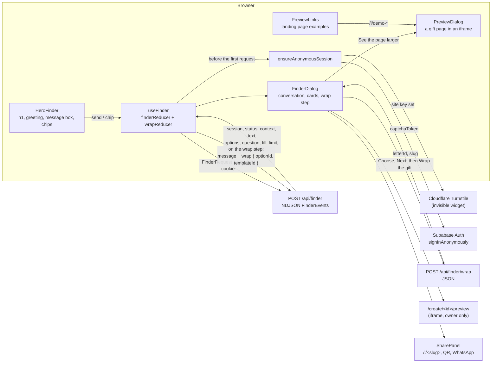
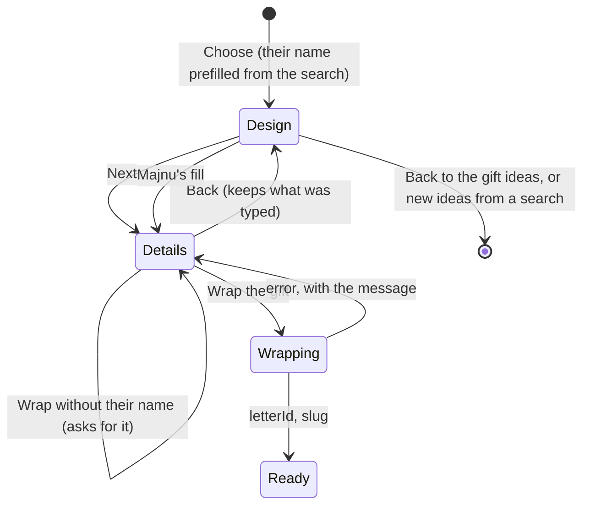

# Gift finder: landing page and finder UI

Issue #32. The server side (the finder agent, `POST /api/finder` and `POST /api/finder/wrap`) is issue #31 and has its own page; this page covers what runs in the browser. The two-step wrap step, the message box on it, Majnu filling in the form and the "Tell Majnu more" hint are issues #70 and #71.

## What it does

A visitor from an ad lands on the headline "Find the right gift for someone you love", Majnu's one-line greeting ("Hi, I'm Majnu. Who is the gift for?") and a one-line message box, and types who they are shopping for, or taps a suggestion. A finder opens over the page (a sheet as tall as the visible screen on phones, a 720 px panel that fits its content on larger screens): Majnu says what it assumed (country, language, relationship, age), streams its reply and shows three gifts from real shops, one of them recommended. Majnu may ask a few questions first, or one under the ideas, and the visitor can always tell it more (a line under the ideas says what helps: their Instagram, TikTok or LinkedIn, what they love, what they talk about). The visitor can personalise the search by answering, choose a gift, pick a design for the page it arrives in, then add their name, their own name, a note and the gift code they bought, and leave with a link and a QR code, all without signing up. Personalising is open to guests too. On the wrap step the message box stays: "it's for my sister Ana, from Javi" goes to Majnu with the chosen gift and design, and Majnu fills in the form for the visitor to check. Looking at a design never leaves the page: the example gifts on the landing page and the finished gift open in a preview dialog.

## How it works

One search, in order:

1. The visitor sends a message from the hero (Enter, the button inside the message box, or a suggestion chip). `useFinder.restart` clears any earlier conversation, opens the dialog and shows the message with the status "Reading your message…".
2. `ensureAnonymousSession` asks the Supabase browser client for a session. If there is one (anonymous or signed up), nothing else happens. Otherwise, when `NEXT_PUBLIC_TURNSTILE_SITE_KEY` is set, it loads the Turnstile script, renders an invisible widget inside the dialog (it only becomes visible if Cloudflare ever asks for an interaction) and waits for a token, then calls `signInAnonymously({ options: { captchaToken } })`. Without a site key (local development) it signs in without a token. Concurrent calls share one attempt, so a visitor gets one account.
3. The browser posts `{ sessionId?, message, locale: { language, languages, timezone } }` to `/api/finder`. Country and region are never sent; the server reads them from the network.
4. `readFinderEvents` reads the NDJSON stream line by line, skipping any line that is not a valid `FinderEvent`, and `finderReducer` turns each event into what the dialog shows. `session` keeps the finder session id for the next message; `status` updates the status line and fills the moon in the header by one step; `context` replaces the assumption chips; `text` streams into Majnu's paragraph; `options` adds the three cards and scrolls the conversation to their top; `question` adds tappable answers; `limit` and `error` add a notice; `done` ends the reply. A stream that ends without `done` adds "The reply stopped before it finished" with Try again.

Screen readers hear each reply once (issue #62). The dialog and the inline panel each keep one polite live region, filled by `finderAnnouncement()` in `finder-state.ts` when a reply ends: "3 gift ideas are ready.", Majnu's question, "Majnu replied." or a limit notice. An error notice is not in it: the notice itself is `role="alert"` (`noticeRole()`), so it interrupts once. Before, a limit notice was both a `role="status"` element and the region's text, and was read twice.
5. Tapping a context chip puts a correction in the message box ("They're ", "It's for my "); "Personalise the gift" sends that exact text as a message, and the agent answers with questions. Beside it, under the newest ideas, `TELL_MORE` reads "Tell Majnu more: their Instagram, TikTok or LinkedIn, what they love, what they talk about." A follow-up question from Majnu, when it asks one, comes after the ideas with answers to tap.
6. When a session has used its 30 searches (`session_full`), the notice offers "Start a new search", which empties the finder; the server then starts a new session if one of the day's two is left. When both are used (`finder_daily`) the notice says to choose from the ideas or come back tomorrow, and the ideas stay on screen to choose and wrap.

Wrapping a chosen gift:

Until 22 November the names sat below the five design cards, out of sight on a phone, while Wrap the gift was always on screen, so a page was often built with a name Majnu guessed. Since issue #71 the wrap step has two steps, held in `wrapReducer` (`finder-state.ts`) with everything typed:

1. **Step 1, the design.** Choose replaces the conversation with "Wrap it in a page for them" and the gift templates (`WRAP_TEMPLATES`: `gift-reveal`, `gift-box-3d`, `party-box`, `classic-envelope`, `postcard`; the two boxes since issue #50) as `TemplateCard` radio buttons, the gift reveal chosen at the start. The party pop box is offered only when the occasion Majnu heard is a birthday or a party (`wrapTemplatesFor(context)`, issue #59; how the occasion is read is in [gift-finder-api.md](gift-finder-api.md)), so most gifts get four designs, two by two from md up, and a birthday gets five. The occasion is also one of the chips ("Birthday"), after who it is for, so the visitor can correct it. The bar fixed to the bottom of the finder holds the chosen gift and **Next**.
2. **Step 2, the details.** In the app the phone tab bar steps aside while the wrap step is open (`data-wrap-step`, see [app-shell.md](app-shell.md)). "Who is it for?" with the step and the design named, then: **their name** (required; filled in with the name the visitor gave Majnu, `FinderContext.name`), your name, a note, and **gift code or voucher** (optional) with the line "Buy the gift in the shop first, then paste the voucher code, gift-card code or order details. Hidden until they open it." The note is one line that grows with its text where the browser supports `field-sizing`. The bar holds **Back**, which returns to step 1 with everything kept, and **Wrap the gift**, the only place it appears. Wrap without their name marks the field, says "Write their name first. It goes on the page." and puts focus there. Next and Back move focus to the new step's heading. The fields keep the server's limits (names 60 characters, the note 600, the code 200).
3. **Talking to Majnu on the wrap step.** The message box stays below the bar (placeholder "Tell Majnu who it's for"). `useFinder.send` adds `wrap: { optionId, templateId }` to every message while the step is open (`wrapChoice()`), and the step shows the newest exchange in a box under its heading (`wrapExchange()`: the visitor's message, Majnu's reply, a question with answers to tap, or a notice); the whole conversation is still there behind "Back to the gift ideas". A `fill` event fills the fields Majnu heard, moves to step 2 and says which were filled ("Majnu filled in their name, your name and the gift code from your message. Check before you wrap."); it never wraps. If Majnu searches again instead, the new options close the wrap step so the visitor sees them.
4. Wrap the gift posts `{ sessionId, optionId, templateId, recipientName, senderName?, note?, giftCode? }` (`wrapRequest()`, trimmed, empty fields left out) to `/api/finder/wrap`. An error, including a limit, comes back into the bar on step 2 without moving focus.
5. On `{ letterId, slug }`, the finder widens to 960 px and shows the owner preview (`/create/<letterId>/preview` in an iframe; the anonymous visitor owns the letter) beside `SharePanel` with `https://<site>/l/<slug>`. On phones the share panel comes first. Below it, a quiet note depends on the session the finder made or found (`wrapAccount()` in `finder-state.ts`, read from this browser's Supabase session): a guest (an anonymous account) reads that the gift is kept in this browser, with "Sign up to keep your gifts", and that advent calendars need an account; a signed-up member reads that the gift is in My gifts, where they will see when it is opened, and offers "Make a calendar", the Create tab's link to the calendar editor (`/dashboard/calendars/new`, since issue #70; before, it opened the letters chat with the advent calendar attached). Nothing shows until the session has been read, so a member never sees the guest's line flash by. "See the page larger" opens the same preview in `PreviewDialog` over the finder; Escape closes only the preview.

Layout:

- **Hero** (`hero-finder.tsx`): a column of at most 540 px, on the same left edge as the wordmark, so the couple in the painting stays in view from md up. The h1 is 30 px on phones, 38 px from sm, 44 px from md and 46 px from lg. The greeting is a small bubble beside a 32 px crescent. The message box is one line (44 px) and grows to four lines as the visitor types; the button sits inside it on the right, an arrow on phones (so the typed examples keep their line) and "Find a gift" from sm up. Chips are 32 px with 14 px text and a 44 px tap area. Once there is a conversation, a quiet "Back to your gift ideas" pill hangs below them; it is positioned absolutely, so it takes no space and nothing moves when it appears. The block enters once on load (a fade and a short rise), and not at all with reduced motion.
- **Finder dialog** (`finder-dialog.tsx`): from md up a panel 720 px wide, 8 % of the screen below the top, as tall as what it holds and at most 820 px or the screen; it grows downwards as a reply streams in. Ready to send has a fixed height and 960 px, because the preview fills it. On phones a bottom sheet 8 px below the top of the visible screen. `useVisualViewportVars` keeps `--vv-height` and `--vv-top` on `<html>` in step with `window.visualViewport` while a sheet is open, so when the keyboard opens the sheet shrinks to the space above it and the message box stays in view. The message box holds the microphone (`VoiceButton`, see [voice-input.md](voice-input.md)) and Send, both 40 px circles on its right.
- **Preview dialog** (`preview-dialog.tsx`): a gift page in an iframe, with its title, "Open in a new tab" and a close button. A 1120 × 900 px panel from md up, a full-height sheet on phones. Escape, the close button and a click outside close it, and focus goes back to whatever opened it. On the landing page, `PreviewLinks` catches plain clicks on links marked `data-preview` (the three examples); a middle click or Cmd/Ctrl-click still opens the page in a new tab, and without JavaScript the links work as before.

## Pieces

| Piece | Job |
|---|---|
| `app/(marketing)/page.tsx` | The landing page: hero finder, How it works (the moon scene), examples (opened in the preview dialog), pricing (Free, and the €2.99 personalised wrapper; the copy lives in the page until `lib/plans.ts` describes the new model), questions |
| `components/landing/hero-finder.tsx` | The page's h1, the greeting bubble, the one-line message box with the typed placeholder and its button, suggestion chips, the way back to the finder; owns the dialog's open state |
| `components/landing/preview-links.tsx`, `plain-click.ts` | Opens the landing page's example links in the preview dialog on a plain click |
| `components/landing/gift-scene.tsx` | The Majnu and Layla painting with the travelling moon; now starts at its final crop so it causes no layout shift |
| `components/finder/finder-dialog.tsx` | The Radix dialog: header with the status moon, chips, conversation or wrap step, message box; returns focus to whatever opened it |
| `components/finder/preview-dialog.tsx` | A gift page in an iframe over the current page, for the examples and the finished gift |
| `components/finder/visual-viewport.ts` | `useVisualViewportVars`: the visible screen's height and offset as CSS variables while a sheet is open |
| `components/finder/conversation.tsx` | Messages, product cards, Personalise the gift, questions, notices |
| `components/finder/gift-option-card.tsx` | One product card and the lazy product image with its placeholder |
| `components/finder/wrap-view.tsx` | The two steps (design; their name, your name, a note and the gift code), the exchange with Majnu on the wrap step, the fixed action bar (Next; Back and Wrap the gift), the preview frame, "See the page larger" and the share panel |
| `components/finder/use-finder.ts` | Sends messages, reads the stream, wraps; the only place that calls the transport |
| `components/finder/transport.ts` | The real `fetch` calls, preview and share URLs, and the browser locale; `/dev/finder` swaps in a mock |
| `components/finder/anonymous-session.ts` | Turnstile token and `signInAnonymously`, with friendly errors |
| `components/finder/ndjson.ts`, `finder-state.ts`, `typewriter.ts`, `context-chips.ts`, `urls.ts` | Pure logic: stream reader, reducers, placeholder cycle, chip labels, safe links and images |
| `app/dev/finder/` | `/dev/finder` (noindex): the hero and finder on a scripted stream, one chip per state |
| `lib/finder/events.ts` | The contract with the server; `wrap` on the request, the `fill` event and `session_full` added for issue #70 |
| `NEXT_PUBLIC_TURNSTILE_SITE_KEY` | Public site key of the invisible Turnstile widget. Empty means no check (local development) |
| `NEXT_PUBLIC_SUPABASE_URL`, `NEXT_PUBLIC_SUPABASE_ANON_KEY` | The browser Supabase client used for the anonymous session |

No tables are read or written from the browser; everything goes through the two finder routes and Supabase Auth.

## Data and privacy

- The browser sends the visitor's message, `navigator.language`, `navigator.languages` and the timezone. It never asks for location; country and region come from the network on the server.
- The anonymous account is a normal Supabase session in cookies, so ownership and row-level security apply as for any user. Signing up later links an identity to the same account (issue #33).
- The browser keeps the conversation only in memory: closing the tab or reloading loses it from the screen. Nothing goes into `localStorage`. Since issue #70 the next message without a session id continues today's open finder session on the server, so a reload or a new search from the hero does not use up one of the day's two sessions.
- The gift code typed on step 2 is sent only to `POST /api/finder/wrap`. A code told to Majnu in the message box is part of the finder conversation the server stores.
- Product images load straight from the shops with `referrerPolicy="no-referrer"`, so shops do not learn the page they were shown on. Shop links open in a new tab with `noopener noreferrer nofollow`. Only https links and https (or same-site) images are used.
- Turnstile is a third-party script, loaded only when a visitor without a session sends their first message. The privacy page must name it, and anonymous accounts, before ads run (issue #33).
- Majnu's text is rendered as plain text with paragraphs and bold only; nothing from the server is parsed as HTML.

## Limits and costs

- The browser sends at most 1,000 characters per message, and nothing while a reply is still streaming. The real limits (since 22 November: 100 finder sessions a day per visitor, counted from their first search, each with 30 searches, personalised or not; and the site-wide cap, the same for guests and signed-up visitors) are enforced by the server and arrive as `limit` events, which the finder shows with the server's message; `session_full` adds "Start a new search".
- The browser itself costs nothing per use. Each search is one `/api/finder` request; each wrap is one `/api/finder/wrap` request; costs are on the server's page.
- The Turnstile check adds about a second before the very first request; later requests reuse the session.

## How it was checked

- **Unit tests** (`tests/unit/components/finder/`, 50 tests): every event type and malformed lines in the stream reader, chunk boundaries and multi-byte characters, cancelling the download; every reducer transition (limits, errors, a cut-off stream, retry, sign-in, reset, unique ids, wrap success and failure); the placeholder cycle (order, one character per step, deleting only back to the shared prefix, timings); chip labels; safe links and images.
- **In the browser** (an isolated Chrome, at 375 × 667 and 1440 × 900, also 1280 × 720 for the wrap screens), on `/dev/finder` with the scripted stream: first search, personalising with a tapped answer, daily limit, site busy, needs an account, error with Try again, a cut-off stream, a broken and a missing product image, choosing, wrap failure and success, the preview and the share panel. Keyboard: Tab to a chip, Enter opens, arrow keys move between templates, Escape closes and focus returns to the chip that opened it. Reduced motion keeps the placeholder still. No horizontal scroll at 375 px. Layout shift on load measured at 0 at both widths. The wrap step and Ready to send fit in the finder without scrolling at 1440 × 900 and 1280 × 720. No console errors.
- **The compact redesign, 21 November** (an isolated Chrome at 320, 375, 390 and 1440 px wide; before and after screenshots are in the pull request): on the landing page, no horizontal scroll at any of those widths and layout shift 0 at 390 and 1440 (a `layout-shift` observer from the first paint). The h1 is 30 px at 390 and 46 px at 1440, the message box 56 px tall with its button inside, the chips 32 px with 14 px text. Tab order: wordmark, How it works, Pricing, Sign in, message box, Find a gift, chips. With reduced motion the hero does not animate and the placeholder stays still. On `/dev/finder`: the panel is 720 px wide, 323 px tall for a short exchange and 804 px (its maximum at 900 px high) with three gifts; Ready to send is 960 px wide; on a 390 × 844 phone the sheet is 390 × 836 with the message box at the bottom. "See the page larger" opens the preview over the finder, Escape closes only the preview and focus returns to the button, a second Escape closes the finder and the viewport variables are removed. On the landing page an example opens in the preview dialog (1120 × 852 at 1440, full height at 390), the address stays `/`, and Escape returns focus to the example's link. No console errors. The design skill's layout checker (`check.mjs`) could not measure this page: it expects pages built from its own kit.
- **Live as a guest, 21 November** (`next dev` against the real Supabase project with anonymous sign-ins on, Turnstile's site key left empty because Cloudflare refuses a browser driven by DevTools): tapping My mother signed the browser in anonymously and showed three gifts after 20 s, one with a product photo; Personalise the gift gave three questions with answers to tap, with no sign-in asked; a typed answer gave a personalised search with three new gifts and updated chips. Two searches in total; nothing was wrapped.
- **Earlier, on the landing page against the real Supabase project:** with the site key set, the automated test browser fails Turnstile (error 600010, expected for a browser driven by DevTools) and the finder shows "Majnu couldn't check this browser". Without the site key, Supabase answered `422 anonymous_provider_disabled`, and the finder showed the sign-in message.
- **Issues #59 and #62, 22 November** (an isolated Chrome, 375 × 812 and 1440 × 900, on `/dev/finder`): the "Birthday" scenario shows the occasion chip and five designs; "First search" shows four, two by two at 1440; the arrow keys move between them. "Daily limit" puts its message in the dialog's live region only, the notice itself has no live role; "Error" leaves the region empty and the notice is the one alert. Console clean apart from the mock's deliberately broken image. The inline panel (`/dashboard/find`) shares the same functions and was not opened, because it needs a signed-in session. Unit tests in [`finder-state.test.ts`](../../tests/unit/components/finder/finder-state.test.ts) and [`context-chips.test.ts`](../../tests/unit/components/finder/context-chips.test.ts).
- **Issues #70 and #71, 22 November** (an isolated Chrome, `next dev` with the model scripted by a local stub, a real guest session against the real Supabase project): on `/dashboard/find` at 375 × 667 and 375 × 812 (touch phone), a search showed the ideas, "Tell Majnu more: …" and the follow-up question with answers to tap; Choose opened step 1 with Next in the bar; the 3D gift box and Next opened step 2 with "Ana" filled in from the search and focus on its heading; a note typed, Back to step 1 (design and note kept, heading focused) and Next again; a message typed in the box ("it's for my sister Ana, from Javi, the code is GC-TEST-1234") showed the exchange on step 2 and filled their name, your name and the code with "Majnu filled in their name, your name and the gift code from your message"; Wrap the gift made the page, and `/l/<slug>` showed "For Ana" and "Open the gift from Javi", then after opening "Your code GC-TEST-1234" with Copy, signed Javi. In the landing page's dialog at 375 × 667 all of step 2 fits (465 and 531 px). In the app, the lead then asked for the tab bar to step aside on the wrap step: with that, and step 2 a little tighter (a one-line note that grows with its text, a shorter help line), step 2 fits without scrolling at 375 × 667 with the guest banner (the help line ends at 515 px, the bar starts at 530 px; 362 px of room for 362 px of content) and at 375 × 812 (515 and 675 px). The tab bar is hidden on both steps, back on the gift ideas and on Ready to send. A long note grows the box, and then step 2 scrolls. At 1440 × 900, the landing dialog: step 1 two by two, step 2 with both names side by side; their name emptied with the keyboard and Enter gave the error, `aria-invalid` and focus on the field. No horizontal scroll at 375 px. Console: only a Fast Refresh notice from editing during the check. The browser check found that the stream reader dropped `fill` events; fixed and covered by [`ndjson.test.ts`](../../tests/unit/components/finder/ndjson.test.ts). Unit tests in [`finder-state.test.ts`](../../tests/unit/components/finder/finder-state.test.ts): both steps, Back keeping everything, Wrap only from step 2, the required name, the field limits, Majnu's fill, new options closing the step, `wrapChoice()`, `wrapRequest()` and `wrapExchange()`.
- **Not yet verified:** the "Start a new search" notice in a browser (unit-tested only); the real model's replies on the wrap step; the Turnstile token flow in a normal browser; the sheet above a real phone keyboard (DevTools cannot open one; the variables follow `visualViewport`, which is what the keyboard changes on iOS Safari and Chrome for Android).

## Open questions

- The pricing section's copy (Free, and the €2.99 personalised wrapper) is written in the page until `lib/plans.ts` describes the new model; then the page should read it from there.
- The hero column stays on the left from md up rather than in the middle of the page, as on layla.ai: centred, it would cover Majnu in the painting at 1440 px. A centred layout would need a different crop of the scene.
- `docs/brand.md` says the main action is always "Create a gift"; the hero's button says "Find a gift", because that is what it does now. The brand page should name both.
- A conversation lives only in memory. If visitors often close the finder by mistake, it could be kept per tab in `sessionStorage`; the server already continues the session (issue #70), so only the screen would need restoring.
