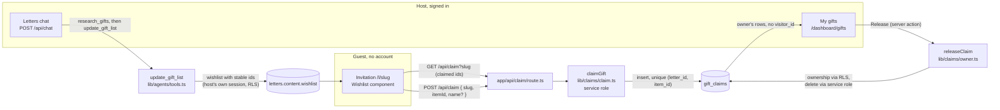

# Gift list on invitations

## What it does

A host making a wedding or birthday invitation (`wedding-invite`, `party-invite`, `wedding-envelope-3d`, or a `party-box` with the party's date and place) can add a **gift list**: gifts they would like, which Majnu can research for them in the Letters & invitations chat. Guests see the list at the end of the invitation and tap **I'll bring this** to claim a gift, optionally leaving a first name for the host. A claimed gift shows as taken for everyone else and cannot be claimed twice. Guests need no account and nothing is stored on their device. The host sees who is bringing what on **My gifts** and can release a claim. Issue #35, decided in [plan.md](../plan.md) ("Gift list on invitations").

## How it works

### The host adds gifts

1. The main agent's prompt ([`main.ts`](../../lib/agents/main.ts), step 5) offers a gift list once, after a wedding or birthday invitation is built. The step names every template in `GIFT_LIST_TEMPLATES` ([`rules.ts`](../../lib/claims/rules.ts)), read from that list when the prompt is built, so the prompt cannot drift from what the tool accepts; it adds that a `party-box` takes one only when it carries the party's date and place (issue #50). If the host wants ideas, it calls `research_gifts` with the host (or the couple) as the person the gifts are for; the research sub-agent is unchanged.
2. The host picks some, and the agent calls **`update_gift_list`** ([`tools.ts`](../../lib/agents/tools.ts)) with `add` (title, description, price, link, copied from the research or the host) and/or `removeIds`. The tool refuses anything but a built invitation whose template is in `GIFT_LIST_TEMPLATES`: `wedding-invite`, `party-invite`, `wedding-envelope-3d` and `party-box` (the last two since issue #52).
3. [`changeGiftList()`](../../lib/claims/rules.ts) removes first, then appends new gifts with a **server-made random id** (10 characters). Existing gifts keep their ids, so claims on them stay valid; the same gift (title and link) is not added twice; only https links are kept; the list stops at 12 gifts and the tool tells the model which were left out.
4. The list is saved with `saveLetterContent()` under the host's own session, the preview reloads, and the tool result lists every gift with its id, so the model can take one off later.

The **builder never sees or writes the list**: its structured-output schema is `LetterContent` without `wishlist` ([`builder.ts`](../../lib/agents/builder.ts)), and in edit mode the current content it is shown leaves the list out. After a build or an edit, `keepGiftList()` puts the existing list back. So rewording an invitation can never drop, rename or invent a gift or change an id that guests' claims point to.

### A guest claims a gift

1. `/l/<slug>` renders the invitation through `<LetterRenderer>`. The gift list comes with the letter's content (`toPublicView()` passes `wishlist` through like every other field). [`wishlist.tsx`](../../components/letters/wishlist.tsx) shows it after the sign-off: title, description, price and a plain "See it in the shop" link (https only, new tab, no referrer). There are no images, so the page still loads nothing from other sites.
2. **Which gifts are taken comes from the server.** [`templates/invitation.tsx`](../../components/letters/templates/invitation.tsx), [`party-box.tsx`](../../components/letters/templates/party-box.tsx) and [`wedding-envelope-3d.tsx`](../../components/letters/templates/wedding-envelope-3d.tsx) are server components: the registry passes the letter's `slug`, and they read the claimed ids with `claimedIdsForPage()` while the page renders, so taken gifts arrive as taken. Without a slug (the template workbench) the list calls `GET /api/claim?slug=…` once after loading; until the answer arrives its buttons are disabled, so nobody can claim from a guess.
3. Tapping **I'll bring this** opens a small form with an optional first name and **Yes, I'll bring it**. The line under the name says who sees it, with the host's whole name as they sign and a verb that agrees ("Only Mia sees it.", "Only Mia & Leo see it.", "Only the host sees it." on an unsigned invitation; `nameHint()` in [`wishlist-model.ts`](../../components/letters/wishlist-model.ts), issue #62). The thank-you after a claim uses the same name. Escape or Cancel closes it and returns focus to the button.
4. The browser posts `{ slug, itemId, name? }` to [`POST /api/claim`](../../app/api/claim/route.ts). The route refuses bodies over 1,024 characters (413), anything that is not valid JSON in that shape (400, zod), and requests a browser marks as `Sec-Fetch-Site: cross-site` (403). The name is cleaned ([`cleanGuestName()`](../../lib/claims/rules.ts): control and formatting characters removed, spaces collapsed, at most 40 characters).
5. [`claimGift()`](../../lib/claims/claim.ts) loads the letter by exact slug with the service-role client. Unknown slugs, demo slugs, letters that are not invitations and invitations without a list answer `not_found`; a gift that is not on the list answers `item_not_found`. Without `OPEN_HASH_SECRET` claims are off (`unavailable`).
6. It computes the **visitor hash** exactly as open tracking does ([`visitorId()`](../../lib/open/visitor.ts): HMAC-SHA-256 of the letter id, IP address and user agent) and **inserts** the claim. The unique constraint on `(letter_id, item_id)` decides between two guests claiming the same gift at once: one insert wins, the other fails with `23505` and gets `taken`.
7. Only then does it **count** this visitor's claims on this invitation. Over 3, it deletes its own row and answers `too_many`. Counting after inserting means a burst of parallel claims from one visitor cannot all pass a count taken before any of them landed (at worst all of them undo themselves).
8. Every answer except the plain errors carries `claimed`, the ids claimed on that invitation now, so the list updates at once: a successful claim shows "You're bringing this" and a thank-you, a lost race shows the gift as taken with "Someone has just claimed this one". "You're bringing this" lasts only while the page is open; after a reload the guest sees the gift as taken like everyone else.

| Answer | Status | Body |
|---|---|---|
| Claimed | 200 | `{ ok: true, claimed }` |
| Invalid body | 400 | `{ ok: false, error: "invalid_request" }` |
| From another site | 403 | `{ ok: false, error: "cross_site" }` |
| No such invitation with a list | 404 | `{ ok: false, error: "not_found" }` |
| Gift not on the list | 404 | `{ ok: false, error: "item_not_found", claimed }` |
| Someone claimed it first | 409 | `{ ok: false, error: "taken", claimed }` |
| Body too large | 413 | `{ ok: false, error: "too_large" }` |
| Visitor limit | 429 | `{ ok: false, error: "too_many", claimed }` |
| Claims off | 503 | `{ ok: false, error: "unavailable" }` |
| Database error | 500 | `{ ok: false, error: "server_error" }` |

`GET /api/claim?slug=…` answers `{ claimed }`, an empty list for anything that is not an invitation with a gift list. Both answers are `Cache-Control: no-store` and set no cookies.

### The host sees and releases claims

1. [`/dashboard/gifts`](../../app/(app)/dashboard/gifts/page.tsx) loads the letters as before and, alongside, [`listMyGiftLists()`](../../lib/claims/owner.ts): the host's wedding and party invitations with their `content->wishlist`, then the claims on them, both with the host's own session, so row-level security limits them to the host's letters. If this fails, the tab still shows every gift without the lists.
2. [`gift-card.tsx`](../../components/app/gift-card.tsx) shows "Gift list · 2 of 3 claimed" and each gift with "Sam is bringing it" (or "A guest is bringing it") and when. Claims on gifts the host has since removed are not shown.
3. **Release** is a form posting to a server action ([`actions.ts`](../../app/(app)/dashboard/gifts/actions.ts), button in [`release-claim.tsx`](../../app/(app)/dashboard/gifts/release-claim.tsx)). [`releaseClaim()`](../../lib/claims/owner.ts) checks the session, reads the letter with the host's own client (RLS: no row means not theirs, and nothing is deleted), then deletes the claim with the service-role client, because claims are written only by server code. The page refreshes; the gift is open again for guests.

The owner's preview (`/create/<id>/preview`) shows the list with taken gifts but disables claiming and says where guests claim.

## Pieces

| Piece | Job |
|---|---|
| [`lib/letters/schema.ts`](../../lib/letters/schema.ts) | `WishlistItem { id, title, description?, price?, url? }` and the optional `LetterContent.wishlist` (additive contract change) |
| [`lib/letters/fixtures.ts`](../../lib/letters/fixtures.ts) | A three-gift list on the wedding and party fixtures, for `/dev/templates` |
| [`lib/claims/rules.ts`](../../lib/claims/rules.ts) | Pure rules: which templates take a list, limits, the claim request schema, name cleaning, ids, `changeGiftList()` |
| [`lib/claims/claim.ts`](../../lib/claims/claim.ts) | `claimGift()`, `getClaimedItemIds()`, `claimedIdsForPage()`: service role, by exact slug |
| [`lib/claims/owner.ts`](../../lib/claims/owner.ts) | `listMyGiftLists()` and `releaseClaim()` for the host |
| [`app/api/claim/route.ts`](../../app/api/claim/route.ts) | `POST` claims a gift, `GET` lists the claimed ids |
| [`lib/agents/tools.ts`](../../lib/agents/tools.ts) | The `update_gift_list` tool and `keepGiftList()` |
| [`lib/agents/builder.ts`](../../lib/agents/builder.ts) | `BuilderLetterContent` (the schema without the list) and `contentForBuilder()` |
| [`lib/agents/main.ts`](../../lib/agents/main.ts) | The gift-list step, which names every template in `GIFT_LIST_TEMPLATES`, and the tool's line in the system prompt |
| [`components/letters/wishlist.tsx`](../../components/letters/wishlist.tsx), [`wishlist-model.ts`](../../components/letters/wishlist-model.ts) | The list on the invitation, in the elegant and the playful mood; the model holds what it shows and how each answer changes it |
| [`components/letters/templates/invitation.tsx`](../../components/letters/templates/invitation.tsx), [`invitation-view.tsx`](../../components/letters/templates/invitation-view.tsx) | Server wrapper that reads the claims when it has the slug; the client invitation, which shows the list after the sign-off |
| [`app/(app)/dashboard/gifts/`](../../app/(app)/dashboard/gifts/) | Loads the lists, the release action and its button |
| [`components/app/gift-card.tsx`](../../components/app/gift-card.tsx), [`gifts-view.tsx`](../../components/app/gifts-view.tsx) | Who claimed what on My gifts |
| [`supabase/migrations/0006_gift_claims.sql`](../../supabase/migrations/0006_gift_claims.sql) | The `gift_claims` table and its security rules |
| `OPEN_HASH_SECRET` | The visitor-hash key, shared with open tracking; without it claims are off |

## Data and privacy

`gift_claims` holds one row per claimed gift: `letter_id` (cascades with the letter), `item_id`, the optional `guest_name` (1 to 40 characters), `visitor_id` (the 64-character HMAC) and `created_at`. A unique constraint on `(letter_id, item_id)` makes a gift claimable once; it also serves every lookup by letter.

- **Row-level security is on.** Owners can read claims on their own letters (policy through `letters.owner_id`). There is no anonymous access: the page and the route read through the service-role client by exact slug.
- **Owners never see the visitor hash.** `authenticated` has a column grant on every column except `visitor_id`, so it cannot be selected even on the host's own letters.
- **Only server code writes.** Neither `anon` nor `authenticated` may insert, update or delete; claims come from `POST /api/claim` and releases from the server action after the ownership check.
- **The guest's name is for the host only.** Guests see "Taken", never who took it; the API never returns names.
- **Nothing on the guest's device.** No cookie, no local storage; the visitor hash is computed on the server and the IP address is never stored. The `/privacy` page has a paragraph on gift lists ("Gift lists on invitations").
- **Retention:** a claim lives until the host releases it or the invitation is deleted.
- Gift links are https only (checked when saved and again when shown), open in a new tab with `noopener noreferrer`, and the list has no images.

## Limits and costs

- At most **12 gifts** on a list and **3 claims per visitor** per invitation.
- Claim bodies up to 1,024 characters; names up to 40 characters.
- Adding gifts is one tool call inside the existing chat limits (6 model requests per message, 200 turns per letter). Researching ideas is the existing `research_gifts` (4 searches, 4 requests).
- A claim costs about four small database queries (letter, insert, count, list) and no model call. The page's claimed-ids read is two queries.

## How it was checked

- **Unit tests** (`npm test`): the schema change ([`schema.test.ts`](../../tests/unit/lib/letters/schema.test.ts)); the rules ([`rules.test.ts`](../../tests/unit/lib/claims/rules.test.ts)); `claimGift` against an in-memory table that enforces the unique constraint, including **two simultaneous claims on one gift (one wins)**, the per-visitor limit sequentially and in parallel, and the refusals ([`claim.test.ts`](../../tests/unit/lib/claims/claim.test.ts)); the route's status codes, validation, size and cross-site checks ([`route.test.ts`](../../tests/unit/app/api/claim/route.test.ts)); release on the owner's own letter only and the host view ([`owner.test.ts`](../../tests/unit/lib/claims/owner.test.ts)); what the list renders, taken items included, and how each answer changes it ([`wishlist-model.test.ts`](../../tests/unit/components/letters/wishlist-model.test.ts); the runner cannot load `.tsx`); the tool, the list surviving `edit_letter` and the builder never seeing it ([`tools.test.ts`](../../tests/unit/lib/agents/tools.test.ts), [`builder.test.ts`](../../tests/unit/lib/agents/builder.test.ts)).
- **Live, 21 November**, against the dev server and the real database after `0006` was applied, with a temporary test user and invitation that were deleted afterwards (letter, claims, profile and events confirmed gone):
  - a guest claimed a gift with a name in the browser at 375 px; the row showed "You're bringing this"; the stored row had the name and a 64-character hash, no IP address; the guest page set no cookie and no storage;
  - a second guest's claim on that gift got 409 `taken`; two `curl` claims on one gift at the same moment got one 200 and one 409;
  - unknown item 404, unknown and demo slugs 404, bad body 400, cross-site 403;
  - My gifts at 375 and 1440 px showed "Sam is bringing it" and "Ana is bringing it" read under the host's own session (the column grant works); Release freed the gift and `GET /api/claim` no longer listed it;
  - the owner's preview showed the taken gift with claiming disabled;
  - one live chat turn: asked to add two gifts to the built party invitation, Majnu called `update_gift_list`; the list grew to five with the original ids and the existing claim intact.
  - Both moods on `/dev/templates` at 375 and 1440 px, keyboard (Tab, Enter, Escape) and the browser console (no errors).
- **Issue #50:** [`main.test.ts`](../../tests/unit/lib/agents/main.test.ts) checks that the gift-list step names every id in `GIFT_LIST_TEMPLATES`. A live chat turn adding a list to a `wedding-envelope-3d` could not be run: the Anthropic key was over its monthly spend limit (429 `enforced_spend_limit_reached`, until 1 December).
- **Not checked live:** the visitor limit's 429 against the real database (the test invitation had three gifts; covered by unit tests); research-then-add in one conversation (one live turn only, research has its own tests); the server-rendered claim path on `/l/<slug>` at the time (covered by unit tests; the registry has passed the slug since).

## Open questions

- **A chat that did not build the invitation** (for example a letter made elsewhere, or reopened without history) does not tell the agent that an invitation exists, so it may offer to build one first. The same is true for `edit_letter` today.
- Removing a gift leaves its claim row in place; it is not shown and does not block anything, and it is deleted with the invitation.
- Hosts are not notified of new claims; they see them on My gifts.
