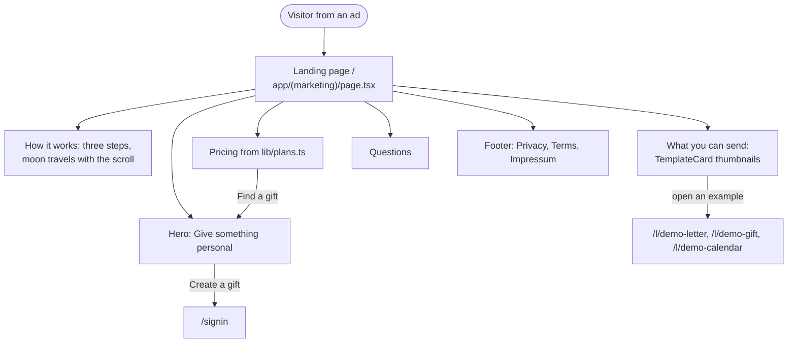
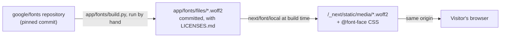

# Landing page, brand and legal pages

## What it does

The landing page at `majnu.app` tells a visitor from an ad what Majnu does in one screen, shows real examples they can open, and gives the price. Its main image is a painting of Majnu giving Layla the moon, with our own moon on top that travels from his hands to hers as the visitor scrolls. The site around every gift follows one brand, **Night Post**. The Impressum, privacy policy and terms, required before ads run in Germany, are written in the same voice.

## How it works

The page, top to bottom ([`app/(marketing)/page.tsx`](../../app/(marketing)/page.tsx)):

1. **Header** with the wordmark, links to "How it works" and "Pricing", and "Sign in".
2. **Hero:** "Personalized digital gifting", the headline "Give something personal.", a primary **Create a gift** button to `/signin` and "See how it works". Under it: "Free to start. Nothing to install for the person you send it to."
3. **How it works:** three steps (Tell Majnu who it is for; Make it yours; Send the link), each with a moon phase one step fuller than the last. On desktop the painting is pinned behind the hero and the steps, and the moon travels as they scroll past; on phones it is a framed card between them.
4. **What you can send:** gift, letter, invitation and advent calendar, with their plan, and three examples drawn with `<TemplateCard>` that open the demo pages. The demo slugs always resolve to the same fixtures as the thumbnails ([templates-and-gift-pages.md](templates-and-gift-pages.md#demo-slugs)).
5. **Pricing:** two cards read from [`lib/plans.ts`](../../lib/plans.ts): Free (€0, everything that makes Majnu useful) and the personalised wrapper (€2.99 once, for one gift, bought with "Make it unique" on a wrapped gift; [billing.md](billing.md)). Prices include VAT; nothing renews.
6. **Questions:** whether you need an account, where the ideas come from, location, whether the recipient needs an account, who can see a gift, what Majnu costs and what happens when you buy a personalised wrapper.
7. A closing call to action and the site footer ([`site-footer.tsx`](../../components/landing/site-footer.tsx)) with Privacy, Terms and Impressum.

Sections below the fold play in as they scroll into view ([`reveal.tsx`](../../components/landing/reveal.tsx)). Content is hidden only after hydration and only while still below the fold, so with reduced motion, or without JavaScript, everything stays visible.

### The scroll scene

[`<GiftScene>`](../../components/landing/gift-scene.tsx) draws the moon in the painting's own coordinates (2048 × 1152), so it stays on the couple whatever the crop:

- The painting was generated with FLUX and is served as WebP at 1280 and 2048 pixels wide from [`public/landing/`](../../public/landing/).
- The moon follows a quadratic curve from the light above Majnu's cupped hands, over an arc, to Layla's open palm. Its radius grows from 9 to 46 and shrinks to 15 as it lands, and it fills from a crescent to full on the way.
- Scroll progress is read on `scroll` (a passive listener) and eased towards with `requestAnimationFrame`, which stops when the moon has arrived.
- **Variants:** `backdrop` pinned behind a long section (desktop landing), `card` animated as it scrolls past (phone landing), and `panel`, which fills its parent with the moon already given (sign-in and sign-up, [`app/(auth)/layout.tsx`](../../app/(auth)/layout.tsx), beside the line "Majnu would have given Layla the moon.").
- With `prefers-reduced-motion`, nothing moves: the scene shows its final state, the full moon in Layla's hand.

## The Night Post brand

Everything is in [docs/brand.md](../brand.md); in short:

- **The name and the story.** In Arabic, Layla means night, and in the old story Majnu writes poems for Layla. Every gift goes out like a letter under the moon: calm, elegant and personal.
- **Logo.** MAJNU in wide capitals with a rose-gold crescent above the J, drawn as vector outlines. Use the files in [`public/brand/`](../../public/brand/) (or the [`Wordmark`](../../components/brand/wordmark.tsx) component), never retype it in a font. The crescent alone is the mark, for icons and avatars, and it never sits next to a star.
- **Colour.** Dark by default (Plum night): Plum `#1B1226` ground, Velvet `#2A1C3A` panels, Petal white `#F5EAF1` text, Lilac haze `#BCA8C4` secondary text, Rose gold `#EAB394` for the one thing to do, Orchid `#CD8DBD` at most once a screen. Forms, the legal pages and long reading may use the light Petal palette. In code they are Tailwind's `night` and `day` colours ([`tailwind.config.ts`](../../tailwind.config.ts)).
- **Type.** Gilda Display for headlines (400 only, sentence case) and Hanken Grotesk for everything people read and tap, self-hosted from files in the repository (see [Fonts](#fonts) below).
- **The moon** is the main image: phases mark progress, the advent calendar's doors fill one step a day, and stars are small and still.
- **Motion** is slow and calm, with one easing curve (`cubic-bezier(0.22, 0.61, 0.36, 1)`) and no bounces; every screen works without animation.
- **Voice.** Write to one person. Short sentences, plain words, sentence case. No exclamation marks, no emoji in the interface, never "magic", "AI-powered" or "unlock". The main action is always **Create a gift**. The main agent's system prompt carries the same rules ([letters-chat.md](letters-chat.md)).

Letter and calendar templates are the sender's gift, not our page, so they may have their own palettes and type; the chrome around them (the share panel, the "made with Majnu" footer, link previews) follows the brand. The logo files, icons and the site's link-preview image are generated by [`scripts/brand/build-brand.mjs`](../../scripts/brand/build-brand.mjs); change colours there and regenerate rather than editing SVGs by hand.

## Fonts

Every typeface is a `.woff2` file committed in [`app/fonts/files/`](../../app/fonts/files/) and loaded with `next/font/local` in [`app/fonts.ts`](../../app/fonts.ts). The build never contacts Google Fonts. Until 21 November it used `next/font/google`, which downloads the fonts during every build, and CI failed whenever Google did not answer in time ("Cannot read properties of null (reading '1')").

| Export | CSS variable | Face | Files | Preloaded |
|---|---|---|---|---|
| `display` | `--font-display` | Gilda Display 400 | latin | yes |
| `sans` | `--font-sans` | Hanken Grotesk 400, 500, 600 (one variable file) | latin | yes |
| `letterSerifDisplay` | `--font-letter-serif-display` | Cormorant Garamond 500, 600, roman and italic | latin, latin-ext | no |
| `letterSerif` | `--font-letter-serif` | EB Garamond 400, 500, roman and italic | latin, latin-ext | no |
| `letterSansDisplay` | `--font-letter-sans-display` | Bricolage Grotesque 200 to 800 | latin, latin-ext | no |
| `letterScript` | `--font-letter-script` | Caveat 400 to 700 | latin, latin-ext | no |
| `letterCalligraphy` | `--font-letter-calligraphy` | Pinyon Script 400 | latin, latin-ext | no |

- **The files are cut the way Google cuts them**, by [`app/fonts/build.py`](../../app/fonts/build.py) from the fonts in the Google Fonts repository: Google's latin and latin-ext character ranges, the OpenType features Google keeps (including tabular and lining figures), no hinting, and axes next/font did not ask for pinned where Google pins them (Bricolage's optical size at 14, not the font's default of 96). The variable fonts are limited to the weights in use, which keeps Hanken Grotesk, preloaded on every page, at 22 KB instead of Google's 34 KB. The script pins the google/fonts commit and gives the same bytes on every run; run it only to change a face, weight or subset, then update `app/fonts.ts` and `LICENSES.md`.
- **Latin-ext is downloaded only when a letter needs it.** Each template face is declared as one font family from two `localFont` calls: the latin file and the latin-ext file, each with its own `unicode-range`, as in Google's own CSS. A letter in English or German loads only the latin files. The latin-ext halves are not exported; `letterFontVariables` includes their (unused) variables so next/font keeps their `@font-face` rules, because it drops a font call that nothing references.
- **The CSS family names** are the export names (`display`, `sans`, `letterSerif` and so on), each with a size-adjusted fallback (`'sans Fallback'`, based on Arial or Times New Roman as before) so text does not jump when the font arrives.
- **Licences.** All seven families are under the SIL Open Font License 1.1; [`app/fonts/files/LICENSES.md`](../../app/fonts/files/LICENSES.md) names each family, its copyright and source, and carries the licence text. Gilda Display reserves the name "Gilda" for unmodified copies, so our subset is called Majnu Display inside the file.

## Legal pages

| Route | File | What it holds |
|---|---|---|
| `/impressum` | [`app/(marketing)/impressum/page.tsx`](../../app/(marketing)/impressum/page.tsx) | Who runs Majnu, as German law requires |
| `/privacy` | [`app/(marketing)/privacy/page.tsx`](../../app/(marketing)/privacy/page.tsx) | What is collected and why, cookies, open tracking, gift pages, processors, transfers outside the EU, retention, rights |
| `/terms` | [`app/(marketing)/terms/page.tsx`](../../app/(marketing)/terms/page.tsx) | The terms of use, of the personalised wrapper and the right of withdrawal |

- All three read the operator's name, address and email from [`lib/legal.ts`](../../lib/legal.ts), which also holds the date of the last change (`legalUpdated`). The name must match the Stripe account. `npm run deploy` refuses to deploy while `lib/legal.ts` has a bracketed placeholder.
- They share [`<LegalPage>`](../../components/legal/legal-page.tsx), on the light Petal palette for long reading.
- The privacy page names Supabase (Frankfurt), Cloudflare, Anthropic, Google, Stripe and Tavily as processors. It says there are no analytics, advertising or tracking cookies, that the only cookie keeps a user signed in and the only stored setting is light or dark mode (both strictly necessary under § 25 (2) TDDDG, so there is no banner), and that gift pages set none. It describes open tracking as it is built ([sharing-and-tracking.md](sharing-and-tracking.md#the-visitor-hash)). If open tracking changes, this page changes in the same commit.
- `hello@majnu.app` is forwarded to the operator's inbox by Cloudflare Email Routing ([docs/setup.md](../setup.md#services)). The app itself sends no email.

## Pieces

| Piece | Job |
|---|---|
| [`app/(marketing)/page.tsx`](../../app/(marketing)/page.tsx) | The landing page |
| [`components/landing/`](../../components/landing/) | The scroll scene, the reveal effect and the site footer |
| [`components/brand/`](../../components/brand/) | The wordmark and the moon-phase drawing used across the site and the templates |
| [`app/(auth)/layout.tsx`](../../app/(auth)/layout.tsx), [`app/(auth)/signin/page.tsx`](../../app/(auth)/signin/page.tsx), [`app/(auth)/signup/page.tsx`](../../app/(auth)/signup/page.tsx) | Sign-in and sign-up beside the scene, by email and password or Google |
| [`app/(marketing)/impressum/page.tsx`](../../app/(marketing)/impressum/page.tsx), [`app/(marketing)/privacy/page.tsx`](../../app/(marketing)/privacy/page.tsx), [`app/(marketing)/terms/page.tsx`](../../app/(marketing)/terms/page.tsx), [`lib/legal.ts`](../../lib/legal.ts) | The legal pages and the operator's details |
| [`app/layout.tsx`](../../app/layout.tsx), [`lib/site.ts`](../../lib/site.ts) | Site-wide metadata: name, description, URL |
| [`app/fonts.ts`](../../app/fonts.ts) | Every typeface, loaded with `next/font/local`, and the CSS variables the site and the templates use |
| [`app/fonts/files/`](../../app/fonts/files/), [`app/fonts/build.py`](../../app/fonts/build.py) | The committed font files with their licences, and the script that makes them from the Google Fonts repository |
| [`public/brand/`](../../public/brand/), [`app/icon.svg`](../../app/icon.svg), [`app/apple-icon.png`](../../app/apple-icon.png), [`app/opengraph-image.png`](../../app/opengraph-image.png) | Logo files, icons and the site's link-preview image |
| [`docs/brand.md`](../brand.md) | The brand guidelines |

## Data and privacy

- The landing page collects nothing: no analytics, no third-party scripts, and fonts served from our own domain. Neither the build nor a visitor's browser contacts Google Fonts.
- Signing in sets Supabase's session cookie, which is strictly necessary. The theme setting is stored in the browser.
- The painting and the brand assets are static files.

## Limits and costs

- The landing and sign-in pages are prerendered and served from the build's static assets ([`open-next.config.ts`](../../open-next.config.ts)). Setup measured cached pages at 1 to 3 ms of CPU, well within the Workers Free limit of 10 ms ([docs/setup.md](../setup.md#services)).
- The painting is the largest download; phones get the 1280-pixel WebP.
- Fonts: every page preloads 35 KB (Gilda Display 13 KB, Hanken Grotesk 22 KB). A letter adds only the faces its mood uses, 27 to 74 KB each for latin; the latin-ext files (17 to 99 KB) load only for text that needs them. The 16 files in the repository total 656 KB.

## How it was checked

- No unit tests cover the landing page itself. The `TemplateCard` data has a test, and the demo slugs are tested to point at templates of the right kind ([`fixtures.test.ts`](../../tests/unit/lib/letters/fixtures.test.ts)).
- Browser checks of the page, the scene and the legal pages (375 px and 1440 px, keyboard, reduced motion) are part of every task's verification, but their results are not recorded in the repository. The screenshots in `media/` come from the starter template and do not show Majnu.
- Self-hosted fonts (21 November): every font file was compared glyph by glyph with the file Google Fonts serves for the same request. Outlines and advance widths match within 1.3 font units (about 0.02 px at 16 px), the OpenType features are the same, and no character in Google's advertised ranges is missing. In a browser, the landing page, `/signin`, `/l/demo-letter` (opened) and `/dev/templates` laid out identically to majnu.app at 375 px and 1440 px (the same text widths and heights per font; one Cormorant line on the landing page 1 px narrower), and the network panel showed fonts only from our own domain. `npm run build` passed with `fonts.googleapis.com` and `fonts.gstatic.com` unreachable.

## Open questions

- The hero gets the gift finder's chat box, as the main flow now starts there ([#32](https://github.com/peresramirez/majnu/issues/32)).
- Before the finder goes live, the privacy page must name Cloudflare Turnstile, Apify and anonymous accounts ([#33](https://github.com/peresramirez/majnu/issues/33)), and before the Daytona redesign is offered, Daytona.
- [docs/brand.md](../brand.md#motion) asks for a still **half** moon with reduced motion; the scene shows the full moon already given. One of the two should change.
- The brand pass on the sign-in pages, favicon and landing examples is still open ([#24](https://github.com/peresramirez/majnu/issues/24)).
- **Fewer scripts than before.** `next/font/google` also self-hosted every other subset Google has (latin-ext for Gilda Display and Hanken Grotesk; cyrillic, greek and vietnamese for several letter faces) and loaded them on demand. Now Gilda Display and Hanken Grotesk cover latin only, so a name like "Łucja" in the site chrome shows its "Ł" in the fallback font, and Cyrillic, Greek and Vietnamese text in letters uses the system font. Adding latin-ext to the two site fonts would cost about 8 KB in the preloaded files.
- [`docs/brand.md`](../brand.md) still says to load the fonts with `next/font/google`.
