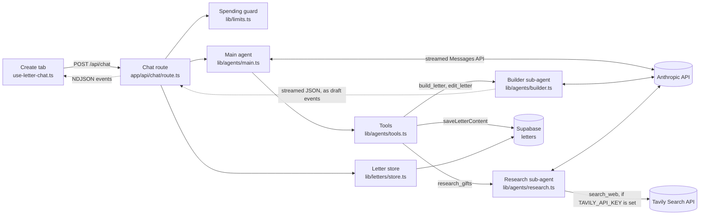
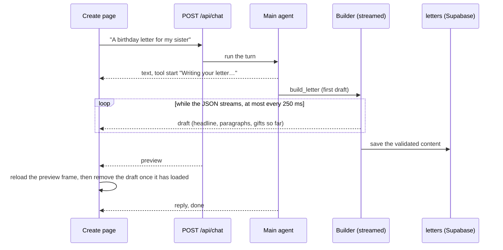
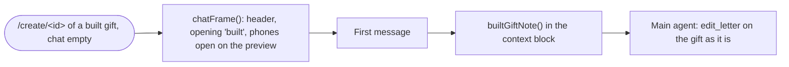

# Letters chat: the main agent and its sub-agents

## What it does

A signed-in sender opens the **Create** tab and chats with Majnu about the person a gift is for. Majnu asks one thing at a time, can look for gift ideas on the web, and writes the page while they talk. As soon as a message says who the gift is for and the occasion, a first draft appears in the preview, written in front of the sender: the headline, then the paragraphs, then the gifts. Every later message that adds a fact changes the page in that same turn, and two or three template cards let them switch the look. On a phone the Preview button shows that the page is being written (issue #30). The sender never sees JSON, tool names or template ids: only a conversation, cards and a preview.

## How it works

How the preview grows during one turn (the live draft, issue #30):

One message, in order:

1. The browser posts `{ letterId?, message, timezone }` to `POST /api/chat` ([`use-letter-chat.ts`](../../components/create/use-letter-chat.ts)). The timezone comes from `Intl.DateTimeFormat().resolvedOptions()`.
2. The route checks the session (401 without one) and validates the body with zod. A message over 4,000 characters gets a 400 with "That message is too long".
3. **Existing gift:** `getMyLetter(letterId)` loads the letter and its stored conversation through the signed-in user's client, so row-level security returns nothing for someone else's letter (404). **New gift:** `canCreateLetter()` checks the daily limit, then `createLetter()` inserts an empty letter with a server-made slug.
4. The response starts streaming. For a new gift the first event is `letter`, and the browser moves to `/create/<id>` with `history.replaceState` while the reply keeps streaming.
5. `canSendChatTurn(letterId)` counts the sender's messages in the stored conversation. At 40 it emits a `limit` event and stops.
6. `runMainAgent()` runs the tool loop (below). Text deltas, tool status lines, template cards, gift ideas, live drafts and preview reloads stream to the browser as they happen.
7. If the turn produced at least one assistant message, the route saves the loaded history plus this turn's messages with `saveChat()`. Then it emits `done` and closes the stream.
8. The whole turn is registered with the Worker's `ctx.waitUntil()`, so a sender who closes the page mid-reply still gets the letter built and the conversation saved.

### The main agent's tool loop

[`runMainAgent()`](../../lib/agents/main.ts) is written by hand on `client.beta.messages.stream()`, not on the SDK's `toolRunner`. In SDK 1.12.0 the runner keeps a server-side thread and appends every reply itself; the route needs to decide what is stored. It leaves out a refused reply, gives a tool call cut off at `max_tokens` an error result so the history stays valid, and applies the fallback rule in [`history.ts`](../../lib/agents/history.ts) before a reply is replayed.

For each model request (at most 6 per sender message):

- The request carries the shared fields from [`client.ts`](../../lib/agents/client.ts), `max_tokens: 8192`, the system prompt, the five tools, `output_config: { effort: "low" }` and a top-level `cache_control: { type: "ephemeral" }`, which caches the whole prefix. Later requests in the loop, and the next message if it comes within five minutes, read that prefix back from the cache.
- While the reply streams, the start of a `tool_use` block emits a `tool` event with status `start`, and text deltas emit `text` events. Separate text blocks are joined with a blank line, the same way the stored conversation is shown again later.
- `stop_reason: "refusal"`: every model in the fallback chain declined. The partial reply is dropped, any started tools are marked `error`, and a `refusal` event says "I can't help with that one…".
- `pause_turn`: the reply is appended and sent back as it is, and the server continues it.
- No tool calls: the turn is done.
- Tool calls with any stop reason other than `tool_use` (cut off at `max_tokens`): nothing runs. Each call gets an `is_error` result asking for a shorter call.
- Otherwise the tools run **one at a time**, so a build and an edit in the same reply cannot race, and their results go back as the next user message. When a reply holds several calls, each one's `start` is sent again as it runs, so the status line names the tool that is running ("Writing your letter…" while the first draft is written, not the template cards announced after it).

When the six requests are used up, the turn ends and what was done so far is kept.

The system prompt asks for the live preview (issue #30): a **first draft in the same turn** the sender says who the gift is for and the occasion, with the template that fits best and `suggest_templates` after it so they can switch; then **one `edit_letter` in the same turn for every message that adds a fact** (a name, a memory, a gift, a date, a place), with every new fact in that one call. The first draft may come before the names: the brief says so, and the builder writes the recipient as the sender calls them ("Sister") and leaves the sender's name empty. Four templates (classic envelope, gift reveal, 3D gift box, treasure map) leave out their "from …" label and tag until there is a name.

### Tools

Defined once at module load in [`tools.ts`](../../lib/agents/tools.ts), with input schemas generated from zod. Their order and wording never change, because tools are part of the cached prefix that thinking blocks are bound to.

| Tool | What it does | Gate | Status line |
|---|---|---|---|
| `suggest_templates` | Emits a `templates` event with 1 to 4 template ids; the chat shows cards. Tapping one sends an ordinary message, `Use the "Classic envelope" template.` | None | Picking a few templates… |
| `research_gifts` | Runs the research sub-agent and emits a `gifts` event with the ideas. The result goes back to the model as JSON, so the cards can be shown again when the chat is reopened | None | Looking for gift ideas… |
| `build_letter` | Runs the builder on a full brief, emits `draft` events while it writes, saves the content and emits `preview`. An optional `givenAsGift` (issue #59) says the page is a present with a gift, such as a party pop box for a birthday: the builder then has to keep that gift (`giftRequired`) | Calendars need a real account (a guest is asked to sign up); 2 builder runs per message | Writing your letter… |
| `edit_letter` | Runs the builder on the current content and the requested change, emits `draft` events over the current content, saves it and emits `preview`. Can move content to another template of the same kind only | Calendars need a real account; 2 builder runs per message | Making your changes… |
| `update_gift_list` | Adds gifts to an invitation's gift list or takes them off, saves it and emits `preview` ([gift-list.md](gift-list.md)) | A built invitation that takes a gift list | Updating the gift list… |

A tool that hits a plan gate emits a `limit` event and returns "Not done: …" to the model, which tells the sender kindly and carries on. The builder cap works the same way without a `limit` event: a third `build_letter` or `edit_letter` in one message returns "Not done: the page was already changed 2 times for this message…", and the model makes the change after the next message. A tool that throws returns an error result, so a `tool_use` never lacks its `tool_result`. A builder or research refusal returns "The writer declined this request".

### The builder sub-agent

[`buildContent()`](../../lib/agents/builder.ts) is one streamed `client.beta.messages.stream()` call with `output_config: { effort: "low", format: betaZodOutputFormat(schema) }` and `max_tokens: 16000` (it was one `messages.parse()` call before issue #30). The text deltas go to an optional draft sink (below); the SDK parses and validates the final message against the zod schema as `parse()` did, and `finalMessage().parsed_output` is the result. The stop reason is read from the stream itself, so a refusal or an answer cut off at `max_tokens` is recognised even when its unfinished JSON fails to parse (with `parse()` both looked like bad JSON). The finder's wrap step builds the same way without a sink. The schema is `LetterContent` or `CalendarContent` from [`schema.ts`](../../lib/letters/schema.ts), chosen by the template's kind. The beta namespace is used because `fallbacks` and `block_binding` exist only there. The user message carries today's date in the sender's timezone, the template, and either the brief or the current content and the change.

The output is then checked against rules the schema cannot express ([`checkContent()`](../../lib/agents/builder.ts)): 1 to 6 body paragraphs; an event on `wedding-invite`, `party-invite` and `wedding-envelope-3d` (`EVENT_TEMPLATES`); at least one gift on `gift-reveal` and `gift-box-3d` (`GIFT_TEMPLATES`), and on `party-box` when the caller says the page is a gift (`giftRequired`, which the finder's wrap step sets, and `build_letter` when the main agent passes `givenAsGift`); exactly 24 doors on `advent-classic`; 1 to 31 doors on `countdown`; a real `startDate`. The builder prompt's Gifts and Invitations sections name the same ids, and a test keeps them in step. If anything fails, or the JSON does not parse, or the answer was cut off, the builder asks once more with the problems listed. A second failure throws `BuilderInvalidOutput`.

Before saving, `sanitize()` drops every gift link and image that is not `https:`, renumbers calendar doors by position (door N is always the Nth door), and replaces an unknown timezone with the sender's. The letter's title is generic and made by `titleFor()`, for example "A gift for Tom" (also for the 3D gift box and the party pop box), "An invitation for Sophie" (also for the 3D wedding envelope) or "An advent calendar for Anna": never message text or a code.

### Live drafts

While the builder streams, [`draft.ts`](../../lib/agents/draft.ts) turns its unfinished JSON into what the create page shows:

- **Parsing:** `parsePartialJson()` reads any prefix of the answer. An unfinished string keeps what it has; an unfinished key, number, literal or escape is left out; open arrays and objects are closed.
- **Shaping:** `toLetterDraft()` and `toCalendarDraft()` keep only what the draft view shows: names, occasion, headline, paragraphs (at most 6), sign-off, gift titles, descriptions and prices, the event, and calendar door titles and messages. **Gift codes, links, images, the theme and the gift list are never in a draft**; they have not been through `sanitize()` yet and the view does not need them.
- **Edits:** `mergeOverCurrent()` lays the streaming answer over the current content. Fields the builder has not reached keep their current value; the field being written keeps its current text as long as the new text is the start of it, so unchanged words do not vanish and type themselves again; finished fields take the new value. Paragraphs further on stay until the new list is finished. A new paragraph inserted in the middle shifts the ones after it while it is written, and they settle when the list is done.
- **Throttling:** `createDraftStream()` sends at most one draft per 250 ms (`DRAFT_INTERVAL_MS`), never the same draft twice, and the rest when the answer is complete. A retry starts the draft again, and so does a fallback model's new text block. A failure in any of this is logged and skipped; it never fails the build.

`build_letter` and `edit_letter` emit each draft as a `draft` event with the letter id, kind and template id ([`tools.ts`](../../lib/agents/tools.ts)), and then, once the validated content is saved, the existing `preview` event. **Drafts are never stored**: the stored conversation, the `letters` row and `/l/<slug>` only ever see the final, validated content.

In the browser, [`draft-state.ts`](../../components/create/draft-state.ts) is a pure reducer beside `chat-state.ts`: a `draft` event replaces the draft (`writing`); `preview` marks it `saved`; it is dropped when the build fails (a `build_letter` or `edit_letter` error), on `error`, `refusal`, a `done` without a save, or a broken stream; and a saved draft goes once the reloaded preview has loaded. [`preview-pane.tsx`](../../components/create/preview-pane.tsx) shows it in [`draft-sheet.tsx`](../../components/create/draft-sheet.tsx), in the preview's phone-sized frame: in place of the empty state for a new gift, and over the preview while it is changed, with the older page underneath made `inert`. The sheet shows the headline first, then the paragraphs, the sign-off, the event and the gifts, or a calendar's intro and doors, with quiet placeholders for what is not written yet and a caret after the part being written. It follows the writing unless the sender scrolls it. It is a writing surface in the Night Post style, not the template: templates open on a sealed envelope or a wrapped box, which would hide a growing text, so the template appears when the saved page reloads. Templates only ever receive saved content.

On a phone, where the preview is behind a button, the **Preview** button appears with the first draft and carries a dot while the page is written (its name reads "Preview (being written)"), and the line under the gift's name shows the headline being written, for example `Writing “Happy birthday, Anna”`. The dot stays, as before, until the preview has been opened. The header takes the recipient's name from the draft once the builder has moved past it.

Motion: new paragraphs, gifts and doors fade and rise into place, the caret and placeholders pulse, and the Preview dot pulses, all only when reduced motion is off (`motion-safe:`). With reduced motion everything appears in place, still.

### The research sub-agent

[`researchGifts()`](../../lib/agents/research.ts) runs its own short tool loop and returns only 3 to 5 ideas (title, reason, price, link) to the main agent, never the search results. It ends with one call to `report_gifts`, a strict tool. It has two modes, each with its own constant system prompt:

- **Tavily**, when `TAVILY_API_KEY` is set: a client tool `search_web` that [`tavily.ts`](../../lib/agents/tavily.ts) answers with one `POST https://api.tavily.com/search` (`search_depth: "basic"`, 5 results, one chunk per source, no answer, raw content or images, an 8-second timeout). Results are cut to a 120-character title and a 500-character extract before the model sees them. A failed search goes back to the model as an error result, and the query, which describes the recipient, is kept out of the logs.
- **Anthropic's web search** otherwise: the server tool `web_search_20260209` with `max_uses: 4`.

Both modes stop after 4 searches and 4 model requests. Before the last request the agent is nudged to report. Ideas are cleaned by `toGiftIdeas()`: at most 5, title cut to 120 characters, reason to 400, price to 40, and links kept only if they are `https:`.

### The NDJSON events

[`lib/agents/events.ts`](../../lib/agents/events.ts) is the contract between the route and the chat UI. The route answers `application/x-ndjson; charset=utf-8` with one JSON event per line ([`lib/agents/ndjson.ts`](../../lib/agents/ndjson.ts)); `JSON.stringify` escapes newlines inside strings, so each event is exactly one line. In the browser, [`components/create/ndjson.ts`](../../components/create/ndjson.ts) splits the stream into events and the pure reducer in [`chat-state.ts`](../../components/create/chat-state.ts) turns them into what the screen shows.

| Event | Sent when | What the chat does |
|---|---|---|
| `letter { letterId }` | First, for a new gift | Moves the address to `/create/<id>` |
| `text { delta }` | Text streams in | Appends to Majnu's message |
| `tool { name, status, label }` | A tool starts, finishes or fails | Shows or clears the status line |
| `templates { ids }` | `suggest_templates` ran | Shows template cards |
| `gifts { ideas }` | `research_gifts` found ideas | Shows gift cards |
| `draft { letterId, kind, templateId, content }` | The builder is writing, at most every 250 ms; `content` is a `LetterDraft` or `CalendarDraft` (every field optional, no codes or links). Added for issue #30 | Shows the draft sheet in the preview frame; marks the Preview button on phones |
| `preview { letterId, kind, templateId }` | Content was built or changed | Reloads the preview; a draft stays over it until the reload has loaded |
| `limit { reason, message }` | A limit or plan gate stopped something | Shows a notice; `reason` is `daily_letters`, `chat_turns`, `monthly_gifts` or `full_moon_only` |
| `refusal { message }` | The model declined | Shows a friendly "try another way" |
| `error { message }` | Something failed | Shows the message, written in the brand's voice by [`errors.ts`](../../lib/agents/errors.ts) |
| `done` | Always, last | Ends the turn |

Before the stream starts, failures are plain HTTP errors with a JSON body `{ error }`: 400 for a bad body, 401 without a session, 404 for a letter that is not yours, 500 when the letter cannot be loaded or created. When the daily limit is reached for a new gift, the answer is a short, already finished stream with a `limit` event, so the chat shows it like any other notice.

### Stored history

The conversation is stored in `letters.chat` **exactly as the API returned it**, thinking blocks included, and replayed unchanged and append-only on the next message. It is never rebuilt from our own objects. The one rule the API sets on echoing a reply concerns server-side fallbacks: when a model declined part-way and a fallback model continued, the blocks the declining model wrote before the last `fallback` block are left out. [`echoableContent()`](../../lib/agents/history.ts) applies this once, when the reply is first appended, so stored history is never edited later.

Per-request facts never go into a system prompt. Each sender message starts with a `<context>` text block from [`context.ts`](../../lib/agents/context.ts), for example `<context>Today is Saturday 2026-11-21 in Europe/Berlin (UTC+01:00). The sender's timezone is Europe/Berlin.</context>`. The default timezone is `Europe/Berlin` when the browser sends none or an unknown one.

A gift that is built but has no stored conversation, such as one wrapped in the gift finder (issue #62), gets one more fact in the first message's block: [`builtGiftNote()`](../../lib/agents/main.ts) says what is built ("This gift is already built and shown in the sender's preview, with no earlier chat: template "Gift reveal" (gift-reveal), for "Tom", from "Lea and Max", occasion …, headline …, gifts: …"). The values are JSON strings, so they read as data, and gift codes and links stay out. The system prompt says to change such a gift with `edit_letter` and to rebuild only when the sender wants to start over.

The page around the chat follows [`chatFrame()`](../../components/create/chat-state.ts) (issue #62): the header with the gift's name and state shows only once a gift exists, so a first message refused by the day's letter limit no longer leaves "New gift · In progress" over a gift that was never made; an empty chat shows the new-gift starter ("Who is it for?"), except on a built gift, which shows "Ready for …" with three changes to ask for; and a built gift with no conversation opens on its preview and share panel on phones.

Stored titles follow the same rule as page titles and link previews: [`titleFor()`](../../lib/agents/builder.ts) names one person by the first name and a group whole (`shortName()` in [`lib/letters/names.ts`](../../lib/letters/names.ts)), so "Sophie Meyer" gives "An invitation for Sophie" and "our friends" "An invitation for our friends".

When a gift is reopened, `/create/[id]` turns the stored conversation into display messages with [`toDisplayMessages()`](../../lib/agents/display.ts). It shows one assistant message per turn, recovers template cards from `suggest_templates` calls and gift cards from `research_gifts` results, and hides the context block, tool results and thinking. Only those display messages reach the browser; the stored conversation stays on the server.

### Model settings

All three agents share the request fields from [`agentRequestBase()`](../../lib/agents/client.ts):

| Setting | Value | Why |
|---|---|---|
| `model` | `MAJNU_MODEL`, default `claude-opus-5-5` | One switch for every agent; `claude-sonnet-5-5` is the documented fallback if replies feel slow or costs run high |
| `betas` | `thinking-binding-controls-2026-08-01`, `server-side-fallback-2026-07-01` | Needed for `block_binding` and `fallbacks` |
| `thinking` | `{ type: "adaptive", block_binding: { prefix_mismatch_behavior: "drop_block" } }` | A prompt or tool change during the night drops old thinking blocks instead of breaking conversations already in progress |
| `fallbacks` | `"default"` | A request the safety classifiers decline is re-run on the model Anthropic recommends for that category |
| `output_config.effort` | `"low"` | Replies must feel fast on a phone |
| Client | `maxRetries: 2`, created on first use, `ANTHROPIC_BASE_URL` honoured | Retries 408, 409, 429 and 5xx with backoff; an AI gateway can be put in front later with no code change |

Requests never send `temperature`, a thinking budget or a forced `tool_choice`: current models reject all three. The system prompts and tool lists are built once from static data, so they stay byte-stable and cacheable.

**Verified live** on `claude-opus-5-5` on 21 November, as recorded in [docs/plan.md](../plan.md#agents): `output_config.effort`; `block_binding: drop_block`, with a stored history replayed after a JSON round trip and no input transformations; `fallbacks: "default"` accepted (an actual fallback was not triggered); effort and format sharing one `output_config`; and `web_search_20260209` with `max_uses: 4`. The check is [`scripts/agent-smoke.test.ts`](../../scripts/agent-smoke.test.ts): `npx vitest run --config scripts/agent-smoke.config.mts`. Its header puts it at about 8 to 10 short, low-effort paid requests; it mocks the store and the limits, so nothing is written to the database. Re-run it after changing a prompt or the SDK.

## Pieces

| Piece | Job |
|---|---|
| [`app/api/chat/route.ts`](../../app/api/chat/route.ts) | `POST /api/chat`: session, body, letter, limits, the agent turn, saving, the event stream |
| [`lib/agents/main.ts`](../../lib/agents/main.ts) | The main agent's system prompt and tool loop |
| [`lib/agents/tools.ts`](../../lib/agents/tools.ts) | Tool definitions, plan gates and what each tool does |
| [`lib/agents/builder.ts`](../../lib/agents/builder.ts) | Builder sub-agent: streamed structured output, checks, sanitising, generic titles |
| [`lib/agents/draft.ts`](../../lib/agents/draft.ts) | Live drafts: partial JSON, shaping for the screen, the edit merge, the throttle |
| [`lib/agents/research.ts`](../../lib/agents/research.ts) | Research sub-agent and its two search modes |
| [`lib/agents/tavily.ts`](../../lib/agents/tavily.ts) | The Tavily Search API call |
| [`lib/agents/client.ts`](../../lib/agents/client.ts) | The one place that creates the Anthropic client and picks the model |
| [`lib/agents/context.ts`](../../lib/agents/context.ts) | The `<context>` block, timezones and today's date |
| [`lib/agents/history.ts`](../../lib/agents/history.ts) | The fallback echo rule for stored replies |
| [`lib/agents/display.ts`](../../lib/agents/display.ts) | Stored conversation to chat messages, for reopened gifts |
| [`lib/agents/events.ts`](../../lib/agents/events.ts), [`lib/agents/ndjson.ts`](../../lib/agents/ndjson.ts) | The event contract and the stream writer |
| [`lib/agents/errors.ts`](../../lib/agents/errors.ts) | Friendly messages for the sender, safe log lines for us |
| [`lib/agents/safe-url.ts`](../../lib/agents/safe-url.ts) | Drops every link that is not `https:` |
| [`components/create/`](../../components/create/) | The chat UI: `create-chat.tsx`, `use-letter-chat.ts`, `chat-state.ts`, `ndjson.ts`, the composer, the template picker and the preview pane; `draft-state.ts` and `draft-sheet.tsx` for the live draft |
| [`app/(app)/dashboard/page.tsx`](../../app/(app)/dashboard/page.tsx) | The Create tab: an empty chat with a fresh key on every visit |
| [`app/(app)/create/[id]/page.tsx`](../../app/(app)/create/[id]/page.tsx) | The same chat for an existing gift, with its display messages |
| [`app/(app)/create/actions.ts`](../../app/(app)/create/actions.ts) | Server action that gives the chat a new gift's slug and name |
| `letters.chat`, `letters.content` | The stored conversation (server-written) and the built content |
| `ANTHROPIC_API_KEY`, `MAJNU_MODEL`, `ANTHROPIC_BASE_URL`, `TAVILY_API_KEY` | The key, the model, an optional gateway and the optional search key |

## Data and privacy

- **The conversation** is stored in `letters.chat` for as long as the letter exists. The browser can read its own letters but cannot write `chat`: the column is left out of the update grant, because the turn limit counts it, and a browser that could rewrite it could reset the count or replay a huge forged history at our cost. `saveChat()` checks ownership through row-level security, then writes with the service-role client.
- **Thinking blocks and tool results** never reach the browser; reopened chats get display messages only.
- **What leaves the server:** the conversation goes to Anthropic to write the replies. With Tavily on, the research agent's search queries go to Tavily; both are named on the privacy page.
- **Logs** carry no message text, gift codes or keys. [`describeError()`](../../lib/agents/errors.ts) logs the error class, status, request id and the API's own error text, which describes the request shape, not its content. Tavily search failures log only the reason.
- **Links written by a model** are kept only if they are `https:` (builder, research, and again in the public view), so a `javascript:` or `data:` link can never become an `href` on a gift page.
- **Titles** are generic, so browser history and link previews show "A letter for Anna", never the message.
- **Live drafts** go only to the sender's own create page, over their signed-in chat stream. They are never stored, carry no gift codes, links or images, and never reach a template, `/l/<slug>` or a link preview: only the saved, validated content does.

## Limits and costs

| Limit | Value | Where |
|---|---|---|
| New gifts per user per UTC day | 5 | `LIMITS.lettersPerDay` in [`lib/limits.ts`](../../lib/limits.ts), checked in the route and again in `createLetter()` |
| Sender messages per gift | 40 | `LIMITS.chatTurnsPerLetter`; tool results travel as user messages but are not counted |
| Characters per message | 4,000 | `MAX_MESSAGE_LENGTH` in the route |
| Model requests per sender message | 6, each up to 8,192 output tokens | `MAX_REQUESTS_PER_TURN` in `main.ts` |
| Builder runs per sender message | 2 (`build_letter` and `edit_letter` together) | `MAX_BUILDS_PER_TURN` in `tools.ts` |
| Builder calls per build or edit | 2 at most, each up to 16,000 output tokens | `buildContent()` |
| Draft events | At most one per 250 ms while the builder writes | `DRAFT_INTERVAL_MS` in `draft.ts` |
| Research per run | 4 searches and 4 model requests, each up to 16,000 output tokens | `MAX_SEARCHES`, `MAX_REQUESTS` in `research.ts` |
| Tavily search | 5 results, basic depth, 8-second timeout | `tavily.ts` |
| Calendars | A real account; everything else is free for everyone (there are no plans since 21 November) | `canUseFeature()` in [`lib/limits.ts`](../../lib/limits.ts) |

On top of these, a monthly spend limit is set in the Anthropic Console. All counts go through the signed-in user's client, so row-level security limits them to that user's own letters.

**Cost of one message** is bounded by the table above but has not been measured. Since issue #30 most messages that add a fact run the builder once more. Estimated, not measured: an edit of a letter sends about 2,000 input tokens (the builder prompt and the current content) and gets about 1,000 output tokens back, roughly $0.03 at Opus 5.5's $4 and $20 per million; a 24-door calendar is about three times that. The main agent's extra request to hand back the tool result reads its prefix from the cache. The cap of 2 builder runs per message bounds the extra spend to 4 builder requests per message. Drafts cost little CPU on the Worker: parsing and shaping 80 drafts of a 24-door calendar took about 2 ms in total, and 20 drafts of a letter edit about 0.3 ms (measured in Node on a laptop, warm). The main agent's prefix is cached (an ephemeral cache, about five minutes), which makes the second and later requests of a tool loop cheaper; the builder and research calls are not cached. On Cloudflare, time spent waiting on the model does not count against the Worker's CPU limit, but the code around it does, so the route keeps that work small.

## How it was checked

- **Unit tests** in [`tests/unit/lib/agents/`](../../tests/unit/lib/agents/): `chat-route.test.ts` (status codes, the new-letter flow, limits, saving), `main.test.ts` (the tool loop, refusals, cut-off calls, pause turns, the first-draft prompt, the status line naming the running tool), `tools.test.ts` (gates and results; draft events before `preview`, the edit draft over the current content, the cap of 2 builder runs), `builder.test.ts` (checks, retries, sanitising, titles; the streamed call through the real SDK against replayed streams from [`fake-stream.ts`](../../tests/unit/lib/agents/fake-stream.ts): drafts in reading order without codes, the unchanged validation and one retry, cut-off and refusal told apart from bad JSON, API errors passed on), `draft.test.ts` (partial JSON on every prefix of a real answer, shaping, the edit merge, the throttle), `research.test.ts` and `tavily.test.ts` (both search modes, caps, timeouts), `history.test.ts`, `display.test.ts` and `ndjson.test.ts`. The chat UI's stream reader (including `draft`), the chat reducer, the draft reducer (`draft-state.test.ts`) and the draft sheet's helpers (`draft-sheet-model.test.ts`) are covered in [`tests/unit/components/create/`](../../tests/unit/components/create/), and the limits in [`tests/unit/lib/limits.test.ts`](../../tests/unit/lib/limits.test.ts).
- **Live:** the model settings above were checked against the real API with `scripts/agent-smoke.test.ts` on 21 November.
- **Live preview, with the model scripted** (22 November, issue #30; the Anthropic key was over its monthly limit): `next dev` with `ANTHROPIC_BASE_URL` pointed at a local stub that streams recorded Messages API events (the main agent's replies and tool calls are scripted; the builder streams a recorded letter, and an edit is applied to the current content the request carries). Everything else was real: the route, the SDK stream, the draft events, saving to Supabase, the preview frame, with a temporary confirmed test user (deleted afterwards). Checked at 1440 px and at a true 375 px (device emulation): the first turn shows the draft sheet about 4 s in, the headline types, then paragraphs 1 to 3, then "Opening the page…" with the saved preview loading underneath, and the sheet leaves once it has loaded, so the preview is never blank; a later message rewrites the page in the same turn over the current content; at 375 px with a 420 px-high viewport (the space above a phone keyboard) and the message box focused, the Preview button appears in the first turn with its dot ("Preview (being written)") and the header shows the headline being written. Reduced motion: no fill-in, caret or placeholder animation; without it they animate. Keyboard: the draft is focusable with a visible ring and the older page under it is skipped (`inert`). No console errors or warnings.
- **Issues #59 and #62, 22 November:** unit tests in `tools.test.ts` (`givenAsGift` passes `giftRequired` to the builder, optional in the schema), `main.test.ts` (the built-gift note in the first message's context block only, never a code or link), `builder.test.ts` (`titleFor` for a surname, groups and no name) and [`chat-state.test.ts`](../../tests/unit/components/create/chat-state.test.ts) (`chatFrame` for a new gift, a refused first message, a built gift without and with a conversation). In an isolated Chrome at 375 and 1440 px, on a temporary page (deleted before committing) rendering `CreateChat` with mock data: a built gift with no conversation opens on its preview and share panel on a phone, and "Back to chat" shows "Ready for our friends" with three changes to ask for and no "Who is it for?"; at 1440 both sit side by side. With `/api/chat` answered in the browser by the stream the route sends for a refused 6th letter (`limit`, `done`), the chat shows the notice and no header; with a stream that creates a letter, the header "New gift · In progress" appears. Console clean. Not checked against the real model (key over its limit): whether it edits the built gift on the first message and sets `givenAsGift`.
- **The template chip, issue #70, 22 November.** A template chosen with the Template button or from the Templates tab (`/dashboard?template=<id>`) sits in the message box as a chip and goes with the message as `Use the "<name>" template.` followed by the text. Enter, the send button and a message dictated by voice already sent it; tapping a starter in an empty chat ("A birthday letter for my sister") sent the starter alone and left the chip behind. All of them now go through `composeMessage()` with the shared rules `sendsOnEnter()`, `canSendMessage()` and `withVoiceText()` in `components/create/chat-state.ts`, tested in [`chat-state.test.ts`](../../tests/unit/components/create/chat-state.test.ts). Checked in the browser with the model scripted: `/dashboard?template=classic-envelope` and a starter sent `Use the "Classic envelope" template. A birthday letter for my sister`, and the Template button, Postcard and Enter sent `Use the "Postcard" template. Make it short`, both as they reached the model.
- **Not verified:** an actual server-side fallback (the parameter is accepted, but no request has been declined and re-run), and the cost of a typical conversation. For issue #30, nothing was checked against the real model: whether it builds a first draft in the first turn and edits after every new fact as the prompt asks, how fast a real builder stream fills the draft, and the real cost per message. A real phone keyboard was not tried, only a short viewport.

## Open questions

- Measure what a typical conversation costs (tokens per message, cache hit rate) before ads scale up, and decide whether `claude-sonnet-5-5` should be the default.
- The limits are per user. Once the gift finder brings anonymous accounts ([#33](https://github.com/peresramirez/majnu/issues/33)), one person can make many accounts; the site-wide caps planned for the finder are the backstop.
- Advent calendars in the agent and the owner preview are still tracked in [#13](https://github.com/peresramirez/majnu/issues/13), and the create page in [#6](https://github.com/peresramirez/majnu/issues/6).
- Live drafts (#30): run the live checks once the key works again (a first draft in the first turn, an edit for each new fact, the pace of the stream, the extra cost per message), and tune the prompt if the model waits for more details. If a draft before the names reads oddly, ask for the recipient's name in the first message instead.
- When a safety fallback model takes over mid-answer, the builder's final message holds two text blocks; the SDK parses each, so the first, unfinished one fails and the builder retries. That was so before #30 too; the draft starts again with the new block.
- Gift ideas from `research_gifts` carry no image. The gift finder's options will ([`lib/finder/events.ts`](../../lib/finder/events.ts)).
