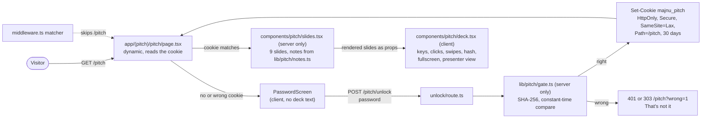

# Pitch deck

Issue #76. Majnu's two-minute hackathon pitch as a page on the site, at [majnu.app/pitch](https://majnu.app/pitch), behind a light password. The spoken script is [../pitch-script.md](../pitch-script.md).

## What it does

Someone opens `/pitch`, types the password (the site's domain name) and gets an eight-slide deck in the Night Post brand, plus one appendix slide for questions. It runs like presentation software: keys, clicks, swipes and a clicker move through it, F makes it full screen, N shows the speaker notes with a clock under the slide, and the address follows the slide (`/pitch#5` opens slide 5). On a phone held upright the slides stack in a column you can scroll and read, and the browser's print dialog saves one slide per landscape page as a PDF.

Before the password is right, the server sends only the password screen: none of the deck's words, pictures or notes are in the HTML, the RSC payload or any JavaScript file.

## How it works

One visit, in order:

1. `GET /pitch` renders `app/(pitch)/pitch/page.tsx`. Reading the cookie makes the page dynamic, so Next.js sends `Cache-Control: private, no-cache, no-store`. The route group's layout (`app/(pitch)/layout.tsx`) has no site header or footer, the title "Majnu", `robots: noindex, nofollow, nocache` and no referrer. The middleware's matcher skips `/pitch` and `/pitch/…`, so the deck never touches a Supabase session.
2. Without the right cookie the page returns `PasswordScreen` and nothing else. The form posts to `/pitch/unlock` and works without JavaScript (a 303 back to `/pitch`, or to `/pitch?wrong=1`, which shows "That's not it"). With JavaScript it posts with `Accept: application/json`, stays on the page when the password is wrong, and reloads on the same hash when it is right, so `/pitch#8` opens slide 8 after unlocking.
3. `/pitch/unlock` hashes the submitted password (trimmed and lower-cased, since phones capitalise and the password is a domain name) with SHA-256 and compares it byte by byte with the stored hash in constant time. Only the hash is in the code. When it matches, it sets `majnu_pitch` to a SHA-256 of the password hash under a label of its own, so changing the password locks out every earlier cookie.
4. With the cookie, the page renders `pitchSlides()`: nine slides drawn on the server, each with its speaker notes, passed as rendered children to the client controller `Deck`. The slides, diagrams, notes and gate are `server-only` modules, so their words are in no JavaScript bundle. The controller holds only generic labels (the slide counter, "Speaker notes (N)", "Turn your phone sideways to present.").

### The deck

- **Canvas.** Every slide is drawn on a 1920 × 1080 canvas. Each slide is a CSS size container and every size is in canvas pixels (`--u` is `100cqw / 1920`), so type and pictures scale with the slide, never with the window. The stage is a size container too, and the slide is the largest 16:9 box that fits it (`min(100cqw, 100cqh × 16/9)`), centred both ways with equal letterbox bars on the brand's darkest night colour.
- **Safe area.** All content sits inside one safe area, the same on every slide: 100 canvas pixels from the top and bottom, 160 from the sides. Titles start at its top edge with one 56-pixel gap to what follows, the moon phase that marks progress sits in its top-right corner on the title's first line, and bottom-anchored content (phones, panels, the vision line, the QR code) ends on its bottom edge. Only background art (the cover painting, the final slide's painting and moon, the dunes in the travel panel) runs to the slide's edges, marked `data-bleed`.
- **Motion.** Slides cross-fade in 800 ms with the brand's easing; each slide's pieces arrive 160 ms apart (or on their own delays, as the three questions on slide 2 do). With `prefers-reduced-motion` there are no transitions or animations at all, and every piece is there at once.
- **The last slide** shows the painting of Majnu giving Layla the moon, darkened under the text on the left and along the bottom. The moon travels from his hands to her palm over 3.8 seconds, growing, filling from a crescent to full and glowing, as on the landing page: `components/pitch/moon-passage.tsx` copies the landing page's drawing (the moon in the painting's own 2048 × 1152 coordinates on the same curve) and runs it on a clock when the slide becomes active instead of on scroll. At rest, which is what the server renders and what print, the phone column and reduced motion show, the moon is in Layla's hand.
- **Navigation.** → ↓ Space PageDown move on; ← ↑ Shift+Space PageUp go back; Home and End jump to the first and last main slide (the appendix comes after the last). A click or tap on the left 35% of the screen goes back, anywhere else forward; a horizontal swipe moves too. The counter (`3 / 8`, or "Appendix"), the progress marks (the current one a moon phase) and the notes and fullscreen buttons fade out after 2.5 seconds without the pointer moving and come back with it or with keyboard focus.
- **Address.** The hash follows the slide with `history.replaceState`, called with no state so Next.js's own patched `replaceState` records the new address. (Given Next.js's internal state it skips that, and the router's next update would put an older address back; the same happens when someone types a hash, so the deck reports typed hashes to it as well.)
- **Presenter view.** N shrinks the slide to make room for the notes underneath, with the elapsed time (starting when the notes first open; click it to restart) and the next slide's name. The audience view never shows notes.
- **Phone column.** On a screen held upright and at most 900 px wide, the slides become a column of full-width 16:9 slides with every piece visible, a hint to turn the phone sideways, and no controls. `/pitch#5` scrolls to slide 5.
- **Print.** `@page` is 1920 × 1080 px with no margin, and each slide is one page, backgrounds included.

### The slides

| # | Slide | What is on it |
|---|---|---|
| 1 | Majnu | The painting full-bleed, the wordmark, "The right gift, wrapped for one person.", majnu.app |
| 2 | Have you ever wondered…? | Three questions arriving one at a time, each with a fuller moon, then "Gifting should be about creating memories, not just buying presents." |
| 3 | Finding the perfect gift isn't easy. | Inspiration, Personalisation, Convenience as three cards with lucide icons; "So we often pick something ordinary, because it's easier." |
| 4 | Say who it's for. Majnu does the rest. | Four steps on four real phone screenshots of majnu.app (`public/pitch/`) |
| 5 | More than a card | The advent calendar (available now) and experiences and travel (coming next, potentially through partners such as Expedia and Layla, named as text only) |
| 6 | How it works inside | One SVG diagram: the phone, Majnu's agents on Claude, the gift page and its link, opened and tracked; Stripe and the Claude Code designer in Daytona underneath |
| 7 | Free to find and send | No account needed, a free account, the €2.99 wrapper (read from `lib/plans.ts`), and the vision |
| 8 | Majnu + Layla | The story of the name over the painting with the moon passing between their hands, a QR code to https://majnu.app (`components/share/qr.ts`, drawn as SVG) and "Thank you" |
| 9 | Appendix | The finder's tool loop (`read_profile`, `ask_questions`, `find_gifts` and the research sub-agent), wrapping with the builder, and the data path (Supabase with row-level security, open tracking, Stripe → webhook → Cloudflare Queue → Claude Code in Daytona → `letter_designs`) |

The screenshots on slide 4 were taken on majnu.app on 22 November at 390 px wide, with a real guest account and one real search and wrap ("A birthday gift for my sister Lena…"). The guest account, its gift and its open were deleted afterwards. The guest session came from `signInAnonymously` on the server, because Turnstile refuses automated browsers.

## Pieces

| Piece | Job |
|---|---|
| `app/(pitch)/layout.tsx` | Full-screen layout: generic title and preview ("Majnu"), noindex, no referrer, the deck's stylesheet |
| `app/(pitch)/pitch/page.tsx` | Reads the cookie; the password screen or the deck |
| `app/(pitch)/pitch/unlock/route.ts` | `POST /pitch/unlock`: checks the password, sets the cookie; 303 for forms, JSON for the script |
| `app/(pitch)/pitch/deck.css` | The canvas units, safe area, slides, controls, presenter view, phone column, print and reduced motion. Holds no deck text, because it loads with the password screen |
| `lib/pitch/gate.ts` | Server only: the password's SHA-256, the constant-time compare, the cookie value and options |
| `lib/pitch/notes.ts` | Server only: the speaker notes, the same words as `docs/pitch-script.md` |
| `lib/pitch/navigation.ts` | Keys, clicks, swipes and the hash to slides; the presenter clock |
| `components/pitch/slides.tsx` | Server only: the nine slides |
| `components/pitch/diagrams.tsx` | Server only: the two SVG diagrams |
| `components/pitch/deck.tsx` | Client: the controller, with no slide text |
| `components/pitch/moon-passage.tsx` | Client: the moon passing between the figures' hands on slide 8 |
| `components/pitch/password-screen.tsx` | Client: the password form |
| `components/pitch/qr-code.tsx` | The QR code as SVG |
| `public/pitch/step-*.webp` | The four phone screenshots, 640 px wide |
| `middleware.ts` | Its matcher skips `pitch` and `pitch/…` (not `/pitchfork`) |
| `vitest.config.ts` | One line, `oxc: { jsx: { runtime: "automatic" } }`, so unit tests can render `.tsx` (the tsconfig keeps JSX for Next.js) |

## Data and privacy

- Nothing is stored. The only state is the `majnu_pitch` cookie in the presenter's browser: HttpOnly, Secure, SameSite=Lax, Path=/pitch, 30 days, its value derived from the password hash.
- The deck's words reach a browser only after the password is right, and only as that response's HTML and RSC payload, which are not cached (`no-store`). The password screen, the stylesheet and the controller's JavaScript contain none of them; a unit test checks every string the unlocked deck renders against the locked page and against those files.
- The page is not indexed (`noindex, nofollow`), is in no sitemap, sends no referrer, and its title and link preview say only "Majnu".
- It is a light gate, as the developer intended: the password is the domain name, there is no rate limit on `/pitch/unlock`, and anyone with read access to this (private) repository can derive the cookie. It keeps the deck off the open web during the hackathon; it does not protect a secret.

## Limits and costs

None at runtime: the deck makes no model, database or third-party calls, and the middleware does not run for it. Taking the slide 4 screenshots cost one live finder search and one wrap on the fallback Anthropic key.

## How it was checked

- **Unit tests** (`tests/unit/lib/pitch/`, 40 tests): the stored hash is the password's SHA-256; right, capitalised and wrong passwords; non-strings and over-long input refused without hashing; the compare reads every byte even when the first differs or the lengths differ; the cookie value, its options and that a new password locks out old cookies; `/pitch/unlock` for forms and JSON, right and wrong, with no cookie on a refusal; the page renders all nine slides with the cookie and, without it or with a forged or old cookie, none of the 100-odd strings the deck renders (text, alt text, labels, notes, picture paths); the slides, diagrams, notes and gate are `server-only` and no client file or the stylesheet imports them or contains their words; the notes match `docs/pitch-script.md` and come to 240 to 280 words; keys, clicks, swipes, the hash and the clock; the middleware matcher skips `/pitch` and `/pitch/unlock` but not `/pitchfork`.
- **curl** against the dev server: `/pitch` without the cookie is 200 with the password screen, `no-store`, the noindex meta and the title "Majnu", and none of the deck's words; a wrong password is a 303 to `/pitch?wrong=1` (or 401 `{ok:false}`) with no cookie; the right one, typed as "Majnu.app ", sets the cookie with every attribute; with it the deck renders; a forged cookie gets the password screen.
- **Overflow and centring, by script**, on every slide at 1288×748, 1440×900, 1920×1080, 1280×720 and 1024×768, with reduced motion so each slide is in its final state, in headless Chrome: the slide is 16:9 and centred with equal letterbox bars; every element's visible box is inside the safe area (only `data-bleed` art is skipped); text stays inside its card, panel, phone, door, chip, tag and diagram box; a slide's layout blocks never overlap; the corner moon never touches the title. Result: 0 problems on all 45 slide-and-size pairs. With motion on, the moon on slide 8 was followed over its whole passage at every size: never cut by the slide's edge, never over a line of text or the QR code, at rest on Layla's palm.
- **Browser** (the isolated `browser` server and headless Chrome): every slide looked at in screenshots at all five sizes and at 375 px; the unlock flow from a fresh profile; keys (→ Space PageDown PageUp Shift+Space Home End), clicks on both sides, swipes, F in and out of full screen, Tab to the controls with a visible focus ring; the presenter view; reduced motion (no running animations, every piece visible, the moon in her hand); the phone column (no sideways scroll, `#8` scrolls to slide 8); print with print media to PDF (9 pages, 16:9, backgrounds kept); the console clean.

## Open questions

- Slide 4 and the notes describe the finder as the developer pitches it: 2 sessions a day with 10 searches each, LinkedIn profiles and photos. Those are issues #70, #74 and #77, open when the deck was made; the code still has 3 searches a day and reads Instagram, TikTok and other public pages.
- The `vitest.config.ts` line is a shared-tooling change; the lead should confirm it.
- If the deck should outlive the hackathon, give `/pitch/unlock` a rate limit and a real secret.
