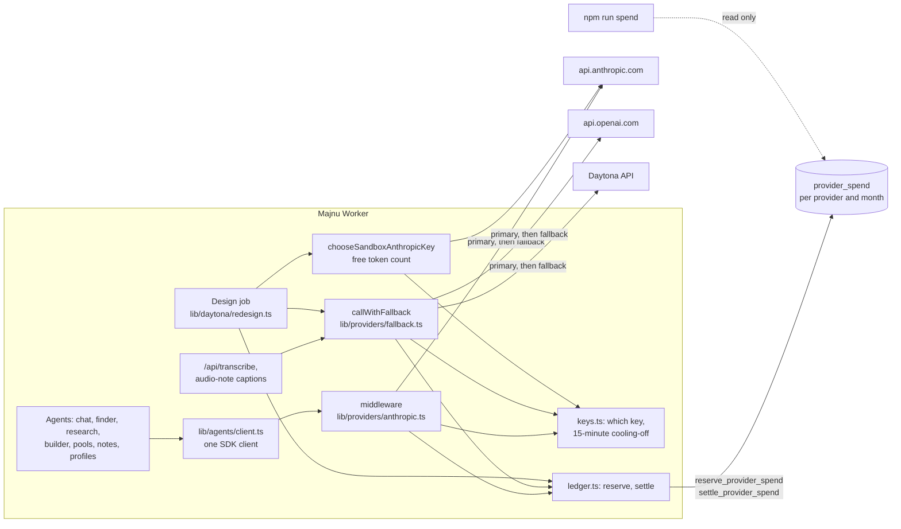

# Provider fallback keys

## What it does

On 21 and 22 November the Anthropic key first hit its spend limit, then its organisation's monthly tier threshold, and every AI feature on majnu.app stopped until 1 December (issue #67). Each paid provider now has an optional second key: Anthropic, OpenAI (speech to text) and Daytona (the personalised wrapper's sandbox). When the primary key cannot be used at all, because it was refused for its key, its billing, a spend limit or a quota, calls move to the fallback key for 15 minutes, and then the primary is tried again. A short rate limit never switches keys. The app spends at most **$150 a month on each fallback** (`FALLBACK_CAP_USD`), counted in the database, and refuses with the usual "busy" message once that is reached. Senders notice nothing, except that the gift finder keeps working.

Without a fallback key, everything behaves exactly as before.

## How it works

One Anthropic request, with `ANTHROPIC_API_KEY_FALLBACK` set:

1. The agent calls the SDK as always. The client's middleware sends the request with `ANTHROPIC_API_KEY`.
2. If the answer is a refusal that waiting will not fix (`lib/providers/classify.ts`), the primary is marked as cooling off for 15 minutes and the switch is logged. One example is the 429 `rate_limit_error` with `error.details.error_code: "enforced_spend_limit_reached"` we got on 22 November.
3. Before the same request goes out with the fallback key, the middleware reserves an upper bound of its cost: every character of the body as a cache write, all of `max_tokens` as output, and each allowed web search with its results. The database adds it only if the month's total stays within the cap (`reserve_provider_spend`, one atomic statement). If it does not fit, no request is made.
4. The fallback's response goes back to the SDK untouched. A copy of its event stream (the SDK middleware's `ctx.parse`) is read in the background for the usage in `message_start` and `message_delta`. `settle_provider_spend` then replaces the reservation with the estimate from those tokens, using the published prices in `lib/providers/costs.ts`. The month's running total is logged.
5. Until the cooling-off period ends, later requests go straight to the fallback. After it, the primary is tried first again.
6. If the fallback is refused too, cooling off, or over its cap, the middleware answers 429 `rate_limit_error` with `x-should-retry: false`. The SDK throws `RateLimitError` at once, and every route already turns that into its friendly "busy, try again in a minute" text.

OpenAI transcription and the Daytona sandbox start go through `callWithFallback`, which does the same for calls we make with `fetch`. Claude Code in the sandbox talks to Anthropic itself, out of reach of the middleware. So the design job first checks the primary with a free `count_tokens` request, which answers with the same refusal as a real request, and gives Claude Code the fallback key if the primary is refused.

When to switch:

| Provider | Switches keys | Stays on the same key (retried as before) |
|---|---|---|
| Anthropic | 401 `authentication_error`, 402 `billing_error`, 403 `permission_error`, 429 with `enforced_spend_limit_reached` (tier threshold or monthly spend cap), 400 "reached your specified API usage limits" (the Console limit), 400 "credit balance is too low" | Any other 429 (requests or tokens per minute), 529 overloaded, 5xx, other 400s |
| OpenAI | 401, `insufficient_quota`, `billing_hard_limit_reached` | Other 429s (`rate_limit_exceeded`), language and format 400s, 5xx, timeouts |
| Daytona | 401, 402, 429 `LIMIT_EXCEEDED`, a 4xx about quota, credits, billing, payment or a suspended organisation | 429 `RATE_LIMITED`, `OVERLOADED`, the tier refusing a network allow list, 5xx |

## Pieces

| Piece | Job |
|---|---|
| [`lib/providers/keys.ts`](../../lib/providers/keys.ts) | The key names per provider, `FALLBACK_CAP_USD`, and the 15-minute cooling-off per key (in memory) |
| [`lib/providers/classify.ts`](../../lib/providers/classify.ts) | Which errors mean "this key cannot be used now", per provider |
| [`lib/providers/costs.ts`](../../lib/providers/costs.ts) | Published prices and the estimates: Anthropic per token (cache reads and writes, web search at $10 per 1,000), OpenAI per minute of audio, Daytona per vCPU and GiB-hour |
| [`lib/providers/ledger.ts`](../../lib/providers/ledger.ts) | Reserve before a fallback call, settle after, log the month's total |
| [`lib/providers/fallback.ts`](../../lib/providers/fallback.ts) | `callWithFallback` (OpenAI) and `callWithFallbackKey` (the Daytona start, settled later), `ProviderUnavailableError` |
| [`lib/providers/anthropic.ts`](../../lib/providers/anthropic.ts) | The SDK middleware, and the key for Claude Code in the sandbox |
| [`lib/agents/client.ts`](../../lib/agents/client.ts) | Installs the middleware only when `ANTHROPIC_API_KEY_FALLBACK` is set |
| [`lib/voice/openai.ts`](../../lib/voice/openai.ts) | `transcribe()`, used by `POST /api/transcribe` (429 `site_busy` when no key can be used) and the audio-note captions |
| [`lib/daytona/redesign.ts`](../../lib/daytona/redesign.ts), [`rest.ts`](../../lib/daytona/rest.ts) | The design job's keys; `DaytonaApiError` keeps Daytona's own `code` and message |
| `provider_spend` ([`0010_provider_spend.sql`](../../supabase/migrations/0010_provider_spend.sql)) | Spend, calls let through and calls refused, per provider and month |
| [`scripts/spend.mts`](../../scripts/spend.mts) (`npm run spend`) | Read-only report of each fallback's spend |
| `ANTHROPIC_API_KEY_FALLBACK`, `OPENAI_API_KEY_FALLBACK`, `DAYTONA_API_KEY_FALLBACK` | Optional, server-only Worker secrets (`npm run cf:secrets`). `ANTHROPIC_API_KEY_FALLBACK` is also Claude Code's fallback in the sandbox |
| `FALLBACK_CAP_USD` | US dollars per fallback and month, default 150; 0 keeps the fallbacks unused |

## Data and privacy

- `provider_spend` holds a provider name, a month, an amount and two counters: no user, no request, no key. Row-level security is on with no policies; `anon` and `authenticated` have no privileges and cannot execute either function. Only server code with the service-role key reads or writes it.
- Log lines name the key's variable (`ANTHROPIC_API_KEY_FALLBACK`), never the key. They also carry the refusal reason, the status, Anthropic's request id and the dollar amounts, never message text. The design job also redacts the fallback keys from anything it logs.
- The fallback keys belong to other accounts (Anthropic answered from a different workspace in the live check). The same data goes to the same providers; only the account that pays changes.

## Limits and costs

- **The cap:** at most `FALLBACK_CAP_USD` (default $150) per fallback per calendar month (UTC), checked before every fallback call. The reservation is an upper bound, so concurrent calls cannot together pass the cap: tested with 300 concurrent one-dollar reservations from 20 database connections, which accepted exactly 150. The cap is the app's own estimate from published prices, so **also set a $150 monthly limit on each fallback key in the provider's own console**: a spend limit on the Anthropic workspace that holds the key, a budget on the OpenAI project, and prepaid Daytona credit without automatic top-up.
- **What one call reserves:** a finder request about $0.10 to $1.50, depending on the conversation's length. A transcription about a tenth of a cent. A design run $4.50 for Claude Code ($3 budget plus a turn) and about $0.06 for 20 minutes of sandbox. Settling brings each back to its estimate: the live finder search below cost about $0.10 in five requests.
- **Where the estimate can be off:** a server-side refusal fallback (`fallbacks: "default"`) is priced at the dearer of the two models; Daytona's region and CPU tier are covered by a 2x margin; Claude Code reports its own cost; a stream that ends early keeps its whole reservation.
- **Cooling-off** is per Worker isolate. A fresh isolate tries the primary once; a refused request costs nothing and is answered in under a second.
- No extra cost without a fallback: no middleware, no database call.

## How it was checked

- **Unit tests** in [`tests/unit/lib/providers/`](../../tests/unit/lib/providers/):
  - `classify.test.ts`: every switch reason, including the body recorded on 22 November, and every error that must not switch.
  - `costs.test.ts`: prices, cache tiers, web search, and the reservation bounding the worst case.
  - `keys.test.ts`: the cap's parsing and the 15-minute cooling-off.
  - `ledger.test.ts`: the cap refusing at $150, 300 concurrent reservations, settling, and a database failure.
  - `fallback.test.ts`: the full switch flow.
  - `anthropic.test.ts`: a real SDK client with a fake `fetch`. A stream and a JSON call move to the fallback, with usage settled from the stream copy. A short 429 and a 529 are retried on the primary. A refused fallback gives `RateLimitError` and the busy text with no retries. The cap is refused before the fallback is called. Cooling-off holds and then expires. An early-ended stream keeps its reservation. Token counts switch without counting. `getClient` has no middleware without a fallback.
  - Also `tests/unit/app/api/transcribe/route.test.ts` (quota → fallback with its cost, the busy answers) and `tests/unit/lib/daytona/redesign.test.ts` (both of the design job's keys, its cap, no sandbox when no key can be used).
- **The migration** on a real Postgres 18 (embedded, with Supabase's roles stood in): 25 checks, including the concurrent cap; then applied to production by the lead, who checked that the anon key cannot read the table or call `reserve_provider_spend`.
- **Live on a dev server, 22 November**, with the primary Anthropic key still blocked by its tier threshold:
  1. Fallback set to an invalid key. One finder search: the primary got 429 `spend_limit` (logged as the switch), the fallback got 401, and the finder answered "A lot of people are looking for gifts right now. Try again in a minute." in 4 seconds, with no retries. The spend row: reserved and released, $0.0000.
  2. No fallback. The same search: the SDK retried the refused primary twice, as before, then the same busy message; no `[providers]` line.
  3. The real fallback key. One finder search: one primary refusal, then five requests on the fallback (finder agent and research) returned three gift ideas in 33 seconds. `npm run spend` showed anthropic $0.1006 and six calls.
  4. OpenAI with an invalid primary key and the real fallback: one recording was transcribed by the fallback, and openai $0.0001 was recorded.
- **Not verified live:** a Daytona sandbox started on the fallback key, and Claude Code running on the Anthropic fallback (each run costs real money; unit tests only); an OpenAI `insufficient_quota` or a Daytona quota refusal from the real services (shapes from their documentation); the middleware on Cloudflare itself, where the settle runs under `waitUntil` (`next dev` only).

## Open questions

- If the primary Anthropic key runs out *during* a design run, Claude Code fails and the purchase is refunded; it does not restart on the fallback.
- The cooling-off state is per isolate, not shared. A shared one would need a row read on every call; a refused request is cheap enough that it is not worth it now.
- Prices are copied from the providers' pages on 22 November; when a model or price changes, update `lib/providers/costs.ts` (an unknown model is already priced as the dearest).
