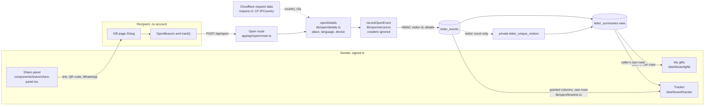

# Sharing and open tracking

## What it does

Once a gift is built, the sender shares its link from the panel under the preview: copy it, send it on WhatsApp, use the phone's own share sheet, or download a QR code to print. When the recipient opens the page, opens a calendar door or taps a gift, Majnu records it, with the approximate place (city and country of the network), the browser's language and the kind of device. The sender sees on **My gifts** when each gift was first and last opened, how often and by how many people, and on the **Tracker** tab a timeline of every open: when (in the sender's timezone), where, in which language and on which device. Nothing is stored on the recipient's device, no cookie is set, and the IP address is never kept.

## How it works

One open, in order:

1. The gift page renders on the server and sends HTML. A link-preview crawler (WhatsApp, iMessage) stops there: it fetches the HTML but does not run the beacon, so it does not count.
2. In the browser, [`<OpenBeacon>`](../../components/letters/open-beacon.tsx) waits until the page is actually visible (`document.visibilityState`), so a page prerendered in the background counts only when someone looks at it. Then it calls `reportOpen()`.
3. [`track.ts`](../../components/letters/track.ts) posts `{ slug, type: "open" }` to `/api/open` with `fetch(..., { keepalive: true })`, so the request finishes even if the recipient taps a link and leaves. Each event (its type and door) is sent at most once per page load, tracked in an in-memory set that a reload clears. Failures are ignored.
4. Templates report `door_open` (with the door's day) and `gift_click` (when a gift's code is copied or its link tapped, with the door's day for calendars) through `track()` from [`letter-context.tsx`](../../components/letters/letter-context.tsx). In the owner's preview `track()` does nothing and no beacon is rendered.
5. [`POST /api/open`](../../app/api/open/route.ts) reads at most 1,024 characters, parses JSON whatever the content type, and validates `{ slug, type, day? }`. It answers **204 with no body and no cookies** whether or not anything was recorded, so the endpoint reveals nothing about which slugs exist. A malformed body gets 400 and an oversized one 413. It also works out the open's details with [`openDetails()`](../../lib/open/details.ts) (see "Place, language and device" below).
6. [`recordOpenEvent()`](../../lib/open/record.ts) ignores malformed and demo slugs and crawlers (below), and records nothing if `OPEN_HASH_SECRET` is not set. It loads the letter by exact slug with the service-role client and builds its public view **as of now**, then [`trackedDay()`](../../lib/open/rules.ts) decides what to store: an `open` is always day 0; a `door_open` only for a calendar door that exists and is open now; a `gift_click` as day 0 on a letter, or for an open door on a calendar. Events for locked doors are ignored, so nobody learns anything by sending them early.
7. The visitor id is computed (below) and the row is upserted with `ON CONFLICT DO NOTHING` on the unique key `(letter_id, type, day, visitor_id)`, so a repeat visit adds nothing, not even a new place. The user agent is cut to 512 characters. The row carries the country, city, language and device.
8. If recording fails, the route logs the error and still answers 204: tracking must never break a gift page.

## Place, language and device

[`lib/open/details.ts`](../../lib/open/details.ts) holds the rules, as pure functions with one read of Cloudflare's data:

| Field | Where it comes from | Stored as |
|---|---|---|
| `country` | `request.cf.country`, read through OpenNext's `getCloudflareContext().cf` (the adapter keeps each request's `cf` in AsyncLocalStorage). Without it, the `CF-IPCountry` header. Without either (`next dev`), nothing. `XX` (unknown) and `T1` (Tor) count as nothing | Two capital letters, `DE` |
| `city` | `request.cf.city`, only when the country came from `request.cf` too. Control characters and runs of spaces folded, at most 80 characters | `Berlin`, or null |
| `language` | The `Accept-Language` range with the highest `q` (ties go to the first; `q=0`, `*`, private tags and malformed ranges are skipped), cut to its primary subtag | `de` |
| `device` | The user agent: iPad, "Tablet", Kindle and Android without "Mobile" are tablets; "Mobi", iPhone, Android with "Mobile" and other phone markers are phones; the rest desktops | `phone`, `tablet` or `desktop` |

Nothing finer is read: Cloudflare's region, postal code, coordinates, timezone and network number stay untouched, and the IP address only feeds the visitor hash. iPads on iPadOS 13 and later announce themselves as Macs, so they are recorded as desktops.

**Crawlers.** Most link-preview services never run the beacon. [`isCrawler()`](../../lib/open/details.ts) catches the rest before any database lookup: known preview bots (WhatsApp, Facebook, iMessage's `facebookexternalhit`, Telegram's `TelegramBot`, Slack, Discord, LinkedIn, X), search engines and AI crawlers, headless browsers (`HeadlessChrome`, Lighthouse), HTTP libraries (`curl`, `python-requests`, `okhttp` and others), and any user agent with `bot/`, `bot;`, `crawler` or `spider`. The in-app browsers of chat apps (Instagram, Facebook's `FBAN`, `Telegram-Android`) are people and count.

## The Tracker tab

[`/dashboard/tracker`](../../app/(app)/dashboard/tracker/page.tsx) lists every gift of the signed-in sender, newest first ([`tracker-view.tsx`](../../components/app/tracker/tracker-view.tsx)). Each card ([`tracked-gift.tsx`](../../components/app/tracker/tracked-gift.tsx)) shows:

- **The status:** "Not finished yet" for a draft, "Not opened yet", or "Opened by 2 people" with "Last opened 2 hours ago" and how often a gift was tapped. Because each visitor is recorded once per event type and door, a visitor who returns adds nothing; the count of times is therefore the page opens plus the doors opened, and it is shown ("Opened 6 times by one person") only when a calendar's doors make it larger than the number of people. The numbers come from `letter_summaries`.
- **The timeline**, behind "Show timeline" (a native `
`, so it opens with Enter or Space and works without JavaScript): one line per open, door and gift tap, grouped by day ("Today", "Yesterday", "Friday 20 November"), each with the time, the flag and "Berlin, Germany", the language name ("German", from `Intl.DisplayNames`) and the device ("Phone", "Tablet", "Computer"). Rows from before the details were recorded say "Place and device not recorded". At most the newest 100 lines per gift are shown.
- **Times in the viewer's timezone.** The cards are client components; [`useViewerTimeZone()`](../../components/app/tracker/use-time-zone.ts) uses `useSyncExternalStore`, so the server's HTML has UTC times and the browser re-renders them in its own timezone right after hydration, without a mismatch. The header says which timezone is in use.

[`listMyOpenEvents()`](../../lib/open/timeline.ts) reads the newest 1,000 events with the sender's own session, asking only for the columns owners are granted. The grouping and wording live in [`timeline.ts`](../../components/app/tracker/timeline.ts), pure and unit-tested.

**Guests** (anonymous accounts from the gift finder) see an invitation instead ([`tracker-invite.tsx`](../../components/app/tracker/tracker-invite.tsx)): a free account shows when, roughly where, in which language and on which device each gift is opened, and keeps everything made as a guest. Its button links to `/signup?next=%2Fdashboard%2Ftracker`; sign-up upgrades the same account and `safeNextPath()` brings them back. The page works when opened directly; its entry in the tab bar comes with the dashboard work in [#47](https://github.com/peresramirez/majnu/issues/47).

## The share panel

[`<SharePanel url locked onUnlock>`](../../components/share/share-panel.tsx) is part of the contract between the two developers. The create page's preview pane ([`preview-pane.tsx`](../../components/create/preview-pane.tsx)) shows it under the gift with the link `${site.url}/l/<slug>`; the workbench shows it in both states.

| Action | How |
|---|---|
| Copy | Copies the link and says "Copied" for two seconds, with a hidden-textarea fallback for in-app browsers that block the Clipboard API ([`copy-button.tsx`](../../components/letters/copy-button.tsx)) |
| WhatsApp | Opens `https://wa.me/?text=` with "I made something for you." and the link |
| Share | The phone's own share sheet through `navigator.share`, only where the browser has one |
| QR code | Drawn on screen as one SVG path; downloads as PNG (24 px per module, drawn on a canvas) or SVG (16 px per module), both with the four-module quiet zone scanners expect |

The QR encoding comes from `uqr`, a small dependency-free encoder, at error-correction level M ([`qr.ts`](../../components/share/qr.ts)); everything else is ours. The code is deterministic, so the server and the browser draw the same one.

`locked` shows "Create a free account to send it" instead of the link, with a blurred QR code, and `onUnlock` starts the sign-up. Nothing is locked behind a payment any more, so the create page no longer sets it; it stays in the contract for a gift that needs an account. Under the share panel, the letter preview and the finder's wrapped gift show "Make it unique, €2.99", the personalised wrapper ([billing.md](billing.md)).

## The visitor hash

[`visitorId()`](../../lib/open/visitor.ts) is an **HMAC-SHA-256** under `OPEN_HASH_SECRET` of the JSON array `[letterId, ip, userAgent]`, as 64 hex characters, computed with Web Crypto (which Workers and Node both provide).

- The IP address comes from Cloudflare's `cf-connecting-ip` header, or the first `X-Forwarded-For` entry in local development. It is used for the hash and **never stored**.
- Hashing an IP address without a secret could be reversed by trying every address, so the function refuses to run without one.
- The letter id is part of the input, so the same person gets different ids on different letters and cannot be followed from one gift to another.
- JSON keeps the fields apart, so `("a", "bc")` and `("ab", "c")` cannot collide.
- Changing the secret makes every returning visitor count as new.

This is what lets the site run without a cookie banner (§ 25 TDDDG), and it is what [`/privacy`](../../app/(marketing)/privacy/page.tsx) promises. If open tracking changes, the privacy page changes in the same commit.

## Statistics and My gifts

The dashboard reads the `letter_summaries` view ([`0001_init.sql`](../../supabase/migrations/0001_init.sql), changed in [`0009_open_details.sql`](../../supabase/migrations/0009_open_details.sql)), which is `security_invoker`: it runs with the caller's privileges, so row-level security decides which letters a user sees, and the statistics are computed in the database in one query.

| Column | Meaning |
|---|---|
| `first_opened_at` | The earliest event of any kind |
| `last_opened_at` | The latest event of any kind (a door opened today moves it) |
| `total_opens` | Rows of type `open`. Because each visitor is recorded once per event type and door, this counts **visitors who opened the gift**, not page loads |
| `unique_visitors` | Distinct visitor ids across all event types, counted by `private.letter_unique_visitors()` (below) because owners cannot read the visitor ids themselves |

[`listMyLetters()`](../../lib/letters/store.ts) returns the user's letters newest first with these numbers, and [`/dashboard/gifts`](../../app/(app)/dashboard/gifts/page.tsx) shows one card per gift ([`components/app/gift-card.tsx`](../../components/app/gift-card.tsx)): who it is for, the template and date, "Opened 2 hours ago", "First opened … · 3 opens · 2 visitors" or "Not opened yet", and a button to copy the link again. The page header counts gifts and how many have been opened.

## Pieces

| Piece | Job |
|---|---|
| [`components/share/share-panel.tsx`](../../components/share/share-panel.tsx), [`components/share/qr.ts`](../../components/share/qr.ts) | The share panel and QR drawing |
| [`components/letters/open-beacon.tsx`](../../components/letters/open-beacon.tsx) | One `open` per page load, once the page is visible |
| [`components/letters/track.ts`](../../components/letters/track.ts), [`components/letters/letter-context.tsx`](../../components/letters/letter-context.tsx) | What templates call to report taps; silent in the owner's preview |
| [`app/api/open/route.ts`](../../app/api/open/route.ts) | `POST /api/open`, excluded from the middleware |
| [`lib/open/record.ts`](../../lib/open/record.ts), [`lib/open/rules.ts`](../../lib/open/rules.ts), [`lib/open/visitor.ts`](../../lib/open/visitor.ts) | Recording, which events count, the visitor hash |
| [`lib/open/details.ts`](../../lib/open/details.ts) | Place from Cloudflare's data, language, device type, crawlers |
| [`lib/open/timeline.ts`](../../lib/open/timeline.ts) | The owner's events for the Tracker, through row-level security |
| [`app/(app)/dashboard/gifts/page.tsx`](../../app/(app)/dashboard/gifts/page.tsx), [`components/app/gifts-view.tsx`](../../components/app/gifts-view.tsx) | The My gifts tab |
| [`app/(app)/dashboard/tracker/`](../../app/(app)/dashboard/tracker/page.tsx) (page, loading, error), [`components/app/tracker/`](../../components/app/tracker/tracker-view.tsx) | The Tracker tab: the view, one card per gift, the guest invitation, the timezone hook and the pure timeline helpers |
| `letter_events` table, `letter_summaries` view | One row per visitor, event type and door, with place, language and device; the statistics |
| `private.letter_unique_visitors(letter_id)` | The visitor count for `letter_summaries`, for the letter's owner only (0009) |
| `OPEN_HASH_SECRET` | Server-only key for the visitor hash. Without it nothing is recorded |

## Data and privacy

- **Stored per event:** the letter, the event type, the door number (0 when there is none), the visitor hash, the user agent (at most 512 characters), the time, and since [0009](../../supabase/migrations/0009_open_details.sql) the country code, the city, the primary language subtag and the device type, each nullable and checked for format in the database. Never the IP address, region, postal code or coordinates. Rows from before 0009 have no place, language or device. The privacy page says these records are kept for as long as the gift exists; they are deleted with the letter (`on delete cascade`).
- **On the recipient's device:** nothing. No cookies, no `localStorage`, no visitor id. The request carries only the slug, the type and the day; place, language and device come from the request's headers and Cloudflare's data on the server.
- **Who can read it:** the letter's owner, through row-level security on `letter_events` and the `security_invoker` view, and only these columns: `id`, `letter_id`, `type`, `day`, `country`, `city`, `language`, `device`, `created_at`. The visitor hash and the raw user agent are not granted to owners (until 0009 they were); asking for them, or for `*`, is refused. The anon key reads nothing. Only the service-role client writes.
- **The visitor count without the hashes:** `letter_summaries` used to count distinct `visitor_id`s itself, which an invoker view can no longer do. `private.letter_unique_visitors()` counts them instead: `security definer`, `search_path` empty, in a `private` schema the Data API does not expose (calling it through PostgREST answers `PGRST202`), with execute granted only to `authenticated` and `service_role`, and an owner check on `auth.uid()` in its body, so it answers 0 for a letter the caller does not own. A service-role read of the view therefore shows 0 visitors; nothing reads it that way.
- **What the sender sees:** the place, language, device and time of each open on the Tracker, never the visitor number or the user agent. Link previews and page titles of gift pages stay generic. [`/privacy`](../../app/(marketing)/privacy/page.tsx) says what an open records and that only the sender sees it.
- `/api/open` and `/l/` are excluded from the session middleware, so neither reads nor refreshes a session.

## Limits and costs

- Each event is one letter lookup and one upsert on the server, and a body of at most 1,024 characters. Crawlers stop before the lookup. No model calls.
- The Tracker reads the sender's letters and their newest 1,000 events in two queries, and shows at most 100 lines per gift. The visitor count runs one small function per letter inside the view.
- There is no rate limit on `/api/open`. Repeats from one visitor add no rows, but someone with the link could inflate the visitor count by changing their user agent.

## How it was checked

- **Unit tests:** [`route.test.ts`](../../tests/unit/app/api/open/route.test.ts) (204 with no body and no cookies, also when recording fails; malformed bodies), [`record.test.ts`](../../tests/unit/lib/open/record.test.ts) (an open as day 0 with a hashed id and never the IP; doors open now; locked doors, unknown, demo and malformed slugs ignored; nothing without the secret), [`rules.test.ts`](../../tests/unit/lib/open/rules.test.ts), [`visitor.test.ts`](../../tests/unit/lib/open/visitor.test.ts) (stable HMAC, different per letter, user agent and secret, no IP inside), [`track.test.ts`](../../tests/unit/components/letters/track.test.ts) (one open per load, nothing in the owner's preview, only slug, type and day sent) and [`qr.test.ts`](../../tests/unit/components/share/qr.test.ts).
- **Tracker unit tests:** [`details.test.ts`](../../tests/unit/lib/open/details.test.ts) (the `request.cf` → `CF-IPCountry` → nothing chain, never coordinates or the IP; language by `q`; phones, tablets and desktops; crawlers, and in-app browsers that are not), [`record.test.ts`](../../tests/unit/lib/open/record.test.ts) (details stored, crawlers ignored without a lookup), [`route.test.ts`](../../tests/unit/app/api/open/route.test.ts) (details passed from the request), [`timeline.test.ts`](../../tests/unit/lib/open/timeline.test.ts) (only granted columns are asked for) and [`components/app/tracker/timeline.test.ts`](../../tests/unit/components/app/tracker/timeline.test.ts) (grouping by day in the viewer's timezone, across a clock change; line titles; place, language and device names; the status line; the guest's sign-up link). The owner's preview stays silent ([`track.test.ts`](../../tests/unit/components/letters/track.test.ts)).
- **Migration 0009**, before it was applied: run after 0001 to 0007 in PGlite (Postgres in WebAssembly) with stand-ins for Supabase's roles and `auth.uid()`, 33 checks: owners read their own rows and the granted columns, are refused `visitor_id`, `user_agent`, `*` and counting visitor ids; counts in `letter_summaries` unchanged; the function answers 0 for another owner's letter; the anon key reads nothing; each format check rejects bad values. The lead then applied it to production with a dry run first and checked with the anon key that `letter_events` and `letter_summaries` are refused (42501) and the function is not exposed (`PGRST202`).
- **Live, 22 November 2026, against production data and `next dev`:** a temporary confirmed user with a letter, a calendar and a postcard made with the service-role key. `curl` posts with an iPhone in German from `DE`, a Windows PC in French from `FR`, an Android tablet in Spanish from `ES` opening doors 1 and 2 and tapping a gift: each row had the right country, language and device and no city (`next dev` has no `request.cf`); a repeat visit, a WhatsApp crawler, a locked door and an unknown slug added nothing; every answer was 204 without cookies. With the user's own token, the granted columns returned only their rows and `visitor_id`, `user_agent` and `*` were refused. The Tracker, signed in as that user, at 375 px and 1440 px: statuses, timelines in Europe/Berlin time, a city line ("São Paulo, Brazil", inserted the way Workers would record it), keyboard (Tab to "Show timeline", Enter and Space open it, rose focus ring), reduced motion (the chevron flips without a transition), no horizontal scroll, no console errors or hydration warnings. A real guest account saw the invitation, and its link opened sign-up with the `next` kept. Opening the gift page in the browser recorded an open through the real beacon. Both accounts were deleted afterwards.
- **Not yet checked:** the city from `request.cf` on Workers in production; the tab bar entry (#47).
- **Planned end-to-end check** ([docs/plan.md](../plan.md#verification)): open `/l/<slug>` in a private window, see one `open` event and the count on My gifts, and confirm the owner's preview does not count. Whether this was run on production is not recorded here.

## Open questions

- The Tracker shows a flag emoji next to each country, as the issue asked, while [brand.md](../brand.md) says "no emoji in the interface". The flag is hidden from screen readers, which read the country name.
- iPads on iPadOS 13 and later are recorded as desktops; the user agent cannot tell them apart from Macs. Client hints could, but only Chromium sends them.
- A repeat visit records nothing new, so a recipient who opens the gift again from another city does not appear twice unless their network or browser changed.

- A sender opening their own `/l/<slug>` counts as an open; only the owner's preview is excluded.
- A link-preview service that runs JavaScript still counts as a visitor if its user agent looks like an ordinary browser; the ones that name themselves, and headless Chrome, are ignored.
- A per-visitor rate limit on `/api/open` would stop inflated visitor counts.
- Issues still open: [#9](https://github.com/peresramirez/majnu/issues/9) (open tracking and dashboard) and [#21](https://github.com/peresramirez/majnu/issues/21) (share panel), though both are in the code.
