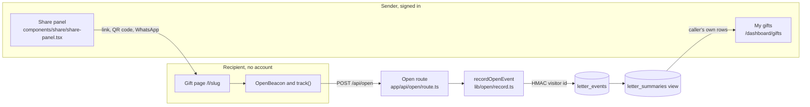

# Sharing and open tracking

## What it does

Once a gift is built, the sender shares its link from the panel under the preview: copy it, send it on WhatsApp, use the phone's own share sheet, or download a QR code to print. When the recipient opens the page, opens a calendar door or taps a gift, Majnu records it. The sender sees on **My gifts** when each gift was first and last opened, how often and by how many people. Nothing is stored on the recipient's device and no cookie is set.

## How it works

One open, in order:

1. The gift page renders on the server and sends HTML. A link-preview crawler (WhatsApp, iMessage) stops there: it fetches the HTML but does not run the beacon, so it does not count.
2. In the browser, [`<OpenBeacon>`](../../components/letters/open-beacon.tsx) waits until the page is actually visible (`document.visibilityState`), so a page prerendered in the background counts only when someone looks at it. Then it calls `reportOpen()`.
3. [`track.ts`](../../components/letters/track.ts) posts `{ slug, type: "open" }` to `/api/open` with `fetch(..., { keepalive: true })`, so the request finishes even if the recipient taps a link and leaves. Each event (its type and door) is sent at most once per page load, tracked in an in-memory set that a reload clears. Failures are ignored.
4. Templates report `door_open` (with the door's day) and `gift_click` (when a gift's code is copied or its link tapped, with the door's day for calendars) through `track()` from [`letter-context.tsx`](../../components/letters/letter-context.tsx). In the owner's preview `track()` does nothing and no beacon is rendered.
5. [`POST /api/open`](../../app/api/open/route.ts) reads at most 1,024 characters, parses JSON whatever the content type, and validates `{ slug, type, day? }`. It answers **204 with no body and no cookies** whether or not anything was recorded, so the endpoint reveals nothing about which slugs exist. A malformed body gets 400 and an oversized one 413.
6. [`recordOpenEvent()`](../../lib/open/record.ts) ignores malformed and demo slugs, and records nothing if `OPEN_HASH_SECRET` is not set. It loads the letter by exact slug with the service-role client and builds its public view **as of now**, then [`trackedDay()`](../../lib/open/rules.ts) decides what to store: an `open` is always day 0; a `door_open` only for a calendar door that exists and is open now; a `gift_click` as day 0 on a letter, or for an open door on a calendar. Events for locked doors are ignored, so nobody learns anything by sending them early.
7. The visitor id is computed (below) and the row is upserted with `ON CONFLICT DO NOTHING` on the unique key `(letter_id, type, day, visitor_id)`, so a repeat visit adds nothing. The user agent is cut to 512 characters.
8. If recording fails, the route logs the error and still answers 204: tracking must never break a gift page.

## The share panel

[`<SharePanel url locked onUnlock>`](../../components/share/share-panel.tsx) is part of the contract between the two developers. The create page's preview pane ([`preview-pane.tsx`](../../components/create/preview-pane.tsx)) shows it under the gift with the link `${site.url}/l/<slug>`; the workbench shows it in both states.

| Action | How |
|---|---|
| Copy | Copies the link and says "Copied" for two seconds, with a hidden-textarea fallback for in-app browsers that block the Clipboard API ([`copy-button.tsx`](../../components/letters/copy-button.tsx)) |
| WhatsApp | Opens `https://wa.me/?text=` with "I made something for you." and the link |
| Share | The phone's own share sheet through `navigator.share`, only where the browser has one |
| QR code | Drawn on screen as one SVG path; downloads as PNG (24 px per module, drawn on a canvas) or SVG (16 px per module), both with the four-module quiet zone scanners expect |

The QR encoding comes from `uqr`, a small dependency-free encoder, at error-correction level M ([`qr.ts`](../../components/share/qr.ts)); everything else is ours. The code is deterministic, so the server and the browser draw the same one.

`locked` shows the upgrade state instead of the link: a blurred QR code and a "Choose Full moon" button that takes the sender to the Plan tab. The create page sets it only when plans are enforced (`MAJNU_BILLING=on`), the sender is on Crescent, and the gift uses a Full moon template ([billing.md](billing.md)).

## The visitor hash

[`visitorId()`](../../lib/open/visitor.ts) is an **HMAC-SHA-256** under `OPEN_HASH_SECRET` of the JSON array `[letterId, ip, userAgent]`, as 64 hex characters, computed with Web Crypto (which Workers and Node both provide).

- The IP address comes from Cloudflare's `cf-connecting-ip` header, or the first `X-Forwarded-For` entry in local development. It is used for the hash and **never stored**.
- Hashing an IP address without a secret could be reversed by trying every address, so the function refuses to run without one.
- The letter id is part of the input, so the same person gets different ids on different letters and cannot be followed from one gift to another.
- JSON keeps the fields apart, so `("a", "bc")` and `("ab", "c")` cannot collide.
- Changing the secret makes every returning visitor count as new.

This is what lets the site run without a cookie banner (§ 25 TDDDG), and it is what [`/privacy`](../../app/(marketing)/privacy/page.tsx) promises. If open tracking changes, the privacy page changes in the same commit.

## Statistics and My gifts

The dashboard reads the `letter_summaries` view ([`0001_init.sql`](../../supabase/migrations/0001_init.sql)), which is `security_invoker`: it runs with the caller's privileges, so row-level security decides which letters a user sees, and the statistics are computed in the database in one query.

| Column | Meaning |
|---|---|
| `first_opened_at` | The earliest event of any kind |
| `last_opened_at` | The latest event of any kind (a door opened today moves it) |
| `total_opens` | Rows of type `open`. Because each visitor is recorded once per event type and door, this counts **visitors who opened the gift**, not page loads |
| `unique_visitors` | Distinct visitor ids across all event types |

[`listMyLetters()`](../../lib/letters/store.ts) returns the user's letters newest first with these numbers, and [`/dashboard/gifts`](../../app/(app)/dashboard/gifts/page.tsx) shows one card per gift ([`components/app/gift-card.tsx`](../../components/app/gift-card.tsx)): who it is for, the template and date, "Opened 2 hours ago", "First opened … · 3 opens · 2 visitors" or "Not opened yet", and a button to copy the link again. The page header counts gifts and how many have been opened.

## Pieces

| Piece | Job |
|---|---|
| [`components/share/share-panel.tsx`](../../components/share/share-panel.tsx), [`components/share/qr.ts`](../../components/share/qr.ts) | The share panel and QR drawing |
| [`components/letters/open-beacon.tsx`](../../components/letters/open-beacon.tsx) | One `open` per page load, once the page is visible |
| [`components/letters/track.ts`](../../components/letters/track.ts), [`components/letters/letter-context.tsx`](../../components/letters/letter-context.tsx) | What templates call to report taps; silent in the owner's preview |
| [`app/api/open/route.ts`](../../app/api/open/route.ts) | `POST /api/open`, excluded from the middleware |
| [`lib/open/record.ts`](../../lib/open/record.ts), [`lib/open/rules.ts`](../../lib/open/rules.ts), [`lib/open/visitor.ts`](../../lib/open/visitor.ts) | Recording, which events count, the visitor hash |
| [`app/(app)/dashboard/gifts/page.tsx`](../../app/(app)/dashboard/gifts/page.tsx), [`components/app/gifts-view.tsx`](../../components/app/gifts-view.tsx) | The My gifts tab |
| `letter_events` table, `letter_summaries` view | One row per visitor, event type and door; the statistics |
| `OPEN_HASH_SECRET` | Server-only key for the visitor hash. Without it nothing is recorded |

## Data and privacy

- **Stored per event:** the letter, the event type, the door number (0 when there is none), the visitor hash, the user agent (at most 512 characters) and the time. Never the IP address. The privacy page says these records are kept for as long as the gift exists; they are deleted with the letter (`on delete cascade`).
- **On the recipient's device:** nothing. No cookies, no `localStorage`, no visitor id. The request carries only the slug, the type and the day.
- **Who can read it:** the letter's owner, through row-level security on `letter_events` and the `security_invoker` view. Only the service-role client writes.
- `/api/open` and `/l/` are excluded from the session middleware, so neither reads nor refreshes a session.

## Limits and costs

- Each event is one letter lookup and one upsert on the server, and a body of at most 1,024 characters. No model calls.
- There is no rate limit on `/api/open`. Repeats from one visitor add no rows, but someone with the link could inflate the visitor count by changing their user agent.

## How it was checked

- **Unit tests:** [`route.test.ts`](../../tests/unit/app/api/open/route.test.ts) (204 with no body and no cookies, also when recording fails; malformed bodies), [`record.test.ts`](../../tests/unit/lib/open/record.test.ts) (an open as day 0 with a hashed id and never the IP; doors open now; locked doors, unknown, demo and malformed slugs ignored; nothing without the secret), [`rules.test.ts`](../../tests/unit/lib/open/rules.test.ts), [`visitor.test.ts`](../../tests/unit/lib/open/visitor.test.ts) (stable HMAC, different per letter, user agent and secret, no IP inside), [`track.test.ts`](../../tests/unit/components/letters/track.test.ts) (one open per load, nothing in the owner's preview, only slug, type and day sent) and [`qr.test.ts`](../../tests/unit/components/share/qr.test.ts).
- **Planned end-to-end check** ([docs/plan.md](../plan.md#verification)): open `/l/<slug>` in a private window, see one `open` event and the count on My gifts, and confirm the owner's preview does not count. Whether this was run on production is not recorded here.

## Open questions

- A sender opening their own `/l/<slug>` counts as an open; only the owner's preview is excluded.
- A link-preview service that runs JavaScript would count as a visitor.
- A per-visitor rate limit on `/api/open` would stop inflated visitor counts.
- Issues still open: [#9](https://github.com/peresramirez/majnu/issues/9) (open tracking and dashboard) and [#21](https://github.com/peresramirez/majnu/issues/21) (share panel), though both are in the code.
