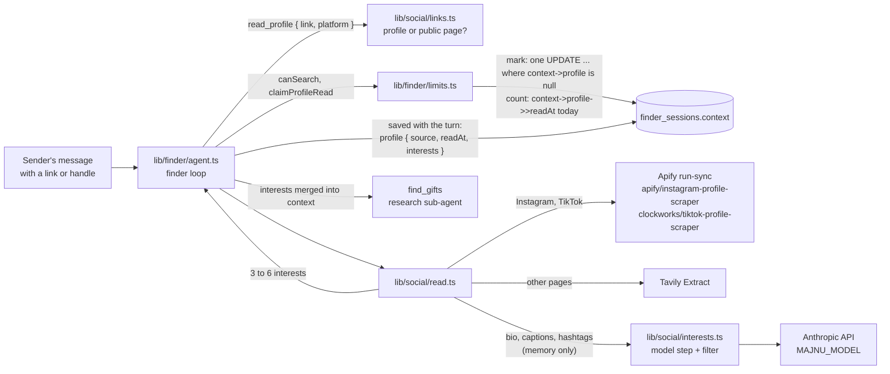

# Social profiles: interests from a public profile the sender shares

Issue #34. Point 4 of the flow in [../plan.md](../plan.md), "Gift finder": a public Instagram or TikTok profile is read with Apify, only when the sender pastes it, and only a short list of interests is kept; other public pages are read with Tavily. It is part of the finder agent described in [gift-finder-api.md](gift-finder-api.md).

## What it does

While Majnu personalises a gift, it may offer once to look at the person's public Instagram or TikTok, or any public page about them ("Paste the link if you like"). When the sender pastes a profile link, a handle with the platform ("her insta is @anna.climbs") or another public page, Majnu reads it and turns it into three to six interests ("Bouldern", "Kaffee", "Analogfotografie"). The interests show as chips next to the other assumptions and steer the next search. A private, missing or blocked profile gets one kind sentence, and the search goes on without it.

## How it works

One read, in order:

1. The finder model calls `read_profile` with the link or handle as the sender wrote it, the platform when the sender named one for a bare handle, the sender's language and a status line. The tool is the third in the finder's byte-stable tool list; it does not end the turn, because `find_gifts` follows it.
2. `parseProfileLink()` decides what it is. `instagram.com/<name>` and `tiktok.com/@<name>` (also from a video link on the profile) become a username. Posts, reels, stories, tag pages and TikTok short links are refused as "not a profile". A bare handle without a platform makes Majnu ask "Instagram or TikTok?". Any other link becomes a web page over https, if its hostname is public: no IP addresses, localhost, internal names, credentials or unusual ports.
3. If this deployment has no key for that kind of source (`APIFY_API_TOKEN`, `TAVILY_API_KEY`), Majnu says profiles can't be read right now and searches anyway.
4. The search the interests are for must still be allowed (`canSearch`, the same check the personalising questions use). If not, the visitor gets the usual `limit` event and nothing is read.
5. `claimProfileRead()` records the read on the session before anything is fetched (see "Limits and costs"). If the session already read one, or the site has reached `APIFY_DAILY_CAP` today, nothing is read and Majnu searches without it.
6. The finder streams a `status` event ("Ich schaue mir das öffentliche Profil an…"), then reads:
   - Instagram: Apify's "Run Actor synchronously and get dataset items" with `apify~instagram-profile-scraper` and `{ "usernames": [name] }`.
   - TikTok: the same endpoint with `clockworks~tiktok-profile-scraper` and `{ "profiles": [name], "resultsPerPage": 10 }`, with every download, subtitle, comment and follower option off.
   - Both calls send the token in the `Authorization` header, a run `timeout` of 60 s, `maxTotalChargeUsd=0.05`, and a `fields` list. With `fields`, follower counts, related profiles and contact details never reach us.
   - Other pages: Tavily Extract, basic depth, as text, with a `query` that keeps the parts of the page about what the person loves.
7. What comes back is cut down to the bio, the business or creator category, up to 12 recent captions (300 characters each) and the 30 most used hashtags. Links, e-mail addresses, @handles of other people and phone numbers are taken out. Sponsored TikTok videos are left out.
8. `extractInterests()` makes one structured-output call (`output_config.format` from a zod schema, low effort, byte-stable system prompt) that names 3 to 6 interests in the sender's language. The profile text is wrapped in `<public_profile>` and marked as data, not instructions. `filterInterests()` then checks every item on the server rather than trusting the model. It drops anything about health, religion, politics, sexuality or gender identity, or ethnicity (English and German stems plus whole words such as "god", "trump" and "trans", so "trumpet" and "transport" stay), as well as handles, links, addresses and long sentences, and keeps at most six.
9. The tool result the finder model sees, and the conversation stores, is only `{ interests, note }`. The model then calls `find_gifts`. The server merges the profile's interests into `context.interests` for that search even if the model left them out. The `context` chips and the researcher's "loves ..." line therefore always carry them.
10. The turn is saved with `profile: { source, readAt, interests }` inside the session's `context` column. A read that failed is saved with no interests and still counts.

Later searches in the same session rely on the model, which sees the interests in the conversation. That way a sender who says "she isn't into that any more" is listened to.

## Pieces

| Piece | Job |
|---|---|
| `lib/social/links.ts` | `parseProfileLink()`: an Instagram or TikTok username, or a public web page, or why not; `isPublicHostname()`; `usesApify()` |
| `lib/social/apify.ts` | The two Apify actors, their inputs and `fields`, the run-sync call, turning items into bio, category, captions and hashtags, and every failure into `private`, `not_found`, `empty`, `blocked`, `timeout` or `failed` |
| `lib/social/web.ts` | Tavily Extract for other public pages |
| `lib/social/interests.ts` | The interest step (system prompt, prompt, structured output) and `filterInterests()` with the sensitive-word lists |
| `lib/social/read.ts` | `readProfileInterests()`: read, name the interests, drop the text; `canReadSource()`; logs carry only the source and the reason |
| `lib/finder/agent.ts` | The `read_profile` tool, its prompt rules, the results the model sees, merging the interests into the search |
| `lib/finder/limits.ts` | `apifyDailyCap()` and `claimProfileRead()` |
| `lib/finder/sessions.ts` | `ProfileRead`, `parseProfile()`, `markProfileRead()`, `clearProfileRead()`, `countProfileReadsSince()`; `saveFinderSession()` writes the marker |
| `lib/finder/messages.ts` | The status line in English and German when the model gave none |
| `finder_sessions.context` | Holds the server-only `profile` marker. `parseContext()` leaves it out, so it never reaches the browser |
| `APIFY_API_TOKEN` | Apify API token, server only. Empty switches Instagram and TikTok reading off |
| `APIFY_DAILY_CAP` | Instagram and TikTok reads per UTC day for the whole site. Default 20; 0 switches them off |
| `TAVILY_API_KEY` | Also reads other public pages |

## Data and privacy

- **Read only on request.** A profile or page is read only when the sender pasted it into the finder. The prompt forbids guessing a handle or looking anyone up, and the tool takes only what the sender wrote.
- **Public only.** Apify's scrapers read what anyone can see without logging in. A private profile is reported as private by the actors (`private: true` on Instagram, `PROFILE_PRIVATE` on TikTok) and nothing is read.
- **Never stored or logged: what was read.** The bio, captions and hashtags exist only in memory, for the one model request that names the interests. They are not part of the finder conversation, and they never appear in an event, a log line or the database. `fields` only limits what Apify sends us: each run's own dataset, with the actor's full output, stays in our Apify account until Apify's data retention removes unnamed storages. We never read it again (see "Open questions").
- **Stored: the interests.** Three to six short tags are stored in the finder session (in `context.interests` and in the `profile` marker), with the source and the time of the read, for as long as the session. They are filtered on the server so that nothing in the GDPR's special categories is kept, nor names, handles or addresses.
- **What leaves our servers.** Apify receives the username; Tavily receives the page address; Anthropic receives the trimmed public text to name the interests. The privacy page names Apify, Tavily and Anthropic, and has a paragraph on public social profiles.
- **Logs** carry the source (`instagram`, `tiktok`, `web`), the failure reason and an HTTP status. Never the handle, the address or any text.

## Limits and costs

- **One read per finder session.** The read is recorded with one `UPDATE ... WHERE id = ? AND owner_id = ? AND context->'profile' IS NULL`, so two messages at the same moment cannot both read. A read that fails still counts, because Apify may already have charged for it.
- **`APIFY_DAILY_CAP` Instagram and TikTok reads a UTC day for the whole site** (default 20). They are counted from the sessions' `context->profile->>readAt` with no table of their own, and claimed like searches: record first, count second, and take the record back when it was over the cap. Pages read with Tavily do not count against it.
- **A read only happens before a search that is allowed**, so in practice a visitor reads at most about three profiles a day (3 searches a day, one read per session).
- **Cost per read**, from the actors' pricing on 21 November: Instagram $0.0026 per profile; TikTok $0.003 per video, so 10 videos are $0.03. Each run is capped at $0.05 by `maxTotalChargeUsd`. At the default cap the worst day costs about $0.60, so the $5 credit lasts at least a week of full days. Tavily Extract at basic depth costs 1 credit per 5 pages. The interest step is one short model request.
- **Time:** measured on 21 November, an Instagram profile in about 6 s, a TikTok profile with 10 videos in 7.8 s and a Tavily extract in 0.3 s. The run timeout is 60 s, and the request gives up at 70 s.

## How it was checked

- Unit tests, with Apify, Tavily and the model mocked (`fetch` and the Anthropic client stubbed):
  - `tests/unit/lib/social/links.test.ts`: profile links in their usual shapes; posts, reels and short links refused; bare handles; other pages; IP addresses, localhost, internal names, ports, credentials and other schemes refused.
  - `tests/unit/lib/social/apify.test.ts`: the endpoint, actor ids, inputs, `fields`, the run timeout and cost cap, the token only in the header; what is kept of an Instagram and a TikTok profile (no followers, related profiles, mentions or links); private, missing, restricted and empty profiles, the TikTok error items, HTTP 402, 403, 408, 429 and 5xx, a network error and the request timeout.
  - `tests/unit/lib/social/web.test.ts`: the Tavily Extract request and its failures.
  - `tests/unit/lib/social/interests.test.ts`: the filter (health, religion, politics and sexuality in English and German; innocent look-alikes such as "trumpet", "transport history" and "Christmas markets" kept; handles, links and addresses dropped), the prompt, the one structured-output request, refusals.
  - `tests/unit/lib/social/read.test.ts`: the right reader per source, polite failures, and no handle or profile text in the logs.
  - `tests/unit/lib/finder/profile-reads.test.ts`: the cap from `APIFY_DAILY_CAP`; one read per session, also for two claims at the same moment; the daily count since midnight UTC that leaves out yesterday and Tavily pages; refusing at the cap and taking the record back; the cap at 0; the marker saved inside the context and left out of what the browser sees. It runs against an in-memory table that applies the same JSON-path filters.
  - `tests/unit/lib/finder/agent.test.ts`: `read_profile` then `find_gifts` with the interests merged into the context and the research brief, only the interests in the conversation, a private profile answered kindly with the search going on, one read per session, the daily cap, no read before a refused search, links that are not profiles, a bare handle, no key, and a database failure.
  - `tests/unit/app/api/finder/route.test.ts`: the marker carried into the turn, saved with it, and never sent to the browser.
- Live, on 21 November:
  - Supabase accepted both JSON-path filters on `finder_sessions` (`context->profile->>readAt=gte...` with `context->profile->>source=in.(instagram,tiktok)`, and `context->profile=is.null`), checked with read-only count requests.
  - Two Apify runs on brand accounts. Instagram `natgeo` was read and parsed in about 6 s. TikTok `natgeo` gave a bio, a category, 9 of 10 videos (one sponsored video left out) and hashtags in 7.8 s.
  - Two Tavily extracts: a Wikipedia page gave about 1,900 characters of interest-ranked text in 0.3 s, and a page whose site refuses Tavily came back as `not_found`.
- **Not checked live:** the interest step and a full personalised finder search with a profile. The Anthropic API key in `.env.local` answered 400 "You have reached your specified API usage limits. You will regain access on 2026-12-01 at 00:00 UTC." to every request on 21 November. One Apify run of the three allowed for this task is left for that check: guest finder → "Personalise the gift" → paste `https://www.instagram.com/natgeo/` → the chips show the profile's interests and the options follow them.

## Open questions

- Each Apify run leaves its dataset (the actor's full output for that profile, followers and related profiles included) in our Apify account until Apify's retention removes it; the retention period for our plan was not checked. Starting the run asynchronously, reading its dataset and deleting it straight away would leave nothing behind, at the cost of two more API calls per read.
- The daily count reads `finder_sessions` without an index on `context->'profile'->>'readAt'`. That is fine at a few thousand sessions. If the table grows, an expression index (or a partial index `where context ? 'profile'`) would keep it fast; that needs a migration.
- Person names are kept out by the prompt, by removing @handles before the model sees the text, and by dropping handles afterwards. A first and last name typed into a caption or a bio could still be named by the model; no server filter catches plain names.
- The prompt asks for tastes rather than names ("country pop", not a singer). A sender who wants "a Taylor Swift fan" gift can still say so in their own words.
- TikTok short links (`vm.tiktok.com`) are refused rather than resolved, because resolving them means fetching a stranger's URL from our server.
- The interests are kept for as long as the finder session, like the rest of it; the retention question in [gift-finder-api.md](gift-finder-api.md) applies to them too.
