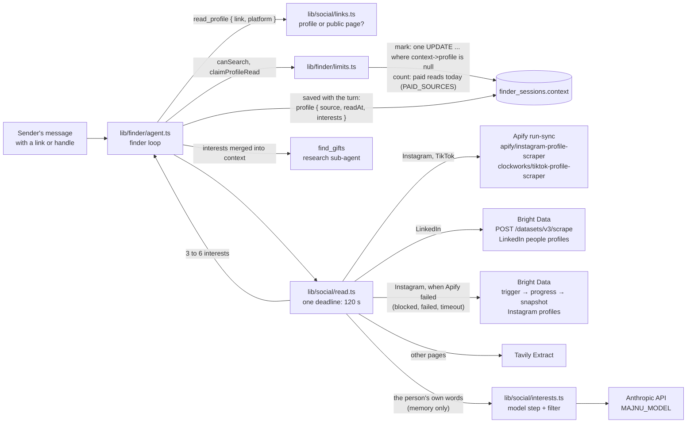

# Social profiles: interests from a public profile the sender shares

Issues #34 and #74. Point 4 of the flow in [../plan.md](../plan.md), "Gift finder": a public profile is read only when the sender pastes it, and only a short list of interests is kept. Instagram and TikTok are read with Apify, LinkedIn with Bright Data, and Instagram with Bright Data too when Apify cannot read it; other public pages are read with Tavily. It is part of the finder agent described in [gift-finder-api.md](gift-finder-api.md).

## What it does

Whenever Majnu wants to know more about the person, before a first search or while personalising, it may ask once for their public Instagram, TikTok or LinkedIn, or any public page about them ("Paste the link if you like", with "No public profile" as an answer to tap; since issue #70). Under the gift ideas the finder also says the visitor can tell Majnu more, a profile link among it. Majnu reads only links and handles the visitor gives: it never looks anyone up by name or email address, and a pasted email address gets one sentence saying so and a request for a profile link or what the visitor knows. When the sender pastes a profile link, a handle with the platform ("her insta is @anna.climbs") or another public page, Majnu reads it and turns it into three to six interests ("Bouldern", "Kaffee", "Analogfotografie"). The interests show as chips next to the other assumptions and steer the next search. A private, missing or blocked profile gets one kind sentence, and the search goes on without it.

## How it works

One read, in order:

1. The finder model calls `read_profile` with the link or handle as the sender wrote it, the platform when the sender named one for a bare handle (`instagram`, `tiktok` or `linkedin`), the sender's language and a status line. The tool is the third in the finder's byte-stable tool list; it does not end the turn, because `find_gifts` follows it.
2. `parseProfileLink()` decides what it is:
   - `instagram.com/<name>` and `tiktok.com/@<name>` (also from a video link on the profile) become a username. Posts, reels, stories, tag pages and TikTok short links are refused as "not a profile".
   - `linkedin.com/in/<name>`, on any subdomain (`www.`, `m.`, `de.`, `uk.`...), with or without a trailing slash or query string, and also from a page under it (`/in/<name>/details/experience`), becomes the profile's public name, decoded (`j%C3%BCrgen-beispiel` → `jürgen-beispiel`) and kept in its case. Company, school, job, post, article and feed pages and `lnkd.in` short links are refused as "not a person's profile".
   - A bare handle without a platform makes Majnu ask which platform it is on.
   - Any other link becomes a web page over https, if its hostname is public: no IP addresses, localhost, internal names, credentials or unusual ports.
3. If this deployment has no key for that kind of source, Majnu says profiles can't be read right now and searches anyway. Instagram needs `APIFY_API_TOKEN` or `BRIGHTDATA_API_KEY`, TikTok `APIFY_API_TOKEN`, LinkedIn `BRIGHTDATA_API_KEY` and other pages `TAVILY_API_KEY`.
4. The search the interests are for must still be allowed (`canSearch`, the same check the personalising questions use). If not, the visitor gets the usual `limit` event and nothing is read.
5. `claimProfileRead()` records the read on the session before anything is fetched (see "Limits and costs"). If the session already read one, or the site has reached `APIFY_DAILY_CAP` paid reads today, nothing is read and Majnu searches without it.
6. The finder streams a `status` event ("Ich schaue mir das öffentliche Profil an…"), then `readProfileInterests()` reads, with one deadline of 120 s (`PROFILE_READ_TIMEOUT_MS`) for every route together:
   - Instagram: Apify's "Run Actor synchronously and get dataset items" with `apify~instagram-profile-scraper` and `{ "usernames": [name] }`. If Apify fails with `blocked`, `failed` or `timeout` (out of credit, a refused token, rate limits, an outage) and at least 100 s of the read are left (`BRIGHTDATA_INSTAGRAM_MIN_MS`), Bright Data reads it instead; without an Apify token, Bright Data is the only route. A `private`, `not_found` or `empty` answer from Apify is about the profile itself and is believed. The switch is logged with the source, Apify's reason and status, nothing else.
   - TikTok: the same Apify endpoint with `clockworks~tiktok-profile-scraper` and `{ "profiles": [name], "resultsPerPage": 10 }`, with every download, subtitle, comment and follower option off.
   - Both Apify calls send the token in the `Authorization` header, a run `timeout` of 60 s, `maxTotalChargeUsd=0.05`, and a `fields` list. With `fields`, follower counts, related profiles and contact details never reach us. The request gives up at 70 s or at the read's deadline, whichever comes first.
   - LinkedIn: Bright Data's synchronous `POST https://api.brightdata.com/datasets/v3/scrape?dataset_id=gd_l1viktl72bvl7bjuj0&notify=false&include_errors=true&format=json` with `{ "input": [{ "url": "https://www.linkedin.com/in/<name>/" }], "custom_output_fields": "position|about|current_company|experience|education|posts|activity|error|error_code" }`. It answers with the record in seconds. If a scrape runs past Bright Data's one-minute limit, it answers 202 with a `snapshot_id`, and the read polls it as below.
   - Instagram through Bright Data: `POST /datasets/v3/trigger?dataset_id=gd_l1vikfch901nx3by4&notify=false&include_errors=true` with the profile URL and `custom_output_fields` `is_private|biography|bio_hashtags|posts|post_hashtags|error|error_code`, then `GET /datasets/v3/progress/<id>` every 5 s until it is `ready`, then `GET /datasets/v3/snapshot/<id>?format=json`. Triggering rather than scraping synchronously gives the snapshot id at once: this scraper takes about 95 s, so a synchronous call would hold the connection for a minute and then answer 202 anyway.
   - At the deadline (3 s before it, to leave time), a Bright Data job still running is cancelled with `POST /datasets/v3/snapshot/<id>/cancel`, so it delivers nothing, and the read fails as `timeout`. Bright Data's key goes in the `Authorization` header, never in a URL; a snapshot id that is not one (`^[A-Za-z0-9_-]{1,64}$`) is refused before it is put in a path.
   - Other pages: Tavily Extract, basic depth, as text, with a `query` that keeps the parts of the page about what the person loves.
7. What comes back is cut down to the person's own words. Links, e-mail addresses, @handles of other people and phone numbers are taken out of every text (`scrub()`).
   - Instagram (either route) and TikTok: the bio, the business or creator category (Apify only; Bright Data's scraper has none), up to 12 recent captions (300 characters each) and the 30 most used hashtags. Sponsored TikTok videos are left out.
   - LinkedIn (`linkedinText()`): the headline (`position`, 220 characters), the about text (500), up to 12 lines of work and studies (current role and company, past roles and companies, schools; 120 characters each), and up to 12 titles (300 characters each) of their own posts and of activity they shared. Activity they only liked or commented on is mostly other people's words and is left out. Their name, city, photos, links and the other people LinkedIn shows (`people_also_viewed`, `similar_profiles`) are never asked for. Hashtags written in the about text or the post titles are counted.
   - Bright Data's error rows (`include_errors=true`) become reasons: `dead_page` and "not found" → `not_found`, anything private → `private`, rate limits or a login wall → `blocked`, anything else → `failed`. HTTP 401, 402, 403 and 429, a 400 saying the account is not active, and a job that failed because the account is suspended or not activated are `blocked`; other errors, an unreachable API and an answer that does not parse are `failed`.
8. `extractInterests()` makes one structured-output call (`output_config.format` from a zod schema, low effort, byte-stable system prompt) that names 3 to 6 interests in the sender's language. The profile text is wrapped in `<public_profile>` and marked as data, not instructions; a LinkedIn profile adds a `Headline:` line and a `Work and studies:` list, so the prompt for the other sources is unchanged. `filterInterests()` then checks every item on the server rather than trusting the model. It drops anything about health, religion, politics, sexuality or gender identity, or ethnicity (English and German stems plus whole words such as "god", "trump" and "trans", so "trumpet" and "transport" stay), as well as handles, links, addresses and long sentences, and keeps at most six. The system prompt also forbids naming where the person lives, works or studies, which matters most for LinkedIn.
9. The tool result the finder model sees, and the conversation stores, is only `{ interests, note }`. The model then calls `find_gifts`. The server merges the profile's interests into `context.interests` for that search even if the model left them out. The `context` chips and the researcher's "loves ..." line therefore always carry them.
10. The turn is saved with `profile: { source, readAt, interests }` inside the session's `context` column (`source` is `instagram`, `tiktok`, `linkedin` or `web`). A read that failed is saved with no interests and still counts.

Later searches in the same session rely on the model, which sees the interests in the conversation. That way a sender who says "she isn't into that any more" is listened to.

### Why Apify stays first for Instagram

Apify read an Instagram profile in about 6 s (measured on 21 November). Bright Data took 81 to 95 s (22 November): its synchronous scrape held the connection for 60.6 s, answered 202, and the job was ready after 95 s; triggered, it was ready after about 80 s. Both give the bio, recent captions and hashtags; Bright Data's scraper has no category. Bright Data is neither faster nor more complete, so it is the second route: if Apify's credit runs out or Apify is down, Instagram reads keep working, slowly.

## Pieces

| Piece | Job |
|---|---|
| `lib/social/links.ts` | `parseProfileLink()`: an Instagram or TikTok username, a LinkedIn profile name, or a public web page, or why not; `isPublicHostname()`; `PAID_SOURCES` and `usesApify()` (whether a read is paid per profile and counts against the cap; LinkedIn counts too) |
| `lib/social/apify.ts` | The two Apify actors, their inputs and `fields`, the run-sync call, turning items into bio, category, captions and hashtags, and every failure into `private`, `not_found`, `empty`, `blocked`, `timeout` or `failed`. Also `ProfileText`, `ProfileReadError`, `scrub()` and the shared caps |
| `lib/social/brightdata.ts` | The two Bright Data scrapers, `custom_output_fields`, the synchronous scrape with its 202 fallback, trigger, progress, snapshot and cancel within the deadline, `linkedinText()`, `brightDataInstagramText()` and the error rows |
| `lib/social/web.ts` | Tavily Extract for other public pages |
| `lib/social/interests.ts` | The interest step (system prompt, prompt, structured output) and `filterInterests()` with the sensitive-word lists |
| `lib/social/read.ts` | `readProfileInterests()`: route, read within `PROFILE_READ_TIMEOUT_MS`, Instagram's second route, name the interests, drop the text; `canReadSource()`; logs carry only the source and the reason |
| `lib/finder/agent.ts` | The `read_profile` tool, its prompt rules, the results the model sees, merging the interests into the search |
| `lib/finder/limits.ts` | `apifyDailyCap()` and `claimProfileRead()`, counting `PAID_SOURCES` |
| `lib/finder/sessions.ts` | `ProfileRead`, `parseProfile()`, `markProfileRead()`, `clearProfileRead()`, `countProfileReadsSince()`; `saveFinderSession()` writes the marker |
| `lib/finder/messages.ts` | The status line in English and German when the model gave none |
| `finder_sessions.context` | Holds the server-only `profile` marker. `parseContext()` leaves it out, so it never reaches the browser |
| `APIFY_API_TOKEN` | Apify API token, server only. Empty switches TikTok reading off, and Instagram then has Bright Data alone |
| `BRIGHTDATA_API_KEY` | Bright Data API key, server only. Empty switches LinkedIn reading off, and Instagram then has Apify alone |
| `APIFY_DAILY_CAP` | Paid profile reads (Instagram, TikTok and LinkedIn) per UTC day for the whole site. Default 20; 0 switches them off |
| `TAVILY_API_KEY` | Also reads other public pages |

## Data and privacy

- **Read only on request.** A profile or page is read only when the sender pasted it into the finder. The prompt forbids guessing a handle or looking anyone up, and the tool takes only what the sender wrote.
- **Public only.** Apify's and Bright Data's scrapers read what anyone can see without logging in. A private profile is reported as private (`private: true` or `is_private: true` on Instagram, `PROFILE_PRIVATE` on TikTok) and nothing is read.
- **Only the person's own words.** From LinkedIn we ask for the headline, about text, roles, schools, posts and activity, and keep only the posts and activity they wrote or shared. We never ask for their name, city, photos or links, nor for the other people a profile shows. From Instagram through Bright Data we never ask for the e-mail address, phone number, business address, followers, related accounts or photos.
- **Never stored or logged: what was read.** The text exists only in memory, for the one model request that names the interests. It is not part of the finder conversation, and it never appears in an event, a log line or the database. `fields` and `custom_output_fields` only limit what the providers send us: each Apify run's dataset (the actor's full output) stays in our Apify account until Apify's retention removes it, and each Bright Data job's snapshot stays in our Bright Data account for 30 days. We never read either again (see "Open questions").
- **Stored: the interests.** Three to six short tags are stored in the finder session (in `context.interests` and in the `profile` marker), with the source and the time of the read, for as long as the session. They are filtered on the server so that nothing in the GDPR's special categories is kept, nor names, handles or addresses.
- **What leaves our servers.** Apify receives the Instagram or TikTok username; Bright Data receives the LinkedIn or Instagram profile address; Tavily receives the page address; Anthropic receives the trimmed public text to name the interests. The privacy page names Apify, Bright Data, Tavily and Anthropic, and has a paragraph on public social profiles. Bright Data Ltd. is in Netanya, Israel, which has an EU adequacy decision; it also processes in the EU and the United States, which the privacy page's transfer section covers.
- **Logs** carry the source (`instagram`, `tiktok`, `linkedin`, `web`), the failure reason and an HTTP status, and for Instagram's second route the reason Apify gave. Never the handle, the address or any text.

## Limits and costs

- **One read per finder session.** The read is recorded with one `UPDATE ... WHERE id = ? AND owner_id = ? AND context->'profile' IS NULL`, so two messages at the same moment cannot both read. A read that fails still counts, because Apify or Bright Data may already have charged for it. Instagram's second route is part of the same read.
- **`APIFY_DAILY_CAP` paid reads a UTC day for the whole site** (default 20): Instagram, TikTok and LinkedIn (`PAID_SOURCES`). They are counted from the sessions' `context->profile->>readAt` with no table of their own, and claimed like searches: record first, count second, and take the record back when it was over the cap. Pages read with Tavily do not count against it.
- **A read only happens before a search that is allowed**, so a visitor reads at most one profile per finder session, within the site-wide cap on paid reads, and 100 finder sessions a day since issue #70. A session continued after a reload keeps its one read.
- **Cost per read**, from the published prices: Apify, on 21 November, Instagram $0.0026 per profile and TikTok $0.003 per video, so 10 videos are $0.03, each run capped at $0.05 by `maxTotalChargeUsd`; Bright Data, on 22 November, $1.50 per 1,000 records on pay as you go, so $0.0015 for one LinkedIn or Instagram profile, with 5,000 free records a month and nothing for failed records. At the default cap the worst day costs about $0.60 on Apify and $0.03 on Bright Data. Tavily Extract at basic depth costs 1 credit per 5 pages. The interest step is one short model request.
- **Spend report:** Bright Data is not in `provider_spend` or `npm run spend`. That table counts what the fallback API keys spend against `FALLBACK_CAP_USD`, its `provider` column only allows `anthropic`, `openai` and `daytona`, and adding Bright Data would take a migration for a key that is not a fallback. Bright Data's own console shows the bill, and its monthly spend limit is the guard there ([../setup.md](../setup.md)).
- **Time:** an Instagram profile in about 6 s with Apify (21 November), a TikTok profile with 10 videos in 7.8 s, a Tavily extract in 0.3 s; a LinkedIn profile in 9.4 s with Bright Data, 10.6 s with the interest step, and an Instagram profile through Bright Data in about 81 s after Apify failed (22 November). One read gives up after 120 s in all.

## How it was checked

- Unit tests, with Apify, Bright Data, Tavily and the model mocked (`fetch` and the Anthropic client stubbed, and `BRIGHTDATA_API_KEY` stubbed empty where a test could reach a provider, because the tests load `.env.local`). All fixtures are made-up people:
  - `tests/unit/lib/social/links.test.ts`: profile links in their usual shapes; LinkedIn on country subdomains, with trailing slashes, query strings, pages under the profile and names in other scripts; LinkedIn company, school, post, article, job and feed pages and `lnkd.in` refused; posts, reels and short links refused; bare handles, LinkedIn's kept in case; other pages; IP addresses, localhost, internal names, ports, credentials and other schemes refused; `PAID_SOURCES`.
  - `tests/unit/lib/social/apify.test.ts`: the endpoint, actor ids, inputs, `fields`, the run timeout and cost cap, the token only in the header; what is kept of an Instagram and a TikTok profile (no followers, related profiles, mentions or links); private, missing, restricted and empty profiles, the TikTok error items, HTTP 402, 403, 408, 429 and 5xx, a network error, the request timeout and the read's deadline.
  - `tests/unit/lib/social/brightdata.test.ts`: the LinkedIn scrape (endpoint, dataset, `format=json`, the key only in the header, the exact `custom_output_fields`); a 202 followed through progress to the snapshot; a lone object and NDJSON; HTTP 401, 402, 403, 429, 400 "Customer is not active", a validation 400, 404 and 500; an unreachable API and a snapshot id that is not one; a scrape aborted at the deadline and no request after it; the Instagram trigger, progress and snapshot (also a snapshot that answers 202 first) with fields that leave out contact details, followers and photos; a job cancelled at the deadline; failed and cancelled jobs; what is kept of a LinkedIn profile (own words only, never other people, the name, city, contact details, links or images, and the caps); what is kept of an Instagram profile; the error rows.
  - `tests/unit/lib/social/web.test.ts`: the Tavily Extract request and its failures.
  - `tests/unit/lib/social/interests.test.ts`: the filter (health, religion, politics and sexuality in English and German; innocent look-alikes such as "trumpet", "transport history" and "Christmas markets" kept; handles, links and addresses dropped), the prompt with and without a LinkedIn headline and background, the one structured-output request, refusals.
  - `tests/unit/lib/social/read.test.ts`: the right reader per source, the one deadline, Instagram's second route after `blocked`, `failed` and `timeout` but not after `private`, `not_found` or `empty`, not when too little time is left, as the only route without an Apify token, and Bright Data's reason when both fail; the keys each source needs; polite failures, and no handle or profile text in the logs.
  - `tests/unit/lib/finder/profile-reads.test.ts`: the cap from `APIFY_DAILY_CAP`; one read per session, also for two claims at the same moment; the daily count since midnight UTC over `PAID_SOURCES` that leaves out yesterday and Tavily pages; LinkedIn reads counted against the same cap both ways; refusing at the cap and taking the record back; the cap at 0; the marker saved inside the context, a LinkedIn marker read back after a JSON round trip, and the marker left out of what the browser sees. It runs against an in-memory table that applies the same JSON-path filters.
  - `tests/unit/lib/finder/agent.test.ts`: `read_profile` then `find_gifts` with the interests merged into the context and the research brief, only the interests in the conversation, a LinkedIn link read and a LinkedIn company page refused with the profile shapes named, a bare LinkedIn name with `platform: "linkedin"`, a private profile answered kindly with the search going on, one read per session, the daily cap, no read before a refused search, links that are not profiles, a bare handle, no key, and a database failure.
  - `tests/unit/app/api/finder/route.test.ts`: the marker carried into the turn, saved with it, and never sent to the browser.
- Live, on 21 November:
  - Supabase accepted both JSON-path filters on `finder_sessions` (`context->profile->>readAt=gte...` with `context->profile->>source=in.(instagram,tiktok)`, and `context->profile=is.null`), checked with read-only count requests.
  - Two Apify runs on brand accounts. Instagram `natgeo` was read and parsed in about 6 s. TikTok `natgeo` gave a bio, a category, 9 of 10 videos (one sponsored video left out) and hashtags in 7.8 s.
  - Two Tavily extracts: a Wikipedia page gave about 1,900 characters of interest-ranked text in 0.3 s, and a page whose site refuses Tavily came back as `not_found`.
- Live, on 22 November (issue #74), four Bright Data records, all public figures' or brands' profiles:
  - The Instagram scraper's synchronous scrape for `natgeo`, once, to re-measure it: no longer "Customer is not active", but it held the connection for 60.6 s and answered 202 with a snapshot id; the job was ready after 95 s.
  - A public figure's LinkedIn profile with `collect()`: 200 in 9.4 s, one record with exactly the seven fields asked for; `linkedinText()` gave a headline, an about text, five roles and schools and 12 titles. The activity labels were "… shared this", "… commented on a post" and "… liked this", which is what the filter for shared activity expects.
  - The same profile with `readProfileInterests(…, "de")`: 10.6 s including one model call, which ran on `ANTHROPIC_API_KEY_FALLBACK` because the primary key answered 429 spend limit. Interests: Lesen, Reisen, Bloggen, Künstliche Intelligenz, Wissenschaft, Sachbücher; no employer or school.
  - Instagram `natgeo` through the second route, with an invalid Apify token: Apify answered 401 (`failed`) after 6.7 s, the switch was logged with source, reason and status only, Bright Data's trigger, 14 progress checks and the snapshot took about 81 s, 88 s in all; the bio, 12 captions and 6 hashtags came back (the interest step was stubbed for this check). The first try answered 400 `validation_error` because `category_name` and `business_category_name` are not in that scraper's output schema; both field lists were then checked against the schemas with requests that end in a validation error, so no job ran.
- **Not checked live:** an error row from Bright Data with `custom_output_fields` set (the names `error` and `error_code` were accepted, but no private or missing profile was read), a LinkedIn scrape that answers 202, cancelling a running job, and a full personalised finder search with a LinkedIn link in the browser.

## Open questions

- Each Apify run leaves its dataset (the actor's full output for that profile, followers and related profiles included) in our Apify account until Apify's retention removes it; the retention period for our plan was not checked. Starting the run asynchronously, reading its dataset and deleting it straight away would leave nothing behind, at the cost of two more API calls per read.
- Each Bright Data job's snapshot stays in our Bright Data account for 30 days. Bright Data publishes no endpoint to delete one. Bright Data's Master Service Agreement also says it "may retain data it has collected or delivered to its Clients and may use it for its own purposes", which sits uneasily with naming it as a processor under Art. 28 GDPR; the developers should check its Data Protection Addendum before relying on LinkedIn reads.
- An Apify timeout (70 s) leaves too little of the 120 s for Bright Data's Instagram scraper, so that read ends as a timeout. Covering it would mean a bound of about 170 s, or a shorter Apify timeout when Bright Data is set.
- The daily count reads `finder_sessions` without an index on `context->'profile'->>'readAt'`. That is fine at a few thousand sessions. If the table grows, an expression index (or a partial index `where context ? 'profile'`) would keep it fast; that needs a migration.
- Person names are kept out by the prompt, by removing @handles before the model sees the text, and by dropping handles afterwards. A first and last name typed into a caption, a bio or a LinkedIn post title could still be named by the model; no server filter catches plain names.
- LinkedIn's work and studies lines name employers and schools. The system prompt forbids putting them in the interests, but no server filter catches a company or school name the model repeats.
- The prompt asks for tastes rather than names ("country pop", not a singer). A sender who wants "a Taylor Swift fan" gift can still say so in their own words.
- TikTok (`vm.tiktok.com`) and LinkedIn (`lnkd.in`) short links are refused rather than resolved, because resolving them means fetching a stranger's URL from our server.
- The interests are kept for as long as the finder session, like the rest of it; the retention question in [gift-finder-api.md](gift-finder-api.md) applies to them too.
