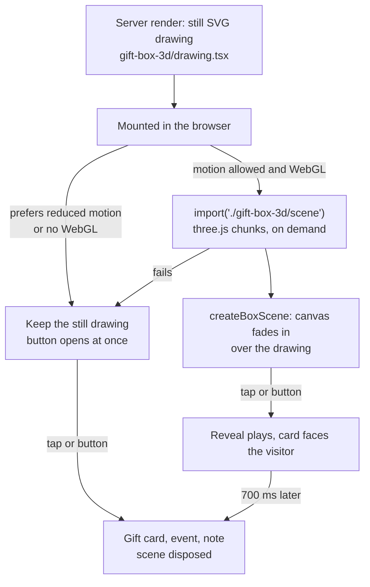
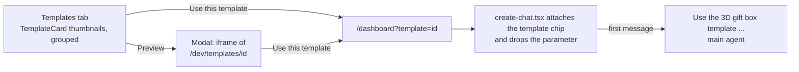

# Templates and gift pages

## What it does

Every gift is one web page at `majnu.app/l/<slug>`, made for one person. It opens full-bleed on their phone, with no account and nothing to install. The sender chooses one of ten templates: a letter in an envelope, a wrapped gift, a gift box in 3D, a party box that pops, two invitations, a postcard, a treasure map, an advent calendar or a countdown. Calendar doors open one day at a time, and a door that has not opened yet carries nothing but its number and its date. Signed-in users (guests included) browse every template on the **Templates** tab, preview one in a modal and start a gift with it.

## How it works

One page view, in order:

1. The middleware does not run for `/l/`, so the page never reads or refreshes a session and sets no cookies.
2. The page is `force-dynamic`: it renders on every request, so a door unlocks on the right day and an edit made a minute ago shows. One cached `load(slug)` per request is shared by the metadata, the viewport colour and the page.
3. [`getPublicLetter(slug)`](../../lib/letters/store.ts) answers the three demo slugs from fixtures. Any other slug must match `^[A-Za-z0-9_-]{6,64}$` and is looked up by exact match with the service-role client. The query never selects `chat`.
4. [`toPublicView()`](../../lib/letters/public-view.ts) re-validates the stored content against the schema for its kind (owners can write their content columns directly), drops gift links and images that are not `https:`, and for calendars replaces every door that has not opened with `{ day, locked: true, opensOn }`. A letter with no content yet, or content that does not fit, is a 404.
5. For letters (never calendars), the page asks whether a Daytona design exists ([daytona-redesign.md](daytona-redesign.md)). If one does, the page is an iframe of `/l/<slug>/design`; if the lookup fails, the template is shown.
6. [`<LetterRenderer>`](../../components/letters/registry.tsx) sets the palette and font moods as CSS variables, loads the template faces and picks the component by template id.
7. [`<OpenBeacon>`](../../components/letters/open-beacon.tsx) reports one `open` from the browser ([sharing-and-tracking.md](sharing-and-tracking.md)).

## The letter contract

The contract between the agent side and the template side is four shared files. After setup they change only by adding, and only when both developers agree: renaming or removing a field breaks the other side without warning.

| File | What it holds |
|---|---|
| [`lib/letters/schema.ts`](../../lib/letters/schema.ts) | zod schemas, imported from `zod/v4` because the Anthropic SDK's zod helpers need it. `LetterContent`: `recipientName`, `senderName`, `occasion`, `headline`, `body[]`, `signOff`, `theme { palette, font }`, `gifts[] { title, description?, url?, code?, imageUrl?, price? }`, `event? { title, startsAt, locationName, address }`. `CalendarContent`: `recipientName`, `senderName`, `headline`, `intro`, `startDate`, `timezone`, `theme`, `doors[] { day, title, message, gift? }`. `PublicLetter`, what a template receives, where a door is either `{ day, locked: true, opensOn }` or open with its content |
| [`lib/letters/templates.ts`](../../lib/letters/templates.ts) | Template metadata only (`id`, `kind`, `name`, `description`, `bestFor`, `plan`). It imports no components, so the agent code can read it and a broken template cannot take down the chat route |
| [`lib/letters/fixtures.ts`](../../lib/letters/fixtures.ts) | One realistic example per template, and the demo slugs |
| [`lib/letters/store.ts`](../../lib/letters/store.ts) | The exported signatures, chiefly `getPublicLetter(slug)` and `toPublicView(letter, now, { ownerPreview })` |

The theme is a mood, not a colour value: `palette` is one of `night`, `petal`, `rose`, `sage` or `ink`, and `font` one of `serif`, `sans` or `script`. Each template decides what a mood looks like ([`components/letters/theme.ts`](../../components/letters/theme.ts)). The faces are in [`app/fonts.ts`](../../app/fonts.ts): serif is Cormorant Garamond for headlines and EB Garamond to read, sans is Bricolage Grotesque with Hanken Grotesk, script is Caveat, with Pinyon Script for formal invitations. They are loaded through `next/font` without preloading, so a gift page downloads only the faces it shows, from our own domain.

## The ten templates

| Id | Kind | Name | What the recipient sees | Component | Plan |
|---|---|---|---|---|---|
| `classic-envelope` | letter | Classic envelope | A sealed envelope with a wax seal. Tapping the seal breaks it, the flap lifts, the letter slides out and opens flat to read | [`classic-envelope.tsx`](../../components/letters/templates/classic-envelope.tsx) | Free |
| `gift-reveal` | letter | Gift reveal | A wrapped box with a ribbon and a name tag. Tapping it unties the bow and brings out the gift card, then the note. The code is not on the page until the box is open | [`gift-reveal.tsx`](../../components/letters/templates/gift-reveal.tsx) | Free |
| `wedding-invite` | letter | Wedding invitation | An engraved card with a monogram and a double rule | [`invitation.tsx`](../../components/letters/templates/invitation.tsx), mood `elegant` | Free |
| `party-invite` | letter | Party invitation | Big type, a ticket with a tear-off stub and chunky countdown tiles | [`invitation.tsx`](../../components/letters/templates/invitation.tsx), mood `playful` | Free |
| `postcard` | letter | Postcard | A picture side with the headline over a painted landscape, and a written side with a stamp and a postmark. Tap or "Turn over" flips it; with reduced motion both sides are shown | [`postcard.tsx`](../../components/letters/templates/postcard.tsx) | Free |
| `gift-box-3d` | letter | 3D gift box | A ribbon-tied box in 3D (three.js). The bow unties, the lid floats away, the sides fold open and a card with their name and the headline rises in sparkles to face them; then the gift card and the note. See "The 3D gift box" below | [`gift-box-3d.tsx`](../../components/letters/templates/gift-box-3d.tsx), mood `gift` | Free |
| `party-box` | letter | Party pop box | The same box in polka dots: it squashes, the lid pops off, confetti bursts and balloons rise, and the card springs up. Then the gift, the party's date, place and a maps link if the content has an event, and the note | [`gift-box-3d.tsx`](../../components/letters/templates/gift-box-3d.tsx), mood `party` | Free |
| `treasure-map` | letter | Treasure map | A folded map on old paper, sealed with wax. Breaking the seal swings its two halves open (CSS 3D); inside, the letter is inked over a faint map whose dotted path draws itself to an X with their name. CSS and SVG only | [`treasure-map.tsx`](../../components/letters/templates/treasure-map.tsx) | Free |
| `advent-classic` | calendar | Advent calendar | 24 numbered doors, each with a moon one step fuller than the last | [`calendar.tsx`](../../components/calendars/calendar.tsx), variant `advent` | Free, with an account |
| `countdown` | calendar | Countdown | Tear-off calendar pages counting the days left, 1 to 31 doors | [`calendar.tsx`](../../components/calendars/calendar.tsx), variant `countdown` | Free, with an account |

Both invitations show the date and time as the sender wrote them (the event's own local time, never converted to the viewer's), a Google Maps search link, an `.ics` file made in the browser (times in UTC, three hours long by default) and a live countdown ([`event-time.ts`](../../components/letters/event-time.ts)). The map is a link, not an embed, so the page loads nothing from Google. A gift is a card ([`gift-card.tsx`](../../components/letters/gift-card.tsx)) with its title, price, description, a code that stays hidden until the recipient asks for it, a copy button and a link to redeem it.

The rules the builder must meet for each template (event on invitations, a gift on a gift reveal, 24 doors, 1 to 31 doors) are in [letters-chat.md](letters-chat.md#the-builder-sub-agent). The three templates added in issue #40 have no rule of their own yet; see "Open questions".

Every template also has a group in [`templates.ts`](../../lib/letters/templates.ts) (`category`: `gift`, `letter`, `invitation` or `calendar`), which the Templates tab uses. `kind` stays `letter` or `calendar`, because that is what the schema and the builder go by.

## Where the new templates came from

Pull request #36 archived a prototype in [`docs/templates/`](../templates/): a Vite and three.js page with three 3D reveals (a wedding envelope, a party box and a gift box), and a design example of a folded parchment map with a wax seal. Issue #40 turned them into Majnu templates on the letter contract:

| Prototype idea | Became | Why |
|---|---|---|
| Gift box: ribbon, bow, lid, folding walls, sparkles, card to camera | `gift-box-3d`, mood `gift` | The strongest idea and new to Majnu. Ported from `src/core/*` and `src/templates/gift.js` |
| Party box: squash, lid pop, confetti, balloons | `party-box`, mood `party` of the same component | Same box and scene; only the reveal differs, so it is a mood (as the two invitations share `invitation.tsx`), with its own id so the agent can offer it by name |
| Wedding envelope: wax seal, flap, card, falling petals | Not a new template | `classic-envelope` already opens a sealed envelope and `wedding-invite` is the formal card; a third envelope would repeat them |
| Parchment design example: folded map, wax seal, ink | `treasure-map` | The look, not the program (the example drew live sensor data). Built in CSS and SVG because they give the same feeling without a download |

What changed in the port: colours and faces come from the letter's palette and font moods instead of a JSON file of hex values and Google Fonts; the card shows the recipient's name and headline and never a gift code; the gift, note and event are ordinary page content after the reveal, so they are readable, selectable and reachable by keyboard.

## The 3D gift box

- **three.js loads on demand, for this template only.** [`gift-box-3d.tsx`](../../components/letters/templates/gift-box-3d.tsx) never imports `three`; after mounting, and only when motion is allowed and [`hasWebGL()`](../../components/letters/templates/gift-box-3d/layout.ts) finds a context, it calls `import("./gift-box-3d/scene")`. [`scene.ts`](../../components/letters/templates/gift-box-3d/scene.ts) is the only file that imports `three`, which [`three-on-demand.test.ts`](../../tests/unit/components/letters/templates/three-on-demand.test.ts) enforces. In the production build three.js is two chunks (349 KB and 210 KB minified) that no route loads up front: `/l/[slug]`, `/dev/templates/[id]` and `/dashboard/templates` were checked against `app-build-manifest.json`, and `/l/[slug]` first-load JS stayed at 128 kB.
- **A still drawing is always there first.** [`drawing.tsx`](../../components/letters/templates/gift-box-3d/drawing.tsx) is an SVG of the box in the palette (stripes, ribbon and bow for `gift`; polka dots, balloons and confetti for `party`). It is the server render, what shows while the chunks load, the whole picture with reduced motion or without WebGL, and the template's thumbnail. With motion it bobs gently in CSS; the canvas fades in over it when the scene is ready.
- **The scene** is the prototype's, adapted: a transparent renderer over the page's own background, the box, lid, bow, balloons and particles built in code, wrapping paper drawn on a canvas, colours read from the template's CSS variables, and the card drawn on a canvas in the page's own fonts (custom properties compute with `var()` resolved, so the canvas gets the real `next/font` family names). The canvas fills the first screen so confetti and balloons never meet an edge; the camera steps back on tall phone screens ([`layout.ts`](../../components/letters/templates/gift-box-3d/layout.ts)). It sends nothing over the network: no models, textures or fonts from other sites.
- **Accessibility.** The canvas is `aria-hidden`; "Open your gift" (or "Pop it open") is a real button, and tapping the box does the same. When the page takes over, focus moves to the headline. If the GPU drops the context, the scene is disposed and the gift opens.
- **Cleanup.** When the gift opens or the page unmounts, every geometry, material and texture is disposed and the WebGL context is released (`forceContextLoss`), because phones allow only a few contexts.
- **Privacy** is as for the gift reveal: the code is not on the page until the box is open, and the 3D card never shows it.

## The Templates tab

`/dashboard/templates` ([`page.tsx`](../../app/(app)/dashboard/templates/page.tsx), [`templates-view.tsx`](../../app/(app)/dashboard/templates/templates-view.tsx)) is a fifth tab in the app shell, after Letters & invitations, defined with the others in [`tabs.ts`](../../components/app/tabs.ts) (`appTabs` and `activeTab()`, covered by its test).

- Every template appears once, grouped as Gifts, Letters, Invitations and Calendars, with its still `<TemplateCard>` thumbnail rendered on the server.
- **Preview** opens a modal ([`template-actions.tsx`](../../app/(app)/dashboard/templates/template-actions.tsx), Radix Dialog): the whole screen on phones, a phone-sized frame from 640 px. Inside is an iframe of the workbench page for that template, rendered from its fixture, so the preview is the real template with example words, 3D included. Closing it removes the iframe (and its WebGL context) and returns focus to the Preview button.
- **Use this template** opens `/dashboard?template=<id>`. [`create-chat.tsx`](../../components/create/create-chat.tsx) reads the parameter once, attaches the template to the message box exactly as the Template button does (a chip, sent as `Use the "<name>" template.` with the first message), and removes the parameter from the address so a reload does not attach it again. Unknown ids are ignored.
- **Calendars** say they need an account for guests. For a guest, their link is "Create an account" (to `/signup`) instead of the chat, because the chat refuses calendars to guests ([`lib/limits.ts`](../../lib/limits.ts)).

## Door locking

Door N opens on `startDate + (N − 1)` days, compared as **calendar dates in the calendar's own timezone**, not as timestamps ([`public-view.ts`](../../lib/letters/public-view.ts)):

- Today is computed with `Intl.DateTimeFormat("en-CA", { timeZone })` from its parts, so it is always `YYYY-MM-DD`. An unknown timezone falls back to UTC rather than taking the page down.
- Opening dates are pure date arithmetic in UTC, so a daylight-saving change cannot shift them. Impossible dates such as `2026-02-30` are rejected.
- A door is locked when its opening date is after today. A locked door keeps only `day`, `locked` and `opensOn`; its title, message and gift never leave the server, so there is nothing in the HTML or in any response to peek at.
- Doors outside 1 to 366 are dropped and the rest are sorted by day.
- In the owner's preview (`ownerPreview: true`) every door is open, because a calendar starting on 1 December would otherwise show nothing but locked doors while it is being made.

Open tracking applies the same view at the moment an event arrives, so a `door_open` for a locked door is ignored ([sharing-and-tracking.md](sharing-and-tracking.md)).

## The owner's preview

`/create/[id]/preview` ([`page.tsx`](../../app/(owner)/create/[id]/preview/page.tsx)) loads the letter with `getMyLetter()`, so only its owner can open it, and renders it with `toPublicView(letter, now, { ownerPreview: true })`. It lives in the `(owner)` route group so it renders full-bleed without the app shell, the create page shows it in an iframe at phone width, and it has no beacon, so a sender looking at their own gift never counts as an open. Templates report taps through [`letter-context.tsx`](../../components/letters/letter-context.tsx), whose `track()` does nothing in the owner's preview.

## The link-preview image

When a gift link is pasted into WhatsApp or iMessage, the app fetches `/l/<slug>/opengraph-image` (and `twitter-image` for X). [`render-envelope.tsx`](../../app/(public)/l/[slug]/render-envelope.tsx) draws a cream envelope on the night sky, sealed with the crescent and addressed to the recipient's first name, at 1200 × 630.

- It takes the kind of gift and the first name and **nothing else** ([`og-envelope.ts`](../../components/letters/og-envelope.ts)), so no message, gift, code, place or date can reach a preview.
- The name is set in an embedded subset of Gilda Display ([`gilda-display.ts`](../../app/(public)/l/[slug]/gilda-display.ts), with its licence in `gilda-display-OFL.txt`). A name with characters outside the subset is shown as "you", because `next/og` would otherwise ask Google Fonts for the missing glyphs and send the name with the request. Long names shrink to fit.
- Unknown slugs and lookup failures get the same envelope addressed to "you", so the image never fails a preview. Responses are cached for an hour.

The page's own metadata ([`page-meta.ts`](../../components/letters/page-meta.ts)) is generic too: the title is the kind of gift and the first name ("A letter for Anna"), the page is `noindex, nofollow`, it sends no referrer, and the browser bar takes the colour of the palette. Deleting the two image routes would make every letter preview with `/brand/majnu-og.png` again.

## Demo slugs

`getPublicLetter()` resolves three slugs to fixtures without touching the database, so templates can be built and shown before the data layer and the landing page can link to real examples:

| Slug | Template | Note |
|---|---|---|
| `demo-letter` | `classic-envelope` | Anna's birthday letter |
| `demo-gift` | `gift-reveal` | Tom's spa day voucher |
| `demo-calendar` | `advent-classic` | Always starts four days ago in the fixture's timezone, so doors 1 to 5 are open and the rest locked, whatever the date |

Open tracking ignores the demo slugs.

## The template workbench

`/dev/templates` ([`page.tsx`](../../app/dev/templates/page.tsx)) renders every fixture in a phone-sized frame. The Templates tab's preview modal shows these pages too. Each frame is an iframe of `/dev/templates/<id>`, so templates get a real 375 px viewport. Fixtures go through the same `toPublicView()` as the public page ([`fixture-letter.ts`](../../app/dev/templates/fixture-letter.ts)), with all doors open unless a query asks otherwise:

| Query | Effect |
|---|---|
| `?live=1` | Lock calendar doors as the public page would right now |
| `?today=2026-12-12` | Lock them as of that date |
| `?days=3` | A countdown with that many doors (1 to 31) |
| `?event=0` | An invitation without its event |
| `?palette=rose`, `?font=script` | Try another mood |

The index links each state the issues asked to check (0, 1, 12 and 24 open doors; 3, 7 and 24-day countdowns; invitations without an event; the 3D boxes and the map in other moods, and the party box without its event), shows every `TemplateCard` and the share panel in both states. The 3D boxes have no query for their still state: check it with the browser's reduced-motion setting or with WebGL blocked. The workbench is public so it can be used for ad screenshots, is never indexed, and is excluded from the middleware. It is also where [`scripts/daytona/export-references.mts`](../../scripts/daytona/export-references.mts) reads the rendered examples for the Daytona snapshot.

[`<TemplateCard id>`](../../components/letters/template-card.tsx) is a still thumbnail of a template's first screen, drawn from its fixture in the template's own palette and type. It has no hooks, state or tracking and ships no JavaScript when rendered on the server; the chat's template picker and the landing page use it.

## Pieces

| Piece | Job |
|---|---|
| [`app/(public)/l/[slug]/page.tsx`](../../app/(public)/l/[slug]/page.tsx) | The gift page |
| [`app/(public)/layout.tsx`](../../app/(public)/layout.tsx) | Full-bleed layout, `noindex`, `no-referrer` |
| [`app/(public)/l/[slug]/opengraph-image.tsx`](../../app/(public)/l/[slug]/opengraph-image.tsx), [`twitter-image.tsx`](../../app/(public)/l/[slug]/twitter-image.tsx) | The envelope preview image |
| [`app/(public)/l/[slug]/not-found.tsx`](../../app/(public)/l/[slug]/not-found.tsx) | What an unknown or empty link shows |
| [`lib/letters/store.ts`](../../lib/letters/store.ts), [`lib/letters/public-view.ts`](../../lib/letters/public-view.ts) | Public read by exact slug and the stripped view |
| [`components/letters/registry.tsx`](../../components/letters/registry.tsx) | `<LetterRenderer>`: template id to component |
| [`components/letters/templates/`](../../components/letters/templates/), [`components/calendars/`](../../components/calendars/) | The ten templates |
| [`components/letters/templates/gift-box-3d/`](../../components/letters/templates/gift-box-3d/) | The 3D box: `scene.ts` (three.js, loaded on demand), `drawing.tsx` (the still), `layout.ts` (framing, text wrap, WebGL check) |
| [`app/(app)/dashboard/templates/`](../../app/(app)/dashboard/templates/) | The Templates tab and its preview modal |
| `three` (npm, with `@types/three`) | 3D rendering for `gift-box-3d` and `party-box` only |
| [`components/letters/`](../../components/letters/) | Shared pieces: theme, chrome, gift card, names, event times, tracking context, template card |
| [`app/dev/templates/`](../../app/dev/templates/) | The workbench |
| `letters` table | `kind`, `template_id`, `title` and `content` are what a page renders |

## Data and privacy

- There is **no anonymous read policy** on `letters`. The page, the preview image and open tracking read through the service-role client, by exact slug, on the server. A slug is 10 characters from a 49-character alphabet without look-alike letters (about 56 bits), so links cannot be guessed ([data-and-security.md](data-and-security.md)).
- **Gift codes** are in the page only once the recipient unwraps the gift or asks for the code. **Locked doors** are removed on the server.
- **Titles and previews** name the kind of gift and the first name only.
- **No third-party requests:** no analytics, no external scripts, fonts served from our domain, a maps link instead of an embed. three.js is bundled and served from our domain like any other chunk. Pages are `noindex` and send no referrer, so a letter's address never reaches another site.
- Anyone with the link can open the gift. The privacy page says so and offers to take a page down on request.

## Limits and costs

- Every view renders on the server. On Workers Free a request may use 10 ms of CPU; setup measured 1 to 3 ms for cached pages, 50 ms for a cold request and 10 to 20 ms for typical server-rendered pages ([docs/setup.md](../setup.md)). Dynamic pages can hit "Worker exceeded resource limits" (1102) under real traffic unless the account is on Workers Paid; measuring this is [#12](https://github.com/peresramirez/majnu/issues/12).
- Stored content is capped at 200,000 bytes and titles at 200 characters by the database.
- The 3D boxes download three.js (about 560 KB minified, before compression) only when they can animate, and use the GPU for the few seconds of the reveal; everything is disposed once the gift is open.
- A view costs no model calls. A calendar takes one database query; a letter takes three (the letter, then its id and newest design for the Daytona check). The preview image is a separate request with its own lookup.

## How it was checked

- **Unit tests:** [`public-view.test.ts`](../../tests/unit/lib/letters/public-view.test.ts) (locking at midnight in Berlin, one more door a day, month ends, leap days, daylight saving, unknown timezones, owner preview, https-only gifts, invalid records), [`store.test.ts`](../../tests/unit/lib/letters/store.test.ts) (demo slugs, exact-slug lookups that never select the chat, content validation before writing), [`demo-calendar.test.ts`](../../tests/unit/lib/letters/demo-calendar.test.ts), [`fixtures.test.ts`](../../tests/unit/lib/letters/fixtures.test.ts), and in [`tests/unit/components/letters/`](../../tests/unit/components/letters/) the page metadata, the envelope rules, names, event times and `.ics`, themes and https-only URLs, and the template card data; calendar dates in [`dates.test.ts`](../../tests/unit/components/calendars/dates.test.ts).
- **In a browser:** the workbench exists so every template and state can be checked at a real 375 px viewport; the commit that added the states names the issues they serve ([#19](https://github.com/peresramirez/majnu/issues/19), [#20](https://github.com/peresramirez/majnu/issues/20), [#25](https://github.com/peresramirez/majnu/issues/25)). The results of those browser checks are not recorded in the repository.
- **The plan's check for locked doors:** a calendar starting today opens door 1, and door 2's text is absent from `curl -s .../l/<slug>`. The unit tests cover the stripping; whether the `curl` check was run against production is not recorded.

### Issue #40 (the prototype templates and the Templates tab)

- **Unit tests:** [`layout.test.ts`](../../tests/unit/components/letters/templates/gift-box-3d/layout.test.ts) (camera framing on phone and desktop aspects, the card always inside the view, text wrapping with ellipsis), [`three-on-demand.test.ts`](../../tests/unit/components/letters/templates/three-on-demand.test.ts) (only the scene imports `three`; the template reaches it only through `import()`; checked to fail on a planted static import), [`templates.test.ts`](../../tests/unit/lib/letters/templates.test.ts) (every template in a group, unique names, the new ids), and the nouns in `names.test.ts`. Fixtures and cards are covered for the new ids by the existing `it.each` tests.
- **In a browser** (isolated Chrome, dev server): `gift-box-3d`, `party-box` and `treasure-map` at 375 × 740 and 1440 × 900, the full reveal of each, with reduced motion (still drawing, no three.js requested, Enter opens at once and focuses the headline) and with WebGL refused (still drawing, no three.js requested). Night, petal, ink, sage and rose palettes and the serif, sans and script faces, including the script face drawn on the 3D card. Console free of errors and warnings. The Templates tab, the modal (keyboard open, Escape, focus back on the trigger, full screen at 375) and the `?template=` chip were checked on temporary mock pages inside the real app shell, because the session could not sign in; the mock pages were deleted. The signed-in `/dashboard/templates` and the active state of its tab were not checked in a browser.
- **The builder** was not checked live for the new ids: both calls were refused because the API key had reached its usage limit (until 1 December). Its prompt sees each template's name and description from `templates.ts`.

## Open questions

- **Builder rules for the new ids** live in `lib/agents/builder.ts`, outside this change: `checkContent` should require a gift for `gift-box-3d` (as for `gift-reveal`), `titleFor` should call `gift-box-3d` and `party-box` "A gift for …" (they fall through to "A letter for …" today), and the builder prompt names only `gift-reveal` as needing a gift.
- **The gift finder's wrap step** offers `gift-reveal`, `classic-envelope` and `postcard` (`lib/finder/events.ts`, `lib/finder/wrap.ts`, `components/finder/finder-state.ts`). `gift-box-3d` fits it well once the builder requires its gift.
- **The preview modal depends on `/dev/templates/<id>`.** If the workbench is taken down after launch, the modal needs a public preview route of its own.

- Issues still open for this area: [#18](https://github.com/peresramirez/majnu/issues/18) (gift reveal) and [#27](https://github.com/peresramirez/majnu/issues/27) (the link-preview image), though both are in the code.
- The gift list on wedding and birthday invitations ([#35](https://github.com/peresramirez/majnu/issues/35)) will add an optional `wishlist` to `LetterContent`, an additive contract change.
- `/dev/templates` is public in production. It shows fixtures only, but a decision is needed on whether it stays up after launch.
