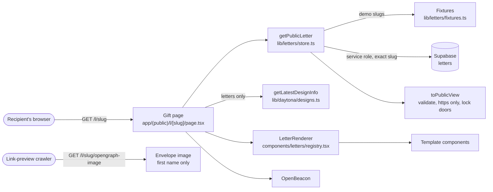

# Templates and gift pages

## What it does

Every gift is one web page at `majnu.app/l/<slug>`, made for one person. It opens full-bleed on their phone, with no account and nothing to install. The sender chooses one of seven templates: a letter in an envelope, a wrapped gift, two invitations, a postcard, an advent calendar or a countdown. Calendar doors open one day at a time, and a door that has not opened yet carries nothing but its number and its date.

## How it works

One page view, in order:

1. The middleware does not run for `/l/`, so the page never reads or refreshes a session and sets no cookies.
2. The page is `force-dynamic`: it renders on every request, so a door unlocks on the right day and an edit made a minute ago shows. One cached `load(slug)` per request is shared by the metadata, the viewport colour and the page.
3. [`getPublicLetter(slug)`](../../lib/letters/store.ts) answers the three demo slugs from fixtures. Any other slug must match `^[A-Za-z0-9_-]{6,64}$` and is looked up by exact match with the service-role client. The query never selects `chat`.
4. [`toPublicView()`](../../lib/letters/public-view.ts) re-validates the stored content against the schema for its kind (owners can write their content columns directly), drops gift links and images that are not `https:`, and for calendars replaces every door that has not opened with `{ day, locked: true, opensOn }`. A letter with no content yet, or content that does not fit, is a 404.
5. For letters (never calendars), the page asks whether a Daytona design exists ([daytona-redesign.md](daytona-redesign.md)). If one does, the page is an iframe of `/l/<slug>/design`; if the lookup fails, the template is shown.
6. [`<LetterRenderer>`](../../components/letters/registry.tsx) sets the palette and font moods as CSS variables, loads the template faces and picks the component by template id.
7. [`<OpenBeacon>`](../../components/letters/open-beacon.tsx) reports one `open` from the browser ([sharing-and-tracking.md](sharing-and-tracking.md)).

## The letter contract

The contract between the agent side and the template side is four shared files. After setup they change only by adding, and only when both developers agree: renaming or removing a field breaks the other side without warning.

| File | What it holds |
|---|---|
| [`lib/letters/schema.ts`](../../lib/letters/schema.ts) | zod schemas, imported from `zod/v4` because the Anthropic SDK's zod helpers need it. `LetterContent`: `recipientName`, `senderName`, `occasion`, `headline`, `body[]`, `signOff`, `theme { palette, font }`, `gifts[] { title, description?, url?, code?, imageUrl?, price? }`, `event? { title, startsAt, locationName, address }`. `CalendarContent`: `recipientName`, `senderName`, `headline`, `intro`, `startDate`, `timezone`, `theme`, `doors[] { day, title, message, gift? }`. `PublicLetter`, what a template receives, where a door is either `{ day, locked: true, opensOn }` or open with its content |
| [`lib/letters/templates.ts`](../../lib/letters/templates.ts) | Template metadata only (`id`, `kind`, `name`, `description`, `bestFor`, `plan`). It imports no components, so the agent code can read it and a broken template cannot take down the chat route |
| [`lib/letters/fixtures.ts`](../../lib/letters/fixtures.ts) | One realistic example per template, and the demo slugs |
| [`lib/letters/store.ts`](../../lib/letters/store.ts) | The exported signatures, chiefly `getPublicLetter(slug)` and `toPublicView(letter, now, { ownerPreview })` |

The theme is a mood, not a colour value: `palette` is one of `night`, `petal`, `rose`, `sage` or `ink`, and `font` one of `serif`, `sans` or `script`. Each template decides what a mood looks like ([`components/letters/theme.ts`](../../components/letters/theme.ts)). The faces are in [`app/fonts.ts`](../../app/fonts.ts): serif is Cormorant Garamond for headlines and EB Garamond to read, sans is Bricolage Grotesque with Hanken Grotesk, script is Caveat, with Pinyon Script for formal invitations. They are loaded through `next/font` without preloading, so a gift page downloads only the faces it shows, from our own domain.

## The seven templates

| Id | Kind | Name | What the recipient sees | Component | Plan |
|---|---|---|---|---|---|
| `classic-envelope` | letter | Classic envelope | A sealed envelope with a wax seal. Tapping the seal breaks it, the flap lifts, the letter slides out and opens flat to read | [`classic-envelope.tsx`](../../components/letters/templates/classic-envelope.tsx) | Free |
| `gift-reveal` | letter | Gift reveal | A wrapped box with a ribbon and a name tag. Tapping it unties the bow and brings out the gift card, then the note. The code is not on the page until the box is open | [`gift-reveal.tsx`](../../components/letters/templates/gift-reveal.tsx) | Free |
| `wedding-invite` | letter | Wedding invitation | An engraved card with a monogram and a double rule | [`invitation.tsx`](../../components/letters/templates/invitation.tsx), mood `elegant` | Free |
| `party-invite` | letter | Party invitation | Big type, a ticket with a tear-off stub and chunky countdown tiles | [`invitation.tsx`](../../components/letters/templates/invitation.tsx), mood `playful` | Free |
| `postcard` | letter | Postcard | A picture side with the headline over a painted landscape, and a written side with a stamp and a postmark. Tap or "Turn over" flips it; with reduced motion both sides are shown | [`postcard.tsx`](../../components/letters/templates/postcard.tsx) | Free |
| `advent-classic` | calendar | Advent calendar | 24 numbered doors, each with a moon one step fuller than the last | [`calendar.tsx`](../../components/calendars/calendar.tsx), variant `advent` | Full moon |
| `countdown` | calendar | Countdown | Tear-off calendar pages counting the days left, 1 to 31 doors | [`calendar.tsx`](../../components/calendars/calendar.tsx), variant `countdown` | Full moon |

Both invitations show the date and time as the sender wrote them (the event's own local time, never converted to the viewer's), a Google Maps search link, an `.ics` file made in the browser (times in UTC, three hours long by default) and a live countdown ([`event-time.ts`](../../components/letters/event-time.ts)). The map is a link, not an embed, so the page loads nothing from Google. A gift is a card ([`gift-card.tsx`](../../components/letters/gift-card.tsx)) with its title, price, description, a code that stays hidden until the recipient asks for it, a copy button and a link to redeem it.

The rules the builder must meet for each template (event on invitations, a gift on a gift reveal, 24 doors, 1 to 31 doors) are in [letters-chat.md](letters-chat.md#the-builder-sub-agent).

## Door locking

Door N opens on `startDate + (N − 1)` days, compared as **calendar dates in the calendar's own timezone**, not as timestamps ([`public-view.ts`](../../lib/letters/public-view.ts)):

- Today is computed with `Intl.DateTimeFormat("en-CA", { timeZone })` from its parts, so it is always `YYYY-MM-DD`. An unknown timezone falls back to UTC rather than taking the page down.
- Opening dates are pure date arithmetic in UTC, so a daylight-saving change cannot shift them. Impossible dates such as `2026-02-30` are rejected.
- A door is locked when its opening date is after today. A locked door keeps only `day`, `locked` and `opensOn`; its title, message and gift never leave the server, so there is nothing in the HTML or in any response to peek at.
- Doors outside 1 to 366 are dropped and the rest are sorted by day.
- In the owner's preview (`ownerPreview: true`) every door is open, because a calendar starting on 1 December would otherwise show nothing but locked doors while it is being made.

Open tracking applies the same view at the moment an event arrives, so a `door_open` for a locked door is ignored ([sharing-and-tracking.md](sharing-and-tracking.md)).

## The owner's preview

`/create/[id]/preview` ([`page.tsx`](../../app/(owner)/create/[id]/preview/page.tsx)) loads the letter with `getMyLetter()`, so only its owner can open it, and renders it with `toPublicView(letter, now, { ownerPreview: true })`. It lives in the `(owner)` route group so it renders full-bleed without the app shell, the create page shows it in an iframe at phone width, and it has no beacon, so a sender looking at their own gift never counts as an open. Templates report taps through [`letter-context.tsx`](../../components/letters/letter-context.tsx), whose `track()` does nothing in the owner's preview.

## The link-preview image

When a gift link is pasted into WhatsApp or iMessage, the app fetches `/l/<slug>/opengraph-image` (and `twitter-image` for X). [`render-envelope.tsx`](../../app/(public)/l/[slug]/render-envelope.tsx) draws a cream envelope on the night sky, sealed with the crescent and addressed to the recipient's first name, at 1200 × 630.

- It takes the kind of gift and the first name and **nothing else** ([`og-envelope.ts`](../../components/letters/og-envelope.ts)), so no message, gift, code, place or date can reach a preview.
- The name is set in an embedded subset of Gilda Display ([`gilda-display.ts`](../../app/(public)/l/[slug]/gilda-display.ts), with its licence in `gilda-display-OFL.txt`). A name with characters outside the subset is shown as "you", because `next/og` would otherwise ask Google Fonts for the missing glyphs and send the name with the request. Long names shrink to fit.
- Unknown slugs and lookup failures get the same envelope addressed to "you", so the image never fails a preview. Responses are cached for an hour.

The page's own metadata ([`page-meta.ts`](../../components/letters/page-meta.ts)) is generic too: the title is the kind of gift and the first name ("A letter for Anna"), the page is `noindex, nofollow`, it sends no referrer, and the browser bar takes the colour of the palette. Deleting the two image routes would make every letter preview with `/brand/majnu-og.png` again.

## Demo slugs

`getPublicLetter()` resolves three slugs to fixtures without touching the database, so templates can be built and shown before the data layer and the landing page can link to real examples:

| Slug | Template | Note |
|---|---|---|
| `demo-letter` | `classic-envelope` | Anna's birthday letter |
| `demo-gift` | `gift-reveal` | Tom's spa day voucher |
| `demo-calendar` | `advent-classic` | Always starts four days ago in the fixture's timezone, so doors 1 to 5 are open and the rest locked, whatever the date |

Open tracking ignores the demo slugs.

## The template workbench

`/dev/templates` ([`page.tsx`](../../app/dev/templates/page.tsx)) renders every fixture in a phone-sized frame. Each frame is an iframe of `/dev/templates/<id>`, so templates get a real 375 px viewport. Fixtures go through the same `toPublicView()` as the public page ([`fixture-letter.ts`](../../app/dev/templates/fixture-letter.ts)), with all doors open unless a query asks otherwise:

| Query | Effect |
|---|---|
| `?live=1` | Lock calendar doors as the public page would right now |
| `?today=2026-12-12` | Lock them as of that date |
| `?days=3` | A countdown with that many doors (1 to 31) |
| `?event=0` | An invitation without its event |
| `?palette=rose`, `?font=script` | Try another mood |

The index links each state the issues asked to check (0, 1, 12 and 24 open doors; 3, 7 and 24-day countdowns; invitations without an event), shows every `TemplateCard` and the share panel in both states. The workbench is public so it can be used for ad screenshots, is never indexed, and is excluded from the middleware. It is also where [`scripts/daytona/export-references.mts`](../../scripts/daytona/export-references.mts) reads the rendered examples for the Daytona snapshot.

[`<TemplateCard id>`](../../components/letters/template-card.tsx) is a still thumbnail of a template's first screen, drawn from its fixture in the template's own palette and type. It has no hooks, state or tracking and ships no JavaScript when rendered on the server; the chat's template picker and the landing page use it.

## Pieces

| Piece | Job |
|---|---|
| [`app/(public)/l/[slug]/page.tsx`](../../app/(public)/l/[slug]/page.tsx) | The gift page |
| [`app/(public)/layout.tsx`](../../app/(public)/layout.tsx) | Full-bleed layout, `noindex`, `no-referrer` |
| [`app/(public)/l/[slug]/opengraph-image.tsx`](../../app/(public)/l/[slug]/opengraph-image.tsx), [`twitter-image.tsx`](../../app/(public)/l/[slug]/twitter-image.tsx) | The envelope preview image |
| [`app/(public)/l/[slug]/not-found.tsx`](../../app/(public)/l/[slug]/not-found.tsx) | What an unknown or empty link shows |
| [`lib/letters/store.ts`](../../lib/letters/store.ts), [`lib/letters/public-view.ts`](../../lib/letters/public-view.ts) | Public read by exact slug and the stripped view |
| [`components/letters/registry.tsx`](../../components/letters/registry.tsx) | `<LetterRenderer>`: template id to component |
| [`components/letters/templates/`](../../components/letters/templates/), [`components/calendars/`](../../components/calendars/) | The seven templates |
| [`components/letters/`](../../components/letters/) | Shared pieces: theme, chrome, gift card, names, event times, tracking context, template card |
| [`app/dev/templates/`](../../app/dev/templates/) | The workbench |
| `letters` table | `kind`, `template_id`, `title` and `content` are what a page renders |

## Data and privacy

- There is **no anonymous read policy** on `letters`. The page, the preview image and open tracking read through the service-role client, by exact slug, on the server. A slug is 10 characters from a 49-character alphabet without look-alike letters (about 56 bits), so links cannot be guessed ([data-and-security.md](data-and-security.md)).
- **Gift codes** are in the page only once the recipient unwraps the gift or asks for the code. **Locked doors** are removed on the server.
- **Titles and previews** name the kind of gift and the first name only.
- **No third-party requests:** no analytics, no external scripts, fonts served from our domain, a maps link instead of an embed. Pages are `noindex` and send no referrer, so a letter's address never reaches another site.
- Anyone with the link can open the gift. The privacy page says so and offers to take a page down on request.

## Limits and costs

- Every view renders on the server. On Workers Free a request may use 10 ms of CPU; setup measured 1 to 3 ms for cached pages, 50 ms for a cold request and 10 to 20 ms for typical server-rendered pages ([docs/setup.md](../setup.md)). Dynamic pages can hit "Worker exceeded resource limits" (1102) under real traffic unless the account is on Workers Paid; measuring this is [#12](https://github.com/peresramirez/majnu/issues/12).
- Stored content is capped at 200,000 bytes and titles at 200 characters by the database.
- A view costs no model calls. A calendar takes one database query; a letter takes three (the letter, then its id and newest design for the Daytona check). The preview image is a separate request with its own lookup.

## How it was checked

- **Unit tests:** [`public-view.test.ts`](../../tests/unit/lib/letters/public-view.test.ts) (locking at midnight in Berlin, one more door a day, month ends, leap days, daylight saving, unknown timezones, owner preview, https-only gifts, invalid records), [`store.test.ts`](../../tests/unit/lib/letters/store.test.ts) (demo slugs, exact-slug lookups that never select the chat, content validation before writing), [`demo-calendar.test.ts`](../../tests/unit/lib/letters/demo-calendar.test.ts), [`fixtures.test.ts`](../../tests/unit/lib/letters/fixtures.test.ts), and in [`tests/unit/components/letters/`](../../tests/unit/components/letters/) the page metadata, the envelope rules, names, event times and `.ics`, themes and https-only URLs, and the template card data; calendar dates in [`dates.test.ts`](../../tests/unit/components/calendars/dates.test.ts).
- **In a browser:** the workbench exists so every template and state can be checked at a real 375 px viewport; the commit that added the states names the issues they serve ([#19](https://github.com/peresramirez/majnu/issues/19), [#20](https://github.com/peresramirez/majnu/issues/20), [#25](https://github.com/peresramirez/majnu/issues/25)). The results of those browser checks are not recorded in the repository.
- **The plan's check for locked doors:** a calendar starting today opens door 1, and door 2's text is absent from `curl -s .../l/<slug>`. The unit tests cover the stripping; whether the `curl` check was run against production is not recorded.

## Open questions

- Issues still open for this area: [#18](https://github.com/peresramirez/majnu/issues/18) (gift reveal) and [#27](https://github.com/peresramirez/majnu/issues/27) (the link-preview image), though both are in the code.
- The gift list on wedding and birthday invitations ([#35](https://github.com/peresramirez/majnu/issues/35)) will add an optional `wishlist` to `LetterContent`, an additive contract change.
- `/dev/templates` is public in production. It shows fixtures only, but a decision is needed on whether it stays up after launch.
