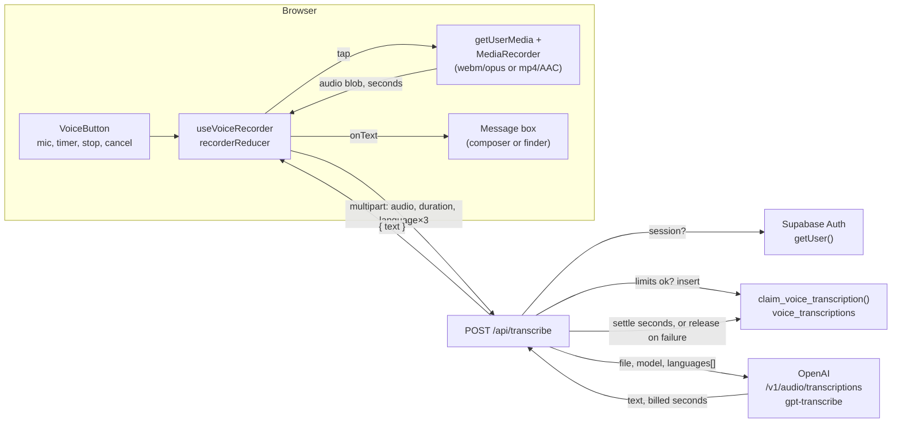

# Voice input: talk to Majnu instead of typing

Issue #37. The decision is in [../plan.md](../plan.md), "Voice": OpenAI is used for speech to text and nothing else, called with `fetch`, never stored.

## What it does

Most visitors arrive on a phone. Next to the message box on the landing page, in the gift finder and in the Letters & invitations chat there is a microphone button. Tap it, say "find a gift for my mum, she loves gardening", and tap again: a moment later the words appear in the message box, added to anything already typed, for the sender to check and send. Nothing is sent automatically. A recording can be at most a minute long and stops by itself at the limit.

## How it works

One recording, in order:

1. The button appears only after the page has loaded and only where the browser can record (`MediaRecorder` and `getUserMedia` exist, which needs https or localhost). Tapping it asks for the microphone. A refusal, no microphone, or a microphone busy in another app shows a short message in a bubble above the button and in the live region; nothing is recorded.
2. `MediaRecorder` records the first format the browser supports from `audio/webm;codecs=opus`, `audio/webm`, `audio/mp4;codecs=mp4a.40.2`, `audio/mp4` (Chrome, Android, Firefox and Safari 18.4+ record webm; older iOS Safari records mp4), asking for 48 kbit/s. While it records, the button becomes Stop (the same element, so keyboard focus stays on it), and a Cancel button and a timer ("0:12 / 1:00") appear beside it. Ten seconds before the limit the live region says so; at 60 seconds the recording stops by itself and is used.
3. Stop releases the microphone at once. A recording under half a second is discarded ("That was too short to hear"). Otherwise the browser posts the audio, its length in seconds and up to three of the browser's languages (`navigator.languages`) to `POST /api/transcribe`. In the finder and on the landing page, `ensureAnonymousSession` runs first, so a visitor without a session gets the same invisible anonymous account the finder uses.
4. The route refuses a cross-site post (403) and answers 401 `session_required` without a Supabase session; anonymous sessions count. It reads the body with a hard byte cap (so a missing or false `Content-Length` cannot make it read an endless upload), then checks the recording: present and not empty, at most 4 MB, a format OpenAI reads (webm, mp4/m4a, mp3, wav; not ogg), and a length of at most 60 seconds (plus 2 seconds for the browser's clock).
5. It claims the call: `claim_voice_transcription()` checks today's per-user and site-wide counts and inserts a row in one step, under a per-user advisory lock so parallel requests cannot all slip past the count. A refusal comes back as 429 with a kind message.
6. It sends OpenAI one multipart request: the file (named `recording.webm` or `recording.mp4`, because OpenAI reads the format from the name), `model=gpt-transcribe`, `response_format=json`, and the language hints as `languages[]` (ISO 639-1 codes such as `de` and `en`, plus `zh-cn`, `zh-tw` and `zh-hk`; anything else is dropped). If OpenAI rejects the request over a language code, it is sent once more without hints. There is a 30-second timeout.
7. On success the claim is settled with the seconds OpenAI billed (`usage.seconds`), or the browser's length if none is reported, and the route answers `{ text }`. On failure the claim is deleted, so a failed call does not count against anyone, and the route answers 502 `failed`.
8. The browser hands the text to the message box: it is appended after a space, the field is focused with the cursor at the end, and the live region says "Done. Check the text in the message box, then send it." Empty text (silence) shows "Majnu didn't catch any words".

## Pieces

| Piece | Job |
|---|---|
| `app/api/transcribe/route.ts` | The route: session, body cap, validation, claim, OpenAI, settle or release, `{ text }` or `{ error, message }` |
| `lib/voice/rules.ts` | Shared by browser and server: the 60-second, half-second and 4 MB limits, per-user limits, recording formats, file extensions, language hints, error codes and their messages |
| `lib/voice/openai.ts` | The `fetch` call to OpenAI's transcription endpoint, the multipart body, the retry without hints, the timeout. Server only |
| `lib/voice/usage.ts` | Claim, settle and release with the service-role client; reads `MAJNU_DAILY_VOICE_CAP`. Server only |
| `components/voice/voice-button.tsx` | The button, Stop, Cancel, timer, error bubble and live region |
| `components/voice/use-voice-recorder.ts` | `getUserMedia`, `MediaRecorder`, the upload, and freeing the microphone on stop, cancel and unmount |
| `components/voice/recorder-state.ts` | Pure logic: the state machine, the live-region text, the timer label, microphone errors and the route's answers |
| `components/create/composer.tsx` | The Letters & invitations message box: the button sits beside Send |
| `components/finder/finder-dialog.tsx` | The finder's message box: the button sits beside Send and passes the finder's `ensureSession` |
| `components/landing/hero-finder.tsx` | The landing page's message box: the button sits between the text and Find a gift, passes the same `ensureSession` with a spot under the box where the bot check can show itself, and hides the typed example while it records |
| `supabase/migrations/0005_voice.sql` | The `voice_transcriptions` table and `claim_voice_transcription()` |
| `OPENAI_API_KEY` | Server only. Without it the route answers 503 `unavailable` and the button says voice is not available |
| `MAJNU_TRANSCRIBE_MODEL` | Optional. Defaults to `gpt-transcribe`. Another model (for example `whisper-1`) gets one `language` instead of `languages[]` |
| `MAJNU_DAILY_VOICE_CAP` | Optional. Transcriptions per UTC day for the whole site, default 1000; `0` turns voice off |

## Data and privacy

- **The recording** exists in the browser's memory until it is posted, then in the Worker's memory for the length of the request, and is sent to OpenAI and nowhere else. It is never written to storage, never logged, and nothing is kept on the visitor's device.
- **The text** goes back to the browser that asked for it. It is not stored or logged by this route; it becomes part of the conversation only if the sender sends it, like anything typed.
- **The route logs** only status codes and OpenAI's error code (never its error message, which could quote input), so neither audio nor text reaches the logs. This was checked against the dev server log after the live calls.
- **`voice_transcriptions`** holds one row per call: the user id, the seconds and the time. No audio, no text. Users can read their own rows; only server code with the service-role key writes them, so nobody can reset their own limit. Rows older than seven days are deleted on the next call, and all of a user's rows go with their account.
- **The microphone** is released (every track stopped) as soon as a recording stops, is cancelled, fails, or the button leaves the page (closing the finder mid-recording).
- **OpenAI** receives the audio and the language hints, nothing else: no user id, no conversation. The privacy page needs a sentence naming OpenAI as the speech-to-text provider (left to the session that owns that page).

## Limits and costs

- **Per recording:** 60 seconds (the browser stops at the limit; the route refuses a declared length over 62 seconds) and 4 MB. A minute of webm/opus at 48 kbit/s is about 360 KB.
- **Per user per UTC day:** 20 transcriptions or 10 minutes, whichever comes first. The minutes are what OpenAI billed. The last recording of the day may go a little over the 10 minutes rather than being thrown away after it was made.
- **Site-wide per UTC day:** `MAJNU_DAILY_VOICE_CAP` transcriptions, default 1000. Refusals say so kindly and point to typing.
- **Cost:** `gpt-transcribe` is $0.0045 per minute of audio (OpenAI's model page, 21 November 2026); in the live calls its `usage.seconds` came back as whole seconds, rounded up. A typical 5-second request costs about $0.0004; one user's daily maximum about $0.05; 1000 one-minute recordings $4.50.
- **Speed:** the live calls took 0.7 to 1.2 seconds end to end through the dev server.

## How it was checked

- **Unit tests** (`npm test`): `tests/unit/app/api/transcribe/route.test.ts` (28 tests, Supabase and OpenAI's `fetch` mocked) covers the answer, the exact request OpenAI receives (URL, key, model, `response_format`, `languages[]`, file name and size, nothing else), the single-`language` path for other models, the retry without hints, the claim with the per-user limits and the site cap before OpenAI is asked, settling with the billed seconds, the three refusals and their messages, failing closed when the limits cannot be checked, releasing the claim when OpenAI fails, and refusing before any spend: no session, cross-site, no key, over 4 MB (by file, by body and by `Content-Length`), over a minute, no length, empty, ogg, no recording, not a form. It also checks that no transcript reaches the logs. `tests/unit/components/voice/recorder-state.test.ts` covers every transition of the state machine, the live-region text, the timer, microphone errors and the route's answers; `tests/unit/lib/voice/rules.test.ts` the formats, language hints and the brand voice of every message.
- **The migration** was run in PGlite (Postgres 17) with stand-ins for `auth.users`, `auth.uid()` and the Supabase roles: the three refusals, the seven-day clean-up, the seconds clamp, owners reading only their rows, and `authenticated` and `anon` refused on writes and on the function. The lead applied it to Supabase (dry run first) and checked the anon key is refused on the table and the function.
- **Five live transcriptions** through the dev server with audio made by macOS `say`:
  - English, webm/opus, `en-US`: "Find a gift for my mom. She loves gardening and old roses." (1.2 s)
  - German, mp4/AAC as iOS Safari records it, `de-DE`: "Finde ein Geschenk für meinen Bruder, er kocht gern und fährt Fahrrad." (1.1 s)
  - German, webm/opus, from a browser set to English only: the same German text (0.7 s), so a wrong hint did no harm.
  - In the browser, through the real button and `MediaRecorder` (Chrome, a fake microphone playing a recorded sentence through WebAudio): in the Letters chat at 1440 px after typing "Hello.", the box read "Hello. It's for my sister. She loves hiking and good coffee." with focus in it and nothing sent; in the finder at 375 px the same sentence landed in the finder's message box.
  - The rows written were 4, 5, 5, 4 and 4 seconds (OpenAI's billed seconds replacing the browser's 3.75 to 4.3), and nothing else. Refusals checked with curl at no cost: no session 401, 75 seconds 413, ogg 415, 5 MB 413, cross-site 403.
- **In the browser** at 375 and 1440 px: the recording state (Cancel, timer, Stop, Send) fits at 375 px with the message field still 110 px wide and no horizontal scroll; the error bubble stays inside the screen (17 to 305 px); keyboard: Tab reaches the button with the rose-gold focus ring, Enter starts, focus stays on Stop, Enter stops, Escape cancels; the live region announces each step; a denied microphone and a missing microphone show their messages and record nothing; the bubble closes when the sender clicks elsewhere; with reduced motion the recording dot does not pulse; no console errors from this feature.
- **Not checked:** real iOS Safari and Android Chrome on a phone with a real microphone (the "done when" of #37), Firefox, and the route on Cloudflare Workers (only `next dev`).

- **Landing page hero (added by the lead after #41):** at 320, 375 and 1440 px the button sits between the text and Find a gift without horizontal scrolling; the typed examples were shortened so the longest (156 px) fits the 158 px left at 320 px, and the example is hidden while recording. Keyboard order is message box, microphone, Find a gift; Escape cancels. End to end in a real Chrome on the dev server, with a spoken test clip standing in for the microphone and real clicks: the guest session was created, and the box read "A gift for my mother, who loves gardening." with focus in it and nothing sent. A first attempt with a scripted click failed because Chrome keeps WebAudio silent without a real gesture; real microphones are not affected.

## Open questions

- **A forged length.** The route trusts the browser's length to refuse long recordings before paying, and checks it afterwards against what OpenAI billed. A hand-made file could pack far more than a minute of low-bitrate audio into 4 MB while claiming 60 seconds. The per-user 10 minutes stops that account after one such call, and the site cap bounds the number of calls, but not their length. If abuse shows up: count the site cap in billed minutes rather than calls (a new migration giving `claim_voice_transcription()` a seconds cap for the site), or lower the byte cap once real iOS file sizes are known.
- **iOS file sizes.** Whether iOS Safari honours the requested 48 kbit/s is unverified; 4 MB leaves room for 256 kbit/s.
- **Language hints.** The browser's languages are sent as hints. A test with German speech and English hints still came back in German, but other pairs were not tried.
